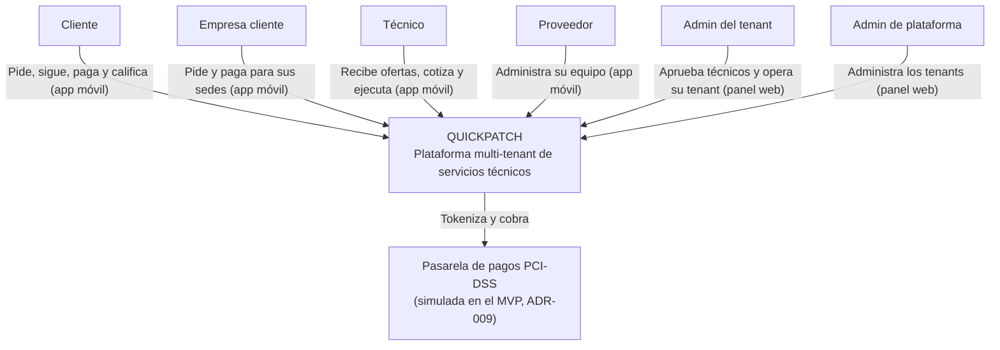
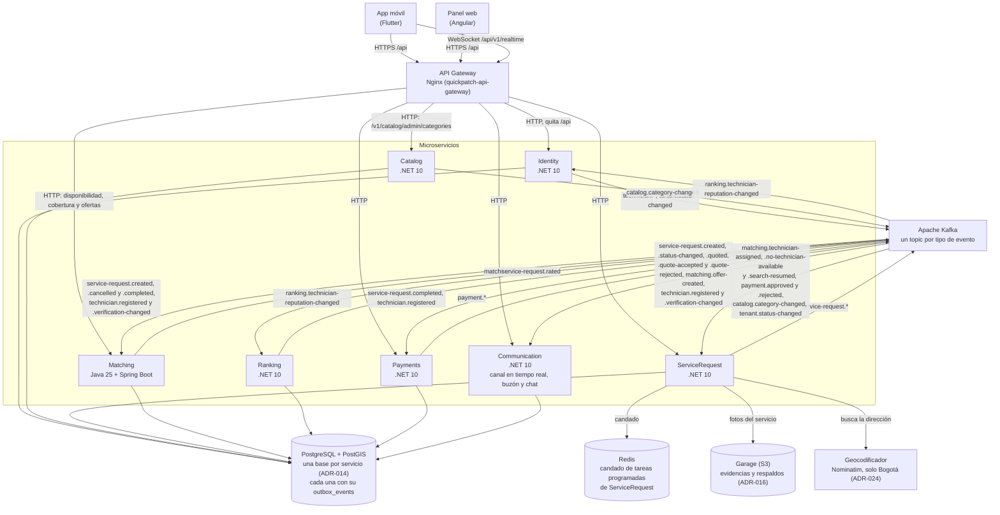
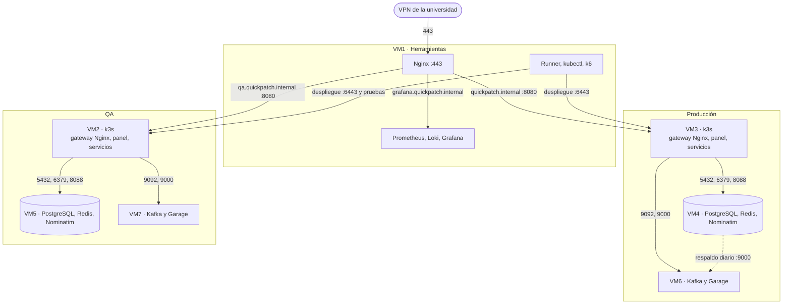

# Diagramas C4: contexto, contenedores y despliegue — SCRUM-575/578

**Versión:** 2.0
**Fecha:** 2026-11-02
**Alineado con:** `docs/architecture/diagrams/c4/quickpatch.dsl`, Documento de Infraestructura (secciones 2.1, 3.3, 3.4 y 4.3), ADR-016, ADR-022, ADR-023, ADR-024 y ADR-028.

**El SDD (secciones 4, 5 y 9; figuras 2, 3, 30 y 31) y `quickpatch.dsl` mandan.** Este documento es solo un resumen de las vistas C4 de nivel 1 y 2 y del reparto de las VMs; si algo difiere, vale el SDD.

---

## 1. Contexto (C4 nivel 1)

Las personas que usan QUICKPATCH y su único sistema externo de producción, la pasarela de pagos (RIE-01, R5, ADR-024). La geocodificación es propia (Nominatim dentro de las VMs) y el API Gateway es un contenedor de QUICKPATCH, no un sistema externo.



Imagen formal: `docs/architecture/diagrams/c4/C4-02-Contexto.png`.

---

## 2. Contenedores (C4 nivel 2)



Notas:

- El gateway es un **Nginx** por ambiente (ADR-028). Según ADR-025, el REST principal va a Identity, ServiceRequest y Payments, con excepciones explícitas: las acciones del técnico en Matching (disponibilidad, cobertura y ofertas: `/v1/matching`, `/v1/technicians/me/availability` y `/coverage`), la administración del catálogo en Catalog (`/v1/catalog/admin/categories`) y, en Communication, el buzón (`/v1/notifications`), el canal en tiempo real (`/v1/realtime`) y el chat (`/v1/service-requests/{id}/messages`). Ranking no recibe REST.
- El cobro con la pasarela lo hace Payments con un adaptador simulado dentro del servicio (ADR-009), así que no hay flecha hacia un sistema externo en esta vista.
- **El buzón no es un servicio aparte:** vive dentro de Communication, junto con el canal en tiempo real y el chat (ADR-023, ADR-024, ADR-026).
- **El outbox es la tabla `outbox_events` de la base de cada servicio**, escrita en la misma transacción que el cambio (ADR-007). Redis no guarda outbox ni sesiones: hoy solo lo usa ServiceRequest como candado de sus tareas programadas.

Imagen formal: desde SCRUM-676 la vista está partida en `docs/architecture/diagrams/c4/C4-03a-Contenedores-Sincrono.png` (REST y datos) y `C4-03b-Contenedores-Eventos.png` (eventos).

---

## 3. Despliegue

La vista de despliegue por ambiente ya está en `develop` y es la referencia vigente:

- Producción: `docs/architecture/diagrams/c4/C4-06-Despliegue-Produccion.png`
- QA: `docs/architecture/diagrams/c4/C4-06-Despliegue-QA.png`

Reparto de las 7 VMs (ADR-022, Documento de Infraestructura 2.1):

|VM|Ambiente|Qué corre|
|---|---|---|
|VM1|Herramientas|Nginx :443 de entrada TLS que reenvía por nombre (`quickpatch.internal`, `qa.quickpatch.internal`, `grafana.quickpatch.internal`); runner de GitHub con kubectl y k6; Prometheus, Loki y Grafana de los dos ambientes|
|VM2|QA, aplicación|k3s de un nodo: Nginx del gateway :8080 con el panel, Traefik :30080 y los microservicios|
|VM3|Producción, aplicación|Igual que VM2|
|VM4|Producción, datos|PostgreSQL + PostGIS :5432, Redis :6379 y Nominatim :8088|
|VM5|QA, datos|Igual que VM4|
|VM6|Producción, mensajería y almacenamiento|Kafka :9092 y Garage :9000|
|VM7|QA, mensajería y almacenamiento|Igual que VM6|



Los dos ambientes no se conectan entre sí; solo VM1 llega a ambos. Las 7 VMs envían métricas y logs a VM1 (no se dibujan para no cruzar todas las flechas). QA no tiene respaldo: sus datos son de prueba.

---

## 4. Flujo de una petición: crear una solicitud

```mermaid
sequenceDiagram
    participant App as App móvil
    participant E as Nginx VM1
    participant G as Gateway Nginx (VM3)
    participant SR as ServiceRequest (k3s)
    participant DB as db_service_request (VM4)
    participant K as Kafka (VM6)
    participant M as Matching (k3s)

    App->>E: POST /api/v1/service-requests (HTTPS, JWT)
    E->>G: reenvía por nombre
    G->>SR: POST /v1/service-requests (quita /api)
    SR->>SR: valida el JWT; tenant del token (RN-T3, DD 7.1)
    SR->>DB: lee tenant_status_replica (RN-T1)
    SR->>DB: INSERT service_requests + INSERT outbox_events (misma transacción, ADR-007)
    SR-->>App: 201 Created
    SR->>K: el publicador envía service-request.created
    K->>M: consume service-request.created
```

---

**Referencias:** Documento de Infraestructura (2.1, 3.3, 3.4, 4.3 y 10); ADR-007, ADR-014, ADR-016, ADR-022, ADR-023, ADR-024, ADR-025, ADR-026 y ADR-028; `quickpatch.dsl`.
