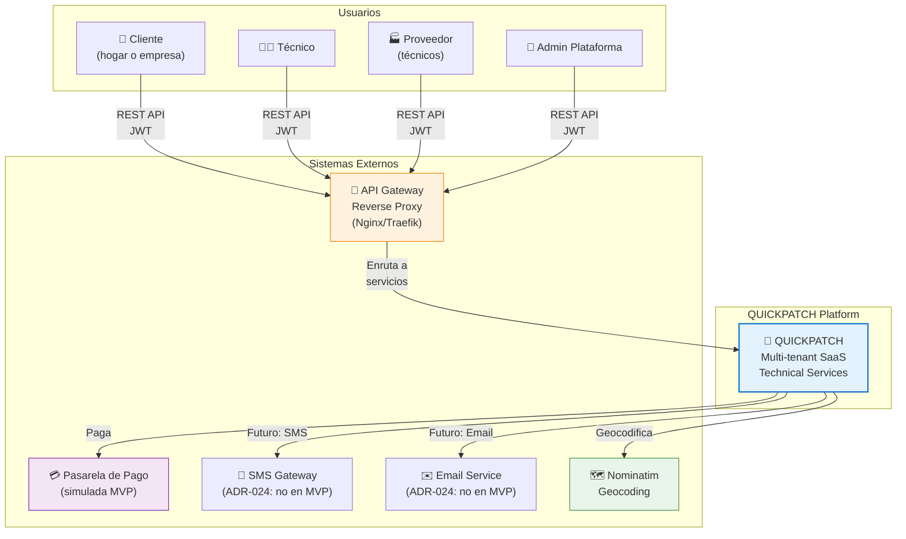
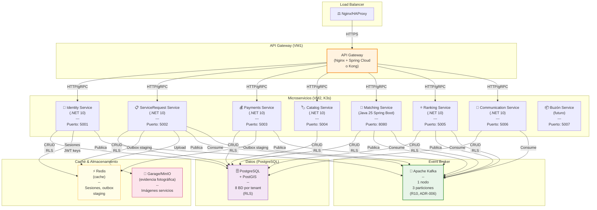
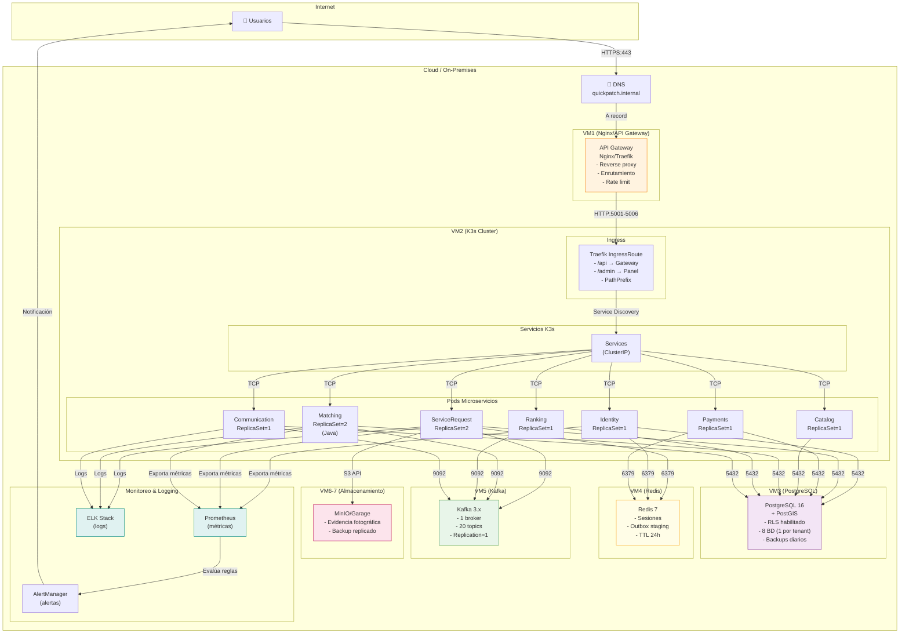
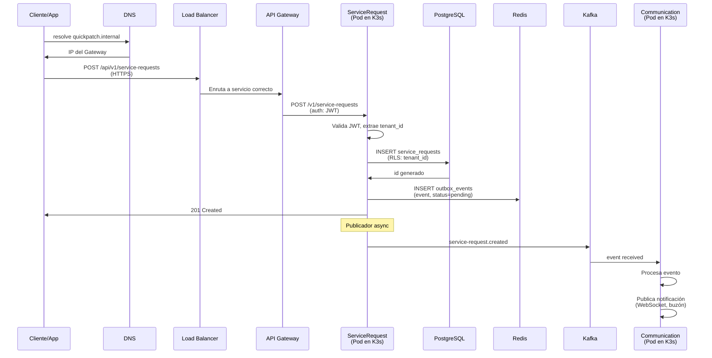

# Diagramas C4: Contexto & Contenedores — SCRUM-575/578

**Documento:** SCRUM-575/578  
**Versión:** 1.0  
**Fecha:** 2026-10-31  
**Scope:** Diagramas C4 de contexto del sistema y contenedores (servicios, BD, cache)

---

## 1. Diagrama de Contexto C4 Nivel 1

QUICKPATCH y sus actores externos.



---

## 2. Diagrama de Contenedores C4 Nivel 2

Microservicios, BD, broker de mensajes.



---

## 3. Diagrama de Despliegue (Infrastructure)

Máquinas virtuales, K3s, DNS, certificados.



---

## 4. Flujo de Request Extremo a Extremo

Cliente → API Gateway → Microservicio → BD → Kafka → Otros servicios.



---

## 5. Arquitectura de Red y Seguridad

```mermaid
graph TB
    Internet["🌍 Internet"]
    
    subgraph "DMZ"
        GW["🔐 API Gateway<br/>(Nginx/Traefik)<br/>- TLS 1.3<br/>- Rate limit<br/>- CORS"]
    end
    
    subgraph "Private Network"
        K3s["K3s Cluster<br/>(Internal)"]
        PG[("PostgreSQL<br/>(Internal)")]
        KAFKA["Kafka<br/>(Internal)"]
        REDIS["Redis<br/>(Internal)"]
    end
    
    subgraph "Storage"
        S3["MinIO<br/>(Backup)"]
    end
    
    Internet -->|"HTTPS:443<br/>Certificado TLS"| GW
    GW -->|"HTTP<br/>Intra-red"| K3s
    
    K3s -->|"5432"| PG
    K3s -->|"6379"| REDIS
    K3s -->|"9092"| KAFKA
    K3s -->|"S3 API"| S3
    
    Note over GW: Public<br/>Nginx/Traefik<br/>Rate limit<br/>Auth mínima
    Note over K3s: Private<br/>Solo desde GW<br/>Service Mesh (futuro)
    Note over PG: Private<br/>RLS (multi-tenancy)<br/>Backup automático
    
    style GW fill:#fff3e0,stroke:#f57c00,stroke-width:2px
    style K3s fill:#e3f2fd,stroke:#1976d2
    style PG fill:#f3e5f5,stroke:#7b1fa2
    style KAFKA fill:#e8f5e9,stroke:#388e3c
```

---

## 6. Notas de Despliegue

### Versioning & Rollouts
- Microservicios usan semver: v1.0.0, v1.1.0, etc.
- K3s: rolling update con `maxSurge=1, maxUnavailable=0`.
- Blue-green deployment para cambios críticos.

### Escalabilidad
- **ServiceRequest:** ReplicaSet=2 (alto volumen de solicitudes).
- **Matching:** ReplicaSet=2 (búsqueda intensiva).
- **Identity:** ReplicaSet=1 (auth crítico, bajo volumen).

### Monitoreo
- Prometheus scrape de métricas cada 15s.
- Alertas: pod down, BD latencia >100ms, Kafka lag.

### Disaster Recovery
- PostgreSQL: backups diarios, PITR 7 días.
- Kafka: replication factor=1 (no redundancia en MVP per R10).
- MinIO: replicado en 2 nodos.

---

**Referencias:**
- SAD (sección 4.2: microservicios, sección 9: infraestructura)
- INFRASTRUCTURE.md (DR, backups, monitoring)
- ADR-009 (Pasarela), ADR-015 (QA), ADR-024 (Email/SMS fuera MVP)

