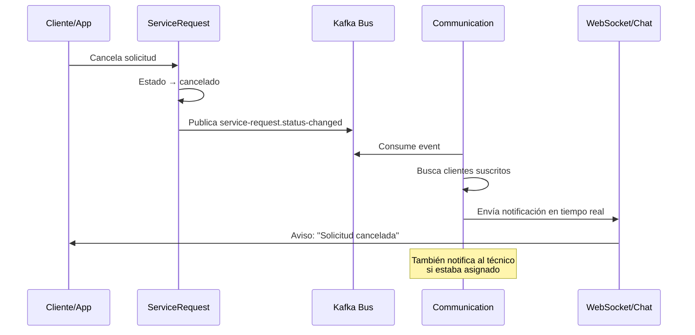
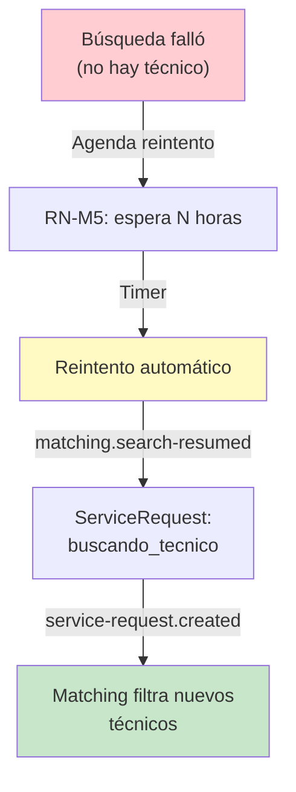
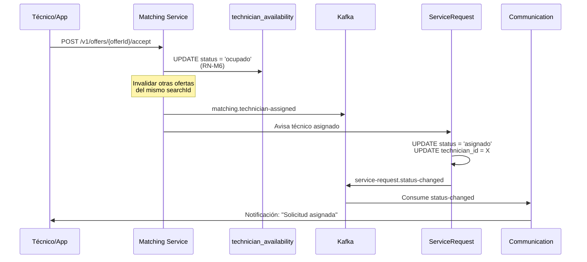
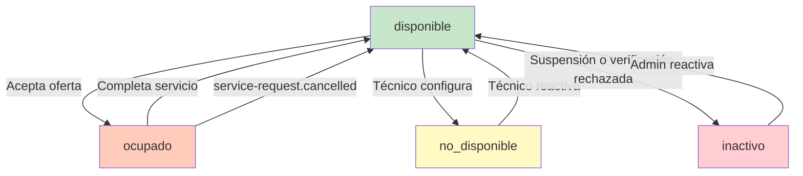

# Diagramas: Communication & Matching Services — SCRUM-583

**Documento:** SCRUM-583  
**Versión:** 1.0  
**Fecha:** 2026-10-31  
**Scope:** Diagramas de secuencia y flujo de Communication y Matching services

---

## 1. Flujo de Notificación en Tiempo Real (Communication)

Communication escucha `service-request.status-changed` y notifica a cliente y técnico en tiempo real.



---

## 2. Flujo de Buzón y Persistencia (Communication)

Cuando un evento llega, Communication persiste la notificación en `chat_messages` para que la app las consulte después.

```mermaid
graph LR
    A["service-request.status-changed<br/>(Kafka)"] -->|Consume| B["Communication:<br/>mapea evento"]
    B -->|INSERT| C["chat_messages<br/>BD Communication"]
    C -->|GET /v1/service-requests/{id}/messages| D["Cliente consulta<br/>buzón"]
    B -->|WebSocket| E["Notificación<br/>tiempo real"]
    
    style A fill:#e1f5ff
    style B fill:#fff3e0
    style C fill:#f3e5f5
    style D fill:#c8e6c9
    style E fill:#ffccbc
```

---

## 3. Matching: Búsqueda de Técnico

Flujo cuando ServiceRequest crea una solicitud y Matching inicia búsqueda.

```mermaid
sequenceDiagram
    participant Client as Cliente
    participant SR as ServiceRequest
    participant Kafka as Kafka
    participant Match as Matching
    participant Tech as Técnico/App
    
    Client->>SR: POST /v1/service-requests (crear solicitud)
    SR->>SR: Estado → buscando_tecnico
    SR->>Kafka: Publica service-request.created
    
    Match->>Kafka: Consume event
    Match->>Match: Filtra técnicos por<br/>- especialidad (RF-13)<br/>- disponibilidad<br/>- cobertura (RF-13)
    
    loop Para cada técnico candidato
        Match->>Match: Crea oferta<br/>(searchId, offerId)
        Match->>Kafka: Publica matching.offer-created
        Match->>Tech: Envía push notification
        
        alt Técnico acepta
            Tech->>Match: POST /v1/offers/{id}/accept
            Match->>SR: Actualiza técnico asignado
            Match->>Kafka: Publica matching.technician-assigned
            SR->>Kafka: Publica service-request.status-changed → asignado
            break Búsqueda termina
        else Técnico rechaza
            Tech->>Match: POST /v1/offers/{id}/reject
            Note over Match: Continúa con siguiente candidato
        else Timeout (2 min)
            Note over Match: Oferta expira, siguiente candidato
        end
    end
    
    opt Sin técnico disponible
        Match->>Kafka: Publica matching.no-technician-available
        SR->>SR: Estado → en_espera
    end
```

---

## 4. Matching: Reintento Automático

Cuando no hay técnico, Matching reintenta periódicamente cada N horas (RN-M5).



---

## 5. Secuencia: Aceptación de Oferta

Flujo detallado cuando un técnico acepta una oferta.



---

## 6. Disponibilidad del Técnico (Estados)

Estados en `technician_availability` que Matching consulta.



---

## 7. Estructura de Datos: Oferta vs. Asignación

```mermaid
graph LR
    A["matching_requests<br/>(búsqueda)"] -->|1:N| B["matching_offers<br/>(candidatos)"]
    B -->|0..1| C["service_request.technician_id<br/>(ganador)"]
    
    style A fill:#e3f2fd
    style B fill:#f3e5f5
    style C fill:#e8f5e9
    
    Note: Una solicitud tiene N ofertas<br/>pero solo 1 técnico asignado
```

---

## Notas de Implementación

1. **Particiones Kafka:** matching.offer-created y matching.technician-assigned usan `serviceRequestId` como clave → 3 particiones (igual que service-request.created).

2. **Idempotencia:** matching.technician-assigned es idempotente; si se procesa dos veces, el UPDATE no cambia el estado.

3. **Timeout de oferta:** 2 minutos (configurable). Después, la oferta expira y Matching sigue con el siguiente candidato.

4. **Communication WebSocket:** Para notificaciones en tiempo real, Communication abre WebSocket por `correlationId` o por `serviceRequestId`. Cliente y técnico reciben notificaciones mientras la solicitud esté activa.

5. **Buzón persistente:** `chat_messages` queda como histórico; app puede consultar `GET /v1/service-requests/{id}/messages?page=&size=` para el buzón.

---

**Referencias:**
- RF-10, RF-11, RF-12 (Matching)
- RF-17 (notificaciones)
- RN-M1 a RN-M7 (reglas de matching)
- DD 8.2.6 (Communication), 8.2.4 (Matching)
- ADR-006 (Kafka), ADR-017 (particiones)

