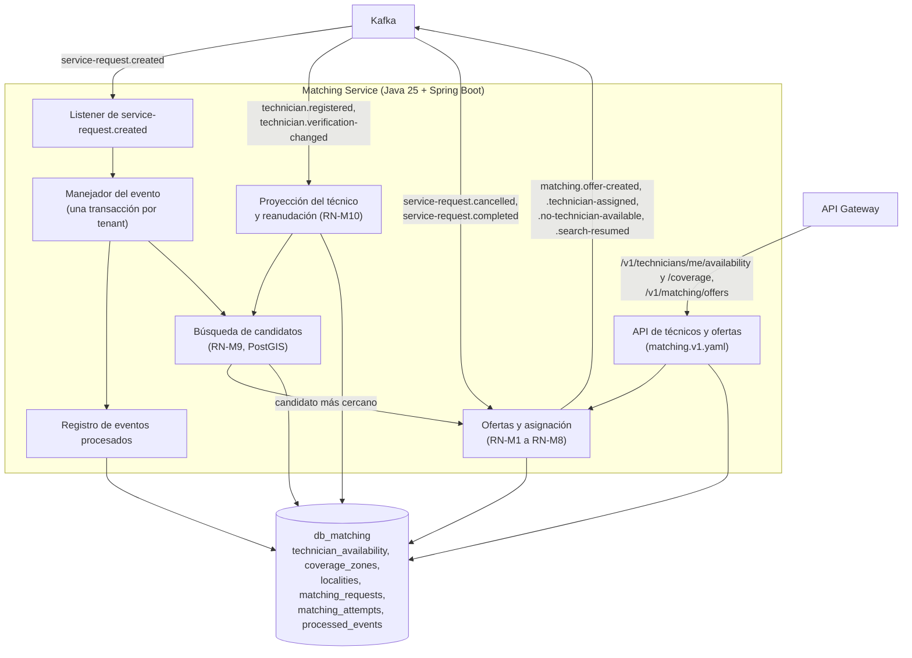
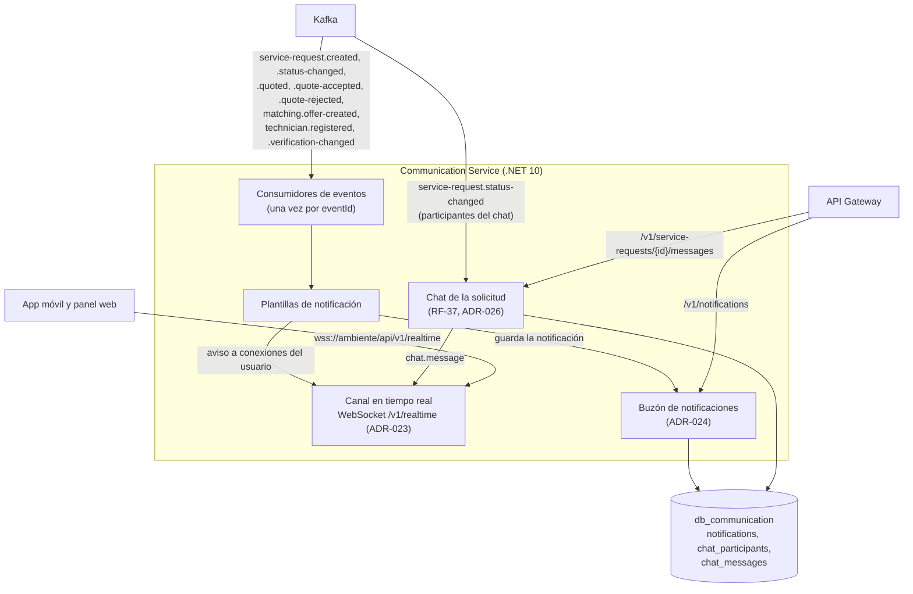
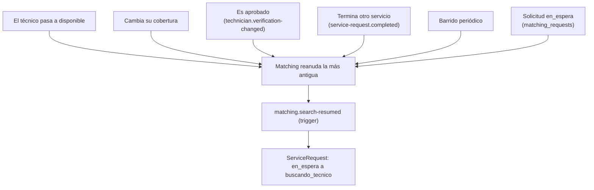
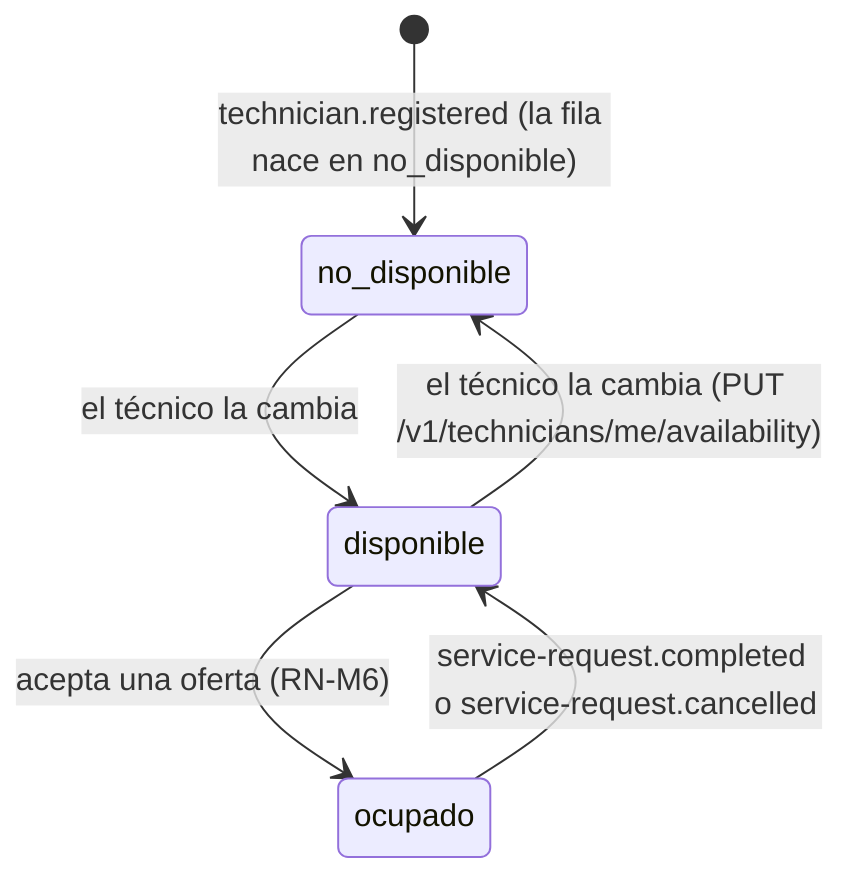
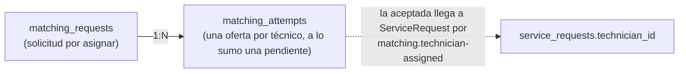

# Diagramas de Communication y Matching — SCRUM-583

**Versión:** 2.0
**Fecha:** 2026-11-02
**Alineado con:** DD 5.19 (secciones 5.6, 5.8, 7.5, 8.2.3, 8.2.6, 8.3.5 y 8.5), `matching.v1.yaml` 1.1.0 y `communication.v1.yaml` (`quickpatch-api-gateway`), `asyncapi/realtime.v1.yaml`, eventos de `quickpatch-kafka` v0.10.0 y `docs/architecture/diagrams/c4/quickpatch.dsl`.

**El SDD (figuras 15 y 18, secciones 6.8 y 6.11) y `quickpatch.dsl` mandan**: las vistas formales con los nombres reales de las clases son `C4-04-Componentes-Matching.png` y `C4-04-Componentes-Communication.png` en `docs/architecture/diagrams/c4/`. Este documento es un apoyo con los flujos principales.

---

## 1. Componentes de Matching Service



- Matching no llama a ServiceRequest ni a Identity: recibe lo que necesita por eventos (ADR-003, ADR-017) y la especialidad y verificación del técnico las guarda en `technician_availability` (P-01).
- Matching no consume `catalog.category-changed`: todavía no replica categorías, así que `categoryName` de la oferta sale `null` (DD 8.3.5).

---

## 2. Componentes de Communication Service



- **El buzón es `notifications`**, no `chat_messages`. La app lo lee con `GET /v1/notifications?unread=&page=&size=` y marca leída con `POST /v1/notifications/{id}/read`.
- `chat_messages` es el chat entre el cliente y el técnico asignado (`GET` y `POST /v1/service-requests/{id}/messages`). Es otra función, no el buzón.

---

## 3. Flujo: búsqueda, oferta y asignación (RF-10)

```mermaid
sequenceDiagram
    participant SR as ServiceRequest
    participant K as Kafka
    participant MT as Matching
    participant CM as Communication
    participant Tech as App del técnico

    SR->>K: service-request.created (solicitud en buscando_tecnico)
    K->>MT: service-request.created
    MT->>MT: processed_events (idempotencia)<br/>busca candidatos (RN-M9) y toma el más cercano
    MT->>MT: INSERT matching_attempts (pendiente, expires_at = offered_at + 3 min, RN-M8)
    MT->>K: matching.offer-created (attemptId, expiresAt)
    K->>CM: matching.offer-created
    CM-->>Tech: aviso offer.created por el canal y notificación oferta-recibida
    Tech->>MT: GET /v1/matching/offers?status=pendiente
    alt El técnico acepta
        Tech->>MT: POST /v1/matching/offers/{attemptId}/accept
        MT->>MT: oferta aceptada; technician_availability a ocupado (RN-M6)
        MT-->>Tech: 200 OK (response aceptado)
        MT->>K: matching.technician-assigned
        K->>SR: matching.technician-assigned
        SR->>SR: solicitud a asignado, technician_id<br/>outbox: service-request.status-changed
        SR->>K: service-request.status-changed (asignado)
        K->>CM: service-request.status-changed
        CM-->>Tech: aviso de estado y notificación solicitud-asignada
    else El técnico rechaza o la oferta vence
        Tech->>MT: POST /v1/matching/offers/{attemptId}/reject
        MT->>MT: oferta rechazada o vencida; siguiente candidato (RN-M3)
    else Se agotan los candidatos
        MT->>K: matching.no-technician-available
        K->>SR: matching.no-technician-available
        SR->>SR: solicitud a en_espera; outbox: status-changed
    end
```

- Matching no avisa a ServiceRequest por llamada directa: ServiceRequest aplica el evento y es quien publica `service-request.status-changed` (SCRUM-466).
- Una oferta que no existe, es de otro técnico, ya se respondió, venció o se canceló responde `409 oferta-no-disponible`. Si al aceptar el técnico ya no está `disponible`, responde `409 tecnico-no-disponible` (RN-M7).

---

## 4. Flujo: solicitudes en espera (RN-M10)

El reintento lo disparan los eventos: una solicitud `en_espera` vuelve a buscarse cuando aparece un técnico que podría atenderla. `WaitingRequestsSweeper` hace además un barrido de respaldo cada `MATCHING_SWEEP_INTERVAL` para los casos que ningún disparador alcanzó.



`trigger` del evento: `disponibilidad`, `cobertura`, `aprobacion`, `liberacion` o `barrido`.

---

## 5. Disponibilidad del técnico (`technician_availability.status`)



Solo existen `disponible`, `ocupado` y `no_disponible` (`CHECK`). La suspensión o el rechazo del técnico no son un estado de disponibilidad: van en `verification_status` (`pendiente`, `aprobado`, `rechazado`, `suspendido`), y solo un técnico `aprobado` es candidato (RN-M9).

---

## 6. Datos de la oferta



No existe una tabla `matching_offers`: cada oferta es una fila de `matching_attempts`, y su `id` es el `attemptId` de la API y de los eventos.

---

**Referencias:** RF-10, RF-11, RF-13, RF-37 y RIE-03; RN-M1 a RN-M10 y RN-SR13; DD 5.6, 5.8, 5.17, 5.22 a 5.24, 7.5, 8.2.3, 8.2.6, 8.3.5 y 8.5; ADR-003, ADR-017, ADR-023, ADR-024 y ADR-026.
