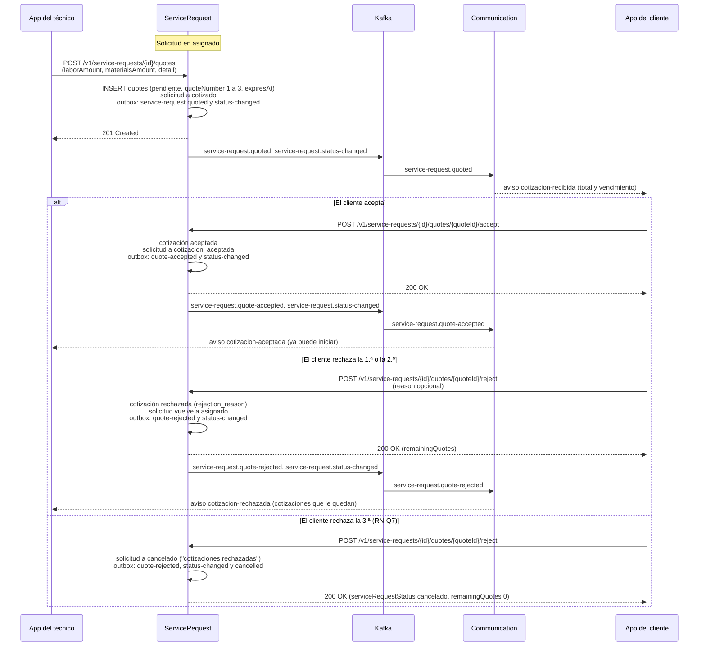
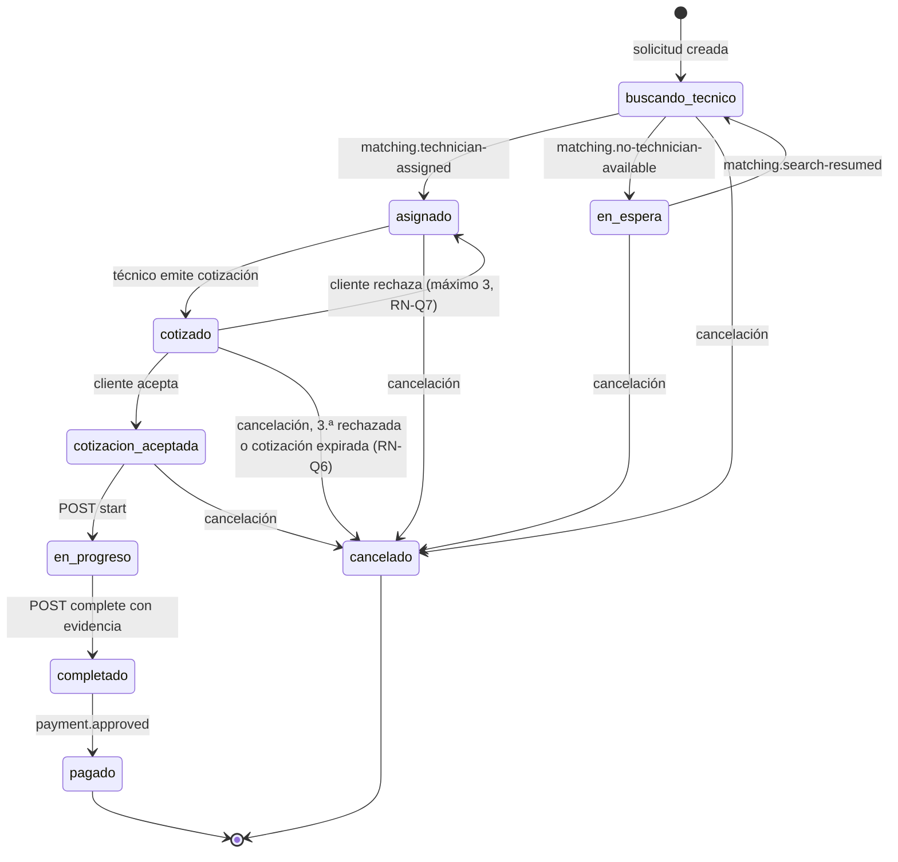

# Diagramas dinámicos: cotización, pago y cancelación — SCRUM-591

**Versión:** 2.0
**Fecha:** 2026-11-02
**Alineado con:** DD 5.17 (secciones 7.4, 7.8, 7.9, 8.2.6, 8.3.7 a 8.3.12 y 8.4), `service-request.v1.yaml` 1.11.0 y `payments.v1.yaml` 1.2.0 (`quickpatch-api-gateway`), eventos de `quickpatch-kafka` v0.10.0.

Cada cambio de estado de la solicitud se guarda junto con sus eventos en `outbox_events`, en la misma transacción (ADR-007). Por eso los diagramas muestran la escritura en la base y, después, el publicador que envía a Kafka.

---

## 1. Cotización (RF-34, RF-35)

El técnico asignado emite la cotización; el cliente que creó la solicitud la acepta o la rechaza.



- El técnico no puede emitir otra cotización mientras haya una `pendiente`: la solicitud está en `cotizado` y responde `409 transicion-invalida`. Con 3 cotizaciones responde `409 limite-de-cotizaciones` (RN-Q2, RN-Q7).
- Si el cliente no responde antes de `expiresAt` (24 horas, RN-Q8), la tarea de vencimiento pasa la cotización a `expirada` y cancela la solicitud con el motivo "cotización sin respuesta" (RN-Q6).
- Aceptar no habilita el pago. Después el técnico inicia (`POST /v1/service-requests/{id}/start`, de `cotizacion_aceptada` a `en_progreso`, RN-SR6), sube la evidencia y completa (`POST /v1/service-requests/{id}/complete`, RN-SR3). El pago existe solo después de `completado`.

---

## 2. Pago (RF-22, RF-23, RF-24)

```mermaid
sequenceDiagram
    participant Tech as App del técnico
    participant Client as App del cliente
    participant SR as ServiceRequest
    participant K as Kafka
    participant PY as Payments
    participant PSP as Pasarela simulada (adaptador)

    Tech->>SR: POST /v1/service-requests/{id}/complete
    SR->>SR: solicitud a completado<br/>outbox: service-request.completed (con el total) y status-changed
    SR->>K: service-request.completed
    K->>PY: service-request.completed
    PY->>PY: INSERT payments (pendiente, monto y técnico del evento) (RN-P4)

    Client->>Client: la app cambia la tarjeta de prueba por tok_sim_*<br/>(la tarjeta no llega al backend, RN-P1)
    Client->>PY: POST /v1/service-requests/{id}/payment<br/>(paymentToken, billing)
    PY->>PY: pendiente a procesando (una sola petición gana, RN-P5)
    PY->>PSP: cobra con el token
    alt Aprobado
        PSP-->>PY: aprobado
        PY->>PY: aprobado, processed_at y comprobante<br/>outbox: payment.approved
        PY-->>Client: 200 OK (status aprobado, invoiceId)
        PY->>K: payment.approved
        K->>SR: payment.approved
        SR->>SR: solicitud a pagado (RN-SR4)
    else Rechazado
        PSP-->>PY: rechazado (reasonCode)
        PY->>PY: rechazado y processed_at<br/>outbox: payment.rejected
        PY-->>Client: 200 OK (status rechazado, invoiceId nulo)
        PY->>K: payment.rejected
        Note over SR: la solicitud sigue en completado;<br/>el cliente puede reintentar (RN-SR5)
    else La pasarela no responde
        PY-->>Client: 502 pasarela-sin-respuesta
        Note over PY: el pago queda procesando y la conciliación<br/>(payments_scheduler) lo cierra; la app consulta<br/>GET /v1/service-requests/{id}/payment
    end
```

- El pago se responde **en la misma petición**: la pasarela simulada decide por el token (`tok_sim_aprobada_…`, `tok_sim_rechazada_…` o `tok_sim_error_…`, ADR-009). La conciliación solo cierra los pagos que quedaron `procesando` sin respuesta (AC9-E5).
- El reintento tras un rechazo usa el mismo `POST`: crea un pago `pendiente` nuevo con el monto y el técnico del rechazado (RN-P4).
- En una solicitud de empresa paga cualquier `empresa_contacto` de la empresa, y `authorized_by_user_id` registra quién (RN-P6).

---

## 3. Cancelación (RF-36)

```mermaid
sequenceDiagram
    participant U as Cliente dueño o admin_tenant
    participant SR as ServiceRequest
    participant K as Kafka
    participant MT as Matching
    participant CM as Communication

    Note over SR: Estado anterior a en_progreso:<br/>buscando_tecnico, en_espera, asignado, cotizado o cotizacion_aceptada

    U->>SR: POST /v1/service-requests/{id}/cancel (reason obligatorio, 5 a 500 caracteres)
    SR->>SR: SELECT ... FOR UPDATE de la solicitud
    alt Estado anterior a en_progreso
        SR->>SR: cancelado, cancelled_at, cancellation_reason,<br/>cancelled_by y cancelled_by_type;<br/>cotización pendiente a anulada (RN-Q5);<br/>audit_logs si cancela el admin_tenant;<br/>outbox: service-request.cancelled y status-changed
        SR-->>U: 200 OK
        SR->>K: service-request.cancelled, service-request.status-changed
        K->>MT: service-request.cancelled
        MT->>MT: oferta pendiente a cancelado y no ofrece a más candidatos (RN-M5);<br/>si había técnico, technician_availability vuelve a disponible (RN-M6)
        K->>CM: service-request.status-changed (cancelado)
        CM-->>U: aviso solicitud-cancelada al cliente y al técnico asignado
    else en_progreso, completado, pagado o cancelado
        SR-->>U: 409 transicion-invalida
    end
```

- Matching no publica ningún evento al cancelar.
- Communication no consume `service-request.cancelled`: el aviso sale de `service-request.status-changed`.
- Una solicitud de otro cliente o de otro tenant responde `404 no-encontrado`; un `tecnico`, `proveedor` o `admin_plataforma` recibe `403`.

---

## 4. Máquina de estados

La misma de la Figura 3 del DD (sección 7.4).



`payment.rejected` no cambia el estado (RN-SR5). Calificar tampoco: solo se califica en `pagado` y queda en `ratings` (RN-R3).

---

## 5. Errores de los contratos

|Ruta|Error|Cuándo|
|---|---|---|
|`POST /v1/service-requests/{id}/quotes`|`409 transicion-invalida`|La solicitud no está en `asignado` (por ejemplo, ya hay una cotización pendiente)|
|`POST /v1/service-requests/{id}/quotes`|`409 limite-de-cotizaciones`|La solicitud ya tiene 3 cotizaciones (RN-Q7)|
|`POST /v1/service-requests/{id}/quotes/{quoteId}/accept` y `/reject`|`409 transicion-invalida`|La cotización no está `pendiente` o ya venció|
|`POST /v1/service-requests/{id}/start`|`409 transicion-invalida`|La solicitud no está en `cotizacion_aceptada` (RN-SR6)|
|`POST /v1/service-requests/{id}/complete`|`422 evidencia-requerida`|No hay ninguna evidencia (RN-SR3)|
|`POST /v1/service-requests/{id}/cancel`|`409 transicion-invalida`|Desde `en_progreso`, `completado`, `pagado` o `cancelado` (RN-SR7)|
|`POST /v1/service-requests/{id}/payment`|`409 pago-no-disponible`|Payments aún no recibió `service-request.completed` (RN-P4)|
|`POST /v1/service-requests/{id}/payment`|`409 pago-en-curso`|Ya hay un pago `procesando` (RN-P5)|
|`POST /v1/service-requests/{id}/payment`|`409 ya-pagado`|La solicitud ya tiene un pago `aprobado` (RN-P2)|
|`POST /v1/service-requests/{id}/payment`|`502 pasarela-sin-respuesta`|La pasarela no respondió; el pago queda `procesando`|
|`POST /v1/service-requests/{id}/rating`|`409 transicion-invalida`|La solicitud no está en `pagado` (RN-R3)|
|`POST /v1/service-requests/{id}/rating`|`409 ya-calificada`|La solicitud ya fue calificada (RN-R2)|

---

**Referencias:** RF-22 a RF-24 y RF-34 a RF-36; RN-SR3 a RN-SR8, RN-Q1 a RN-Q8, RN-P1 a RN-P6, RN-M5, RN-M6, RN-R2 y RN-R3; DD 7.4, 7.8, 7.9, 8.2.6, 8.3.7 a 8.3.12 y 8.4; ADR-007 (Outbox) y ADR-009 (pasarela simulada).
