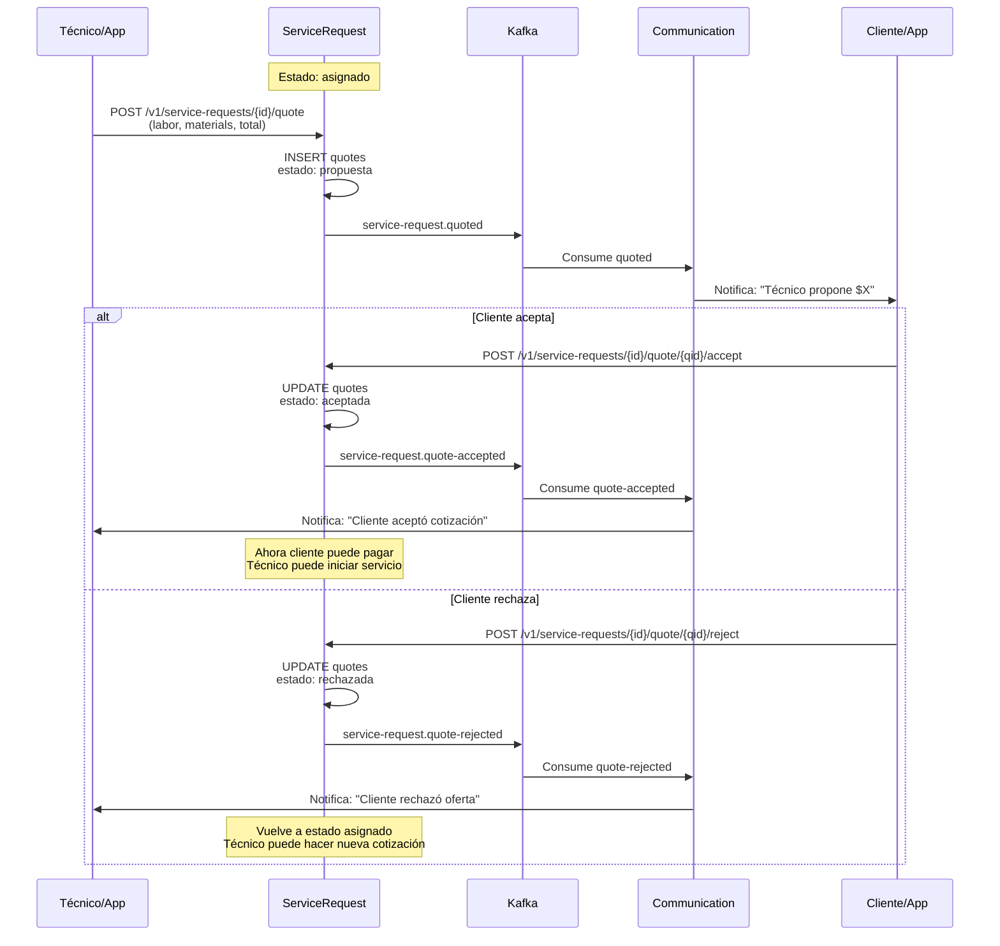
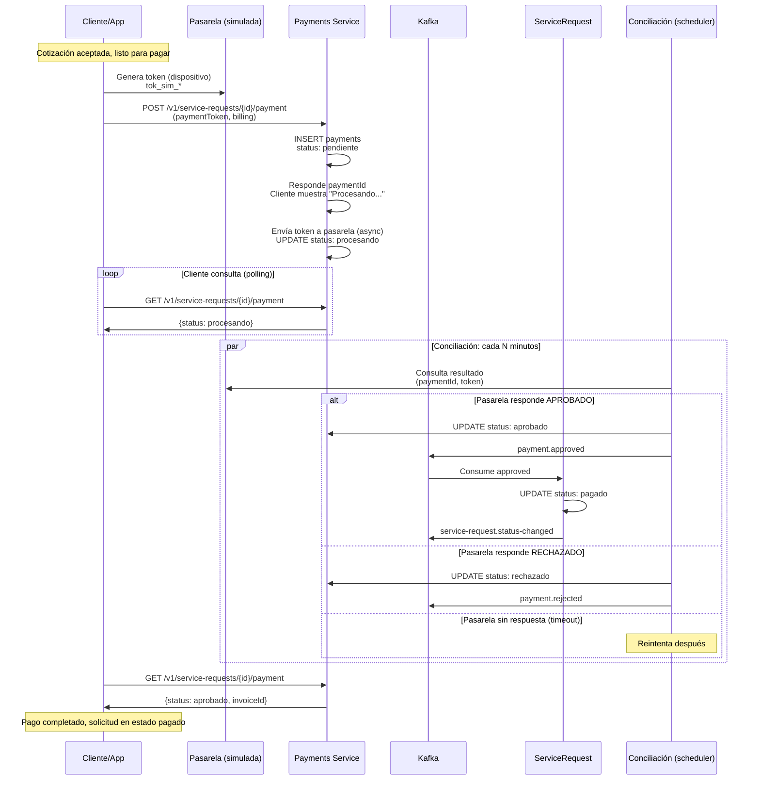
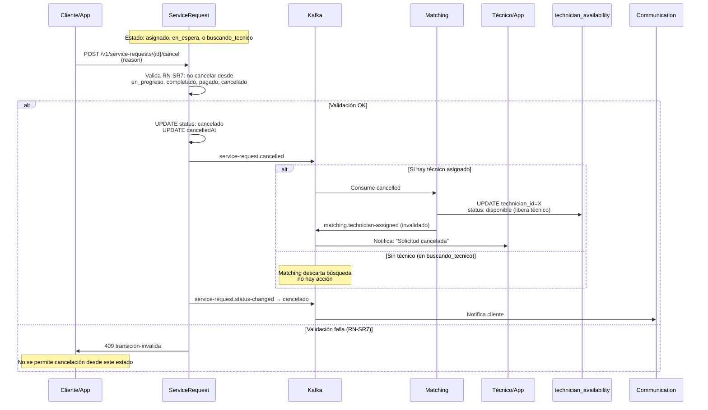
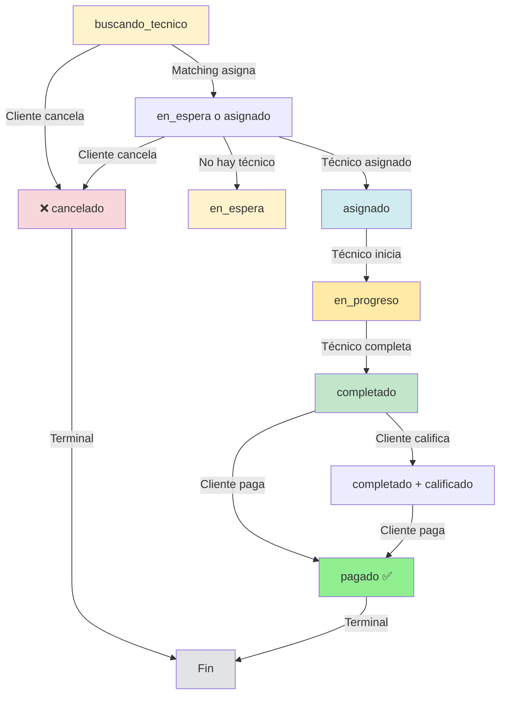
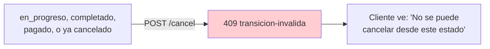
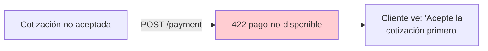
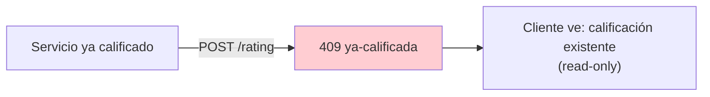

# Diagramas Dinámicos: Cotización, Pago, Cancelación — SCRUM-591

**Documento:** SCRUM-591  
**Versión:** 1.0  
**Fecha:** 2026-10-31  
**Scope:** Flujos transaccionales de cotización, pago y cancelación

---

## 1. Flujo de Cotización (Quote)

Técnico propone mano de obra + materiales; cliente acepta o rechaza.



---

## 2. Flujo de Pago (Payment)

Cliente paga con token; pasarela (simulada) aprueba o rechaza.



---

## 3. Flujo de Cancelación

Cliente cancela antes de iniciar el servicio; técnico se libera.



---

## 4. Máquina de Estados Completa

Estados y transiciones permitidas según RN-SR1 a RN-SR8.



---

## 5. Transaccionalidad: Outbox Pattern

Cuando ocurren cambios de estado críticos, se insertan en `outbox_events` y se publican a Kafka.

```mermaid
graph LR
    A["Cambio de estado<br/>(cancelación, pago, etc.)"] -->|Insert| B["outbox_events<br/>(misma transacción)"]
    B -->|Commit| C["Evento persiste"]
    
    C -->|Publicador<br/>asíncrono| D["Kafka"]
    D -->|Consumer 1<br/>idempotente| E["Matching"]
    D -->|Consumer 2<br/>idempotente| F["Communication"]
    
    E -->|processed_events| G["Marca leído"]
    F -->|processed_events| G
    
    Note over B,C: Garantía: evento no se pierde<br/>aunque falle publicación inmediata
    Note over E,F: Garantía: idempotencia<br/>Si se reintenta, no cambia estado
```

---

## 6. Casos de Error

### Cancelación desde estado no permitido


### Pago sin cotización aceptada


### Calificación duplicada


---

## 7. Notas de Implementación

1. **Cotización múltiple:** Técnico puede proponer varias cotizaciones; cliente acepta una (RN-Q3).

2. **Cancelación y reembolso:** Cancelación NO implementa reembolsos automáticos en el MVP (ADR-009, ADR-024).

3. **Conciliación:** Payments ejecuta cada N minutos para verificar pagos en `procesando`; no es time-critical.

4. **Polling vs. Webhook:** Cliente hace polling `GET /payment` porque la pasarela es simulada; en prod usaría webhook.

5. **Idempotencia:** `payment.approved` y `payment.rejected` son idempotentes; si se publican dos veces, el UPDATE es el mismo.

6. **Regla RN-SR4:** ServiceRequest solo pasa a `pagado` cuando `payment.approved` llega. No hay pase automático.

---

**Referencias:**
- RF-34, RF-35 (Cotización)
- RF-22, RF-23 (Pago)
- RF-36 (Cancelación)
- RN-SR1 a RN-SR8, RN-Q1 a RN-Q7, RN-P1 a RN-P6 (Reglas)
- DD 8.3.5 (Cancelación), 8.3.6-8.3.9 (Cotización), 8.3.12 (Pago)
- ADR-007 (Outbox), ADR-009 (Pasarela), ADR-024 (Fuera MVP)

