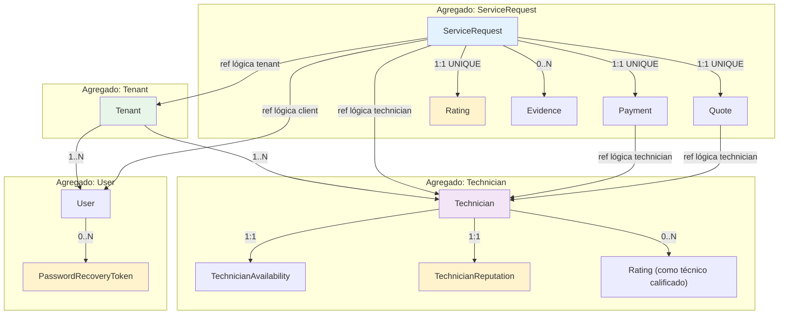

# Correcciones Modelo de Dominio — SCRUM-597

**Documento:** SCRUM-597  
**Versión:** 1.0  
**Fecha:** 2026-10-31  
**Scope:** Alineación del modelo de dominio con cambios Sprint 5 (SCRUM-497, SCRUM-508, SCRUM-500, SCRUM-624)

---

## Cambios Incorporados

### 1. Calificación (Rating) — SCRUM-497

**Entidad nueva:** `Rating`

```
Rating {
  - id: UUID (PK)
  - serviceRequest: ServiceRequest (FK 1:1 UNIQUE)
  - technician: Technician (ref lógica)
  - score: Integer [1..5]
  - comment: String? (max 500 chars)
  - ratedAt: DateTime
  
  Invariantes:
  - Solo se puede calificar en estado "pagado"
  - Una solicitud tiene máximo 1 calificación
  - Inmutable después de creada (no se edita)
}
```

**Afecta a:**
- `ServiceRequest.rating: Rating?` (relación opcional)
- `Technician.ratings: Rating[]` (historial de calificaciones)
- Nuevo evento: `service-request.rated`, `ranking.technician-reputation-changed`

---

### 2. Reputación Técnico (Ranking) — SCRUM-497

**Entidad nueva:** `TechnicianReputation`

```
TechnicianReputation {
  - technician: Technician (PK)
  - averageRating: Decimal [0.0..5.0] (0.1 precision)
  - ratingCount: Integer
  - lowReputation: Boolean (flag: averageRating < threshold)
  - updatedAt: DateTime
  
  Invariantes:
  - Calculada automáticamente por Ranking service
  - Se actualiza cada vez que hay nueva Rating
  - lowReputation es derived: averageRating < 3.5
}
```

**Afecta a:**
- `Technician.reputation: TechnicianReputation` (asociación)
- Matching puede filtrar por reputación baja (RN-M2 futuro)

---

### 3. Recuperación de Contraseña — SCRUM-624

**Entidad nueva:** `PasswordRecoveryToken`

```
PasswordRecoveryToken {
  - token: String (PK, SHA256)
  - user: User (FK)
  - expiresAt: DateTime (72 horas)
  - usedAt: DateTime? (null = no usado)
  - createdAt: DateTime
  
  Invariantes:
  - Token de un solo uso
  - Vence a las 72 horas
  - Una vez usado, no se puede volver a usar
  - Se crea anónimamente (sin requerir auth)
}
```

**Afecta a:**
- `User` (relación 1:N con tokens)
- Nuevo flujo: request → email (ADR-024) → confirm
- No hay persistencia de correo en MVP (ADR-024)

---

### 4. Estado Tenant — SCRUM-508

**Entidad actualizada:** `Tenant`

```
Tenant {
  - id: UUID
  - name: String
  - status: Enum { ACTIVE, INACTIVE, SUSPENDED }
  - statusChangedAt: DateTime
  
  Invariantes:
  - Solo un status activo a la vez
  - INACTIVE: no crea solicitudes nuevas (RN-T1)
  - SUSPENDED: acceso bloqueado totalmente (RN-T2)
}
```

**Afecta a:**
- `ServiceRequest` no puede crearse si tenant es INACTIVE
- Validación en el gateway (RN-T1, RN-SR12)
- Nuevo evento: `tenant.status-changed`

---

### 5. Historial Técnico Ampliado — SCRUM-499

**Entidad actualizada:** `ServiceRequest`

```
ServiceRequest {
  ...existentes...
  
  // Nuevos campos (desde 1.10.0 de contrato):
  - rating: Rating? (null si no calificada)
  - ratingScore: Integer [1..5]? (denormalización para lista)
  - ratedAt: DateTime? (denormalización para lista)
  
  // En la lista GET /v1/technicians/me/service-requests:
  // Se devuelven score y ratedAt si están presentes
}
```

**Afecta a:**
- Técnico ve sus servicios con calificación en el historial
- Desnormalización: permite queries rápidas sin JOIN

---

### 6. Historial de Pagos — SCRUM-500

**Entidad actualizada:** `Payment`

Ahora con índice compuesto para queries rápidas:

```
Payment {
  ...existentes...
  
  Índices:
  - (serviceRequestId) → para GET un pago de una solicitud
  - (technicanId, status) → para GET /v1/payments/received ⭐
  - (tenantId, status, createdAt) → para reportes admin
}
```

**Afecta a:**
- Listado eficiente de pagos recibidos por técnico (RF-25)
- Query: `SELECT * FROM payments WHERE technician_id=X AND status='aprobado' ORDER BY approvedAt DESC`

---

## Diagrama: Agregados Principales



---

## Checklist de Alineación

| Cambio | Entidad Afectada | Incorporado | Observación |
|--------|------------------|-------------|------------|
| Rating (SCRUM-497) | ServiceRequest, Technician, Rating | ✅ | Inmutable, 1:1 UNIQUE |
| Reputación (SCRUM-497) | Technician | ✅ | Calculada por Ranking, derived |
| Password Recovery (SCRUM-624) | User, PasswordRecoveryToken | ✅ | 72h, single-use, sin correo MVP |
| Tenant Status (SCRUM-508) | Tenant | ✅ | ACTIVE/INACTIVE/SUSPENDED, valida RN-T1 |
| Historial (SCRUM-499) | ServiceRequest | ✅ | Desnormalizado: score, ratedAt en lista |
| Índices (SCRUM-500) | Payment | ✅ | Compuesto: (technician_id, status) |

---

## Reglas de Negocio Actualizadas

### RN-T1 (Tenant inactivo)
Si `tenant.status = INACTIVE`, ServiceRequest rechaza `POST /v1/service-requests` con `403 tenant-inactivo`.

### RN-SR12 (Validación tenant)
Toda solicitud nace con el `tenant_id` del JWT (no se acepta en el body). Valida RN-T1.

### RN-SR4 (Pago)
`ServiceRequest.status` → `pagado` solo cuando llega `payment.approved` (no antes).

### RN-R1 a RN-R3 (Calificación)
- RN-R1: Solo cliente dueño puede calificar
- RN-R2: Solo desde estado `pagado`
- RN-R3: Una sola calificación por solicitud (1:1 UNIQUE)

---

## Referencias Cruzadas

| Artefacto | Sección | Cambio |
|-----------|---------|--------|
| DD | 5.9 Ratings | Incluye ratedAt en descripción |
| DD | 5.13 Payments | Índice compuesto (technician_id, status) |
| DD | 8.3.12 | Calificación, reputación |
| SAD | 8 (Datos) | Confirmado multi-tenant, RLS |
| SDD | 11 (Flujos) | Flujo: completado → pagado → calificación |
| ADRs | ADR-027 | Calificación y reputación |
| ADRs | ADR-024 | Password recovery sin correo |

---

**Validación:** Modelo alineado con DD 5.14, contratos 1.10.0 (identity), 1.2.0 (payments), eventos SCRUM-497/508.

