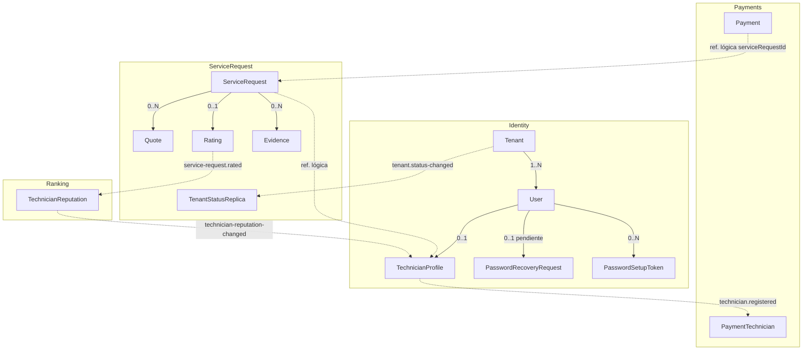

# Modelo de dominio — cambios del Sprint 5 (SCRUM-597)

**Versión:** 2.0
**Fecha:** 2026-11-02
**Alineado con:** DD 5.19 (`develop`), `identity.v1.yaml` 1.10.0 (`quickpatch-api-gateway` v0.20.0), ADR-017, ADR-024 y ADR-027, código de Ranking y de `quickpatch-identity#29`.

Este documento resume cómo cambia el modelo de dominio con las historias del Sprint 5. El detalle de cada tabla, regla y contrato está en el DD; aquí solo se referencia.

---

## 1. Calificación — SCRUM-497

**Dueño:** ServiceRequest Service, tabla `ratings` (DD 5.9).

```
Rating {
  id: UUID
  tenantId: UUID
  serviceRequestId: UUID      // único: una calificación por solicitud
  technicianId: UUID          // ref. lógica
  score: Integer [1..5]
  comment: String?            // máximo 500 caracteres
  createdAt: DateTime         // ratedAt en REST
}
```

Reglas (DD 7.6):

- **RN-R1:** el puntaje va de 1 a 5.
- **RN-R2:** una solicitud se califica una sola vez.
- **RN-R3:** solo se califica una solicitud en estado `pagado`.

Calificar no cambia el estado de la solicitud. ServiceRequest publica `service-request.rated` por Outbox (ADR-007, ADR-027).

---

## 2. Reputación del técnico — SCRUM-497 y SCRUM-498

**Dueño del cálculo:** Ranking Service. **Proyección:** Identity, `technician_profiles.average_rating` (DD 5.3) y la marca de reputación baja (ADR-027).

```
TechnicianReputation {        // Ranking, por técnico y tenant
  technicianId: UUID
  ratingCount: Integer
  ratingSum: Integer
  averageRating: Decimal(2,1)  // suma / cantidad, redondeado a un decimal
  lowReputation: Boolean
}
```

- **Reputación baja:** 5 o más calificaciones **y** promedio menor a 3.0 (`LowReputationMinRatings = 5`, `LowReputationThreshold = 3.0m` en Ranking; ADR-027, AC9-E2). La marca no suspende al técnico; decide el administrador (RF-20).
- Ranking publica `ranking.technician-reputation-changed` (`technicianId`, `averageRating`, `ratingCount`, `lowReputation`, `changedAt`). Identity descarta los eventos con un `changedAt` anterior al último aplicado (ADR-017).

---

## 3. Recuperación de la contraseña olvidada — SCRUM-625

**Dueño:** Identity Service (DD 5.21, 5.27, 5.28 y 8.3.19). No hay correo en el MVP (ADR-024): el enlace lo genera el `admin_tenant` y se lo entrega al usuario.

```
PasswordRecoveryRequest {     // password_recovery_requests
  id: UUID
  tenantId: UUID
  userId: UUID                // como máximo una pendiente por usuario
  status: pendiente | cerrada
  requestedAt: DateTime
  closedAt: DateTime?
}

PasswordRecoveryAttempt {     // password_recovery_attempts
  id: UUID
  tenantId: UUID
  emailHash: String           // HMAC-SHA256 del correo con una clave del servicio (DD 5.19), no el correo
  attemptedAt: DateTime
}

PasswordSetupToken {          // password_setup_tokens, ya existía para las invitaciones
  ...
  purpose: invitacion | recuperacion
  expiresAt: DateTime         // invitación: 72 horas; recuperación: 1 hora
}
```

Flujo (contrato 1.10.0):

1. `POST /v1/auth/password-recovery`: el usuario lo pide con su correo. Responde `202` exista o no la cuenta; `429` si pasa de 3 pedidos por correo por hora.
2. `GET /v1/admin/password-recovery-requests`: el `admin_tenant` ve las pendientes de su tenant.
3. `POST /v1/admin/password-recovery-requests/{id}/link`: el `admin_tenant` genera el enlace de un solo uso, que vence a 1 hora.
4. `POST /v1/auth/password-recovery/confirm`: el usuario define la contraseña nueva; el token va en el cuerpo. También marca como usadas las invitaciones pendientes del usuario (DD 5.19).

Solo se guarda el hash del token. Los administradores no usan este flujo. Regla RN-U7 (DD 7.2).

---

## 4. Estado del tenant — SCRUM-508

**Dueño:** Identity Service, tabla `tenants` (DD 5.1). **Réplica:** ServiceRequest, tabla `tenant_status_replica` (DD 5.26).

```
Tenant {
  id: UUID
  name: String
  nit: String                 // único en la plataforma
  status: activo | inactivo   // CHECK en la base; no existe otro estado
}
```

- **RN-T1:** un tenant inactivo no puede crear solicitudes nuevas ni sus usuarios pueden iniciar sesión. Identity rechaza el login y, al cambiar el estado, publica `tenant.status-changed` v1 por Outbox con el estado completo y `updatedAt` como versión. ServiceRequest guarda la réplica, sin llamar a Identity (ADR-003, ADR-017), y responde `422 tenant-inactivo` a `POST /v1/service-requests` aunque el token siga vigente. Un tenant sin fila en la réplica cuenta como activo.
- **RN-T2:** todo tenant es una empresa oferente identificada por su NIT.
- La validación no la hace el Gateway.

---

## 5. Historial del técnico con calificación — SCRUM-499

`GET /v1/technicians/me/service-requests` (`service-request.v1.yaml` 1.10.0) incluye `score` y `ratedAt` en las solicitudes calificadas. Se leen de `ratings`; `service_requests` no copia la calificación (DD 5.9, ADR-027).

---

## 6. Pagos recibidos — SCRUM-500 y SCRUM-501

**Dueño:** Payments Service, tabla `payments` (DD 5.12) y proyección `payment_technicians` (DD 5.25).

- Estados del pago: `pendiente`, `procesando`, `aprobado` y `rechazado`. La fecha en que quedó aprobado o rechazado es `processed_at`.
- `GET /v1/payments/received` devuelve los pagos sin los `rechazado`, del más reciente al más antiguo. El `tecnico` ve los suyos; el `proveedor`, los de su equipo según `payment_technicians`.
- Índice compuesto `technician_id, status` para esa consulta.

---

## Diagrama de agregados



Línea continua: relación dentro del servicio. Línea punteada: referencia lógica o evento entre servicios.

---

## Referencias al DD

|Tema|Secciones del DD 5.19|
|---|---|
|Calificación|5.9, 7.6, 8.3.11|
|Reputación|5.3 (`average_rating`). El evento `ranking.technician-reputation-changed` está en ADR-027 y en `docs/kafka/EVENTS_CATALOG.md`; falta agregarlo al Cuadro 11 del DD.|
|Recuperación de la contraseña|5.21, 5.27, 5.28, 7.2 (RN-U7), 8.2.1, 8.3.19|
|Estado del tenant|5.1, 5.26, 7.1 (RN-T1), 8.4|
|Pagos recibidos|5.12, 5.25, 8.2.5|
