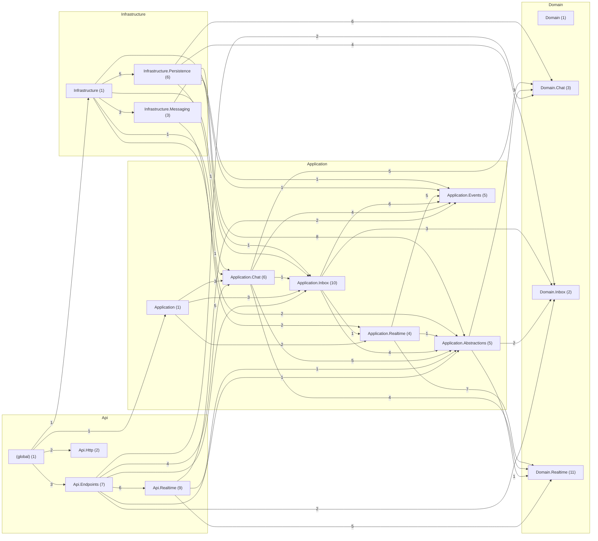

# Communication — antes

Código de `origin/develop` en `120623a`, generado el 2026-11-10 con `tools/arquitectura/generar.py`.

| Métrica | Valor |
|---|---|
| Tipos (sin migraciones) | 77 |
| Paquetes | 17 |
| Dependencias entre tipos | 181 |
| Dependencias entre paquetes | 44 |
| Ciclos entre paquetes | 0 |
| Paquetes dentro de ciclos | 0 |
| Ciclos entre tipos | 1 |
| Tipos en el mayor ciclo | 2 |
| Violaciones de SDD 10.3.2 | 0 |
| Tipos de más de 250 líneas | 0 |
| Fan-out máximo (sin raíces de composición) | 10 |
| Fan-out promedio | 2.35 |
| Cohesión relacional promedio (H) | 0.83 |

## Dependencias entre capas

| Desde → hacia | Dependencias |
|---|---|
| Api → Application | 14 |
| Api → Domain | 9 |
| Api → Infrastructure | 1 |
| Application → Domain | 25 |
| Infrastructure → Application | 18 |
| Infrastructure → Domain | 10 |

## Clases con más dependencias de salida (fan-out)

| Tipo | Capa | Líneas | Sale | Entra |
|---|---|---|---|---|
| `Application.Chat.SendChatMessageHandler` | Application | 48 | 10 | 2 |
| `Api.Endpoints.InboxEndpoints` | Api | 141 | 9 | 1 |
| `Api.Realtime.ConnectionRegistry` | Api | 44 | 8 | 2 |
| `Application.Inbox.InboxRecorder` | Application | 37 | 8 | 2 |
| `Application.Realtime.NoticeRouter` | Application | 37 | 8 | 2 |
| `Application.Realtime.RealtimeNotifier` | Application | 46 | 8 | 2 |
| `Api.Endpoints.ChatEndpoints` | Api | 144 | 7 | 1 |
| `Api.Realtime.RealtimeSession` | Api | 216 | 7 | 2 |
| `Application.Chat.ChatParticipantsRecorder` | Application | 39 | 7 | 2 |
| `Api.Endpoints.RealtimeEndpoints` | Api | 34 | 6 | 1 |

## Clases más usadas (fan-in)

| Tipo | Capa | Entra | Sale |
|---|---|---|---|
| `Domain.Inbox.Notification` | Domain | 10 | 0 |
| `Domain.Chat.ChatMessage` | Domain | 9 | 0 |
| `Domain.Chat.ChatParticipants` | Domain | 7 | 0 |
| `Application.Abstractions.IChatStore` | Application | 6 | 3 |
| `Application.Abstractions.IInboxStore` | Application | 6 | 2 |
| `Application.Events.EventEnvelope` | Application | 6 | 0 |
| `Api.Realtime.RealtimeUser` | Api | 5 | 0 |
| `Application.Events.InvalidEventException` | Application | 5 | 0 |
| `Application.Events.RealtimeJson` | Application | 5 | 0 |
| `Domain.Realtime.Delivery` | Domain | 5 | 2 |

## Clases más grandes

| Tipo | Capa | Líneas | Archivo |
|---|---|---|---|
| `Api.Realtime.RealtimeSession` | Api | 216 | `src/QuickPatch.Communication.Api/Realtime/RealtimeSession.cs` |
| `Application.Inbox.InboxRules` | Application | 168 | `src/QuickPatch.Communication.Application/Inbox/InboxRules.cs` |
| `Api.Endpoints.ChatEndpoints` | Api | 144 | `src/QuickPatch.Communication.Api/Endpoints/ChatEndpoints.cs` |
| `Api.Endpoints.InboxEndpoints` | Api | 141 | `src/QuickPatch.Communication.Api/Endpoints/InboxEndpoints.cs` |
| `Infrastructure.Persistence.InboxStore` | Infrastructure | 71 | `src/QuickPatch.Communication.Infrastructure/Persistence/InboxStore.cs` |
| `Infrastructure.Persistence.ChatStore` | Infrastructure | 69 | `src/QuickPatch.Communication.Infrastructure/Persistence/ChatStore.cs` |
| `Infrastructure.Persistence.CommunicationDbContext` | Infrastructure | 63 | `src/QuickPatch.Communication.Infrastructure/Persistence/CommunicationDbContext.cs` |
| `Infrastructure.Messaging.PersistentEventsConsumer` | Infrastructure | 60 | `src/QuickPatch.Communication.Infrastructure/Messaging/PersistentEventsConsumer.cs` |
| `Domain.Inbox.Notification` | Domain | 55 | `src/QuickPatch.Communication.Domain/Inbox/Notification.cs` |
| `Api.Realtime.TokenValidator` | Api | 53 | `src/QuickPatch.Communication.Api/Realtime/TokenValidator.cs` |

## Ciclos entre paquetes

Ninguno.

## Violaciones de las reglas de dependencia (SDD 10.3.2)

Ninguna.

## Paquetes

| Paquete | Tipos | Fan-in | Fan-out | Inestabilidad | Cohesión H |
|---|---|---|---|---|---|
| `(global)` | 1 | 0 | 4 | 1.0 | 1.0 |
| `Api.Endpoints` | 7 | 1 | 6 | 0.86 | 1.0 |
| `Api.Http` | 2 | 1 | 0 | 0.0 | 1.0 |
| `Api.Realtime` | 9 | 1 | 3 | 0.75 | 1.56 |
| `Application` | 1 | 1 | 3 | 0.75 | 1.0 |
| `Application.Abstractions` | 5 | 7 | 3 | 0.3 | 0.6 |
| `Application.Chat` | 6 | 4 | 5 | 0.56 | 0.83 |
| `Application.Events` | 5 | 6 | 0 | 0.0 | 0.6 |
| `Application.Inbox` | 10 | 5 | 4 | 0.44 | 0.8 |
| `Application.Realtime` | 4 | 3 | 3 | 0.5 | 1.0 |
| `Domain` | 1 | 0 | 0 | 0.0 | 1.0 |
| `Domain.Chat` | 3 | 4 | 0 | 0.0 | 0.33 |
| `Domain.Inbox` | 2 | 4 | 0 | 0.0 | 0.5 |
| `Domain.Realtime` | 11 | 4 | 0 | 0.0 | 0.91 |
| `Infrastructure` | 1 | 1 | 6 | 0.86 | 1.0 |
| `Infrastructure.Messaging` | 3 | 1 | 2 | 0.67 | 0.33 |
| `Infrastructure.Persistence` | 6 | 1 | 5 | 0.83 | 0.67 |

## Diagrama de paquetes

Fuente: [`paquetes.puml`](paquetes.puml) (PlantUML) y [`paquetes.mmd`](paquetes.mmd). Clases más conectadas: [`clases-centrales.puml`](clases-centrales.puml).

