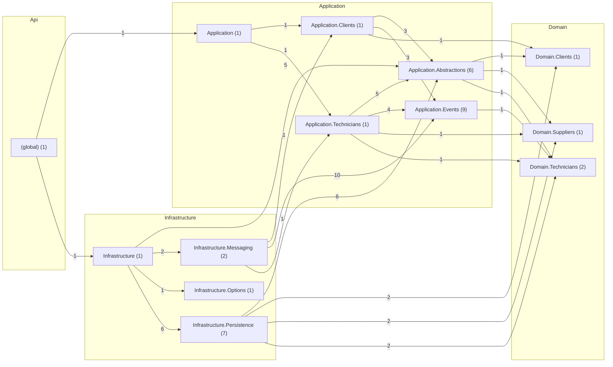

# Actors — despues

Código de `origin/develop` en `5c85eb6`, generado el 2026-11-12 con `tools/arquitectura/generar.py`.

| Métrica | Valor |
|---|---|
| Tipos (sin migraciones) | 34 |
| Paquetes | 13 |
| Dependencias entre tipos | 77 |
| Dependencias entre paquetes | 26 |
| Ciclos entre paquetes | 0 |
| Paquetes dentro de ciclos | 0 |
| Ciclos entre tipos | 0 |
| Tipos en el mayor ciclo | 0 |
| Violaciones de SDD 10.3.2 | 0 |
| Tipos de más de 250 líneas | 0 |
| Fan-out máximo (sin raíces de composición) | 11 |
| Fan-out promedio | 2.26 |
| Cohesión relacional promedio (H) | 0.88 |

## Dependencias entre capas

| Desde → hacia | Dependencias |
|---|---|
| Api → Application | 1 |
| Api → Infrastructure | 1 |
| Application → Domain | 7 |
| Infrastructure → Application | 23 |
| Infrastructure → Domain | 6 |

## Clases con más dependencias de salida (fan-out)

| Tipo | Capa | Líneas | Sale | Entra |
|---|---|---|---|---|
| `Application.Technicians.TechnicianEventsHandler` | Application | 99 | 11 | 2 |
| `Application.Clients.ServiceRequestCreatedHandler` | Application | 31 | 7 | 2 |
| `Infrastructure.Messaging.ServiceRequestCreatedConsumer` | Infrastructure | 36 | 6 | 1 |
| `Infrastructure.Messaging.TechnicianEventsConsumer` | Infrastructure | 53 | 6 | 1 |
| `Application.Events.TechnicianEventsContract` | Application | 14 | 4 | 1 |
| `Infrastructure.Persistence.TechnicianActorRepository` | Infrastructure | 16 | 4 | 1 |
| `Infrastructure.Persistence.ActorsDbContext` | Infrastructure | 57 | 3 | 7 |
| `Infrastructure.Persistence.ClientActorRepository` | Infrastructure | 6 | 3 | 1 |
| `Infrastructure.Persistence.SupplierRepository` | Infrastructure | 6 | 3 | 1 |
| `Application.Abstractions.ITechnicianActorRepository` | Application | 0 | 2 | 3 |

## Clases más usadas (fan-in)

| Tipo | Capa | Entra | Sale |
|---|---|---|---|
| `Infrastructure.Persistence.ActorsDbContext` | Infrastructure | 7 | 3 |
| `Application.Events.EventEnvelope` | Application | 6 | 0 |
| `Application.Abstractions.IProcessedEventRepository` | Application | 4 | 0 |
| `Application.Abstractions.ITenantUnitOfWork` | Application | 4 | 0 |
| `Domain.Clients.ClientActor` | Domain | 4 | 0 |
| `Domain.Suppliers.Supplier` | Domain | 4 | 0 |
| `Domain.Technicians.TechnicianActor` | Domain | 4 | 1 |
| `Application.Abstractions.IClientActorRepository` | Application | 3 | 1 |
| `Application.Abstractions.ISupplierRepository` | Application | 3 | 1 |
| `Application.Abstractions.ITechnicianActorRepository` | Application | 3 | 2 |

## Clases más grandes

| Tipo | Capa | Líneas | Archivo |
|---|---|---|---|
| `Application.Technicians.TechnicianEventsHandler` | Application | 99 | `src/QuickPatch.Actors.Application/Technicians/TechnicianEventsHandler.cs` |
| `Domain.Technicians.TechnicianActor` | Domain | 82 | `src/QuickPatch.Actors.Domain/Technicians/TechnicianActor.cs` |
| `Infrastructure.Persistence.ActorsDbContext` | Infrastructure | 57 | `src/QuickPatch.Actors.Infrastructure/Persistence/ActorsDbContext.cs` |
| `Infrastructure.Messaging.TechnicianEventsConsumer` | Infrastructure | 53 | `src/QuickPatch.Actors.Infrastructure/Messaging/TechnicianEventsConsumer.cs` |
| `Domain.Clients.ClientActor` | Domain | 38 | `src/QuickPatch.Actors.Domain/Clients/ClientActor.cs` |
| `Domain.Suppliers.Supplier` | Domain | 36 | `src/QuickPatch.Actors.Domain/Suppliers/Supplier.cs` |
| `Infrastructure.Messaging.ServiceRequestCreatedConsumer` | Infrastructure | 36 | `src/QuickPatch.Actors.Infrastructure/Messaging/ServiceRequestCreatedConsumer.cs` |
| `Application.Clients.ServiceRequestCreatedHandler` | Application | 31 | `src/QuickPatch.Actors.Application/Clients/ServiceRequestCreatedHandler.cs` |
| `Infrastructure.Persistence.TechnicianActorRepository` | Infrastructure | 16 | `src/QuickPatch.Actors.Infrastructure/Persistence/TechnicianActorRepository.cs` |
| `Application.Events.TechnicianEventsContract` | Application | 14 | `src/QuickPatch.Actors.Application/Events/TechnicianEvents.cs` |

## Ciclos entre paquetes

Ninguno.

## Violaciones de las reglas de dependencia (SDD 10.3.2)

Ninguna.

## Paquetes

| Paquete | Tipos | Fan-in | Fan-out | Inestabilidad | Cohesión H |
|---|---|---|---|---|---|
| `(global)` | 1 | 0 | 2 | 1.0 | 1.0 |
| `Application` | 1 | 1 | 2 | 0.67 | 1.0 |
| `Application.Abstractions` | 6 | 4 | 3 | 0.43 | 0.33 |
| `Application.Clients` | 1 | 2 | 3 | 0.6 | 1.0 |
| `Application.Events` | 9 | 3 | 1 | 0.25 | 0.67 |
| `Application.Technicians` | 1 | 2 | 4 | 0.67 | 1.0 |
| `Domain.Clients` | 1 | 3 | 0 | 0.0 | 1.0 |
| `Domain.Suppliers` | 1 | 3 | 0 | 0.0 | 1.0 |
| `Domain.Technicians` | 2 | 4 | 0 | 0.0 | 1.0 |
| `Infrastructure` | 1 | 1 | 4 | 0.8 | 1.0 |
| `Infrastructure.Messaging` | 2 | 1 | 3 | 0.75 | 0.5 |
| `Infrastructure.Options` | 1 | 1 | 0 | 0.0 | 1.0 |
| `Infrastructure.Persistence` | 7 | 1 | 4 | 0.8 | 1.0 |

## Diagrama de paquetes

Fuente: [`paquetes.puml`](paquetes.puml) (PlantUML) y [`paquetes.mmd`](paquetes.mmd). Clases más conectadas: [`clases-centrales.puml`](clases-centrales.puml).

