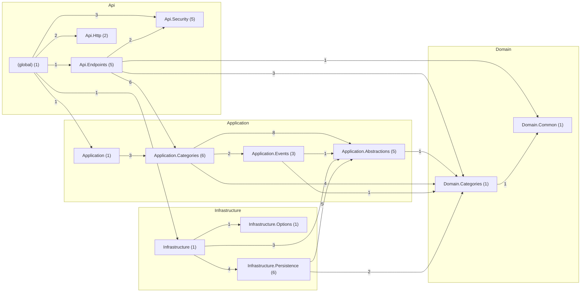

# Catalog — despues

Código de `origin/develop` en `6345700`, generado el 2026-11-12 con `tools/arquitectura/generar.py`.

| Métrica | Valor |
|---|---|
| Tipos (sin migraciones) | 38 |
| Paquetes | 13 |
| Dependencias entre tipos | 73 |
| Dependencias entre paquetes | 22 |
| Ciclos entre paquetes | 0 |
| Paquetes dentro de ciclos | 0 |
| Ciclos entre tipos | 0 |
| Tipos en el mayor ciclo | 0 |
| Violaciones de SDD 10.3.2 | 0 |
| Tipos de más de 250 líneas | 0 |
| Fan-out máximo (sin raíces de composición) | 14 |
| Fan-out promedio | 1.92 |
| Cohesión relacional promedio (H) | 0.86 |

## Dependencias entre capas

| Desde → hacia | Dependencias |
|---|---|
| Api → Application | 7 |
| Api → Domain | 4 |
| Api → Infrastructure | 1 |
| Application → Domain | 6 |
| Infrastructure → Application | 8 |
| Infrastructure → Domain | 2 |

## Clases con más dependencias de salida (fan-out)

| Tipo | Capa | Líneas | Sale | Entra |
|---|---|---|---|---|
| `Api.Endpoints.CategoryEndpoints` | Api | 88 | 14 | 1 |
| `Application.Categories.CreateCategoryHandler` | Application | 34 | 7 | 2 |
| `Application.Categories.UpdateCategoryHandler` | Application | 28 | 6 | 2 |
| `Application.Events.CategoryChangedEvent` | Application | 17 | 4 | 2 |
| `Application.Categories.ListCategoriesHandler` | Application | 4 | 3 | 2 |
| `Infrastructure.Persistence.CategoryRepository` | Infrastructure | 14 | 3 | 1 |
| `Infrastructure.Persistence.EfOutbox` | Infrastructure | 7 | 3 | 1 |
| `Infrastructure.Persistence.TenantUnitOfWork` | Infrastructure | 15 | 3 | 1 |
| `Api.Security.RequestTenant` | Api | 24 | 2 | 2 |
| `Api.Endpoints.AdminCategoryResponse` | Api | 3 | 1 | 1 |

## Clases más usadas (fan-in)

| Tipo | Capa | Entra | Sale |
|---|---|---|---|
| `Domain.Categories.Category` | Domain | 11 | 1 |
| `Application.Abstractions.ICategoryRepository` | Application | 5 | 1 |
| `Application.Abstractions.ITenantUnitOfWork` | Application | 5 | 0 |
| `Infrastructure.Persistence.CatalogDbContext` | Infrastructure | 5 | 1 |
| `Application.Abstractions.IOutbox` | Application | 4 | 1 |
| `Application.Abstractions.OutboxMessage` | Application | 3 | 0 |
| `Api.Security.AuthenticatedUser` | Api | 2 | 0 |
| `Api.Security.ChannelOptions` | Api | 2 | 0 |
| `Api.Security.RequestTenant` | Api | 2 | 2 |
| `Application.Categories.CreateCategoryCommand` | Application | 2 | 0 |

## Clases más grandes

| Tipo | Capa | Líneas | Archivo |
|---|---|---|---|
| `Domain.Categories.Category` | Domain | 97 | `src/QuickPatch.Catalog.Domain/Categories/Category.cs` |
| `Api.Endpoints.CategoryEndpoints` | Api | 88 | `src/QuickPatch.Catalog.Api/Endpoints/CategoryEndpoints.cs` |
| `Application.Categories.CreateCategoryHandler` | Application | 34 | `src/QuickPatch.Catalog.Application/Categories/CreateCategory.cs` |
| `Application.Categories.UpdateCategoryHandler` | Application | 28 | `src/QuickPatch.Catalog.Application/Categories/UpdateCategory.cs` |
| `Infrastructure.Persistence.CatalogDbContext` | Infrastructure | 25 | `src/QuickPatch.Catalog.Infrastructure/Persistence/CatalogDbContext.cs` |
| `Api.Http.BadRequestExceptionHandler` | Api | 24 | `src/QuickPatch.Catalog.Api/Http/BadRequestExceptionHandler.cs` |
| `Api.Security.RequestTenant` | Api | 24 | `src/QuickPatch.Catalog.Api/Security/RequestTenant.cs` |
| `Domain.Common.DomainValidationException` | Domain | 23 | `src/QuickPatch.Catalog.Domain/Common/DomainValidationException.cs` |
| `Api.Security.ChannelOptions` | Api | 22 | `src/QuickPatch.Catalog.Api/Security/ChannelOptions.cs` |
| `Api.Security.AuthenticatedUser` | Api | 19 | `src/QuickPatch.Catalog.Api/Security/AuthenticatedUser.cs` |

## Ciclos entre paquetes

Ninguno.

## Violaciones de las reglas de dependencia (SDD 10.3.2)

Ninguna.

## Paquetes

| Paquete | Tipos | Fan-in | Fan-out | Inestabilidad | Cohesión H |
|---|---|---|---|---|---|
| `(global)` | 1 | 0 | 5 | 1.0 | 1.0 |
| `Api.Endpoints` | 5 | 1 | 4 | 0.8 | 1.0 |
| `Api.Http` | 2 | 1 | 0 | 0.0 | 0.5 |
| `Api.Security` | 5 | 2 | 0 | 0.0 | 0.8 |
| `Application` | 1 | 1 | 1 | 0.5 | 1.0 |
| `Application.Abstractions` | 5 | 4 | 1 | 0.2 | 0.4 |
| `Application.Categories` | 6 | 2 | 3 | 0.6 | 0.67 |
| `Application.Events` | 3 | 1 | 2 | 0.67 | 1.0 |
| `Domain.Categories` | 1 | 5 | 1 | 0.17 | 1.0 |
| `Domain.Common` | 1 | 2 | 0 | 0.0 | 1.0 |
| `Infrastructure` | 1 | 1 | 3 | 0.75 | 1.0 |
| `Infrastructure.Options` | 1 | 1 | 0 | 0.0 | 1.0 |
| `Infrastructure.Persistence` | 6 | 1 | 2 | 0.67 | 0.83 |

## Diagrama de paquetes

Fuente: [`paquetes.puml`](paquetes.puml) (PlantUML) y [`paquetes.mmd`](paquetes.mmd). Clases más conectadas: [`clases-centrales.puml`](clases-centrales.puml).

