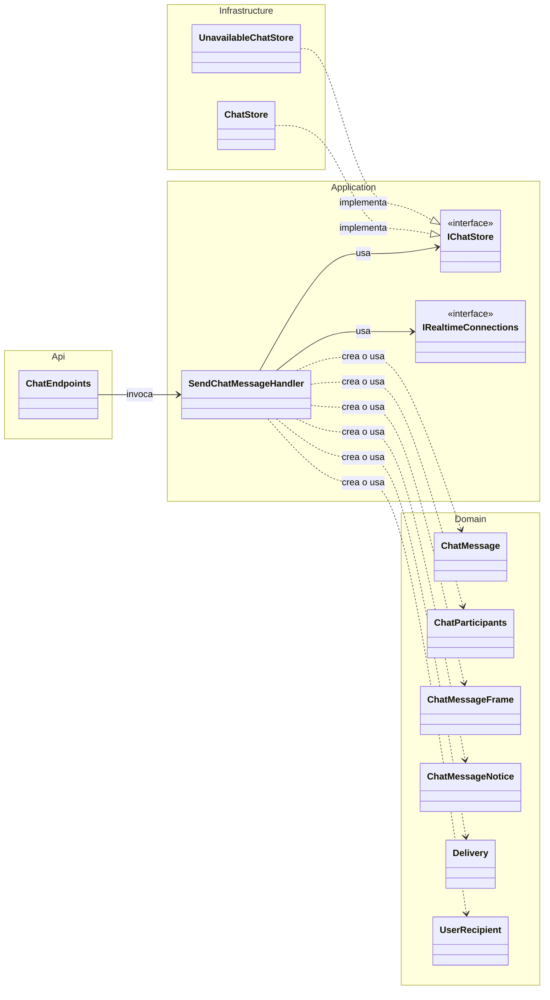

# Communication — código del caso de uso principal (despues)

Nivel 4 del modelo C4 ([c4model.com/diagrams](https://c4model.com/diagrams)): las clases del caso de uso principal, **envío de un mensaje del chat (RF-37, ADR-026)**, desde su clase de entrada hasta los adaptadores, con un bloque por capa (SDD 10.3.1 y 10.3.2). El resto del servicio repite el patrón y está en su diagrama de componentes (C4-04) y en [`paquetes.mmd`](paquetes.mmd).

Generado desde el código compilado de `origin/develop` (`92f11ed`) el 2026-11-23 con `tools/arquitectura/generar.py` (SCRUM-715). No se edita a mano.

**Cómo leerlo.** `-->` es una dependencia inyectada por el constructor; `..|>`, una clase que implementa un puerto (un adaptador de Infrastructure o un colaborador de Application); `..>`, un tipo del dominio que el caso de uso o sus colaboradores usan, según el IL (.NET) o el bytecode (Java). No se dibujan las dependencias transversales: `ILogger`, `TimeProvider`.

| Clase | Capa | Archivo |
|---|---|---|
| `Api.Endpoints.ChatEndpoints` | Api | `src/QuickPatch.Communication.Api/Endpoints/ChatEndpoints.cs` |
| `Application.Chat.SendChatMessageHandler` | Application | `src/QuickPatch.Communication.Application/Chat/SendChatMessage.cs` |
| `Application.Abstractions.IChatStore` | Application | `` |
| `Infrastructure.Persistence.ChatStore` | Infrastructure | `src/QuickPatch.Communication.Infrastructure/Persistence/ChatStore.cs` |
| `Infrastructure.Persistence.UnavailableChatStore` | Infrastructure | `src/QuickPatch.Communication.Infrastructure/Persistence/ChatStore.cs` |
| `Application.Abstractions.IRealtimeConnections` | Application | `` |
| `Domain.Chat.ChatMessage` | Domain | `src/QuickPatch.Communication.Domain/Chat/Chat.cs` |
| `Domain.Chat.ChatParticipants` | Domain | `src/QuickPatch.Communication.Domain/Chat/Chat.cs` |
| `Domain.Realtime.ChatMessageFrame` | Domain | `src/QuickPatch.Communication.Domain/Realtime/Notices.cs` |
| `Domain.Realtime.ChatMessageNotice` | Domain | `src/QuickPatch.Communication.Domain/Realtime/Notices.cs` |
| `Domain.Realtime.Delivery` | Domain | `src/QuickPatch.Communication.Domain/Realtime/Notices.cs` |
| `Domain.Realtime.UserRecipient` | Domain | `src/QuickPatch.Communication.Domain/Realtime/Notices.cs` |
