# Identity — despues

Código de `origin/develop` en `21fa2e6`, generado el 2026-11-19 con `tools/arquitectura/generar.py`.

| Métrica | Valor |
|---|---|
| Tipos (sin migraciones) | 192 |
| Paquetes | 24 |
| Dependencias entre tipos | 629 |
| Dependencias entre paquetes | 91 |
| Ciclos entre paquetes | 0 |
| Paquetes dentro de ciclos | 0 |
| Ciclos entre tipos | 0 |
| Tipos en el mayor ciclo | 0 |
| Violaciones de SDD 10.3.2 | 0 |
| Tipos de más de 250 líneas | 0 |
| Fan-out máximo (sin raíces de composición) | 28 |
| Fan-out promedio | 3.28 |
| Cohesión relacional promedio (H) | 0.78 |

## Dependencias entre capas

| Desde → hacia | Dependencias |
|---|---|
| Api → Application | 82 |
| Api → Domain | 19 |
| Api → Infrastructure | 1 |
| Application → Domain | 102 |
| Infrastructure → Application | 51 |
| Infrastructure → Domain | 20 |

## Clases con más dependencias de salida (fan-out)

| Tipo | Capa | Líneas | Sale | Entra |
|---|---|---|---|---|
| `Api.Endpoints.CompanyEndpoints` | Api | 189 | 28 | 1 |
| `Api.Endpoints.PasswordEndpoints` | Api | 165 | 24 | 1 |
| `Api.Endpoints.AuthEndpoints` | Api | 138 | 20 | 1 |
| `Api.Endpoints.ProviderTeamEndpoints` | Api | 108 | 16 | 1 |
| `Application.Technicians.CreateTeamTechnicianHandler` | Application | 71 | 16 | 2 |
| `Api.Endpoints.PlatformEndpoints` | Api | 74 | 14 | 1 |
| `Api.Endpoints.AdminTechnicianEndpoints` | Api | 72 | 13 | 1 |
| `Application.Auth.ConfirmPasswordRecoveryHandler` | Application | 57 | 13 | 2 |
| `Application.Auth.RegisterTechnicianHandler` | Application | 60 | 13 | 3 |
| `Application.Companies.CreateCompanyUserHandler` | Application | 54 | 13 | 2 |

## Clases más usadas (fan-in)

| Tipo | Capa | Entra | Sale |
|---|---|---|---|
| `Domain.Users.User` | Domain | 41 | 3 |
| `Application.Abstractions.ITenantUnitOfWork` | Application | 25 | 0 |
| `Domain.Tenants.Tenant` | Domain | 23 | 1 |
| `Application.Abstractions.IUserRepository` | Application | 21 | 1 |
| `Domain.Technicians.TechnicianProfile` | Domain | 21 | 1 |
| `Domain.Common.DomainValidationException` | Domain | 20 | 0 |
| `Infrastructure.Persistence.IdentityDbContext` | Infrastructure | 13 | 8 |
| `Application.Abstractions.ITechnicianProfileRepository` | Application | 12 | 3 |
| `Application.Abstractions.ITenantRepository` | Application | 12 | 1 |
| `Application.Abstractions.IPasswordHasher` | Application | 11 | 0 |

## Clases más grandes

| Tipo | Capa | Líneas | Archivo |
|---|---|---|---|
| `Api.Endpoints.CompanyEndpoints` | Api | 189 | `src/QuickPatch.Identity.Api/Endpoints/CompanyEndpoints.cs` |
| `Infrastructure.Persistence.IdentityDbContext` | Infrastructure | 177 | `src/QuickPatch.Identity.Infrastructure/Persistence/IdentityDbContext.cs` |
| `Domain.Users.User` | Domain | 167 | `src/QuickPatch.Identity.Domain/Users/User.cs` |
| `Api.Endpoints.PasswordEndpoints` | Api | 165 | `src/QuickPatch.Identity.Api/Endpoints/PasswordEndpoints.cs` |
| `Domain.Users.UserRules` | Domain | 162 | `src/QuickPatch.Identity.Domain/Users/UserRules.cs` |
| `Api.Endpoints.AuthEndpoints` | Api | 138 | `src/QuickPatch.Identity.Api/Endpoints/AuthEndpoints.cs` |
| `Domain.Technicians.TechnicianProfile` | Domain | 132 | `src/QuickPatch.Identity.Domain/Technicians/TechnicianProfile.cs` |
| `Api.Endpoints.UserEndpoints` | Api | 122 | `src/QuickPatch.Identity.Api/Endpoints/UserEndpoints.cs` |
| `Api.Endpoints.ProviderTeamEndpoints` | Api | 108 | `src/QuickPatch.Identity.Api/Endpoints/ProviderTeamEndpoints.cs` |
| `Domain.Users.PasswordSetupToken` | Domain | 99 | `src/QuickPatch.Identity.Domain/Users/PasswordSetupToken.cs` |

## Ciclos entre paquetes

Ninguno.

## Violaciones de las reglas de dependencia (SDD 10.3.2)

Ninguna.

## Paquetes

| Paquete | Tipos | Fan-in | Fan-out | Inestabilidad | Cohesión H |
|---|---|---|---|---|---|
| `(global)` | 1 | 0 | 6 | 1.0 | 1.0 |
| `Api.Bootstrap` | 5 | 1 | 3 | 0.75 | 1.0 |
| `Api.Endpoints` | 31 | 1 | 13 | 0.93 | 1.39 |
| `Api.Http` | 3 | 2 | 1 | 0.33 | 0.33 |
| `Api.Security` | 8 | 4 | 1 | 0.2 | 0.5 |
| `Application` | 1 | 1 | 6 | 0.86 | 1.0 |
| `Application.Abstractions` | 30 | 12 | 5 | 0.29 | 0.37 |
| `Application.Auth` | 22 | 3 | 8 | 0.73 | 0.68 |
| `Application.Companies` | 12 | 2 | 6 | 0.75 | 0.92 |
| `Application.Events` | 9 | 4 | 3 | 0.43 | 0.78 |
| `Application.Platform` | 7 | 2 | 5 | 0.71 | 0.71 |
| `Application.Technicians` | 20 | 5 | 7 | 0.58 | 0.9 |
| `Application.Users` | 5 | 2 | 4 | 0.67 | 0.8 |
| `Domain.Audit` | 1 | 5 | 0 | 0.0 | 1.0 |
| `Domain.Common` | 1 | 11 | 0 | 0.0 | 1.0 |
| `Domain.Companies` | 1 | 4 | 1 | 0.2 | 1.0 |
| `Domain.Technicians` | 2 | 7 | 1 | 0.12 | 0.5 |
| `Domain.Tenants` | 1 | 8 | 1 | 0.11 | 1.0 |
| `Domain.Users` | 6 | 9 | 1 | 0.1 | 1.0 |
| `Infrastructure` | 1 | 1 | 5 | 0.83 | 1.0 |
| `Infrastructure.Messaging` | 3 | 1 | 4 | 0.8 | 0.33 |
| `Infrastructure.Options` | 5 | 3 | 0 | 0.0 | 0.2 |
| `Infrastructure.Persistence` | 13 | 2 | 7 | 0.78 | 1.08 |
| `Infrastructure.Security` | 4 | 1 | 3 | 0.75 | 0.25 |

## Diagrama de paquetes

Fuente: [`paquetes.puml`](paquetes.puml) (PlantUML) y [`paquetes.mmd`](paquetes.mmd). Clases más conectadas: [`clases-centrales.puml`](clases-centrales.puml).

```mermaid
flowchart LR
  subgraph Api
    _global_["(global) (1)"]
    QuickPatch_Identity_Api_Bootstrap["Api.Bootstrap (5)"]
    QuickPatch_Identity_Api_Endpoints["Api.Endpoints (31)"]
    QuickPatch_Identity_Api_Http["Api.Http (3)"]
    QuickPatch_Identity_Api_Security["Api.Security (8)"]
  end
  subgraph Application
    QuickPatch_Identity_Application["Application (1)"]
    QuickPatch_Identity_Application_Abstractions["Application.Abstractions (30)"]
    QuickPatch_Identity_Application_Auth["Application.Auth (22)"]
    QuickPatch_Identity_Application_Companies["Application.Companies (12)"]
    QuickPatch_Identity_Application_Events["Application.Events (9)"]
    QuickPatch_Identity_Application_Platform["Application.Platform (7)"]
    QuickPatch_Identity_Application_Technicians["Application.Technicians (20)"]
    QuickPatch_Identity_Application_Users["Application.Users (5)"]
  end
  subgraph Domain
    QuickPatch_Identity_Domain_Audit["Domain.Audit (1)"]
    QuickPatch_Identity_Domain_Common["Domain.Common (1)"]
    QuickPatch_Identity_Domain_Companies["Domain.Companies (1)"]
    QuickPatch_Identity_Domain_Technicians["Domain.Technicians (2)"]
    QuickPatch_Identity_Domain_Tenants["Domain.Tenants (1)"]
    QuickPatch_Identity_Domain_Users["Domain.Users (6)"]
  end
  subgraph Infrastructure
    QuickPatch_Identity_Infrastructure["Infrastructure (1)"]
    QuickPatch_Identity_Infrastructure_Messaging["Infrastructure.Messaging (3)"]
    QuickPatch_Identity_Infrastructure_Options["Infrastructure.Options (5)"]
    QuickPatch_Identity_Infrastructure_Persistence["Infrastructure.Persistence (13)"]
    QuickPatch_Identity_Infrastructure_Security["Infrastructure.Security (4)"]
  end
  _global_ -->|3| QuickPatch_Identity_Api_Bootstrap
  _global_ -->|2| QuickPatch_Identity_Api_Endpoints
  _global_ -->|2| QuickPatch_Identity_Api_Http
  _global_ -->|4| QuickPatch_Identity_Api_Security
  _global_ -->|1| QuickPatch_Identity_Application
  _global_ -->|1| QuickPatch_Identity_Infrastructure
  QuickPatch_Identity_Api_Bootstrap -->|2| QuickPatch_Identity_Api_Security
  QuickPatch_Identity_Api_Bootstrap -->|12| QuickPatch_Identity_Application_Auth
  QuickPatch_Identity_Api_Bootstrap -->|1| QuickPatch_Identity_Domain_Common
  QuickPatch_Identity_Api_Endpoints -->|6| QuickPatch_Identity_Api_Http
  QuickPatch_Identity_Api_Endpoints -->|21| QuickPatch_Identity_Api_Security
  QuickPatch_Identity_Api_Endpoints -->|5| QuickPatch_Identity_Application_Abstractions
  QuickPatch_Identity_Api_Endpoints -->|19| QuickPatch_Identity_Application_Auth
  QuickPatch_Identity_Api_Endpoints -->|11| QuickPatch_Identity_Application_Companies
  QuickPatch_Identity_Api_Endpoints -->|7| QuickPatch_Identity_Application_Platform
  QuickPatch_Identity_Api_Endpoints -->|20| QuickPatch_Identity_Application_Technicians
  QuickPatch_Identity_Api_Endpoints -->|5| QuickPatch_Identity_Application_Users
  QuickPatch_Identity_Api_Endpoints -->|7| QuickPatch_Identity_Domain_Common
  QuickPatch_Identity_Api_Endpoints -->|2| QuickPatch_Identity_Domain_Companies
  QuickPatch_Identity_Api_Endpoints -->|3| QuickPatch_Identity_Domain_Technicians
  QuickPatch_Identity_Api_Endpoints -->|2| QuickPatch_Identity_Domain_Tenants
  QuickPatch_Identity_Api_Endpoints -->|4| QuickPatch_Identity_Domain_Users
  QuickPatch_Identity_Api_Http -->|1| QuickPatch_Identity_Api_Security
  QuickPatch_Identity_Api_Security -->|2| QuickPatch_Identity_Application_Abstractions
  QuickPatch_Identity_Application -->|8| QuickPatch_Identity_Application_Auth
  QuickPatch_Identity_Application -->|5| QuickPatch_Identity_Application_Companies
  QuickPatch_Identity_Application -->|3| QuickPatch_Identity_Application_Platform
  QuickPatch_Identity_Application -->|7| QuickPatch_Identity_Application_Technicians
  QuickPatch_Identity_Application -->|3| QuickPatch_Identity_Application_Users
  QuickPatch_Identity_Application -->|1| QuickPatch_Identity_Domain_Users
  QuickPatch_Identity_Application_Abstractions -->|1| QuickPatch_Identity_Domain_Audit
  QuickPatch_Identity_Application_Abstractions -->|1| QuickPatch_Identity_Domain_Companies
  QuickPatch_Identity_Application_Abstractions -->|1| QuickPatch_Identity_Domain_Technicians
  QuickPatch_Identity_Application_Abstractions -->|2| QuickPatch_Identity_Domain_Tenants
  QuickPatch_Identity_Application_Abstractions -->|4| QuickPatch_Identity_Domain_Users
  QuickPatch_Identity_Application_Auth -->|40| QuickPatch_Identity_Application_Abstractions
  QuickPatch_Identity_Application_Auth -->|1| QuickPatch_Identity_Application_Events
  QuickPatch_Identity_Application_Auth -->|3| QuickPatch_Identity_Application_Technicians
  QuickPatch_Identity_Application_Auth -->|1| QuickPatch_Identity_Domain_Audit
  QuickPatch_Identity_Application_Auth -->|1| QuickPatch_Identity_Domain_Common
  QuickPatch_Identity_Application_Auth -->|4| QuickPatch_Identity_Domain_Technicians
  QuickPatch_Identity_Application_Auth -->|6| QuickPatch_Identity_Domain_Tenants
  QuickPatch_Identity_Application_Auth -->|21| QuickPatch_Identity_Domain_Users
  QuickPatch_Identity_Application_Companies -->|21| QuickPatch_Identity_Application_Abstractions
  QuickPatch_Identity_Application_Companies -->|4| QuickPatch_Identity_Application_Technicians
  QuickPatch_Identity_Application_Companies -->|2| QuickPatch_Identity_Domain_Common
  QuickPatch_Identity_Application_Companies -->|3| QuickPatch_Identity_Domain_Companies
  QuickPatch_Identity_Application_Companies -->|2| QuickPatch_Identity_Domain_Tenants
  QuickPatch_Identity_Application_Companies -->|12| QuickPatch_Identity_Domain_Users
  QuickPatch_Identity_Application_Events -->|3| QuickPatch_Identity_Application_Abstractions
  QuickPatch_Identity_Application_Events -->|2| QuickPatch_Identity_Domain_Technicians
  QuickPatch_Identity_Application_Events -->|1| QuickPatch_Identity_Domain_Tenants
  QuickPatch_Identity_Application_Platform -->|9| QuickPatch_Identity_Application_Abstractions
  QuickPatch_Identity_Application_Platform -->|1| QuickPatch_Identity_Application_Events
  QuickPatch_Identity_Application_Platform -->|2| QuickPatch_Identity_Domain_Audit
  QuickPatch_Identity_Application_Platform -->|1| QuickPatch_Identity_Domain_Common
  QuickPatch_Identity_Application_Platform -->|5| QuickPatch_Identity_Domain_Tenants
  QuickPatch_Identity_Application_Technicians -->|28| QuickPatch_Identity_Application_Abstractions
  QuickPatch_Identity_Application_Technicians -->|4| QuickPatch_Identity_Application_Events
  QuickPatch_Identity_Application_Technicians -->|1| QuickPatch_Identity_Domain_Audit
  QuickPatch_Identity_Application_Technicians -->|2| QuickPatch_Identity_Domain_Common
  QuickPatch_Identity_Application_Technicians -->|7| QuickPatch_Identity_Domain_Technicians
  QuickPatch_Identity_Application_Technicians -->|2| QuickPatch_Identity_Domain_Tenants
  QuickPatch_Identity_Application_Technicians -->|9| QuickPatch_Identity_Domain_Users
  QuickPatch_Identity_Application_Users -->|8| QuickPatch_Identity_Application_Abstractions
  QuickPatch_Identity_Application_Users -->|1| QuickPatch_Identity_Domain_Common
  QuickPatch_Identity_Application_Users -->|3| QuickPatch_Identity_Domain_Technicians
  QuickPatch_Identity_Application_Users -->|4| QuickPatch_Identity_Domain_Users
  QuickPatch_Identity_Domain_Companies -->|1| QuickPatch_Identity_Domain_Common
  QuickPatch_Identity_Domain_Technicians -->|1| QuickPatch_Identity_Domain_Common
  QuickPatch_Identity_Domain_Tenants -->|1| QuickPatch_Identity_Domain_Common
  QuickPatch_Identity_Domain_Users -->|2| QuickPatch_Identity_Domain_Common
  QuickPatch_Identity_Infrastructure -->|16| QuickPatch_Identity_Application_Abstractions
  QuickPatch_Identity_Infrastructure -->|3| QuickPatch_Identity_Infrastructure_Messaging
  QuickPatch_Identity_Infrastructure -->|5| QuickPatch_Identity_Infrastructure_Options
  QuickPatch_Identity_Infrastructure -->|11| QuickPatch_Identity_Infrastructure_Persistence
  QuickPatch_Identity_Infrastructure -->|4| QuickPatch_Identity_Infrastructure_Security
  QuickPatch_Identity_Infrastructure_Messaging -->|2| QuickPatch_Identity_Application_Abstractions
  QuickPatch_Identity_Infrastructure_Messaging -->|3| QuickPatch_Identity_Application_Events
  QuickPatch_Identity_Infrastructure_Messaging -->|2| QuickPatch_Identity_Application_Technicians
  QuickPatch_Identity_Infrastructure_Messaging -->|1| QuickPatch_Identity_Infrastructure_Persistence
  QuickPatch_Identity_Infrastructure_Persistence -->|22| QuickPatch_Identity_Application_Abstractions
  QuickPatch_Identity_Infrastructure_Persistence -->|2| QuickPatch_Identity_Domain_Audit
  QuickPatch_Identity_Infrastructure_Persistence -->|2| QuickPatch_Identity_Domain_Companies
  QuickPatch_Identity_Infrastructure_Persistence -->|2| QuickPatch_Identity_Domain_Technicians
  QuickPatch_Identity_Infrastructure_Persistence -->|3| QuickPatch_Identity_Domain_Tenants
  QuickPatch_Identity_Infrastructure_Persistence -->|10| QuickPatch_Identity_Domain_Users
  QuickPatch_Identity_Infrastructure_Persistence -->|1| QuickPatch_Identity_Infrastructure_Options
  QuickPatch_Identity_Infrastructure_Security -->|6| QuickPatch_Identity_Application_Abstractions
  QuickPatch_Identity_Infrastructure_Security -->|1| QuickPatch_Identity_Domain_Users
  QuickPatch_Identity_Infrastructure_Security -->|4| QuickPatch_Identity_Infrastructure_Options
```

