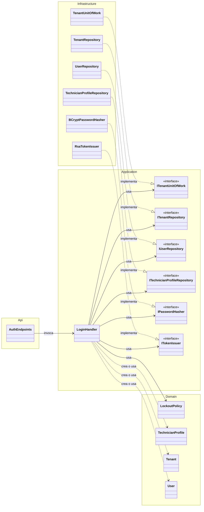

# Identity — código del caso de uso principal (despues)

Nivel 4 del modelo C4 ([c4model.com/diagrams](https://c4model.com/diagrams)): las clases del caso de uso principal, **inicio de sesión (RF-03, RN-U4, ADR-018)**, desde su clase de entrada hasta los adaptadores, con un bloque por capa (SDD 10.3.1 y 10.3.2). El resto del servicio repite el patrón y está en su diagrama de componentes (C4-04) y en [`paquetes.mmd`](paquetes.mmd).

Generado desde el código compilado de `origin/develop` (`6631e7f`) el 2026-11-23 con `tools/arquitectura/generar.py` (SCRUM-715). No se edita a mano.

**Cómo leerlo.** `-->` es una dependencia inyectada por el constructor; `..|>`, una clase que implementa un puerto (un adaptador de Infrastructure o un colaborador de Application); `..>`, un tipo del dominio que el caso de uso o sus colaboradores usan, según el IL (.NET) o el bytecode (Java). No se dibujan las dependencias transversales: `ILogger`, `TimeProvider`.

| Clase | Capa | Archivo |
|---|---|---|
| `Api.Endpoints.AuthEndpoints` | Api | `src/QuickPatch.Identity.Api/Endpoints/AuthEndpoints.cs` |
| `Application.Auth.LoginHandler` | Application | `src/QuickPatch.Identity.Application/Auth/Login.cs` |
| `Application.Abstractions.ITenantUnitOfWork` | Application | `` |
| `Infrastructure.Persistence.TenantUnitOfWork` | Infrastructure | `src/QuickPatch.Identity.Infrastructure/Persistence/TenantUnitOfWork.cs` |
| `Application.Abstractions.ITenantRepository` | Application | `` |
| `Infrastructure.Persistence.TenantRepository` | Infrastructure | `src/QuickPatch.Identity.Infrastructure/Persistence/TenantRepository.cs` |
| `Application.Abstractions.IUserRepository` | Application | `` |
| `Infrastructure.Persistence.UserRepository` | Infrastructure | `src/QuickPatch.Identity.Infrastructure/Persistence/UserRepository.cs` |
| `Application.Abstractions.ITechnicianProfileRepository` | Application | `` |
| `Infrastructure.Persistence.TechnicianProfileRepository` | Infrastructure | `src/QuickPatch.Identity.Infrastructure/Persistence/TechnicianProfileRepository.cs` |
| `Application.Abstractions.IPasswordHasher` | Application | `` |
| `Infrastructure.Security.BCryptPasswordHasher` | Infrastructure | `src/QuickPatch.Identity.Infrastructure/Security/SecurityAdapters.cs` |
| `Application.Abstractions.ITokenIssuer` | Application | `` |
| `Infrastructure.Security.RsaTokenIssuer` | Infrastructure | `src/QuickPatch.Identity.Infrastructure/Security/SecurityAdapters.cs` |
| `Domain.Users.LockoutPolicy` | Domain | `src/QuickPatch.Identity.Domain/Users/User.cs` |
| `Domain.Technicians.TechnicianProfile` | Domain | `src/QuickPatch.Identity.Domain/Technicians/TechnicianProfile.cs` |
| `Domain.Tenants.Tenant` | Domain | `src/QuickPatch.Identity.Domain/Tenants/Tenant.cs` |
| `Domain.Users.User` | Domain | `src/QuickPatch.Identity.Domain/Users/User.cs` |
