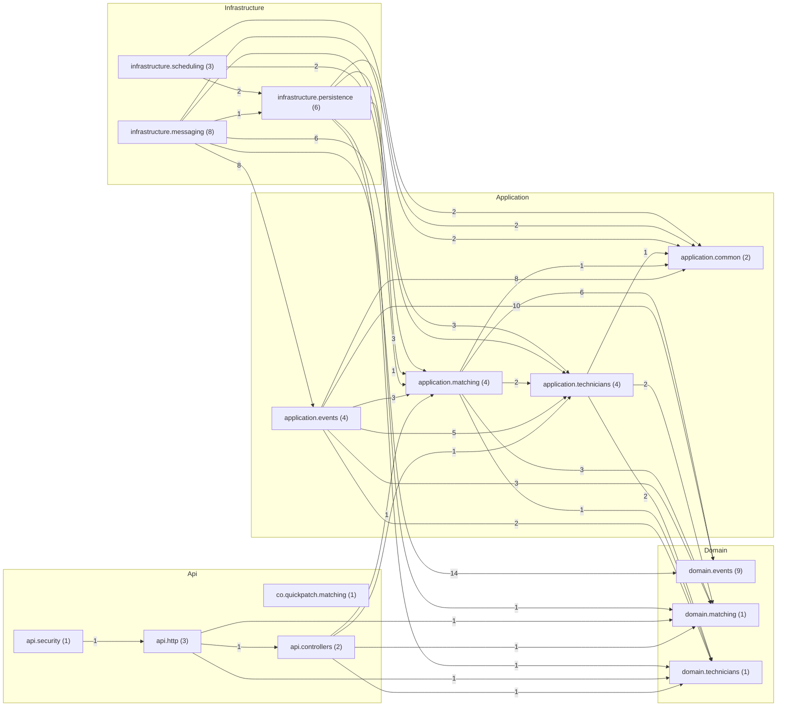

# Matching — despues

Código de `origin/develop` en `8e6450c`, generado el 2026-11-12 con `tools/arquitectura/generar.py`.

| Métrica | Valor |
|---|---|
| Tipos (sin migraciones) | 49 |
| Paquetes | 14 |
| Dependencias entre tipos | 123 |
| Dependencias entre paquetes | 36 |
| Ciclos entre paquetes | 0 |
| Paquetes dentro de ciclos | 0 |
| Ciclos entre tipos | 0 |
| Tipos en el mayor ciclo | 0 |
| Violaciones de SDD 10.3.2 | 0 |
| Tipos de más de 250 líneas | 0 |
| Fan-out máximo (sin raíces de composición) | 13 |
| Fan-out promedio | 2.51 |
| Cohesión relacional promedio (H) | 0.75 |

## Dependencias entre capas

| Desde → hacia | Dependencias |
|---|---|
| Api → Application | 2 |
| Api → Domain | 4 |
| Application → Domain | 29 |
| Infrastructure → Application | 29 |
| Infrastructure → Domain | 16 |

## Clases con más dependencias de salida (fan-out)

| Tipo | Capa | Líneas | Sale | Entra |
|---|---|---|---|---|
| `infrastructure.messaging.KafkaConfig` | Infrastructure | 81 | 13 | 0 |
| `application.events.TechnicianEventsHandler` | Application | 64 | 10 | 2 |
| `application.events.ServiceRequestCancelledHandler` | Application | 76 | 8 | 2 |
| `application.events.ServiceRequestCompletedHandler` | Application | 58 | 8 | 2 |
| `application.matching.MatchingEngine` | Application | 117 | 7 | 3 |
| `application.matching.OfferService` | Application | 128 | 7 | 3 |
| `application.events.ServiceRequestCreatedHandler` | Application | 37 | 5 | 2 |
| `infrastructure.messaging.TechnicianEventsListener` | Infrastructure | 70 | 5 | 0 |
| `api.http.ApiExceptionHandler` | Api | 65 | 4 | 0 |
| `application.technicians.TechnicianAvailabilityService` | Application | 104 | 4 | 2 |

## Clases más usadas (fan-in)

| Tipo | Capa | Entra | Sale |
|---|---|---|---|
| `domain.events.InvalidEventException` | Domain | 11 | 0 |
| `domain.matching.Matching` | Domain | 11 | 0 |
| `application.common.TenantTransaction` | Application | 10 | 0 |
| `domain.events.EventEnvelope` | Domain | 10 | 1 |
| `application.matching.MatchingPorts` | Application | 8 | 1 |
| `application.technicians.TechnicianPorts` | Application | 8 | 2 |
| `domain.technicians.Technicians` | Domain | 8 | 0 |
| `application.common.ProcessedEventStore` | Application | 6 | 0 |
| `domain.events.ServiceRequestCreated` | Domain | 4 | 1 |
| `application.matching.MatchingEngine` | Application | 3 | 7 |

## Clases más grandes

| Tipo | Capa | Líneas | Archivo |
|---|---|---|---|
| `infrastructure.persistence.JdbcMatchingStores` | Infrastructure | 220 | `src/main/java/co/quickpatch/matching/infrastructure/persistence/JdbcMatchingStores.java` |
| `application.matching.OfferService` | Application | 128 | `src/main/java/co/quickpatch/matching/application/matching/OfferService.java` |
| `application.matching.MatchingEngine` | Application | 117 | `src/main/java/co/quickpatch/matching/application/matching/MatchingEngine.java` |
| `application.technicians.TechnicianAvailabilityService` | Application | 104 | `src/main/java/co/quickpatch/matching/application/technicians/TechnicianAvailabilityService.java` |
| `domain.matching.Matching` | Domain | 98 | `src/main/java/co/quickpatch/matching/domain/matching/Matching.java` |
| `api.security.SecurityConfig` | Api | 92 | `src/main/java/co/quickpatch/matching/api/security/SecurityConfig.java` |
| `infrastructure.messaging.OutboxPublisher` | Infrastructure | 91 | `src/main/java/co/quickpatch/matching/infrastructure/messaging/OutboxPublisher.java` |
| `application.matching.MatchingPorts` | Application | 89 | `src/main/java/co/quickpatch/matching/application/matching/MatchingPorts.java` |
| `infrastructure.messaging.KafkaConfig` | Infrastructure | 81 | `src/main/java/co/quickpatch/matching/infrastructure/messaging/KafkaConfig.java` |
| `application.events.ServiceRequestCancelledHandler` | Application | 76 | `src/main/java/co/quickpatch/matching/application/events/ServiceRequestCancelledHandler.java` |

## Ciclos entre paquetes

Ninguno.

## Violaciones de las reglas de dependencia (SDD 10.3.2)

Ninguna.

## Paquetes

| Paquete | Tipos | Fan-in | Fan-out | Inestabilidad | Cohesión H |
|---|---|---|---|---|---|
| `co.quickpatch.matching` | 1 | 0 | 0 | 0.0 | 1.0 |
| `api.controllers` | 2 | 1 | 4 | 0.8 | 1.0 |
| `api.http` | 3 | 1 | 3 | 0.75 | 1.0 |
| `api.security` | 1 | 0 | 1 | 1.0 | 1.0 |
| `application.common` | 2 | 6 | 0 | 0.0 | 0.5 |
| `application.events` | 4 | 1 | 6 | 0.86 | 0.25 |
| `application.matching` | 4 | 5 | 5 | 0.5 | 1.25 |
| `application.technicians` | 4 | 5 | 3 | 0.38 | 0.75 |
| `domain.events` | 9 | 3 | 0 | 0.0 | 1.11 |
| `domain.matching` | 1 | 6 | 0 | 0.0 | 1.0 |
| `domain.technicians` | 1 | 6 | 0 | 0.0 | 1.0 |
| `infrastructure.messaging` | 8 | 0 | 6 | 1.0 | 0.12 |
| `infrastructure.persistence` | 6 | 2 | 5 | 0.71 | 0.17 |
| `infrastructure.scheduling` | 3 | 0 | 3 | 1.0 | 0.33 |

## Diagrama de paquetes

Fuente: [`paquetes.puml`](paquetes.puml) (PlantUML) y [`paquetes.mmd`](paquetes.mmd). Clases más conectadas: [`clases-centrales.puml`](clases-centrales.puml).

