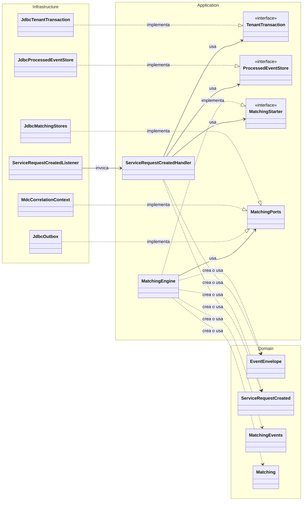

# Matching — código del caso de uso principal (despues)

Nivel 4 del modelo C4 ([c4model.com/diagrams](https://c4model.com/diagrams)): las clases del caso de uso principal, **inicio del matching al crearse la solicitud (RN-M1 a RN-M10, RN-EV1)**, desde su clase de entrada hasta los adaptadores, con un bloque por capa (SDD 10.3.1 y 10.3.2). El resto del servicio repite el patrón y está en su diagrama de componentes (C4-04) y en [`paquetes.mmd`](paquetes.mmd).

Generado desde el código compilado de `origin/develop` (`2816723`) el 2026-11-23 con `tools/arquitectura/generar.py` (SCRUM-715). No se edita a mano.

**Cómo leerlo.** `-->` es una dependencia inyectada por el constructor; `..|>`, una clase que implementa un puerto (un adaptador de Infrastructure o un colaborador de Application); `..>`, un tipo del dominio que el caso de uso o sus colaboradores usan, según el IL (.NET) o el bytecode (Java). No se dibujan las dependencias transversales: `Duration`.

| Clase | Capa | Archivo |
|---|---|---|
| `infrastructure.messaging.ServiceRequestCreatedListener` | Infrastructure | `src/main/java/co/quickpatch/matching/infrastructure/messaging/ServiceRequestCreatedListener.java` |
| `application.events.ServiceRequestCreatedHandler` | Application | `src/main/java/co/quickpatch/matching/application/events/ServiceRequestCreatedHandler.java` |
| `application.common.TenantTransaction` | Application | `src/main/java/co/quickpatch/matching/application/common/TenantTransaction.java` |
| `infrastructure.persistence.JdbcTenantTransaction` | Infrastructure | `src/main/java/co/quickpatch/matching/infrastructure/persistence/JdbcTenantTransaction.java` |
| `application.common.ProcessedEventStore` | Application | `src/main/java/co/quickpatch/matching/application/common/ProcessedEventStore.java` |
| `infrastructure.persistence.JdbcProcessedEventStore` | Infrastructure | `src/main/java/co/quickpatch/matching/infrastructure/persistence/JdbcProcessedEventStore.java` |
| `application.matching.MatchingStarter` | Application | `src/main/java/co/quickpatch/matching/application/matching/MatchingStarter.java` |
| `application.matching.MatchingEngine` | Application | `src/main/java/co/quickpatch/matching/application/matching/MatchingEngine.java` |
| `application.matching.MatchingPorts` | Application | `src/main/java/co/quickpatch/matching/application/matching/MatchingPorts.java` |
| `infrastructure.messaging.JdbcOutbox` | Infrastructure | `src/main/java/co/quickpatch/matching/infrastructure/messaging/JdbcOutbox.java` |
| `infrastructure.messaging.MdcCorrelationContext` | Infrastructure | `src/main/java/co/quickpatch/matching/infrastructure/messaging/MdcCorrelationContext.java` |
| `infrastructure.persistence.JdbcMatchingStores` | Infrastructure | `src/main/java/co/quickpatch/matching/infrastructure/persistence/JdbcMatchingStores.java` |
| `domain.events.EventEnvelope` | Domain | `src/main/java/co/quickpatch/matching/domain/events/EventEnvelope.java` |
| `domain.events.ServiceRequestCreated` | Domain | `src/main/java/co/quickpatch/matching/domain/events/ServiceRequestCreated.java` |
| `domain.events.MatchingEvents` | Domain | `src/main/java/co/quickpatch/matching/domain/events/MatchingEvents.java` |
| `domain.matching.Matching` | Domain | `src/main/java/co/quickpatch/matching/domain/matching/Matching.java` |
