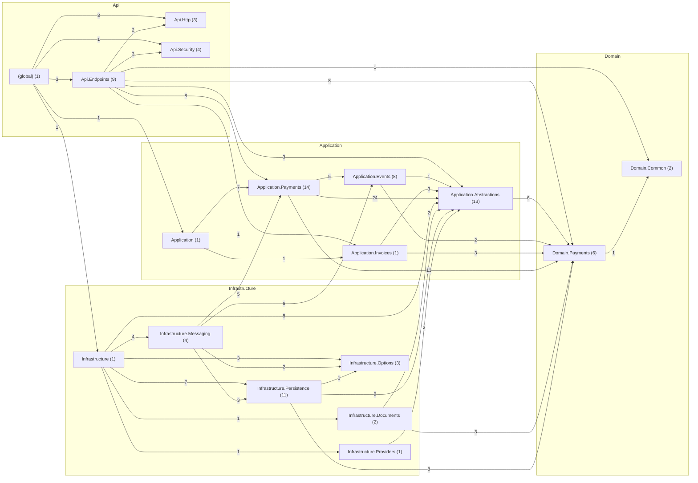

# Payments — despues

Código de `origin/develop` en `cf3af88`, generado el 2026-11-11 con `tools/arquitectura/generar.py`.

| Métrica | Valor |
|---|---|
| Tipos (sin migraciones) | 84 |
| Paquetes | 17 |
| Dependencias entre tipos | 214 |
| Dependencias entre paquetes | 39 |
| Ciclos entre paquetes | 0 |
| Paquetes dentro de ciclos | 0 |
| Ciclos entre tipos | 0 |
| Tipos en el mayor ciclo | 0 |
| Violaciones de SDD 10.3.2 | 0 |
| Tipos de más de 250 líneas | 0 |
| Fan-out máximo (sin raíces de composición) | 12 |
| Fan-out promedio | 2.55 |
| Cohesión relacional promedio (H) | 0.78 |

## Dependencias entre capas

| Desde → hacia | Dependencias |
|---|---|
| Api → Application | 13 |
| Api → Domain | 9 |
| Api → Infrastructure | 1 |
| Application → Domain | 24 |
| Infrastructure → Application | 32 |
| Infrastructure → Domain | 11 |

## Clases con más dependencias de salida (fan-out)

| Tipo | Capa | Líneas | Sale | Entra |
|---|---|---|---|---|
| `Api.Endpoints.PaymentEndpoints` | Api | 69 | 12 | 1 |
| `Application.Payments.PayHandler` | Application | 75 | 10 | 2 |
| `Application.Payments.PaymentSettlement` | Application | 45 | 9 | 3 |
| `Application.Payments.ReconcilePaymentsHandler` | Application | 44 | 9 | 2 |
| `Api.Endpoints.InvoiceEndpoints` | Api | 69 | 7 | 1 |
| `Application.Events.PaymentEvents` | Application | 20 | 7 | 1 |
| `Application.Payments.ServiceRequestCompletedHandler` | Application | 39 | 7 | 2 |
| `Application.Payments.TechnicianRegisteredHandler` | Application | 36 | 7 | 2 |
| `Api.Endpoints.ReceivedPaymentEndpoints` | Api | 76 | 6 | 1 |
| `Application.Invoices.GetInvoiceHandler` | Application | 20 | 6 | 2 |

## Clases más usadas (fan-in)

| Tipo | Capa | Entra | Sale |
|---|---|---|---|
| `Domain.Payments.Payment` | Domain | 21 | 0 |
| `Application.Abstractions.ITenantUnitOfWork` | Application | 10 | 0 |
| `Domain.Payments.Invoice` | Domain | 10 | 2 |
| `Application.Abstractions.IPaymentRepository` | Application | 9 | 2 |
| `Domain.Payments.Billing` | Domain | 9 | 1 |
| `Infrastructure.Persistence.PaymentsDbContext` | Infrastructure | 9 | 5 |
| `Application.Payments.PaymentView` | Application | 7 | 1 |
| `Application.Abstractions.InvoiceDocument` | Application | 5 | 3 |
| `Application.Abstractions.ProviderResult` | Application | 5 | 0 |
| `Application.Events.EventEnvelope` | Application | 5 | 0 |

## Clases más grandes

| Tipo | Capa | Líneas | Archivo |
|---|---|---|---|
| `Domain.Payments.Payment` | Domain | 143 | `src/QuickPatch.Payments.Domain/Payments/Payment.cs` |
| `Infrastructure.Documents.InvoicePdfRenderer` | Infrastructure | 118 | `src/QuickPatch.Payments.Infrastructure/Documents/InvoicePdfRenderer.cs` |
| `Infrastructure.Persistence.PaymentsDbContext` | Infrastructure | 99 | `src/QuickPatch.Payments.Infrastructure/Persistence/PaymentsDbContext.cs` |
| `Infrastructure.Messaging.ServiceRequestCompletedConsumer` | Infrastructure | 87 | `src/QuickPatch.Payments.Infrastructure/Messaging/ServiceRequestCompletedConsumer.cs` |
| `Infrastructure.Messaging.TechnicianRegisteredConsumer` | Infrastructure | 87 | `src/QuickPatch.Payments.Infrastructure/Messaging/TechnicianRegisteredConsumer.cs` |
| `Infrastructure.Persistence.PaymentRepository` | Infrastructure | 80 | `src/QuickPatch.Payments.Infrastructure/Persistence/PaymentRepository.cs` |
| `Api.Endpoints.ReceivedPaymentEndpoints` | Api | 76 | `src/QuickPatch.Payments.Api/Endpoints/ReceivedPaymentEndpoints.cs` |
| `Application.Payments.PayHandler` | Application | 75 | `src/QuickPatch.Payments.Application/Payments/Pay.cs` |
| `Infrastructure.Messaging.OutboxPublisher` | Infrastructure | 73 | `src/QuickPatch.Payments.Infrastructure/Messaging/OutboxPublisher.cs` |
| `Api.Endpoints.InvoiceEndpoints` | Api | 69 | `src/QuickPatch.Payments.Api/Endpoints/InvoiceEndpoints.cs` |

## Ciclos entre paquetes

Ninguno.

## Violaciones de las reglas de dependencia (SDD 10.3.2)

Ninguna.

## Paquetes

| Paquete | Tipos | Fan-in | Fan-out | Inestabilidad | Cohesión H |
|---|---|---|---|---|---|
| `(global)` | 1 | 0 | 5 | 1.0 | 1.0 |
| `Api.Endpoints` | 9 | 1 | 7 | 0.88 | 1.0 |
| `Api.Http` | 3 | 2 | 0 | 0.0 | 0.67 |
| `Api.Security` | 4 | 2 | 0 | 0.0 | 0.75 |
| `Application` | 1 | 1 | 2 | 0.67 | 1.0 |
| `Application.Abstractions` | 13 | 8 | 1 | 0.11 | 0.38 |
| `Application.Events` | 8 | 2 | 2 | 0.5 | 0.62 |
| `Application.Invoices` | 1 | 2 | 2 | 0.5 | 1.0 |
| `Application.Payments` | 14 | 3 | 3 | 0.5 | 1.07 |
| `Domain.Common` | 2 | 2 | 0 | 0.0 | 0.5 |
| `Domain.Payments` | 6 | 7 | 1 | 0.12 | 0.5 |
| `Infrastructure` | 1 | 1 | 6 | 0.86 | 1.0 |
| `Infrastructure.Documents` | 2 | 1 | 2 | 0.67 | 1.0 |
| `Infrastructure.Messaging` | 4 | 1 | 4 | 0.8 | 0.25 |
| `Infrastructure.Options` | 3 | 3 | 0 | 0.0 | 0.33 |
| `Infrastructure.Persistence` | 11 | 2 | 3 | 0.6 | 1.18 |
| `Infrastructure.Providers` | 1 | 1 | 1 | 0.5 | 1.0 |

## Diagrama de paquetes

Fuente: [`paquetes.puml`](paquetes.puml) (PlantUML) y [`paquetes.mmd`](paquetes.mmd). Clases más conectadas: [`clases-centrales.puml`](clases-centrales.puml).

