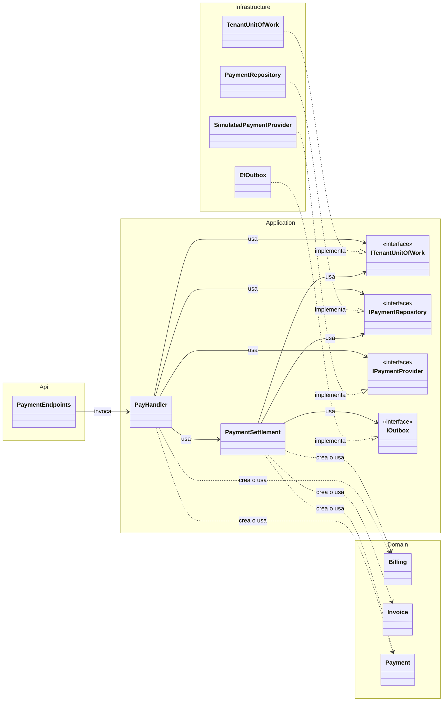

# Payments — código del caso de uso principal (despues)

Nivel 4 del modelo C4 ([c4model.com/diagrams](https://c4model.com/diagrams)): las clases del caso de uso principal, **pago con la pasarela simulada (RF-22, ADR-009 modificado)**, desde su clase de entrada hasta los adaptadores, con un bloque por capa (SDD 10.3.1 y 10.3.2). El resto del servicio repite el patrón y está en su diagrama de componentes (C4-04) y en [`paquetes.mmd`](paquetes.mmd).

Generado desde el código compilado de `origin/develop` (`a665f4f`) el 2026-11-23 con `tools/arquitectura/generar.py` (SCRUM-715). No se edita a mano.

**Cómo leerlo.** `-->` es una dependencia inyectada por el constructor; `..|>`, una clase que implementa un puerto (un adaptador de Infrastructure o un colaborador de Application); `..>`, un tipo del dominio que el caso de uso o sus colaboradores usan, según el IL (.NET) o el bytecode (Java). No se dibujan las dependencias transversales: `ILogger`, `TimeProvider`.

| Clase | Capa | Archivo |
|---|---|---|
| `Api.Endpoints.PaymentEndpoints` | Api | `src/QuickPatch.Payments.Api/Endpoints/PaymentEndpoints.cs` |
| `Application.Payments.PayHandler` | Application | `src/QuickPatch.Payments.Application/Payments/Pay.cs` |
| `Application.Abstractions.ITenantUnitOfWork` | Application | `` |
| `Infrastructure.Persistence.TenantUnitOfWork` | Infrastructure | `src/QuickPatch.Payments.Infrastructure/Persistence/TenantUnitOfWork.cs` |
| `Application.Abstractions.IPaymentRepository` | Application | `` |
| `Infrastructure.Persistence.PaymentRepository` | Infrastructure | `src/QuickPatch.Payments.Infrastructure/Persistence/PaymentRepository.cs` |
| `Application.Abstractions.IPaymentProvider` | Application | `` |
| `Infrastructure.Providers.SimulatedPaymentProvider` | Infrastructure | `src/QuickPatch.Payments.Infrastructure/Providers/SimulatedPaymentProvider.cs` |
| `Application.Payments.PaymentSettlement` | Application | `src/QuickPatch.Payments.Application/Payments/PaymentSettlement.cs` |
| `Application.Abstractions.IOutbox` | Application | `` |
| `Infrastructure.Persistence.EfOutbox` | Infrastructure | `src/QuickPatch.Payments.Infrastructure/Persistence/EfOutbox.cs` |
| `Domain.Payments.Billing` | Domain | `src/QuickPatch.Payments.Domain/Payments/Billing.cs` |
| `Domain.Payments.Invoice` | Domain | `src/QuickPatch.Payments.Domain/Payments/Invoice.cs` |
| `Domain.Payments.Payment` | Domain | `src/QuickPatch.Payments.Domain/Payments/Payment.cs` |
