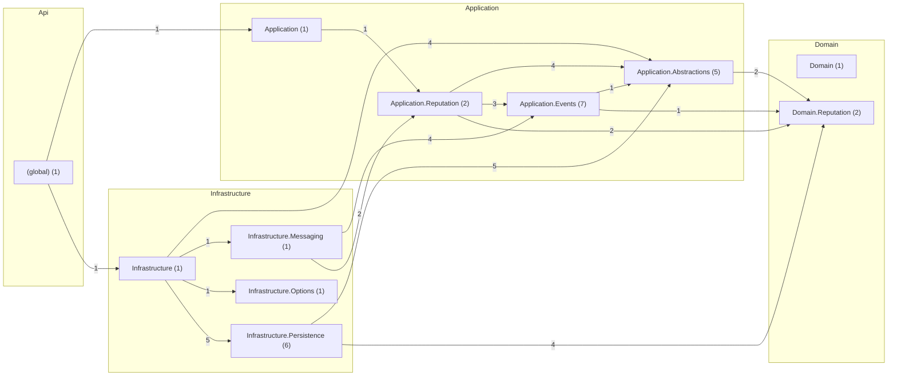

# Ranking — despues

Código de `origin/develop` en `1679652`, generado el 2026-11-12 con `tools/arquitectura/generar.py`.

| Métrica | Valor |
|---|---|
| Tipos (sin migraciones) | 28 |
| Paquetes | 11 |
| Dependencias entre tipos | 54 |
| Dependencias entre paquetes | 17 |
| Ciclos entre paquetes | 0 |
| Paquetes dentro de ciclos | 0 |
| Ciclos entre tipos | 0 |
| Tipos en el mayor ciclo | 0 |
| Violaciones de SDD 10.3.2 | 0 |
| Tipos de más de 250 líneas | 0 |
| Fan-out máximo (sin raíces de composición) | 10 |
| Fan-out promedio | 1.93 |
| Cohesión relacional promedio (H) | 0.89 |

## Dependencias entre capas

| Desde → hacia | Dependencias |
|---|---|
| Api → Application | 1 |
| Api → Infrastructure | 1 |
| Application → Domain | 5 |
| Infrastructure → Application | 15 |
| Infrastructure → Domain | 4 |

## Clases con más dependencias de salida (fan-out)

| Tipo | Capa | Líneas | Sale | Entra |
|---|---|---|---|---|
| `Application.Reputation.ServiceRequestRatedHandler` | Application | 49 | 10 | 2 |
| `Infrastructure.Messaging.ServiceRequestRatedConsumer` | Infrastructure | 39 | 6 | 1 |
| `Application.Events.RankingEvents` | Application | 14 | 5 | 1 |
| `Infrastructure.Persistence.ReputationRepository` | Infrastructure | 13 | 4 | 1 |
| `Infrastructure.Persistence.EfOutbox` | Infrastructure | 7 | 3 | 1 |
| `Application.Abstractions.IReputationRepository` | Application | 0 | 2 | 3 |
| `Application.Events.ServiceRequestRatedContract` | Application | 7 | 2 | 1 |
| `Infrastructure.Persistence.ProcessedEventRepository` | Infrastructure | 1 | 2 | 1 |
| `Infrastructure.Persistence.RankingDbContext` | Infrastructure | 49 | 2 | 6 |
| `Infrastructure.Persistence.TenantUnitOfWork` | Infrastructure | 6 | 2 | 1 |

## Clases más usadas (fan-in)

| Tipo | Capa | Entra | Sale |
|---|---|---|---|
| `Infrastructure.Persistence.RankingDbContext` | Infrastructure | 6 | 2 |
| `Domain.Reputation.TechnicianReputation` | Domain | 5 | 0 |
| `Application.Events.EventEnvelope` | Application | 4 | 0 |
| `Domain.Reputation.AppliedRating` | Domain | 4 | 0 |
| `Application.Abstractions.IOutbox` | Application | 3 | 1 |
| `Application.Abstractions.IProcessedEventRepository` | Application | 3 | 0 |
| `Application.Abstractions.IReputationRepository` | Application | 3 | 2 |
| `Application.Abstractions.ITenantUnitOfWork` | Application | 3 | 0 |
| `Application.Abstractions.OutboxMessage` | Application | 3 | 0 |
| `Application.Events.ServiceRequestRatedData` | Application | 3 | 0 |

## Clases más grandes

| Tipo | Capa | Líneas | Archivo |
|---|---|---|---|
| `Domain.Reputation.TechnicianReputation` | Domain | 55 | `src/QuickPatch.Ranking.Domain/Reputation/TechnicianReputation.cs` |
| `Application.Reputation.ServiceRequestRatedHandler` | Application | 49 | `src/QuickPatch.Ranking.Application/Reputation/ServiceRequestRatedHandler.cs` |
| `Infrastructure.Persistence.RankingDbContext` | Infrastructure | 49 | `src/QuickPatch.Ranking.Infrastructure/Persistence/RankingDbContext.cs` |
| `Infrastructure.Messaging.ServiceRequestRatedConsumer` | Infrastructure | 39 | `src/QuickPatch.Ranking.Infrastructure/Messaging/ServiceRequestRatedConsumer.cs` |
| `Domain.Reputation.AppliedRating` | Domain | 24 | `src/QuickPatch.Ranking.Domain/Reputation/TechnicianReputation.cs` |
| `Application.Events.RankingEvents` | Application | 14 | `src/QuickPatch.Ranking.Application/Events/TechnicianReputationChanged.cs` |
| `Infrastructure.Persistence.ReputationRepository` | Infrastructure | 13 | `src/QuickPatch.Ranking.Infrastructure/Persistence/ReputationRepository.cs` |
| `Application.Events.EventEnvelope` | Application | 9 | `src/QuickPatch.Ranking.Application/Events/EventEnvelope.cs` |
| `Application.Events.EventSerializer` | Application | 8 | `src/QuickPatch.Ranking.Application/Events/EventSerializer.cs` |
| `Application.Events.ServiceRequestRatedContract` | Application | 7 | `src/QuickPatch.Ranking.Application/Events/ServiceRequestRated.cs` |

## Ciclos entre paquetes

Ninguno.

## Violaciones de las reglas de dependencia (SDD 10.3.2)

Ninguna.

## Paquetes

| Paquete | Tipos | Fan-in | Fan-out | Inestabilidad | Cohesión H |
|---|---|---|---|---|---|
| `(global)` | 1 | 0 | 2 | 1.0 | 1.0 |
| `Application` | 1 | 1 | 1 | 0.5 | 1.0 |
| `Application.Abstractions` | 5 | 4 | 1 | 0.2 | 0.4 |
| `Application.Events` | 7 | 2 | 2 | 0.5 | 0.86 |
| `Application.Reputation` | 2 | 2 | 3 | 0.6 | 1.0 |
| `Domain` | 1 | 0 | 0 | 0.0 | 1.0 |
| `Domain.Reputation` | 2 | 4 | 0 | 0.0 | 0.5 |
| `Infrastructure` | 1 | 1 | 4 | 0.8 | 1.0 |
| `Infrastructure.Messaging` | 1 | 1 | 2 | 0.67 | 1.0 |
| `Infrastructure.Options` | 1 | 1 | 0 | 0.0 | 1.0 |
| `Infrastructure.Persistence` | 6 | 1 | 2 | 0.67 | 1.0 |

## Diagrama de paquetes

Fuente: [`paquetes.puml`](paquetes.puml) (PlantUML) y [`paquetes.mmd`](paquetes.mmd). Clases más conectadas: [`clases-centrales.puml`](clases-centrales.puml).

