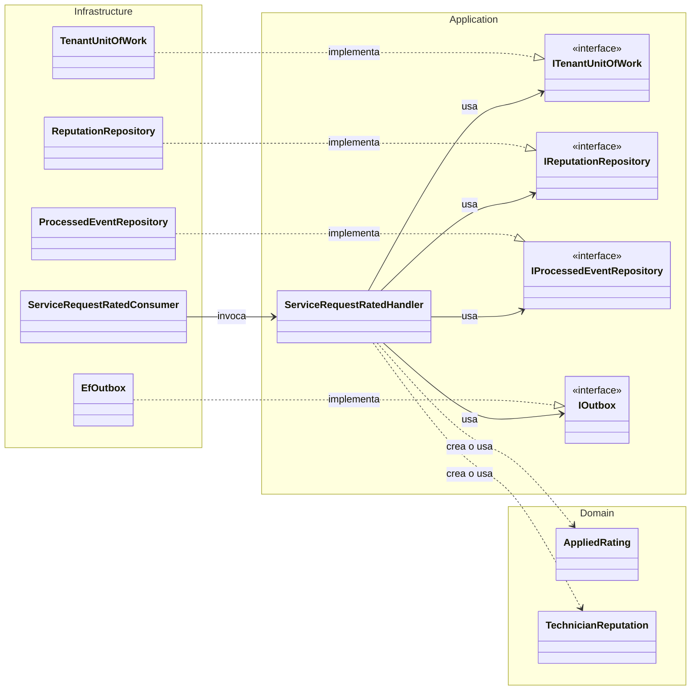

# Ranking — código del caso de uso principal (despues)

Nivel 4 del modelo C4 ([c4model.com/diagrams](https://c4model.com/diagrams)): las clases del caso de uso principal, **reputación del técnico desde la calificación (ADR-027)**, desde su clase de entrada hasta los adaptadores, con un bloque por capa (SDD 10.3.1 y 10.3.2). El resto del servicio repite el patrón y está en su diagrama de componentes (C4-04) y en [`paquetes.mmd`](paquetes.mmd).

Generado desde el código compilado de `origin/develop` (`9e4b500`) el 2026-11-23 con `tools/arquitectura/generar.py` (SCRUM-715). No se edita a mano.

**Cómo leerlo.** `-->` es una dependencia inyectada por el constructor; `..|>`, una clase que implementa un puerto (un adaptador de Infrastructure o un colaborador de Application); `..>`, un tipo del dominio que el caso de uso o sus colaboradores usan, según el IL (.NET) o el bytecode (Java). No se dibujan las dependencias transversales: `ILogger`, `TimeProvider`.

| Clase | Capa | Archivo |
|---|---|---|
| `Infrastructure.Messaging.ServiceRequestRatedConsumer` | Infrastructure | `src/QuickPatch.Ranking.Infrastructure/Messaging/ServiceRequestRatedConsumer.cs` |
| `Application.Reputation.ServiceRequestRatedHandler` | Application | `src/QuickPatch.Ranking.Application/Reputation/ServiceRequestRatedHandler.cs` |
| `Application.Abstractions.ITenantUnitOfWork` | Application | `` |
| `Infrastructure.Persistence.TenantUnitOfWork` | Infrastructure | `src/QuickPatch.Ranking.Infrastructure/Persistence/TenantUnitOfWork.cs` |
| `Application.Abstractions.IReputationRepository` | Application | `` |
| `Infrastructure.Persistence.ReputationRepository` | Infrastructure | `src/QuickPatch.Ranking.Infrastructure/Persistence/ReputationRepository.cs` |
| `Application.Abstractions.IProcessedEventRepository` | Application | `` |
| `Infrastructure.Persistence.ProcessedEventRepository` | Infrastructure | `src/QuickPatch.Ranking.Infrastructure/Persistence/ProcessedEventRepository.cs` |
| `Application.Abstractions.IOutbox` | Application | `` |
| `Infrastructure.Persistence.EfOutbox` | Infrastructure | `src/QuickPatch.Ranking.Infrastructure/Persistence/EfOutbox.cs` |
| `Domain.Reputation.AppliedRating` | Domain | `src/QuickPatch.Ranking.Domain/Reputation/TechnicianReputation.cs` |
| `Domain.Reputation.TechnicianReputation` | Domain | `src/QuickPatch.Ranking.Domain/Reputation/TechnicianReputation.cs` |
