# ServiceRequest — despues

Código de `origin/develop` en `ebd07d8`, generado el 2026-11-11 con `tools/arquitectura/generar.py`.

| Métrica | Valor |
|---|---|
| Tipos (sin migraciones) | 217 |
| Paquetes | 31 |
| Dependencias entre tipos | 618 |
| Dependencias entre paquetes | 111 |
| Ciclos entre paquetes | 0 |
| Paquetes dentro de ciclos | 0 |
| Ciclos entre tipos | 0 |
| Tipos en el mayor ciclo | 0 |
| Violaciones de SDD 10.3.2 | 0 |
| Tipos de más de 250 líneas | 1 |
| Fan-out máximo (sin raíces de composición) | 22 |
| Fan-out promedio | 2.85 |
| Cohesión relacional promedio (H) | 0.78 |

## Dependencias entre capas

| Desde → hacia | Dependencias |
|---|---|
| Api → Application | 54 |
| Api → Domain | 31 |
| Api → Infrastructure | 1 |
| Application → Domain | 71 |
| Infrastructure → Application | 73 |
| Infrastructure → Domain | 19 |

## Clases con más dependencias de salida (fan-out)

| Tipo | Capa | Líneas | Sale | Entra |
|---|---|---|---|---|
| `Api.Endpoints.ExecutionEndpoints` | Api | 188 | 22 | 1 |
| `Application.ServiceRequests.CreateServiceRequestHandler` | Application | 93 | 20 | 2 |
| `Api.Endpoints.AdminServiceRequestEndpoints` | Api | 97 | 19 | 1 |
| `Api.Endpoints.QuoteEndpoints` | Api | 109 | 18 | 1 |
| `Api.Endpoints.ServiceRequestEndpoints` | Api | 114 | 15 | 1 |
| `Application.Events.ServiceRequestEvents` | Application | 43 | 14 | 8 |
| `Application.Matching.MatchingStatusHandler` | Application | 95 | 14 | 2 |
| `Application.ServiceRequests.CancelServiceRequestHandler` | Application | 58 | 12 | 2 |
| `Api.Endpoints.LocationPreviewEndpoints` | Api | 40 | 11 | 1 |
| `Application.Quotes.IssueQuoteHandler` | Application | 48 | 11 | 2 |

## Clases más usadas (fan-in)

| Tipo | Capa | Entra | Sale |
|---|---|---|---|
| `Domain.ServiceRequests.ServiceRequest` | Domain | 34 | 5 |
| `Application.Abstractions.ITenantUnitOfWork` | Application | 22 | 0 |
| `Application.Abstractions.IServiceRequestRepository` | Application | 19 | 3 |
| `Infrastructure.Persistence.ServiceRequestDbContext` | Infrastructure | 16 | 11 |
| `Domain.Ratings.Rating` | Domain | 15 | 1 |
| `Domain.Common.DomainValidationException` | Domain | 14 | 0 |
| `Domain.Quotes.Quote` | Domain | 14 | 1 |
| `Domain.ServiceRequests.GeoPoint` | Domain | 13 | 0 |
| `Application.Abstractions.IOutbox` | Application | 12 | 1 |
| `Application.Events.EventEnvelope` | Application | 10 | 0 |

## Clases más grandes

| Tipo | Capa | Líneas | Archivo |
|---|---|---|---|
| `Domain.ServiceRequests.ServiceRequest` | Domain | 299 | `src/QuickPatch.ServiceRequest.Domain/ServiceRequests/ServiceRequest.cs` |
| `Domain.Quotes.Quote` | Domain | 207 | `src/QuickPatch.ServiceRequest.Domain/Quotes/Quote.cs` |
| `Infrastructure.Persistence.ServiceRequestDbContext` | Infrastructure | 197 | `src/QuickPatch.ServiceRequest.Infrastructure/Persistence/ServiceRequestDbContext.cs` |
| `Api.Endpoints.ExecutionEndpoints` | Api | 188 | `src/QuickPatch.ServiceRequest.Api/Endpoints/ExecutionEndpoints.cs` |
| `Infrastructure.Messaging.MatchingEventsConsumer` | Infrastructure | 143 | `src/QuickPatch.ServiceRequest.Infrastructure/Messaging/MatchingEventsConsumer.cs` |
| `Infrastructure.Messaging.PaymentEventsConsumer` | Infrastructure | 132 | `src/QuickPatch.ServiceRequest.Infrastructure/Messaging/PaymentEventsConsumer.cs` |
| `Api.Endpoints.ServiceRequestEndpoints` | Api | 114 | `src/QuickPatch.ServiceRequest.Api/Endpoints/ServiceRequestEndpoints.cs` |
| `Api.Endpoints.QuoteEndpoints` | Api | 109 | `src/QuickPatch.ServiceRequest.Api/Endpoints/QuoteEndpoints.cs` |
| `Api.Endpoints.AdminServiceRequestEndpoints` | Api | 97 | `src/QuickPatch.ServiceRequest.Api/Endpoints/AdminServiceRequestEndpoints.cs` |
| `Application.Matching.MatchingStatusHandler` | Application | 95 | `src/QuickPatch.ServiceRequest.Application/Matching/MatchingStatusHandler.cs` |

## Ciclos entre paquetes

Ninguno.

## Violaciones de las reglas de dependencia (SDD 10.3.2)

Ninguna.

## Paquetes

| Paquete | Tipos | Fan-in | Fan-out | Inestabilidad | Cohesión H |
|---|---|---|---|---|---|
| `(global)` | 1 | 0 | 5 | 1.0 | 1.0 |
| `Api.Endpoints` | 37 | 1 | 14 | 0.93 | 1.0 |
| `Api.Http` | 4 | 2 | 0 | 0.0 | 0.5 |
| `Api.Security` | 5 | 2 | 0 | 0.0 | 0.6 |
| `Application` | 1 | 1 | 9 | 0.9 | 1.0 |
| `Application.Abstractions` | 26 | 17 | 6 | 0.26 | 0.38 |
| `Application.Categories` | 2 | 2 | 3 | 0.6 | 1.0 |
| `Application.Events` | 21 | 10 | 4 | 0.29 | 0.57 |
| `Application.Execution` | 11 | 2 | 5 | 0.71 | 1.09 |
| `Application.Matching` | 2 | 2 | 3 | 0.6 | 1.0 |
| `Application.Payments` | 2 | 2 | 3 | 0.6 | 1.0 |
| `Application.Quotes` | 12 | 4 | 4 | 0.5 | 0.92 |
| `Application.Ratings` | 3 | 2 | 4 | 0.67 | 1.0 |
| `Application.References` | 2 | 2 | 3 | 0.6 | 0.5 |
| `Application.ServiceRequests` | 27 | 2 | 6 | 0.75 | 1.04 |
| `Application.Tenants` | 2 | 2 | 3 | 0.6 | 1.0 |
| `Domain.Categories` | 1 | 5 | 0 | 0.0 | 1.0 |
| `Domain.Common` | 1 | 6 | 0 | 0.0 | 1.0 |
| `Domain.Evidence` | 2 | 4 | 1 | 0.2 | 0.5 |
| `Domain.Quotes` | 2 | 7 | 1 | 0.12 | 0.5 |
| `Domain.Ratings` | 1 | 6 | 1 | 0.14 | 1.0 |
| `Domain.ServiceRequests` | 9 | 13 | 1 | 0.07 | 0.67 |
| `Domain.Tenants` | 1 | 4 | 0 | 0.0 | 1.0 |
| `Infrastructure` | 1 | 1 | 10 | 0.91 | 1.0 |
| `Infrastructure.Geocoding` | 2 | 1 | 2 | 0.67 | 1.0 |
| `Infrastructure.Identity` | 2 | 1 | 2 | 0.67 | 0.5 |
| `Infrastructure.Messaging` | 5 | 1 | 8 | 0.89 | 0.2 |
| `Infrastructure.Options` | 7 | 5 | 0 | 0.0 | 0.14 |
| `Infrastructure.Persistence` | 20 | 2 | 8 | 0.8 | 1.15 |
| `Infrastructure.Scheduling` | 3 | 1 | 3 | 0.75 | 0.33 |
| `Infrastructure.Storage` | 2 | 1 | 2 | 0.67 | 0.5 |

## Diagrama de paquetes

Fuente: [`paquetes.puml`](paquetes.puml) (PlantUML) y [`paquetes.mmd`](paquetes.mmd). Clases más conectadas: [`clases-centrales.puml`](clases-centrales.puml).

```mermaid
flowchart LR
  subgraph Api
    _global_["(global) (1)"]
    QuickPatch_ServiceRequest_Api_Endpoints["Api.Endpoints (37)"]
    QuickPatch_ServiceRequest_Api_Http["Api.Http (4)"]
    QuickPatch_ServiceRequest_Api_Security["Api.Security (5)"]
  end
  subgraph Application
    QuickPatch_ServiceRequest_Application["Application (1)"]
    QuickPatch_ServiceRequest_Application_Abstractions["Application.Abstractions (26)"]
    QuickPatch_ServiceRequest_Application_Categories["Application.Categories (2)"]
    QuickPatch_ServiceRequest_Application_Events["Application.Events (21)"]
    QuickPatch_ServiceRequest_Application_Execution["Application.Execution (11)"]
    QuickPatch_ServiceRequest_Application_Matching["Application.Matching (2)"]
    QuickPatch_ServiceRequest_Application_Payments["Application.Payments (2)"]
    QuickPatch_ServiceRequest_Application_Quotes["Application.Quotes (12)"]
    QuickPatch_ServiceRequest_Application_Ratings["Application.Ratings (3)"]
    QuickPatch_ServiceRequest_Application_References["Application.References (2)"]
    QuickPatch_ServiceRequest_Application_ServiceRequests["Application.ServiceRequests (27)"]
    QuickPatch_ServiceRequest_Application_Tenants["Application.Tenants (2)"]
  end
  subgraph Domain
    QuickPatch_ServiceRequest_Domain_Categories["Domain.Categories (1)"]
    QuickPatch_ServiceRequest_Domain_Common["Domain.Common (1)"]
    QuickPatch_ServiceRequest_Domain_Evidence["Domain.Evidence (2)"]
    QuickPatch_ServiceRequest_Domain_Quotes["Domain.Quotes (2)"]
    QuickPatch_ServiceRequest_Domain_Ratings["Domain.Ratings (1)"]
    QuickPatch_ServiceRequest_Domain_ServiceRequests["Domain.ServiceRequests (9)"]
    QuickPatch_ServiceRequest_Domain_Tenants["Domain.Tenants (1)"]
  end
  subgraph Infrastructure
    QuickPatch_ServiceRequest_Infrastructure["Infrastructure (1)"]
    QuickPatch_ServiceRequest_Infrastructure_Geocoding["Infrastructure.Geocoding (2)"]
    QuickPatch_ServiceRequest_Infrastructure_Identity["Infrastructure.Identity (2)"]
    QuickPatch_ServiceRequest_Infrastructure_Messaging["Infrastructure.Messaging (5)"]
    QuickPatch_ServiceRequest_Infrastructure_Options["Infrastructure.Options (7)"]
    QuickPatch_ServiceRequest_Infrastructure_Persistence["Infrastructure.Persistence (20)"]
    QuickPatch_ServiceRequest_Infrastructure_Scheduling["Infrastructure.Scheduling (3)"]
    QuickPatch_ServiceRequest_Infrastructure_Storage["Infrastructure.Storage (2)"]
  end
  _global_ -->|9| QuickPatch_ServiceRequest_Api_Endpoints
  _global_ -->|3| QuickPatch_ServiceRequest_Api_Http
  _global_ -->|2| QuickPatch_ServiceRequest_Api_Security
  _global_ -->|1| QuickPatch_ServiceRequest_Application
  _global_ -->|1| QuickPatch_ServiceRequest_Infrastructure
  QuickPatch_ServiceRequest_Api_Endpoints -->|13| QuickPatch_ServiceRequest_Api_Http
  QuickPatch_ServiceRequest_Api_Endpoints -->|10| QuickPatch_ServiceRequest_Api_Security
  QuickPatch_ServiceRequest_Api_Endpoints -->|2| QuickPatch_ServiceRequest_Application_Abstractions
  QuickPatch_ServiceRequest_Api_Endpoints -->|11| QuickPatch_ServiceRequest_Application_Execution
  QuickPatch_ServiceRequest_Api_Endpoints -->|10| QuickPatch_ServiceRequest_Application_Quotes
  QuickPatch_ServiceRequest_Api_Endpoints -->|3| QuickPatch_ServiceRequest_Application_Ratings
  QuickPatch_ServiceRequest_Api_Endpoints -->|2| QuickPatch_ServiceRequest_Application_References
  QuickPatch_ServiceRequest_Api_Endpoints -->|25| QuickPatch_ServiceRequest_Application_ServiceRequests
  QuickPatch_ServiceRequest_Api_Endpoints -->|1| QuickPatch_ServiceRequest_Domain_Categories
  QuickPatch_ServiceRequest_Api_Endpoints -->|8| QuickPatch_ServiceRequest_Domain_Common
  QuickPatch_ServiceRequest_Api_Endpoints -->|2| QuickPatch_ServiceRequest_Domain_Evidence
  QuickPatch_ServiceRequest_Api_Endpoints -->|2| QuickPatch_ServiceRequest_Domain_Quotes
  QuickPatch_ServiceRequest_Api_Endpoints -->|5| QuickPatch_ServiceRequest_Domain_Ratings
  QuickPatch_ServiceRequest_Api_Endpoints -->|13| QuickPatch_ServiceRequest_Domain_ServiceRequests
  QuickPatch_ServiceRequest_Application -->|1| QuickPatch_ServiceRequest_Application_Categories
  QuickPatch_ServiceRequest_Application -->|5| QuickPatch_ServiceRequest_Application_Execution
  QuickPatch_ServiceRequest_Application -->|1| QuickPatch_ServiceRequest_Application_Matching
  QuickPatch_ServiceRequest_Application -->|1| QuickPatch_ServiceRequest_Application_Payments
  QuickPatch_ServiceRequest_Application -->|5| QuickPatch_ServiceRequest_Application_Quotes
  QuickPatch_ServiceRequest_Application -->|1| QuickPatch_ServiceRequest_Application_Ratings
  QuickPatch_ServiceRequest_Application -->|2| QuickPatch_ServiceRequest_Application_References
  QuickPatch_ServiceRequest_Application -->|8| QuickPatch_ServiceRequest_Application_ServiceRequests
  QuickPatch_ServiceRequest_Application -->|1| QuickPatch_ServiceRequest_Application_Tenants
  QuickPatch_ServiceRequest_Application_Abstractions -->|1| QuickPatch_ServiceRequest_Domain_Categories
  QuickPatch_ServiceRequest_Application_Abstractions -->|1| QuickPatch_ServiceRequest_Domain_Evidence
  QuickPatch_ServiceRequest_Application_Abstractions -->|1| QuickPatch_ServiceRequest_Domain_Quotes
  QuickPatch_ServiceRequest_Application_Abstractions -->|1| QuickPatch_ServiceRequest_Domain_Ratings
  QuickPatch_ServiceRequest_Application_Abstractions -->|4| QuickPatch_ServiceRequest_Domain_ServiceRequests
  QuickPatch_ServiceRequest_Application_Abstractions -->|1| QuickPatch_ServiceRequest_Domain_Tenants
  QuickPatch_ServiceRequest_Application_Categories -->|3| QuickPatch_ServiceRequest_Application_Abstractions
  QuickPatch_ServiceRequest_Application_Categories -->|2| QuickPatch_ServiceRequest_Application_Events
  QuickPatch_ServiceRequest_Application_Categories -->|1| QuickPatch_ServiceRequest_Domain_Categories
  QuickPatch_ServiceRequest_Application_Events -->|1| QuickPatch_ServiceRequest_Application_Abstractions
  QuickPatch_ServiceRequest_Application_Events -->|1| QuickPatch_ServiceRequest_Domain_Quotes
  QuickPatch_ServiceRequest_Application_Events -->|1| QuickPatch_ServiceRequest_Domain_Ratings
  QuickPatch_ServiceRequest_Application_Events -->|1| QuickPatch_ServiceRequest_Domain_ServiceRequests
  QuickPatch_ServiceRequest_Application_Execution -->|17| QuickPatch_ServiceRequest_Application_Abstractions
  QuickPatch_ServiceRequest_Application_Execution -->|2| QuickPatch_ServiceRequest_Application_Events
  QuickPatch_ServiceRequest_Application_Execution -->|5| QuickPatch_ServiceRequest_Domain_Evidence
  QuickPatch_ServiceRequest_Application_Execution -->|1| QuickPatch_ServiceRequest_Domain_Quotes
  QuickPatch_ServiceRequest_Application_Execution -->|5| QuickPatch_ServiceRequest_Domain_ServiceRequests
  QuickPatch_ServiceRequest_Application_Matching -->|5| QuickPatch_ServiceRequest_Application_Abstractions
  QuickPatch_ServiceRequest_Application_Matching -->|6| QuickPatch_ServiceRequest_Application_Events
  QuickPatch_ServiceRequest_Application_Matching -->|2| QuickPatch_ServiceRequest_Domain_ServiceRequests
  QuickPatch_ServiceRequest_Application_Payments -->|4| QuickPatch_ServiceRequest_Application_Abstractions
  QuickPatch_ServiceRequest_Application_Payments -->|4| QuickPatch_ServiceRequest_Application_Events
  QuickPatch_ServiceRequest_Application_Payments -->|1| QuickPatch_ServiceRequest_Domain_ServiceRequests
  QuickPatch_ServiceRequest_Application_Quotes -->|18| QuickPatch_ServiceRequest_Application_Abstractions
  QuickPatch_ServiceRequest_Application_Quotes -->|3| QuickPatch_ServiceRequest_Application_Events
  QuickPatch_ServiceRequest_Application_Quotes -->|6| QuickPatch_ServiceRequest_Domain_Quotes
  QuickPatch_ServiceRequest_Application_Quotes -->|4| QuickPatch_ServiceRequest_Domain_ServiceRequests
  QuickPatch_ServiceRequest_Application_Ratings -->|4| QuickPatch_ServiceRequest_Application_Abstractions
  QuickPatch_ServiceRequest_Application_Ratings -->|1| QuickPatch_ServiceRequest_Application_Events
  QuickPatch_ServiceRequest_Application_Ratings -->|2| QuickPatch_ServiceRequest_Domain_Ratings
  QuickPatch_ServiceRequest_Application_Ratings -->|1| QuickPatch_ServiceRequest_Domain_ServiceRequests
  QuickPatch_ServiceRequest_Application_References -->|3| QuickPatch_ServiceRequest_Application_Abstractions
  QuickPatch_ServiceRequest_Application_References -->|1| QuickPatch_ServiceRequest_Domain_Categories
  QuickPatch_ServiceRequest_Application_References -->|1| QuickPatch_ServiceRequest_Domain_ServiceRequests
  QuickPatch_ServiceRequest_Application_ServiceRequests -->|36| QuickPatch_ServiceRequest_Application_Abstractions
  QuickPatch_ServiceRequest_Application_ServiceRequests -->|5| QuickPatch_ServiceRequest_Application_Events
  QuickPatch_ServiceRequest_Application_ServiceRequests -->|1| QuickPatch_ServiceRequest_Domain_Common
  QuickPatch_ServiceRequest_Application_ServiceRequests -->|1| QuickPatch_ServiceRequest_Domain_Quotes
  QuickPatch_ServiceRequest_Application_ServiceRequests -->|4| QuickPatch_ServiceRequest_Domain_Ratings
  QuickPatch_ServiceRequest_Application_ServiceRequests -->|22| QuickPatch_ServiceRequest_Domain_ServiceRequests
  QuickPatch_ServiceRequest_Application_Tenants -->|3| QuickPatch_ServiceRequest_Application_Abstractions
  QuickPatch_ServiceRequest_Application_Tenants -->|2| QuickPatch_ServiceRequest_Application_Events
  QuickPatch_ServiceRequest_Application_Tenants -->|1| QuickPatch_ServiceRequest_Domain_Tenants
  QuickPatch_ServiceRequest_Domain_Evidence -->|1| QuickPatch_ServiceRequest_Domain_Common
  QuickPatch_ServiceRequest_Domain_Quotes -->|1| QuickPatch_ServiceRequest_Domain_Common
  QuickPatch_ServiceRequest_Domain_Ratings -->|1| QuickPatch_ServiceRequest_Domain_Common
  QuickPatch_ServiceRequest_Domain_ServiceRequests -->|2| QuickPatch_ServiceRequest_Domain_Common
  QuickPatch_ServiceRequest_Infrastructure -->|17| QuickPatch_ServiceRequest_Application_Abstractions
  QuickPatch_ServiceRequest_Infrastructure -->|1| QuickPatch_ServiceRequest_Application_Quotes
  QuickPatch_ServiceRequest_Infrastructure -->|1| QuickPatch_ServiceRequest_Domain_ServiceRequests
  QuickPatch_ServiceRequest_Infrastructure -->|2| QuickPatch_ServiceRequest_Infrastructure_Geocoding
  QuickPatch_ServiceRequest_Infrastructure -->|2| QuickPatch_ServiceRequest_Infrastructure_Identity
  QuickPatch_ServiceRequest_Infrastructure -->|5| QuickPatch_ServiceRequest_Infrastructure_Messaging
  QuickPatch_ServiceRequest_Infrastructure -->|7| QuickPatch_ServiceRequest_Infrastructure_Options
  QuickPatch_ServiceRequest_Infrastructure -->|14| QuickPatch_ServiceRequest_Infrastructure_Persistence
  QuickPatch_ServiceRequest_Infrastructure -->|3| QuickPatch_ServiceRequest_Infrastructure_Scheduling
  QuickPatch_ServiceRequest_Infrastructure -->|2| QuickPatch_ServiceRequest_Infrastructure_Storage
  QuickPatch_ServiceRequest_Infrastructure_Geocoding -->|2| QuickPatch_ServiceRequest_Application_Abstractions
  QuickPatch_ServiceRequest_Infrastructure_Geocoding -->|2| QuickPatch_ServiceRequest_Domain_ServiceRequests
  QuickPatch_ServiceRequest_Infrastructure_Identity -->|2| QuickPatch_ServiceRequest_Application_Abstractions
  QuickPatch_ServiceRequest_Infrastructure_Identity -->|1| QuickPatch_ServiceRequest_Application_Events
  QuickPatch_ServiceRequest_Infrastructure_Messaging -->|2| QuickPatch_ServiceRequest_Application_Categories
  QuickPatch_ServiceRequest_Infrastructure_Messaging -->|15| QuickPatch_ServiceRequest_Application_Events
  QuickPatch_ServiceRequest_Infrastructure_Messaging -->|2| QuickPatch_ServiceRequest_Application_Matching
  QuickPatch_ServiceRequest_Infrastructure_Messaging -->|2| QuickPatch_ServiceRequest_Application_Payments
  QuickPatch_ServiceRequest_Infrastructure_Messaging -->|2| QuickPatch_ServiceRequest_Application_Tenants
  QuickPatch_ServiceRequest_Infrastructure_Messaging -->|1| QuickPatch_ServiceRequest_Domain_Tenants
  QuickPatch_ServiceRequest_Infrastructure_Messaging -->|1| QuickPatch_ServiceRequest_Infrastructure_Options
  QuickPatch_ServiceRequest_Infrastructure_Messaging -->|2| QuickPatch_ServiceRequest_Infrastructure_Persistence
  QuickPatch_ServiceRequest_Infrastructure_Persistence -->|19| QuickPatch_ServiceRequest_Application_Abstractions
  QuickPatch_ServiceRequest_Infrastructure_Persistence -->|2| QuickPatch_ServiceRequest_Domain_Categories
  QuickPatch_ServiceRequest_Infrastructure_Persistence -->|2| QuickPatch_ServiceRequest_Domain_Evidence
  QuickPatch_ServiceRequest_Infrastructure_Persistence -->|2| QuickPatch_ServiceRequest_Domain_Quotes
  QuickPatch_ServiceRequest_Infrastructure_Persistence -->|2| QuickPatch_ServiceRequest_Domain_Ratings
  QuickPatch_ServiceRequest_Infrastructure_Persistence -->|5| QuickPatch_ServiceRequest_Domain_ServiceRequests
  QuickPatch_ServiceRequest_Infrastructure_Persistence -->|2| QuickPatch_ServiceRequest_Domain_Tenants
  QuickPatch_ServiceRequest_Infrastructure_Persistence -->|2| QuickPatch_ServiceRequest_Infrastructure_Options
  QuickPatch_ServiceRequest_Infrastructure_Scheduling -->|3| QuickPatch_ServiceRequest_Application_Abstractions
  QuickPatch_ServiceRequest_Infrastructure_Scheduling -->|1| QuickPatch_ServiceRequest_Application_Quotes
  QuickPatch_ServiceRequest_Infrastructure_Scheduling -->|1| QuickPatch_ServiceRequest_Infrastructure_Options
  QuickPatch_ServiceRequest_Infrastructure_Storage -->|4| QuickPatch_ServiceRequest_Application_Abstractions
  QuickPatch_ServiceRequest_Infrastructure_Storage -->|1| QuickPatch_ServiceRequest_Infrastructure_Options
```

