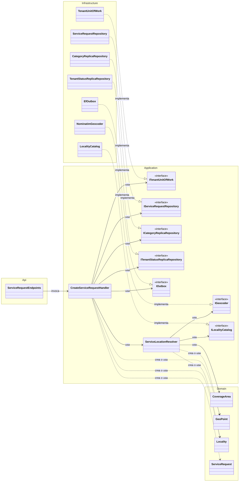

# ServiceRequest — código del caso de uso principal (despues)

Nivel 4 del modelo C4 ([c4model.com/diagrams](https://c4model.com/diagrams)): las clases del caso de uso principal, **creación de la solicitud (RF-07, RN-SR1, RN-SR9, RN-T1)**, desde su clase de entrada hasta los adaptadores, con un bloque por capa (SDD 10.3.1 y 10.3.2). El resto del servicio repite el patrón y está en su diagrama de componentes (C4-04) y en [`paquetes.mmd`](paquetes.mmd).

Generado desde el código compilado de `origin/develop` (`04391e4`) el 2026-11-23 con `tools/arquitectura/generar.py` (SCRUM-715). No se edita a mano.

**Cómo leerlo.** `-->` es una dependencia inyectada por el constructor; `..|>`, una clase que implementa un puerto (un adaptador de Infrastructure o un colaborador de Application); `..>`, un tipo del dominio que el caso de uso o sus colaboradores usan, según el IL (.NET) o el bytecode (Java). No se dibujan las dependencias transversales: `TimeProvider`.

| Clase | Capa | Archivo |
|---|---|---|
| `Api.Endpoints.ServiceRequestEndpoints` | Api | `src/QuickPatch.ServiceRequest.Api/Endpoints/ServiceRequestEndpoints.cs` |
| `Application.ServiceRequests.CreateServiceRequestHandler` | Application | `src/QuickPatch.ServiceRequest.Application/ServiceRequests/CreateServiceRequest.cs` |
| `Application.Abstractions.ITenantUnitOfWork` | Application | `` |
| `Infrastructure.Persistence.TenantUnitOfWork` | Infrastructure | `src/QuickPatch.ServiceRequest.Infrastructure/Persistence/TenantUnitOfWork.cs` |
| `Application.Abstractions.IServiceRequestRepository` | Application | `` |
| `Infrastructure.Persistence.ServiceRequestRepository` | Infrastructure | `src/QuickPatch.ServiceRequest.Infrastructure/Persistence/ServiceRequestRepository.cs` |
| `Application.Abstractions.ICategoryReplicaRepository` | Application | `` |
| `Infrastructure.Persistence.CategoryReplicaRepository` | Infrastructure | `src/QuickPatch.ServiceRequest.Infrastructure/Persistence/CategoryReplicaRepository.cs` |
| `Application.Abstractions.ITenantStatusReplicaRepository` | Application | `` |
| `Infrastructure.Persistence.TenantStatusReplicaRepository` | Infrastructure | `src/QuickPatch.ServiceRequest.Infrastructure/Persistence/TenantStatusReplicaRepository.cs` |
| `Application.Abstractions.IOutbox` | Application | `` |
| `Infrastructure.Persistence.EfOutbox` | Infrastructure | `src/QuickPatch.ServiceRequest.Infrastructure/Persistence/EfOutbox.cs` |
| `Application.ServiceRequests.ServiceLocationResolver` | Application | `src/QuickPatch.ServiceRequest.Application/ServiceRequests/ServiceLocationResolver.cs` |
| `Application.Abstractions.IGeocoder` | Application | `` |
| `Infrastructure.Geocoding.NominatimGeocoder` | Infrastructure | `src/QuickPatch.ServiceRequest.Infrastructure/Geocoding/NominatimGeocoder.cs` |
| `Application.Abstractions.ILocalityCatalog` | Application | `` |
| `Infrastructure.Persistence.LocalityCatalog` | Infrastructure | `src/QuickPatch.ServiceRequest.Infrastructure/Persistence/LocalityCatalog.cs` |
| `Domain.ServiceRequests.CoverageArea` | Domain | `src/QuickPatch.ServiceRequest.Domain/ServiceRequests/CoverageArea.cs` |
| `Domain.ServiceRequests.GeoPoint` | Domain | `src/QuickPatch.ServiceRequest.Domain/ServiceRequests/GeoPoint.cs` |
| `Domain.ServiceRequests.Locality` | Domain | `src/QuickPatch.ServiceRequest.Domain/ServiceRequests/Locality.cs` |
| `Domain.ServiceRequests.ServiceRequest` | Domain | `src/QuickPatch.ServiceRequest.Domain/ServiceRequests/ServiceRequest.cs` |
