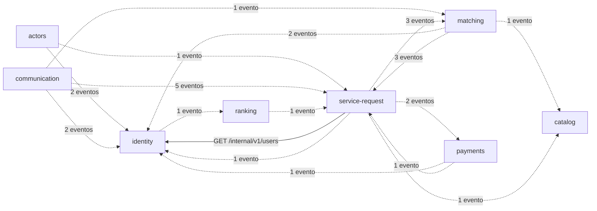

# Acoplamiento y cohesión entre los microservicios

Generado el 2026-11-23 con `python tools/arquitectura/servicios.py` (SCRUM-709) sobre los repositorios en `develop` (identity `6631e7f`, actors `2759bd6`, catalog `9c574e0`, service-request `04391e4`, matching `2816723`, ranking `9e4b500`, payments `a665f4f`, communication `92f11ed`) y el catálogo de topics `quickpatch-kafka` v0.11.0. La medición de cada servicio por dentro está en [`../despues/`](../despues/README.md).

## Resultado

| Criterio | Cumple | Detalle |
|---|---|---|
| Ningún servicio usa el código de otro | Sí | solo comparten `quickpatch-shared-dotnet`, que es código transversal (ADR-020) |
| Cada servicio tiene su propia base de datos | Sí | una base por servicio (ADR-014) |
| Cada evento tiene un solo productor, que es dueño de ese dato | Sí | 20 topics, un productor cada uno (ADR-006) |
| El catálogo de eventos coincide con el código | Sí | sin diferencias |
| Las llamadas síncronas entre servicios son mínimas y sin ciclos | Sí | 1 relación síncrona: service-request → identity (GET /internal/v1/users) |
| Cada servicio es cohesivo por dentro | Sí | 0 ciclos entre paquetes, 0 violaciones de capas y cohesión relacional promedio de 0.75 a 0.89 |

## Por servicio

Ce: servicios de los que depende (le publican eventos que consume o los llama). Ca: servicios que dependen de él. I = Ce / (Ca + Ce): cerca de 0, estable (muchos dependen de él); cerca de 1, dependiente. H: cohesión relacional promedio de sus paquetes (`generar.py`).

| Servicio | Ce | de ellas síncronas | Ca | I | Eventos que publica | Eventos que consume | H | Ciclos entre paquetes | Violaciones | Base |
|---|---|---|---|---|---|---|---|---|---|---|
| identity | 1 | 0 | 5 | 0.17 | 3 | 1 | 0.79 | 0 | 0 | `db_identity` |
| actors | 2 | 0 | 0 | 1.0 | 0 | 3 | 0.88 | 0 | 0 | `db_actors` |
| catalog | 0 | 0 | 2 | 0.0 | 1 | 0 | 0.86 | 0 | 0 | `db_catalog` |
| service-request | 4 | 1 | 5 | 0.44 | 9 | 7 | 0.77 | 0 | 0 | `db_service_request` |
| matching | 3 | 0 | 2 | 0.6 | 4 | 6 | 0.75 | 0 | 0 | `db_matching` |
| ranking | 1 | 0 | 1 | 0.5 | 1 | 1 | 0.89 | 0 | 0 | `db_ranking` |
| payments | 2 | 0 | 1 | 0.67 | 2 | 2 | 0.77 | 0 | 0 | `db_payments` |
| communication | 3 | 0 | 0 | 1.0 | 0 | 8 | 0.83 | 0 | 0 | `db_communication` |

## Dependencias entre servicios

Una flecha va del servicio que depende al que provee: el consumidor de un evento depende de su productor, y el que llama, del llamado. Las continuas son síncronas (HTTP); las punteadas, eventos de Kafka.

## Eventos (catálogo contrastado con el código)

| Topic | Productor | Consumidores |
|---|---|---|
| `service-request.created` | service-request | matching, communication, actors |
| `catalog.category-changed` | catalog | service-request, matching |
| `technician.registered` | identity | matching, communication, payments, actors |
| `technician.verification-changed` | identity | matching, communication, actors |
| `matching.offer-created` | matching | communication |
| `matching.technician-assigned` | matching | service-request |
| `matching.no-technician-available` | matching | service-request |
| `matching.search-resumed` | matching | service-request |
| `service-request.status-changed` | service-request | communication |
| `service-request.cancelled` | service-request | matching |
| `service-request.quoted` | service-request | communication |
| `service-request.quote-accepted` | service-request | communication |
| `service-request.quote-rejected` | service-request | communication |
| `service-request.started` | service-request | — (sin consumidores hoy) |
| `service-request.completed` | service-request | matching, payments |
| `payment.approved` | payments | service-request |
| `payment.rejected` | payments | service-request |
| `service-request.rated` | service-request | ranking |
| `ranking.technician-reputation-changed` | ranking | identity |
| `tenant.status-changed` | identity | service-request |

**Diferencias entre el catálogo y el código:** ninguna.

**Consumidores previstos** (en el catálogo, documentados como fuera del alcance actual): 
- `matching` en `catalog.category-changed`: previsto, no implementado (DD 9 y SAD 4.2.2: Matching aún no replica los nombres de las categorías)

## Cómo leerlo

- **Bajo acoplamiento** entre microservicios no es «cero dependencias»: un flujo de negocio cruza varios servicios. Lo que importa es el medio y la dirección. Los eventos (ADR-006, ADR-007) desacoplan en el tiempo: el productor no conoce a sus consumidores ni espera que estén arriba. Una llamada síncrona sí acopla la disponibilidad, por eso se mide aparte y debe ser la excepción.
- **Ciclos.** Entre servicios, los ciclos de eventos son coreografía normal (ServiceRequest publica `service-request.created`, Matching responde con `matching.technician-assigned`); lo que no puede haber es un ciclo de llamadas síncronas, que encadenaría las caídas.
- **Alta cohesión** de un servicio: es dueño de sus datos (su base, ADR-014), es el único productor de los eventos de su agregado, y por dentro sus clases trabajan juntas (cohesión relacional, sin ciclos ni violaciones de capas).
