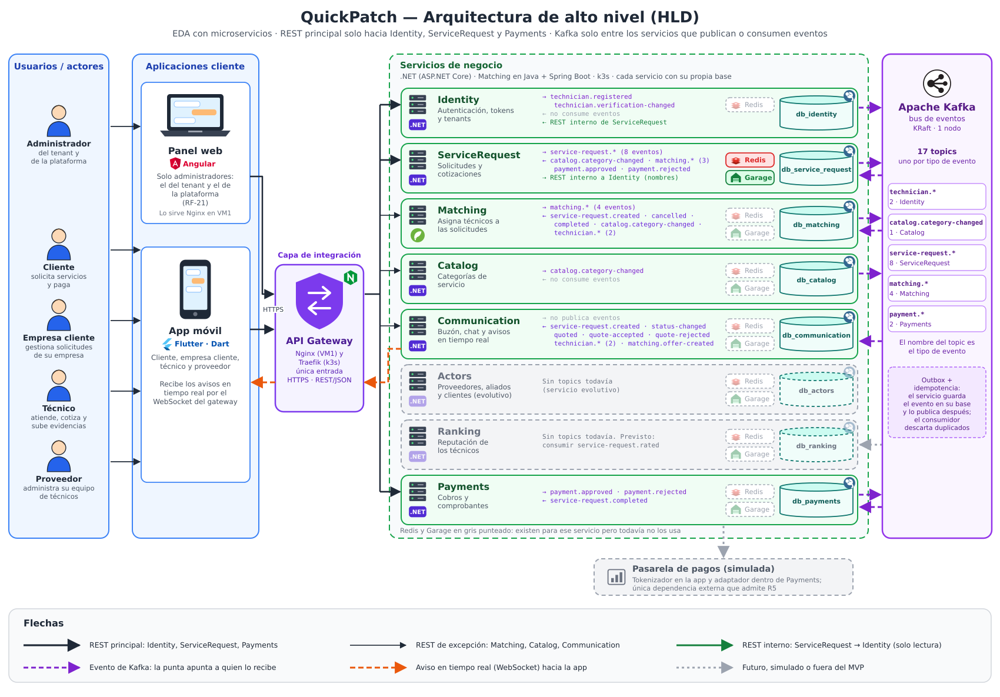
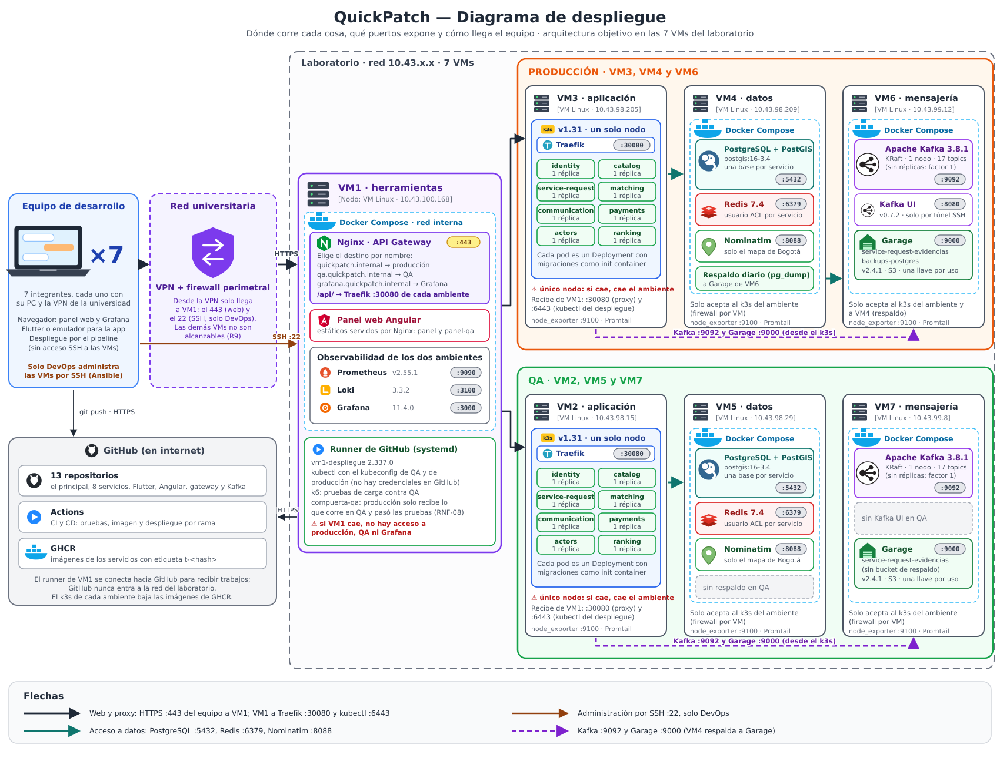
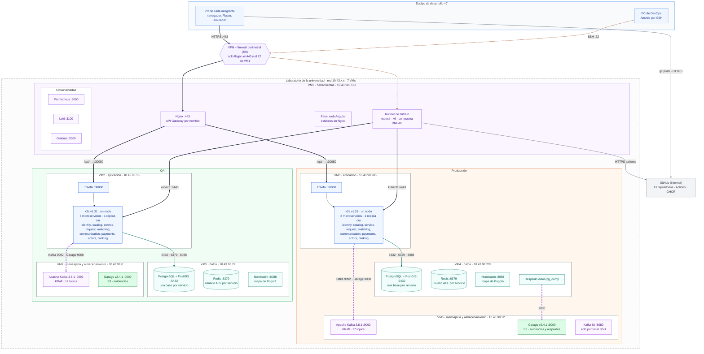

# Diagramas de alto nivel y de despliegue

Dos diagramas que explican la arquitectura de QUICKPATCH sin leer el SAD: **alto nivel** (quién habla con quién y por cuál canal) y **despliegue** (dónde corre cada pieza y qué puertos abre). Cada uno está en dos formas: ilustrado (SVG y PNG) y en Mermaid, que GitHub dibuja en esta misma página.

| Diagrama | Ilustrado | Mermaid |
|---|---|---|
| Alto nivel (HLD) | [`01-hld.svg`](01-hld.svg) · [`01-hld.png`](01-hld.png) | [Ver abajo](#alto-nivel-mermaid) |
| Despliegue | [`05-despliegue.svg`](05-despliegue.svg) · [`05-despliegue.png`](05-despliegue.png) | [Ver abajo](#despliegue-mermaid) |

## Alto nivel

**Qué muestra.** Los actores entran por la app móvil Flutter (cliente, empresa cliente, técnico y proveedor) o por el panel web Angular (administradores). Todo pasa por el API Gateway. Los servicios se coordinan por eventos de Kafka y cada uno tiene su propia base.

**Cómo se lee**

- **REST principal:** el gateway solo llega a Identity, ServiceRequest y Payments (ADR-025). Matching, Catalog y Communication reciben REST solo por las excepciones que lista ese ADR (acciones del técnico, administración del catálogo, buzón, chat y canal en tiempo real). ServiceRequest llama a Identity por REST interno, solo lectura (nombres por lote).
- **Kafka:** solo lo usan los servicios con eventos. Actors y Ranking no tienen ningún topic hoy; Ranking consumirá `service-request.rated`, que está previsto en el DD pero no existe todavía.
- **Redis y Garage:** hoy solo ServiceRequest los usa (coordinación de tareas programadas y evidencias). Los demás tienen el usuario de Redis y el bucket creados, pero reservados (Documento de Infraestructura, sección 3.4).
- **Tiempo real:** Communication avisa a la app por WebSocket a través del gateway (ADR-023). No hay proveedor de correo ni de push (ADR-024).
- **Pasarela de pagos:** simulada dentro de Payments (ADR-009); es la única dependencia externa que admite R5.

### Quién publica y quién consume

Fuente: `apps/kafka/topics/topics.yaml` (quickpatch-kafka v0.9.0, 17 topics).

| Servicio | Publica | Consume |
|---|---|---|
| Identity | `technician.registered`, `technician.verification-changed` | — |
| Catalog | `catalog.category-changed` | — |
| ServiceRequest | `service-request.*` (8: created, status-changed, cancelled, quoted, quote-accepted, quote-rejected, started, completed) | `catalog.category-changed`, `matching.technician-assigned`, `matching.no-technician-available`, `matching.search-resumed`, `payment.approved`, `payment.rejected` |
| Matching | `matching.*` (4: offer-created, technician-assigned, no-technician-available, search-resumed) | `service-request.created`, `service-request.cancelled`, `service-request.completed`, `catalog.category-changed`, `technician.*` (2) |
| Communication | — | `service-request.created`, `service-request.status-changed`, `service-request.quoted`, `service-request.quote-accepted`, `service-request.quote-rejected`, `technician.*` (2), `matching.offer-created` |
| Payments | `payment.approved`, `payment.rejected` | `service-request.completed` |
| Actors | — (sin topics) | — |
| Ranking | — (sin topics) | previsto: `service-request.rated` |

`service-request.started` no tiene consumidores todavía.

### Alto nivel (Mermaid)

```mermaid
flowchart TB

    subgraph ACT["Usuarios / actores"]
        ADM["Administrador<br/>tenant y plataforma"]
        CLI["Cliente"]
        EMP["Empresa cliente"]
        TEC["Técnico"]
        PRO["Proveedor"]
    end
    subgraph CLIENTES["Aplicaciones cliente"]
        WEB["Panel web<br/>Angular · Nginx en VM1"]
        APP["App móvil<br/>Flutter"]
    end
    GW{{"API Gateway<br/>Nginx (VM1) + Traefik (k3s)<br/>única entrada · HTTPS · REST/JSON"}}
    subgraph SERV["Servicios de negocio · k3s · cada servicio con su propia base"]
        ID["Identity<br/>.NET"] --- DID[("db_identity")]
        SR["ServiceRequest<br/>.NET"] --- DSR[("db_service_request")]
        MT["Matching<br/>Java + Spring Boot"] --- DMT[("db_matching")]
        CT["Catalog<br/>.NET"] --- DCT[("db_catalog")]
        CM["Communication<br/>.NET"] --- DCM[("db_communication")]
        PY["Payments<br/>.NET"] --- DPY[("db_payments")]
        AC["Actors<br/>.NET · evolutivo"] --- DAC[("db_actors")]
        RK["Ranking<br/>.NET · evolutivo"] --- DRK[("db_ranking")]
        SR --- RD["Redis<br/>coordinación de tareas"]
        SR --- GR["Garage<br/>evidencias"]
    end
    KF{{"Apache Kafka · 17 topics<br/>technician.* (2) · catalog.category-changed<br/>service-request.* (8) · matching.* (4) · payment.* (2)"}}
    PG["Pasarela de pagos<br/>simulada"]
    ADM --> WEB
    CLI --> APP
    EMP --> APP
    TEC --> APP
    PRO --> APP
    WEB -->|"HTTPS"| GW
    APP -->|"HTTPS"| GW
    GW -->|"REST principal"| ID
    GW -->|"REST principal"| SR
    GW -->|"REST principal"| PY
    GW -->|"excepción ADR-025"| MT
    GW -->|"excepción ADR-025"| CT
    GW -->|"excepción ADR-025"| CM
    SR -->|"nombres (lectura)"| ID
    CM -.->|"WebSocket"| GW
    GW -.->|"WebSocket"| APP
    ID -.->|"technician.*"| KF
    CT -.->|"catalog.*"| KF
    SR -.->|"service-request.*"| KF
    KF -.->|"consume"| SR
    MT -.->|"matching.*"| KF
    KF -.->|"consume"| MT
    PY -.->|"payment.*"| KF
    KF -.->|"consume"| PY
    KF -.->|"consume"| CM
    KF -.->|"service-request.rated (previsto)"| RK
    PY -.->|"simulada (ADR-009)"| PG
    linkStyle 10,11,12,13,14,15,16 stroke:#1f2937,stroke-width:2.5px
    linkStyle 17,18,19 stroke:#1f2937,stroke-width:3px
    linkStyle 20,21,22 stroke:#1f2937,stroke-width:1.5px
    linkStyle 23 stroke:#15803d,stroke-width:3px
    linkStyle 24,25 stroke:#ea580c,stroke-width:2.5px,stroke-dasharray:8 5
    linkStyle 26,27,28,29,30,31,32,33,34 stroke:#7e22ce,stroke-width:2.5px,stroke-dasharray:8 5
    linkStyle 35,36 stroke:#9ca3af,stroke-width:2.5px,stroke-dasharray:3 5

    classDef actor fill:#eff6ff,stroke:#3b82f6,color:#1e3a8a
    classDef cliente fill:#eff6ff,stroke:#3b82f6,color:#1e3a8a
    classDef gw fill:#f5f3ff,stroke:#7c3aed,color:#4c1d95
    classDef srv fill:#f0fdf4,stroke:#16a34a,color:#14532d
    classDef fut fill:#f3f4f6,stroke:#9ca3af,color:#6b7280,stroke-dasharray:5 4
    classDef db fill:#f0fdfa,stroke:#0f766e,color:#115e59
    classDef kafka fill:#faf5ff,stroke:#9333ea,color:#581c87
    classDef cache fill:#fee2e2,stroke:#dc2626,color:#991b1b
    classDef store fill:#dcfce7,stroke:#15803d,color:#14532d
    class ADM,CLI,EMP,TEC,PRO actor
    class WEB,APP cliente
    class GW gw
    class ID,SR,MT,CT,CM,PY srv
    class AC,RK,PG fut
    class DID,DSR,DMT,DCT,DCM,DPY,DAC,DRK db
    class KF kafka
    class RD cache
    class GR store
    style ACT fill:#f8fafc,stroke:#3b82f6
    style CLIENTES fill:#f8fafc,stroke:#3b82f6
    style SERV fill:#f8fafc,stroke:#16a34a,stroke-dasharray:6 4
```

Mermaid no dibuja los íconos ni deja controlar la posición; el ilustrado es la versión de referencia. Las flechas punteadas moradas son eventos de Kafka (`consume` significa que el servicio los recibe; la lista de topics está en la tabla de arriba).

## Despliegue

**Qué muestra.** La arquitectura objetivo de las 7 VMs del laboratorio (ADR-022): VM1 de herramientas, tres VMs de producción (aplicación, datos, mensajería y almacenamiento) y tres de QA con la misma forma. Incluye los PC del equipo (7 integrantes), la VPN y el firewall perimetral, GitHub y GHCR.

**Cómo se lee**

- **Una sola entrada:** desde la VPN solo llega a VM1 el 443 (web) y el 22 (SSH, solo DevOps). Nginx de VM1 elige el ambiente por nombre y reenvía `/api/` al Traefik de cada k3s (:30080).
- **Despliegue:** el runner de VM1 se conecta hacia GitHub, baja el trabajo y aplica `kubectl` (:6443) en los dos k3s. La compuerta RNF-08 deja pasar a producción solo lo que corre en QA y pasó las pruebas.
- **Datos y eventos:** cada k3s llega a PostgreSQL, Redis y Nominatim (VM de datos) y a Kafka y Garage (VM de mensajería); VM4 respalda cada día en el Garage de VM6.
- **Límites a la vista:** un solo nodo de k3s por ambiente y VM1 como punto único de entrada.

> [!NOTE]
> El diagrama muestra cómo quedan los dos ambientes con los 8 microservicios y Nominatim en producción. A la fecha de este PR (22 de octubre de 2026), producción corre 4 de los 8 servicios y QA corre 6; Nominatim de producción está pendiente de desplegar (ver `docs/infrastructure/INFRASTRUCTURE.md`).

### Despliegue (Mermaid)

## Fuentes comprobadas

- `apps/kafka/topics/topics.yaml` (productor y consumidores por topic).
- ADR-003, ADR-006, ADR-007, ADR-009, ADR-014, ADR-016, ADR-017, ADR-022, ADR-023, ADR-024 y ADR-025.
- `docs/infrastructure/INFRASTRUCTURE.md`: secciones 3.2 (VMs e IP), 3.3 (conexiones permitidas), 3.4 (recursos por servicio) y 10.4 (SSH).
- `docs/design/DD.md`, sección 3 (Actors y Ranking sin entidades todavía).
