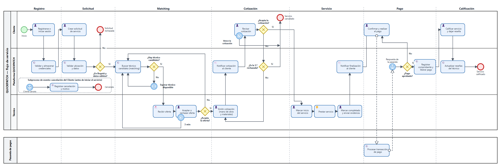

# Especificación de Requisitos de Software (SRS)
## QUICKPATCH — Ciudad de Bogotá D.C.

| | |
|---|---|
| **Curso** | Arquitectura de Software |
| **Proyecto Jira** | SCRUM — Arquitectura de Software |
| **Versión del documento** | 5.0 (MVP, incremento del Sprint 4) |
| **Historia en Jira** | SCRUM-403 (subtareas SCRUM-404, SCRUM-405 y SCRUM-406) |
| **Responsable** | Angy Bautista (Product Owner) |
| **Estado** | Aprobado por el Product Owner el 14 de octubre de 2026 (SCRUM-406). Pendiente: revisión de la línea base de la sección 1.3 (Sebastián Sánchez) y el PR a `develop` |
| **Estándar de referencia** | IEEE Std 830-1998 |

---

## Índice

1. [Introducción](#1-introducción)
2. [Descripción General](#2-descripción-general)
3. [Usuarios del Sistema](#3-usuarios-del-sistema)
4. [Módulos del Producto](#4-módulos-del-producto)
5. [Requisitos Específicos](#5-requisitos-específicos)
6. [Matriz Comparativa](#6-matriz-comparativa)
7. [Apéndices](#7-apéndices)
8. [Referencias](#referencias)

---

## 1. Introducción

### 1.1 Propósito

El propósito de este documento es especificar de manera clara, completa y verificable los requisitos de software para la **Versión 5 (MVP, incremento del Sprint 4)** de la plataforma multi-tenant de servicios técnicos para el hogar y empresas. Este documento sigue la estructura general del estándar IEEE 830 y está dirigido a:

- El equipo de desarrollo, como guía para el diseño, la implementación y las pruebas del sistema.
- El docente y evaluadores del curso de Arquitectura de Software, como soporte académico del proyecto.
- Futuros integrantes del equipo, como documentación de referencia del alcance funcional del MVP.

Los requisitos de este documento son la entrada del SAD: los drivers, killers, restricciones y escenarios de calidad del SAD (secciones 1 a 3) citan los RF y RNF definidos aquí.

**Novedades de la versión 5.** Los requisitos del flujo del técnico que entran en el incremento (RF-09, RF-10, RF-13 y RF-19) tienen criterios de aceptación verificables, con su historia de Jira, la regla del DD que los sustenta y los casos de prueba que los verifican (sección 5.5, SCRUM-404). La contradicción entre la restricción R5 del SAD y las interfaces RIE-02 y RIE-03 queda resuelta según el ADR-024 del SAD: R5 no cambia, la geocodificación corre dentro de la infraestructura y las notificaciones del MVP se muestran dentro de la app (sección 5.4, SCRUM-405). Los RNF indican el escenario de calidad del SAD que los mide (sección 5.3) y la matriz de trazabilidad enlaza cada requisito con su historia y sus casos de prueba (sección 7.1).

### 1.2 Definiciones, Acrónimos y Abreviaturas

| Término | Definición |
|---|---|
| MVP | Minimum Viable Product — Producto Mínimo Viable. |
| SRS | Software Requirements Specification — Especificación de Requisitos de Software. |
| SAD | Software Architecture Document — Documento de Arquitectura de Software. |
| DD | Detailed Design — Diseño Detallado. |
| Tenant | Empresa oferente de servicios técnicos que opera dentro de la plataforma, identificada por su NIT, con sus propios usuarios, técnicos, catálogo de servicios y datos aislados de los demás tenants. Los clientes hogar y las empresas cliente son usuarios de un tenant, no tenants propios (SAD, sección 7.1). |
| HU | Historia de Usuario. |
| RF | Requisito Funcional. |
| RNF | Requisito No Funcional. |
| Feature | Agrupación lógica de historias de usuario relacionadas dentro de una misma épica, usada en Jira como etiqueta (*label*) para organizar el backlog. |
| Módulo de Dominio | Componente del sistema que implementa directamente una capacidad de negocio central (ej. matching, pagos). |
| Módulo Transversal | Componente de soporte utilizado por varios (o todos) los módulos de dominio (ej. seguridad, multi-tenancy, logging). |
| PCI-DSS | Payment Card Industry Data Security Standard — estándar de seguridad para el manejo de datos de tarjetas de pago. |
| Matching | Proceso automático mediante el cual el sistema asigna un técnico disponible a una solicitud de servicio. |
| Admin del tenant | Usuario que administra un tenant: verifica y suspende a sus técnicos y proveedores y supervisa su operación. Solo actúa sobre su propio tenant. |
| Admin de plataforma | Usuario de la empresa dueña de la plataforma que administra los tenants (alta, activación y desactivación). |
| App móvil | Aplicación Flutter (iOS/Android), canal de Clientes, Empresas, Técnicos y Proveedores. |
| Panel web | Aplicación Angular de uso exclusivo de los administradores (del tenant y de plataforma). No tiene páginas públicas. |
| Cotización | Precio de mano de obra y materiales que el Técnico asignado propone para una solicitud, y que el Cliente acepta o rechaza antes de iniciar el servicio. |
| Evidencia fotográfica | Foto del trabajo realizado que el Técnico adjunta a la solicitud antes de marcarla como completada. |
| BPMN | Business Process Model and Notation — notación para modelar procesos de negocio. |
| Proveedor | Empresa u organización que agrupa y administra un equipo de técnicos dentro de la plataforma. |
| Oferta | Propuesta de una solicitud que el motor de matching hace a un único técnico candidato. El técnico la acepta o la rechaza antes de que venza (DD, tabla `matching_attempts`). |
| Localidad | Cada una de las 20 divisiones administrativas de Bogotá D.C. El técnico define su zona de cobertura como una lista de localidades (DD, tabla `localities`). |
| Criterio de aceptación | Condición verificable que un requisito debe cumplir para darse por implementado. Cada criterio de la sección 5.5 se puede comprobar con una prueba del Documento de Pruebas (TD). |

### 1.3 Línea base de documentos

Este SRS se alinea con los documentos de `develop` del repositorio `quickpatch` consultados el **10 de octubre de 2026**. La resolución de R5 frente a RIE-02 y RIE-03 incorpora además el SAD 2.27 (ADR-024, 12 de octubre de 2026). Las demás secciones citan los documentos por sección y no por versión, para que una nueva versión de ellos no deje desactualizado el SRS. Si un documento cambia una sección citada, la referencia se revisa en la siguiente versión del SRS.

| Documento | Versión en la línea base | Siguiente versión (Jira) |
|---|---|---|
| SAD — Documento de Arquitectura de Software | 2.25 (R5, RIE-02 y RIE-03: 2.27, ADR-024) | SAD V4 (SCRUM-411) |
| DD — Diccionario de Datos y Contratos | 3.1 | DD V4 (SCRUM-416) |
| SDD — Documento de Diseño de Software | V2 (modelo C4) | SDD V3 (SCRUM-424) |
| TD — Documento de Pruebas | 1.4 | TD V2 (SCRUM-399) |
| Documento de Infraestructura | 2.6 | Infraestructura V3 (SCRUM-420) |
| Backlog de producto (Jira, proyecto SCRUM) | Consulta del 10 oct 2026 (estados de las épicas 6 y 7: 14 oct 2026) | Backlog V5 (SCRUM-407) |

> SCRUM-403 pide alinear el SRS V5 con el SAD V4 y el DD V4. Cuando se redactó esta versión ninguno estaba completo, así que usa las versiones de la tabla y deja en la sección 7.4 los cambios que el SAD V4 y el DD V4 deben incorporar. Al 14 de octubre de 2026, `develop` ya tiene el SAD 2.28 (ADR-023, ADR-024 y la compuerta de RNF-08), el DD 4.0 y el Documento de Infraestructura 3.3; el TD sigue en 1.4 y el SDD en V2. De esos cambios, esta versión solo incorpora el ADR-024, así que cita el ADR-024 con una línea base que todavía no lo incluye. **El Product Owner aprobó esta versión el 14 de octubre de 2026 con la línea base pendiente:** falta llevar la tabla a esas versiones y revisar las secciones citadas que cambiaron.

---

## 2. Descripción General

### 2.1 Perspectiva del Producto

La plataforma es un sistema nuevo, independiente, compuesto por:

- Una **app móvil** para **Clientes**, **Empresas**, **Técnicos** y **Proveedores**: creación, cotización, seguimiento, pago y calificación de solicitudes; disponibilidad, ejecución y cierre de servicios; gestión del equipo de técnicos.
- Un **panel web** de uso exclusivo de los administradores (**Admin del tenant** y **Admin de plataforma**): operación, verificación de técnicos y gestión de tenants. El panel web no tiene sitio público.
- Un backend con arquitectura **multi-tenant**, un motor de *matching*, y una pasarela de pagos certificada **PCI-DSS** integrada mediante un proveedor externo.

**Canales por rol**

| Rol | Canal |
|---|---|
| Cliente | App móvil |
| Empresa (usuarios autorizados) | App móvil |
| Técnico | App móvil |
| Proveedor | App móvil |
| Admin del tenant | Panel web |
| Admin de plataforma | Panel web |

### 2.2 Funciones del Producto

A alto nivel, el MVP debe permitir:

1. Registro y autenticación segura de usuarios, con aislamiento de datos por tenant.
2. Creación de solicitudes de servicio técnico por parte de Clientes y Empresas, cotización del Técnico y aceptación del Cliente antes de iniciar el servicio.
3. Asignación automática (matching) de un técnico disponible a cada solicitud.
4. Ejecución del servicio por parte del Técnico, con evidencia fotográfica al cerrarlo, y seguimiento en tiempo real para el Cliente.
5. Procesamiento seguro de pagos y generación de comprobantes/facturas.
6. Calificación del servicio por parte del Cliente.
7. Administración operativa: verificación de técnicos por parte del Admin del tenant y gestión de tenants por parte del Admin de plataforma.
8. Infraestructura mínima de CI/CD, pruebas automatizadas, logging/monitoreo y cifrado de datos sensibles.

### 2.3 Restricciones

- El manejo de datos de tarjetas de pago debe cumplir el estándar **PCI-DSS**; no se deben almacenar datos completos de tarjeta en los servidores propios del sistema.
- La arquitectura debe garantizar **aislamiento lógico** de datos entre tenants.
- El MVP se limita a la ciudad de **Bogotá D.C.** como zona de cobertura inicial: una solicitud con ubicación fuera de Bogotá se rechaza.
- El desarrollo debe ajustarse al tiempo y alcance definidos para el curso de Arquitectura de Software.
- El sistema corre en las 7 máquinas virtuales del laboratorio de la universidad, sin servicios con costo (SAD, restricciones R5 y R10). Según el ADR-022 del SAD, producción ocupa VM3 (aplicación), VM4 (PostgreSQL y Redis) y VM6 (Kafka y almacenamiento de evidencias); QA es una copia en VM2, VM5 y VM7, y VM1 es la VM de herramientas y observabilidad y la única entrada a los dos ambientes.
- La única dependencia externa de producción es la pasarela de pagos (SAD, R5). La geocodificación de direcciones (RIE-02) corre dentro de las VMs y las notificaciones del MVP (RIE-03) se entregan dentro de la app, sin proveedores externos (SAD, ADR-024).
- El sistema debe cumplir la normativa colombiana que aplica al producto: protección de datos personales (Ley 1581 de 2012), protección al consumidor (Ley 1480 de 2011) y facturación electrónica (SAD, killers K12 a K14).
- El técnico no es subordinado de la plataforma: el sistema no impone turnos, exclusividad ni sanciones por rechazar una solicitud (SAD, restricción R12).

**Fuera del alcance del MVP:** modo sin conexión en la app móvil, sitio web público, chat dentro de la aplicación y módulo de reclamos (SAD, sección 1.3).

### 2.4 Supuestos y Dependencias

- Se asume disponibilidad de un proveedor de pagos externo certificado PCI-DSS (pasarela de pagos) para el procesamiento de transacciones.
- Se asume que el mapa de OpenStreetMap de Bogotá tiene la mayoría de las direcciones que escriben los Clientes. Cuando el geocodificador no encuentra una dirección o no responde a tiempo, la app pide al Cliente compartir la ubicación de su dispositivo (RIE-02).
- Se asume que la red del laboratorio permite conexiones salientes desde producción hacia la pasarela de pagos. Lo debe confirmar DevOps (SAD, restricción R9).
- Se asume conectividad a internet estable por parte de Clientes y Técnicos para el uso de la plataforma.
- El listado inicial de técnicos y proveedores se registra manualmente para efectos de demostración del MVP.

---

## 3. Usuarios del Sistema

La plataforma QUICKPATCH está diseñada para seis tipos de usuario, cada uno con necesidades, nivel de acceso y objetivos distintos dentro del ciclo de negocio (*Cliente solicita → Técnico cotiza → Cliente acepta → Técnico ejecuta → Cliente paga → Cliente califica*). Todos los usuarios pertenecen a un tenant, la empresa oferente que presta los servicios. El Admin de plataforma pertenece al tenant dueño de la plataforma.

| Rol | Descripción | Necesidades | Nivel de acceso |
|---|---|---|---|
| Cliente | Persona natural que solicita servicios técnicos para el hogar. No requiere conocimientos técnicos previos. Usa la app móvil. | Solicitar un servicio rápido y confiable, conocer el precio antes de aceptarlo, hacer seguimiento en tiempo real, pagar de forma segura y calificar la experiencia. | Autenticado — solo sus propias solicitudes y pagos. |
| Empresa | Cuenta corporativa de una empresa cliente (ej. una compañía que requiere mantenimiento en sus sedes) que solicita y paga servicios técnicos a nombre de la organización. Es una cuenta de usuario dentro del tenant, no un tenant propio. Sus usuarios autorizados usan la app móvil. | Centralizar solicitudes y pagos de varias sedes bajo una sola cuenta; delegar la solicitud a distintos usuarios autorizados. | Autenticado — solicitudes y pagos de su cuenta corporativa. |
| Técnico | Persona certificada que ejecuta los servicios técnicos solicitados. Puede operar de forma independiente o vinculada a un Proveedor. Decide su disponibilidad y puede rechazar solicitudes sin penalización. Usa la app móvil. | Recibir solicitudes acordes a su especialidad y zona, cotizar el trabajo, gestionar su disponibilidad, y recibir el pago de forma confiable. | Autenticado — solo sus propias solicitudes y pagos. |
| Proveedor | Empresa que administra un equipo de técnicos dentro de la plataforma. Usa la app móvil. | Administrar su equipo de técnicos y visualizar el desempeño y los pagos generados por su equipo. | Autenticado — su equipo y su tenant asociado. |
| Admin del tenant | Administrador de la empresa oferente (el tenant). Usa el panel web. | Verificar, aprobar y suspender técnicos y proveedores, monitorear la operación de su tenant y cancelar solicitudes cuando sea necesario. | Autenticado con privilegios elevados — solo su propio tenant. |
| Admin de plataforma | Administrador de la empresa dueña de la plataforma. Usa el panel web. | Dar de alta, activar y desactivar tenants, y monitorear la operación de todos ellos. | Autenticado con privilegios elevados — todos los tenants, solo para su administración. |

### 3.1 Flujo principal del Cliente

La Figura 1 modela en notación BPMN el flujo de negocio de QUICKPATCH, desde que el Cliente se registra hasta que califica el servicio. El pool de QUICKPATCH tiene un carril por participante (Cliente, Plataforma QUICKPATCH y Técnico) y se divide en siete fases: registro, solicitud, matching, cotización, servicio, pago y calificación. La pasarela de pagos es una empresa externa, por eso va en un pool aparte y se comunica con QUICKPATCH por flujos de mensaje (líneas punteadas).

El ícono de cada tarea indica quién la hace: 👤 una persona en la app o el panel (tarea de usuario), ⚙️ el sistema por sí solo (tarea de servicio), ✋ un trabajo físico fuera del sistema (tarea manual), y ✉️ o 📩 el envío o la recepción de un aviso. Los rombos son compuertas exclusivas; los relojes pegados al borde de una tarea son temporizadores (la oferta vence a los 3 minutos y la cotización tiene fecha de vencimiento), y el evento condicional del matching representa la espera hasta que haya un técnico disponible. El diagrama incluye los caminos alternos: la solicitud rechazada por ubicación o datos inválidos (RF-07), la espera y la reasignación del matching (RF-09, RF-10), el límite de 3 cotizaciones (RF-35), el reintento de un pago rechazado (RF-22) y, como subproceso de evento, la cancelación por parte del Cliente antes de iniciar el servicio (RF-36).

**Figura 1: Flujo de negocio de QUICKPATCH (BPMN)**

_Clic en la figura para abrirla en SVG, que se puede ampliar sin perder nitidez. La fuente editable es `diagrams/flujo-negocio.svg`; el PNG se exporta de ella con el mismo nombre._

_Requisitos que cubre cada fase: registro (RF-01, RF-03), creación (RF-07, RF-08, RNF-11, RIE-02), asignación y reasignación (RF-09, RF-10, RF-13, RNF-05), cotización (RF-34, RF-35), ejecución y cierre con evidencia (RF-14, RF-15), seguimiento (RF-11, RNF-06), pago y comprobante (RF-22 a RF-24), calificación (RF-12) y cancelación (RF-36)._

---

## 4. Módulos del Producto

El sistema se organiza en dos tipos de módulos: los **módulos de dominio**, que implementan directamente una capacidad central del negocio, y los **módulos transversales**, que dan soporte de infraestructura a todos (o varios) de los módulos de dominio y no son visibles como una función de negocio independiente para el usuario final.

### 4.1 Módulos de Dominio

| Módulo | Descripción | Épica / Features |
|---|---|---|
| Gestión de Usuarios y Cuentas | Registro y autenticación de Cliente, Técnico/Proveedor y Empresa; administración de roles y permisos. | SCRUM-7 (F1.1, F1.3, F1.4) |
| Solicitudes y Matching | Creación de solicitudes de servicio, respuesta a la cotización, cancelación antes de iniciar el servicio y motor de asignación automática de técnico (matching). | SCRUM-8 (F2.1, F2.2) |
| Seguimiento y Calificación | Seguimiento en tiempo real del estado de la solicitud y calificación del servicio al finalizar. | SCRUM-8 (F2.3, F2.4) |
| Ejecución de Servicios (Técnico) | Gestión de disponibilidad, detalle, cotización y cierre con evidencia fotográfica de solicitudes asignadas, historial de servicios. | SCRUM-9 (F3.1, F3.2, F3.4) |
| Gestión de Equipos (Proveedor) | Administración del equipo de técnicos por parte de un Proveedor. | SCRUM-9 (F3.3) |
| Administración y Operaciones | Panel web de los administradores: dashboard operativo y aprobación/suspensión de técnicos (Admin del tenant), gestión de tenants (Admin de plataforma). | SCRUM-10 (F4.1, F4.2, F4.3) |
| Pagos y Facturación | Cobro del servicio (Cliente/Empresa), generación de comprobantes y registro de pagos recibidos. | SCRUM-11 (F5.1, F5.2, F5.3) |

### 4.2 Módulos Transversales

| Módulo | Descripción | Épica / Features |
|---|---|---|
| Multi-tenancy | Aísla lógicamente los datos de cada tenant (*tenant_id*) en todas las operaciones de lectura/escritura del sistema. Utilizado por **todos** los módulos de dominio. | SCRUM-7 (F1.2) |
| Seguridad y Control de Acceso | Autenticación, control de acceso basado en roles (RBAC) y cifrado de datos sensibles en tránsito y en reposo. | SCRUM-7 (F1.3), SCRUM-12 (F6.4) |
| Integración de Pagos (PCI-DSS) | Capa de integración con la pasarela de pagos externa certificada PCI-DSS, usada por el módulo de Pagos y por cualquier flujo que requiera cobro. | SCRUM-11 (F5.1) |
| Notificaciones | Envío de confirmaciones y alertas dentro de la app (canal en tiempo real y buzón de notificaciones; SAD, ADR-023 y ADR-024) usadas por Registro, Matching, Seguimiento y Pagos. | Transversal a SCRUM-7, 8, 11 |
| Logging y Monitoreo | Registro centralizado de errores y alertas de disponibilidad, usado por todos los módulos del sistema. | SCRUM-12 (F6.3) |
| Integración y Despliegue Continuo (CI/CD) | Infraestructura de build, pruebas automáticas y despliegue que da soporte al desarrollo de todos los módulos anteriores. | SCRUM-12 (F6.1, F6.2) |
| Gestión del Proyecto y Documentación | Proceso de gestión de versiones de documentos (SRS, SAD, SDD, DD, etc.), control de cambios en el equipo y seguimiento de entregables. | SCRUM-120 (F7.1) |

**Relación entre módulos transversales y módulos de dominio**

| Módulo Transversal | Módulos de Dominio a los que da soporte |
|---|---|
| Multi-tenancy | Todos los módulos de dominio (Usuarios, Solicitudes, Ejecución, Administración, Pagos). |
| Seguridad y Control de Acceso | Todos los módulos de dominio. |
| Integración de Pagos (PCI-DSS) | Pagos y Facturación. |
| Notificaciones | Gestión de Usuarios, Solicitudes y Matching, Pagos y Facturación. |
| Logging y Monitoreo | Todos los módulos de dominio. |
| CI/CD | Todos los módulos de dominio (indirectamente, como infraestructura de entrega). |
| Gestión del Proyecto y Documentación | Todos los módulos del proyecto (documentación y proceso). |

---

## 5. Requisitos Específicos

Los requisitos funcionales se agrupan según las épicas definidas en el backlog del proyecto (Jira, proyecto SCRUM). A su vez, dentro de cada épica, las historias de usuario se agrupan en **Features** (agrupaciones lógicas registradas como etiquetas en Jira). Cada requisito conserva la trazabilidad con su historia de usuario de origen mediante su identificador de Jira.

### 5.1 Features del Sistema (Agrupaciones Funcionales)

A continuación se listan las **23 Features** identificadas en el backlog, agrupadas por épica, junto con los requisitos funcionales e historias de usuario que cada una contiene.

#### Épica 1 — Fundación del Sistema y Arquitectura Multi-tenant (SCRUM-7)

| Feature (Jira label) | Descripción | Requisitos | HU (Jira) |
|---|---|---|---|
| F1.1 — Registro y Autenticación | Registro de Cliente y Técnico/Proveedor, e inicio de sesión seguro para todos los roles. | RF-01, RF-02, RF-03 | SCRUM-21, 22, 23 |
| F1.2 — Arquitectura Multi-tenant | Aislamiento lógico de datos entre tenants mediante *tenant_id*. | RF-04 | SCRUM-24 |
| F1.3 — Roles y Permisos | Definición y validación de permisos diferenciados por rol (RBAC). | RF-05 | SCRUM-25 |
| F1.4 — Registro de Empresas | Registro de cuentas corporativas de empresas cliente dentro del tenant. | RF-06 | SCRUM-26 |

#### Épica 2 — Motor de Matching y Experiencia del Cliente (SCRUM-8)

| Feature (Jira label) | Descripción | Requisitos | HU (Jira) |
|---|---|---|---|
| F2.1 — Solicitud de Servicio | Creación de solicitudes de servicio técnico por Cliente y Empresa, respuesta a la cotización y cancelación antes de iniciar el servicio. | RF-07, RF-08, RF-35, RF-36 | SCRUM-27, 28 (RF-35 y RF-36: historias por crear) |
| F2.2 — Motor de Matching | Asignación automática de técnico y aceptación/rechazo de la solicitud por parte del Técnico. | RF-09, RF-10 | SCRUM-29, 30 |
| F2.3 — Seguimiento del Servicio | Visualización en tiempo real del estado de la solicitud. | RF-11 | SCRUM-31 |
| F2.4 — Calificación del Servicio | Calificación del servicio por parte del Cliente después de pagarlo. | RF-12 | SCRUM-32 |

#### Épica 3 — Herramientas para el Técnico y Proveedores (SCRUM-9)

| Feature (Jira label) | Descripción | Requisitos | HU (Jira) |
|---|---|---|---|
| F3.1 — Perfil y Disponibilidad | Configuración de disponibilidad y zona de cobertura del Técnico. | RF-13 | SCRUM-33 |
| F3.2 — Gestión de Servicios Asignados | Consulta de detalle, cotización y cierre (completado, con evidencia fotográfica obligatoria) de una solicitud asignada. | RF-14, RF-15, RF-34 | SCRUM-34, 35 (RF-34: historia por crear) |
| F3.3 — Gestión de Equipo (Proveedor) | Administración del equipo de técnicos por parte de un Proveedor. | RF-16 | SCRUM-36 |
| F3.4 — Historial de Servicios | Consulta del historial de solicitudes atendidas por el Técnico. | RF-17 | SCRUM-37 |

#### Épica 4 — Panel Administrativo y Operaciones (SCRUM-10)

| Feature (Jira label) | Descripción | Requisitos | HU (Jira) |
|---|---|---|---|
| F4.1 — Dashboard Operativo | Panel web de solicitudes activas por tenant y por estado. | RF-18 | SCRUM-38 |
| F4.2 — Gestión de Técnicos/Proveedores | Aprobación, rechazo y suspensión de técnicos y proveedores. | RF-19, RF-20 | SCRUM-39, 40 |
| F4.3 — Gestión de Tenants | Administración (activar/desactivar) de tenants. | RF-21 | SCRUM-41, SCRUM-348 |

#### Épica 5 — Procesamiento de Pagos PCI-DSS y Facturación (SCRUM-11)

| Feature (Jira label) | Descripción | Requisitos | HU (Jira) |
|---|---|---|---|
| F5.1 — Cobro del Servicio | Pago del servicio con tarjeta por Cliente y por Empresa (PCI-DSS). | RF-22, RF-23 | SCRUM-42, 43 |
| F5.2 — Facturación | Generación automática de comprobante/factura al confirmar el pago. | RF-24 | SCRUM-44 |
| F5.3 — Registro de Pagos Recibidos | Consulta de pagos recibidos por Técnico/Proveedor. | RF-25 | SCRUM-45 |

#### Épica 6 — Infraestructura y Preparación para Producción (DevOps & QA) (SCRUM-12)

| Feature (Jira label) | Descripción | Requisitos | HU (Jira) |
|---|---|---|---|
| F6.1 — Integración y Despliegue Continuo | Pipeline de CI/CD con build y pruebas automáticas antes de desplegar. | RF-26 | SCRUM-46 |
| F6.2 — Pruebas del Flujo Crítico | Prueba automatizada end-to-end del flujo Cliente→Pago→Calificación. | RF-27 | SCRUM-47 |
| F6.3 — Monitoreo y Logging | Registro centralizado de errores y alertas básicas de caída de servicio. | RF-28 | SCRUM-48 |
| F6.4 — Seguridad de Datos | Cifrado de datos sensibles en tránsito y en reposo. | RF-29 | SCRUM-49 |

La Épica 6 tiene además cuatro historias de infraestructura sin etiqueta de Feature en Jira. No agregan requisitos: implementan los que ya existen.

| Jira | Historia | Requisitos que implementa | Estado (Jira, 14 oct 2026) |
|---|---|---|---|
| SCRUM-306 | Despliegue del incremento funcional de Sprint 3 en ambiente QA | RF-26, RNF-07, RNF-08 | ✅ Finalizado |
| SCRUM-333 | Reestructuración multirepo: 12 repositorios del profesor + repositorio principal | RF-26 (cada repositorio tiene su propio pipeline de CI) | ✅ Finalizado |
| SCRUM-334 | Redistribución de VMs: 3 de producción, 3 de QA y 1 de herramientas | RNF-07, RNF-08 | ✅ Finalizado |
| SCRUM-388 | Despliegue del incremento funcional de Sprint 4 en ambiente QA | RF-26, RNF-07, RNF-08 | En desarrollo |

#### Épica 7 — Gestión del Proyecto y Documentación Transversal (SCRUM-120)

| Feature (Jira label) | Descripción | Requisitos | HU (Jira) |
|---|---|---|---|
| F7.1 — Gestión Documental | Creación, revisión y versionado de documentos clave del proyecto (SRS, SAD, SDD, DD, Infraestructura, Calidad y Pruebas, Herramientas), prototipos, gestión de cada sprint y seguimiento de entregas. | RNF-13 | SCRUM-121 a SCRUM-133, SCRUM-189, SCRUM-252 a SCRUM-259, SCRUM-305, SCRUM-307, SCRUM-332 y las 9 historias del Sprint 4 (SCRUM-394 a SCRUM-429) |

**Detalle de los 34 elementos de F7.1 (estado en Jira, consultado el 14 de octubre de 2026):**

| Jira | Tarea o historia | Responsable | Estado |
|---|---|---|---|
| SCRUM-121 | SRS Versión 2 | Angy Bautista | ✅ Finalizado |
| SCRUM-122 | Herramientas y Políticas v2 | Sebastian Sánchez Olaya | ✅ Finalizado |
| SCRUM-123 | DD | Juan Diego Rojas Vargas | ✅ Finalizado |
| SCRUM-124 | Presentación de los documentos pedidos por el profe | kathe | ✅ Finalizado |
| SCRUM-125 | SAD V1 | Sebastian Sánchez Olaya | ✅ Finalizado |
| SCRUM-126 | Mockups - Versión 1 | Angy Bautista | ✅ Finalizado |
| SCRUM-127 | Presentación de la Entrega Sprint 2 | Jorge Fortich | ✅ Finalizado |
| SCRUM-128 | Documentos de herramientas, políticas y lineamientos V3 | Sebastian Sánchez Olaya | ✅ Finalizado |
| SCRUM-129 | Documento de requerimientos SRS V3 | Angy Bautista | ✅ Finalizado |
| SCRUM-130 | Documento SAD V2 | Sebastian Sánchez Olaya | ✅ Finalizado |
| SCRUM-131 | Documento DD V2 | joseval2910 (Jose Eduardo) | ✅ Finalizado |
| SCRUM-132 | Documento de Infraestructura V1 | Sebastian Sánchez Olaya | ✅ Finalizado |
| SCRUM-133 | Documento de diseño SDD V1 | Jorge Fortich | ✅ Finalizado |
| SCRUM-189 | Organización Repositorio Git | Juan Diego Rojas Vargas | ✅ Finalizado |
| SCRUM-252 | Documentación de SRS V4 | Angy Bautista | ✅ Finalizado |
| SCRUM-253 | Documentación de Infraestructura V2 | Sebastian Sánchez Olaya | ✅ Finalizado |
| SCRUM-254 | Documentación Calidad y Pruebas V1 | kathe | ✅ Finalizado |
| SCRUM-255 | Gestión del Sprint 3 y presentación | Jorge Fortich | ✅ Finalizado |
| SCRUM-256 | Documentación SDD V2 — C4 Model | Juan Diego Rojas Vargas | ✅ Finalizado |
| SCRUM-257 | Configuración de máquinas virtuales (VMs) | Sebastian Sánchez Olaya | ✅ Finalizado |
| SCRUM-258 | Documentación SAD V3 | Juan Diego Rojas Vargas | ✅ Finalizado |
| SCRUM-259 | DD V3 — Diccionario de Datos y Contratos | joseval2910 (Jose Eduardo) | ✅ Finalizado |
| SCRUM-305 | Backlog V4 y métricas de avance del Sprint 3 | Jorge Fortich | ✅ Finalizado |
| SCRUM-307 | Informe de pruebas y evidencias del Sprint 3 | kathe | ✅ Finalizado |
| SCRUM-332 | Actualización de Prototipos Front — Web y Mobile | Miguel Sarmiento | ✅ Finalizado |
| SCRUM-394 | Informe de pruebas del Sprint 4 contra QA | kathe | Por hacer |
| SCRUM-399 | Documento de Pruebas TD V2 | kathe | Por hacer |
| SCRUM-403 | Documento de Requerimientos SRS V5 (este documento) | Angy Bautista | En desarrollo |
| SCRUM-407 | Backlog V5 y métricas del Sprint 4 | Jorge Fortich | Backlog |
| SCRUM-411 | Documento de Arquitectura SAD V4 | Juan Diego Rojas Vargas | En desarrollo |
| SCRUM-416 | Diccionario de Datos y Contratos DD V4 | joseval2910 (Jose Eduardo) | ✅ Finalizado |
| SCRUM-420 | Documento de Infraestructura V3 | Sebastian Sánchez Olaya | ✅ Finalizado |
| SCRUM-424 | Documento de Diseño SDD V3 | Juan Diego Rojas Vargas | En desarrollo |
| SCRUM-429 | Presentación de la entrega del Sprint 4 | Jorge Fortich | Backlog |

### 5.2 Requisitos Funcionales

#### Épica 1 — Fundación del Sistema y Arquitectura Multi-tenant (SCRUM-7)

| ID | Descripción | Prior. | Feature | Jira |
|---|---|---|---|---|
| RF-01 | El sistema debe permitir a un Cliente registrarse desde la app móvil con correo y contraseña, validando el formato del correo, su unicidad dentro del tenant y una contraseña de mínimo 8 caracteres. | Alta | F1.1 | SCRUM-21 |
| RF-02 | El sistema debe permitir a un Técnico/Proveedor registrarse aportando datos y documentos básicos, quedando en estado "Pendiente de verificación". | Alta | F1.1 | SCRUM-22 |
| RF-03 | El sistema debe permitir el inicio de sesión seguro para todos los roles, con bloqueo temporal de la cuenta tras 5 intentos fallidos consecutivos. | Alta | F1.1 | SCRUM-23 |
| RF-04 | El sistema debe aislar lógicamente los datos de cada tenant mediante un identificador de tenant (*tenant_id*) obligatorio en cada registro. El tenant de cada operación se toma del usuario autenticado, nunca de un dato enviado por la app o el panel. | Alta | F1.2 | SCRUM-24 |
| RF-05 | El sistema debe restringir el acceso a funciones y datos según el rol del usuario autenticado (Cliente, Empresa, Técnico, Proveedor, Admin del tenant, Admin de plataforma) y según el canal: el panel web solo admite a los administradores y la app móvil, al resto de roles. | Alta | F1.3 | SCRUM-25 |
| RF-06 | El sistema debe permitir a una Empresa registrar una cuenta corporativa dentro del tenant, con razón social, NIT y datos de contacto, y asociar a ella más de un usuario autorizado para solicitar servicios. | Alta | F1.4 | SCRUM-26 |

#### Épica 2 — Motor de Matching y Experiencia del Cliente (SCRUM-8)

| ID | Descripción | Prior. | Feature | Jira |
|---|---|---|---|---|
| RF-07 | El sistema debe permitir a un Cliente crear desde la app móvil una solicitud de servicio indicando una categoría activa del tenant, la ubicación del servicio y una descripción del problema. La ubicación se toma del GPS del dispositivo o, si el Cliente no la comparte, de la dirección que escribe, que el sistema convierte en coordenadas (RIE-02). Las coordenadas deben estar dentro de Bogotá D.C. Si el sistema no encuentra la dirección o el geocodificador no responde a tiempo, rechaza la solicitud y le pide al Cliente compartir su ubicación (ADR-024). La dirección escrita complementa la ubicación (torre, apartamento, indicaciones). | Alta | F2.1 | SCRUM-27 |
| RF-08 | El sistema debe permitir a los usuarios autorizados de una Empresa registrar solicitudes de servicio para sus sedes corporativas, a nombre de la cuenta corporativa. | Alta | F2.1 | SCRUM-28 |
| RF-09 | El sistema debe asignar automáticamente cada solicitud a un técnico del mismo tenant que esté aprobado, disponible, tenga la especialidad de la categoría solicitada y cubra la localidad de la ubicación del servicio (motor de matching), ofreciéndola primero al candidato más cercano. Si ningún técnico cumple las condiciones, la solicitud queda en espera y se reintenta cuando aparezca un candidato. Criterios de aceptación: sección 5.5.1. | Alta | F2.2 | SCRUM-29 |
| RF-10 | El sistema debe ofrecer cada solicitud a un técnico a la vez y permitirle aceptarla o rechazarla desde la app móvil antes de que la oferta venza (3 minutos), sin penalización por rechazarla. Si la rechaza o no responde, el sistema la ofrece al siguiente candidato. Criterios de aceptación: sección 5.5.2. | Alta | F2.2 | SCRUM-30 |
| RF-11 | El sistema debe mostrar al Cliente el estado actual de su solicitud en tiempo real (mínimo 4 estados). | Alta | F2.3 | SCRUM-31 |
| RF-12 | El sistema debe permitir al Cliente calificar el servicio (1 a 5, con comentario opcional) una sola vez, después de que se confirme el pago (estado "Pagado"). | Media | F2.4 | SCRUM-32 |
| RF-35 | El sistema debe permitir al Cliente aceptar o rechazar la cotización de su solicitud. Una solicitud admite como máximo 3 cotizaciones, y una cotización sin respuesta antes de su vencimiento cancela la solicitud. | Alta | F2.1 | Por crear |
| RF-36 | El sistema debe permitir al Cliente, o al administrador de su tenant, cancelar una solicitud mientras el servicio no haya iniciado, registrando el motivo de la cancelación. | Media | F2.1 | Por crear |

#### Épica 3 — Herramientas para el Técnico y Proveedores (SCRUM-9)

| ID | Descripción | Prior. | Feature | Jira |
|---|---|---|---|---|
| RF-13 | El sistema debe permitir al Técnico cambiar desde la app móvil su disponibilidad (disponible o no disponible) y su zona de cobertura, como una lista de localidades de Bogotá. El motor de matching usa esos datos desde el siguiente intento de asignación. Criterios de aceptación: sección 5.5.3. | Alta | F3.1 | SCRUM-33 |
| RF-14 | El sistema debe mostrar al Técnico el detalle completo de una solicitud asignada. | Alta | F3.2 | SCRUM-34 |
| RF-15 | El sistema debe permitir al Técnico marcar una solicitud como completada únicamente después de adjuntar al menos una evidencia fotográfica del trabajo realizado, habilitando el proceso de pago. | Alta | F3.2 | SCRUM-35 |
| RF-16 | El sistema debe permitir al Proveedor registrar y administrar su equipo de técnicos. | Media | F3.3 | SCRUM-36 |
| RF-17 | El sistema debe mostrar al Técnico el historial de solicitudes atendidas. | Media | F3.4 | SCRUM-37 |
| RF-34 | El sistema debe permitir al Técnico asignado emitir una cotización de mano de obra y materiales para la solicitud; el servicio no puede iniciar sin una cotización aceptada por el Cliente. | Alta | F3.2 | Por crear |

#### Épica 4 — Panel Administrativo y Operaciones (SCRUM-10)

| ID | Descripción | Prior. | Feature | Jira |
|---|---|---|---|---|
| RF-18 | El sistema debe mostrar en el panel web las solicitudes activas por estado: al Admin del tenant, las de su tenant; al Admin de plataforma, las de todos los tenants, filtrables por tenant. | Alta | F4.1 | SCRUM-38 |
| RF-19 | El sistema debe permitir al Admin del tenant, desde el panel web, aprobar o rechazar con motivo el registro de los técnicos y proveedores de su tenant. Solo los técnicos aprobados pueden recibir ofertas, y cada decisión queda auditada. Criterios de aceptación: sección 5.5.4. | Alta | F4.2 | SCRUM-39 |
| RF-20 | El sistema debe permitir al Admin del tenant suspender la cuenta de un técnico de su tenant, registrando la fecha y el responsable. | Media | F4.2 | SCRUM-40 |
| RF-21 | El sistema debe permitir al Admin de plataforma activar y desactivar tenants desde el panel web, con confirmación y registro en auditoría. Los usuarios de un tenant desactivado no pueden iniciar sesión. Las sesiones abiertas antes de la desactivación siguen vigentes hasta que vence su token de acceso (DD, RN-T1; la duración del token está en la decisión P9 de la sección 7.4); el rechazo inmediato de nuevas solicitudes de un tenant inactivo, sin esperar ese vencimiento, queda en SCRUM-348. | Media | F4.3 | SCRUM-41 |

#### Épica 5 — Procesamiento de Pagos PCI-DSS y Facturación (SCRUM-11)

| ID | Descripción | Prior. | Feature | Jira |
|---|---|---|---|---|
| RF-22 | El sistema debe permitir al Cliente pagar con tarjeta, mediante un proveedor de pagos certificado PCI-DSS, el valor de la cotización aceptada una vez el servicio esté completado. Un pago rechazado no cambia el estado de la solicitud y permite reintentar. | Alta | F5.1 | SCRUM-42 |
| RF-23 | El sistema debe permitir a una Empresa pagar servicios a nombre de su cuenta corporativa. | Alta | F5.1 | SCRUM-43 |
| RF-24 | El sistema debe generar automáticamente un comprobante/factura al confirmarse un pago. | Alta | F5.2 | SCRUM-44 |
| RF-25 | El sistema debe mostrar al Técnico/Proveedor el registro de pagos recibidos por sus servicios. | Media | F5.3 | SCRUM-45 |

#### Épica 6 — Infraestructura y Preparación para Producción (DevOps & QA) (SCRUM-12)

| ID | Descripción | Prior. | Feature | Jira |
|---|---|---|---|---|
| RF-26 | El sistema debe contar con un pipeline de CI/CD que ejecute build y pruebas automáticas antes de desplegar. | Alta | F6.1 | SCRUM-46 |
| RF-27 | El sistema debe contar con una prueba automatizada end-to-end del flujo crítico (solicitud → asignación → cotización → servicio completado → pago → calificación). | Alta | F6.2 | SCRUM-47 |
| RF-28 | El sistema debe registrar logs centralizados y estructurados de errores, con un identificador de correlación entre servicios, y contar con alertas básicas de caída de servicio. | Media | F6.3 | SCRUM-48 |
| RF-29 | El sistema debe cifrar los datos sensibles en tránsito (HTTPS/TLS) y en reposo (contraseñas con hash seguro). | Alta | F6.4 | SCRUM-49 |

### 5.3 Requisitos No Funcionales

Cada RNF indica el escenario de calidad del SAD que lo mide y el estado de su validación en el SAD (sección 2.2): *Cubierto* (hay escenario, decisión y evidencia), *Parcial* (falta el escenario o la evidencia) o *Sin cobertura* (ningún componente lo implementa todavía).

| ID | Requisito | Escenario (SAD) | Estado (SAD 2.2) |
|---|---|---|---|
| **Seguridad** | | | |
| RNF-01 | El sistema debe cumplir el estándar PCI-DSS en el manejo de información de pagos, delegando el almacenamiento de datos de tarjeta a un proveedor certificado. | AC6-E1 | Parcial |
| RNF-02 | Toda comunicación cliente-servidor debe realizarse mediante HTTPS/TLS. | Ninguno (decisión abierta, sección 7.4) | Parcial |
| RNF-03 | Las contraseñas deben almacenarse utilizando un algoritmo de *hashing* seguro (nunca en texto plano). | Ninguno (decisión abierta, sección 7.4) | Parcial |
| RNF-04 | El sistema debe registrar en log todo intento de acceso no autorizado (error 403) a recursos restringidos por rol. | AC6-E3, AC6-E8 | Cubierto |
| RNF-14 | El sistema debe tratar los datos personales de clientes y técnicos (nombre, teléfono, dirección, ubicación y fotos de evidencia) conforme a la Ley 1581 de 2012: pedir la autorización del titular al registrarse, usarlos solo para la finalidad informada y permitirle consultarlos, actualizarlos y solicitar su supresión (SAD, killer K12). Los datos personales no salen de la infraestructura del proyecto para geocodificar ni para notificar (SAD, ADR-024; DR-01). | Ninguno: la validación del SAD no lo incluye | Sin validar |
| **Rendimiento** | | | |
| RNF-05 | El motor de matching debe iniciar el proceso de asignación en menos de 60 segundos desde la creación de la solicitud (ambiente de QA). | AC2-E3 (7 s, más exigente) | Parcial |
| RNF-06 | Los cambios de estado de una solicitud deben reflejarse en la interfaz del Cliente en menos de 1 minuto. | AC2-E3, AC4-E9 | Sin cobertura |
| **Disponibilidad y Confiabilidad** | | | |
| RNF-07 | El sistema debe contar con un ambiente de QA permanente separado de producción, copia de su topología (VM2, VM5 y VM7; ADR-022 del SAD), para las pruebas funcionales, de aceptación, de seguridad (E2E, UAT, OWASP ZAP) y de carga y rendimiento (k6). Las pruebas de carga se ejecutan contra un tenant de prueba dedicado en ese ambiente, nunca contra la infraestructura de producción. | AC7-E6 | Parcial |
| RNF-08 | Un fallo en las pruebas automatizadas funcionales, de aceptación, de seguridad o de carga del flujo crítico, ejecutadas en el ambiente de QA antes del despliegue (ver RNF-07), debe bloquear el despliegue a producción. Si el despliegue en producción falla su verificación de salud, se revierte (`kubectl rollout undo`) antes de habilitar tráfico real. | AC7-E6, AC9-E7 | Parcial |
| **Escalabilidad y Arquitectura Multi-tenant** | | | |
| RNF-09 | La arquitectura debe permitir incorporar nuevos tenants (nuevas empresas o zonas geográficas) sin afectar el aislamiento de datos de los tenants existentes. | AC8-E1 | Parcial |
| RNF-10 | Las consultas a base de datos deben filtrar automáticamente por el *tenant_id* de la sesión activa. | AC6-E2 | Cubierto |
| **Usabilidad** | | | |
| RNF-11 | El flujo de creación de una solicitud de servicio (Cliente) debe poder completarse en un máximo de 3 pasos. | AC4-E1 | Cubierto |
| RNF-12 | La app móvil debe funcionar en teléfonos Android e iOS de distintos tamaños de pantalla, y el panel web debe adaptarse a pantallas de escritorio y portátil (diseño responsivo). | AC4-E2 | Parcial |
| **Gestión del Proyecto y Documentación** | | | |
| RNF-13 | El equipo debe mantener un control de versiones de todos los documentos entregables (SRS, SAD, SDD, DD, etc.) y utilizar Jira para el seguimiento de tareas y el control de cambios. | — (requisito de proceso) | Cubierto |

Las acciones correctivas de los RNF parciales y sin cobertura (por ejemplo, que el despliegue a producción dependa del resultado de las pruebas en QA para RNF-08, o el canal de estado en tiempo real para RNF-06) están en el SAD, sección 2.2, con su responsable.

### 5.4 Requisitos de Interfaces Externas

- **RIE-01 Pasarela de pagos:** el sistema debe integrarse con un proveedor de pagos externo certificado PCI-DSS mediante una API segura (tokenización de tarjeta).
- **RIE-02 Servicio de geocodificación:** el sistema debe poder convertir en coordenadas la dirección de Bogotá que escribe el Cliente cuando no comparte la ubicación de su dispositivo. La geocodificación corre dentro de la infraestructura del proyecto, con un geocodificador propio (Nominatim) que solo tiene el mapa de Bogotá, en la VM de datos de cada ambiente (VM4 en producción y VM5 en QA). La usa ServiceRequest Service cuando la solicitud llega con la dirección y sin coordenadas (SAD, ADR-024). Ningún servicio externo recibe la dirección del Cliente. Las coordenadas del GPS siguen siendo la primera opción. Si la dirección no se encuentra o el geocodificador no responde, el sistema rechaza la solicitud con un error que le pide al Cliente compartir su ubicación. La cercanía entre la solicitud y los técnicos la calcula el propio sistema con PostGIS.
- **RIE-03 Servicio de notificaciones:** el sistema debe informar al usuario dentro de la app el registro, la oferta y la asignación de técnico, la cotización y los cambios de estado. Los avisos llegan de dos formas: en vivo, por el canal en tiempo real, y en un buzón de notificaciones que Communication Service guarda por usuario y que el usuario consulta al abrir la app (SAD, ADR-023 y ADR-024). Así ve lo que pasó aunque no tuviera la app abierta. El correo electrónico y las notificaciones push con la app cerrada quedan fuera del MVP, porque exigirían un proveedor externo (R5).

> **Resuelto (SCRUM-405; SAD, ADR-024):** con la redacción de la versión 4.0, RIE-02 y RIE-03 contradecían la restricción R5 del SAD, que permite como única dependencia externa de producción la pasarela de pagos. El equipo decidió el 12 de octubre de 2026 mantener R5 sin cambios y resolver las dos interfaces dentro de las 7 VMs (decisión DR-01, sección 7.4).

### 5.5 Criterios de aceptación de los RF del incremento

Los RF del flujo del técnico que entran en el incremento del Sprint 4 se precisan con criterios de aceptación verificables (SCRUM-404). Cada criterio indica de dónde sale (criterio de la historia de Jira y regla de negocio del DD) y qué caso del Documento de Pruebas (TD, sección 7) lo verifica. "Falta caso" significa que el TD todavía no tiene un caso para ese criterio y debe agregarlo en el TD V2 (SCRUM-399). "Parcial" significa que los casos citados cubren solo una parte del criterio; la parte sin caso se indica en la misma celda. Los criterios usan los estados y los códigos de error de los contratos del DD (secciones 7 y 8).

#### 5.5.1 RF-09 — Asignación automática de técnico (SCRUM-29)

| # | Criterio de aceptación | Fuente | Casos (TD) |
|---|---|---|---|
| 1 | Dada una solicitud nueva, el motor solo considera técnicos que cumplen todas estas condiciones: son del mismo tenant, están aprobados y disponibles, su especialidad es la categoría de la solicitud, alguna de sus localidades de cobertura contiene la ubicación, no tienen otra oferta pendiente y no recibieron antes una oferta para esa misma solicitud. | SCRUM-29 c1 y c6; DD RN-M9, RN-TP1 | Parcial: MAT-001 (especialidad), MAT-002 (aprobado), MAT-004 (disponible), MAT-006 y MAT-007 (cobertura). Falta caso: mismo tenant, sin otra oferta pendiente y sin oferta previa para esa solicitud |
| 2 | Los candidatos se ordenan por distancia a la ubicación de la solicitud y la oferta va primero al más cercano. Un empate se resuelve con la fecha de la última actualización de la disponibilidad, como define el DD. | SCRUM-29 c2; DD 5.6 y 5.8 (`distance_m`) | MAT-008 |
| 3 | Una solicitud tiene como máximo una oferta pendiente a la vez. | DD RN-M1 | Parcial: MAT-009 solo comprueba que el intento se crea con vigencia de 3 minutos. Falta caso: una sola oferta pendiente por solicitud |
| 4 | Si ningún técnico cumple las condiciones, la solicitud pasa a `en_espera` y el sistema publica `matching.no-technician-available`. El motor no relaja las condiciones para encontrar un candidato. | SCRUM-29 c3; DD RN-M4, RN-M9; SAD AC9-E4 | MAT-013 |
| 5 | Una solicitud en espera vuelve a buscar técnico cuando aparece un posible candidato: un técnico pasa a disponible, cambia su cobertura, es aprobado o termina otro servicio. Se reintenta primero la solicitud más antigua. | SCRUM-29 c3; DD RN-M10 | Falta caso |
| 6 | En QA, el primer intento de asignación ocurre en menos de 60 segundos desde la creación de la solicitud. | SCRUM-29 c4; RNF-05; SAD AC2-E3 | PRF-001 |
| 7 | Procesar dos veces el mismo evento `service-request.created` no crea dos ofertas para la solicitud. | SCRUM-29 c5; DD RN-EV1 | Falta caso |

#### 5.5.2 RF-10 — Aceptación o rechazo de la oferta por el Técnico (SCRUM-30)

| # | Criterio de aceptación | Fuente | Casos (TD) |
|---|---|---|---|
| 1 | El técnico recibe un aviso de la oferta en la app (RIE-03) y la ve con la categoría, la descripción, la localidad, la distancia y la hora de vencimiento. La dirección exacta y el teléfono del cliente solo se muestran después de que la acepta. | SCRUM-30 c1; DD 8.3.5, RN-SR13 | Falta caso |
| 2 | Solo el técnico al que se dirigió la oferta puede verla y responderla. Si otro técnico intenta responderla, el sistema la rechaza con `409 OFFER_NOT_AVAILABLE`. | SCRUM-30 c5 y c6; DD RN-M2 | Falta caso |
| 3 | Si el técnico acepta antes del vencimiento, queda `ocupado`, la solicitud pasa a `asignado` y el sistema publica `matching.technician-assigned`. | SCRUM-30 c2; DD RN-M4, RN-M6 | MAT-010 |
| 4 | Si el técnico rechaza, el sistema ofrece la solicitud al siguiente candidato. El rechazo no cambia el estado de verificación ni la disponibilidad del técnico, y solo lo excluye de esa solicitud (sin penalización, SAD R12). | SCRUM-30 c3; DD RN-M3, RN-M9 | MAT-011, E2E-007 |
| 5 | Si el técnico no responde en 3 minutos, la oferta queda `expirado` y el sistema ofrece la solicitud al siguiente candidato. | SCRUM-30 c4; DD RN-M3, RN-M8 | MAT-009, MAT-012 |
| 6 | Aceptar una oferta vencida o ya respondida responde `409 OFFER_NOT_AVAILABLE`. Aceptar cuando el técnico ya no está disponible responde `409 TECHNICIAN_NOT_AVAILABLE`. | SCRUM-30 c5; DD 8.3.5, RN-M7 | Falta caso |
| 7 | Si el cliente cancela la solicitud mientras la oferta está pendiente, la oferta queda `cancelado` y no se ofrece a más técnicos. | DD RN-M5 | Falta caso |

#### 5.5.3 RF-13 — Disponibilidad y zona de cobertura del Técnico (SCRUM-33)

| # | Criterio de aceptación | Fuente | Casos (TD) |
|---|---|---|---|
| 1 | Un técnico recién registrado queda `no_disponible` y no recibe ofertas hasta que se marca disponible. | DD 5.6 | Falta caso |
| 2 | El técnico puede cambiar desde la app su estado entre `disponible` y `no_disponible`. | SCRUM-33 c1; DD 8.3.6 | MAT-003 |
| 3 | El estado `ocupado` solo lo fija el sistema al aceptar una oferta. Si el técnico está ocupado e intenta cambiar su estado, el sistema responde `409 INVALID_STATE_TRANSITION`. | SCRUM-33 c5; DD RN-M6 | Falta caso |
| 4 | Mientras está `no_disponible` u `ocupado`, el técnico no recibe ofertas. | SCRUM-33 c2; DD RN-M6 | MAT-004 |
| 5 | El técnico puede consultar sus localidades de cobertura y reemplazarlas por una lista nueva. Una lista vacía o con un código de localidad que no existe responde `400 VALIDATION_ERROR`. | SCRUM-33 c3; DD 5.7, 8.3.6 | MAT-005 |
| 6 | Pasar a `disponible` o cambiar la cobertura hace que el sistema reintente las solicitudes en espera que el técnico podría atender. | SCRUM-33 c4; DD RN-M10 | Falta caso |
| 7 | Un técnico solo ve y modifica su propia disponibilidad y cobertura, y nunca recibe solicitudes de otro tenant. | SCRUM-33 c6; RF-04 | Falta caso |
| 8 | El sistema no exige un mínimo de horas ni de días disponibles, y estar no disponible no tiene ninguna consecuencia para el técnico. | SAD R12 | Inspección de la app y los contratos |

#### 5.5.4 RF-19 — Aprobación o rechazo de técnicos y proveedores (SCRUM-39)

| # | Criterio de aceptación | Fuente | Casos (TD) |
|---|---|---|---|
| 1 | El Admin del tenant ve en el panel web los técnicos y proveedores de su tenant que están pendientes de verificación. | SCRUM-39 c1 | E2E-003 |
| 2 | El Admin del tenant puede aprobar un registro pendiente. Para rechazarlo debe escribir un motivo, que queda guardado. | SCRUM-39 c2; DD 8.3.13 | ACT-003, ACT-004 |
| 3 | Las transiciones que el DD no permite (por ejemplo, rechazar a un técnico ya aprobado) responden `409 INVALID_STATE_TRANSITION`. Un técnico rechazado puede aprobarse después, en una nueva revisión. | SCRUM-39 c3; DD 8.3.13 | Falta caso |
| 4 | Cada decisión queda en el registro de auditoría con el responsable, la fecha y el identificador de correlación, y el sistema publica `technician.verification-changed`. | SCRUM-39 c4; DD 8.3.13, RN-A1 | Falta caso |
| 5 | Solo los técnicos aprobados son candidatos del matching. Cuando un técnico disponible es aprobado, el sistema reintenta las solicitudes en espera que podría atender. | SCRUM-39 c5; DD RN-TP1, RN-M10 | MAT-002 |
| 6 | El técnico puede consultar en la app el estado de su verificación y, si fue rechazado, el motivo. | SCRUM-39 c6 | Falta caso |
| 7 | Un Admin del tenant no puede ver ni verificar técnicos ni proveedores de otro tenant. | SCRUM-39 c7; DD RN-U6; RF-04 | Falta caso |

> **Diferencias con el TD que debe corregir el TD V2 (SCRUM-399):** MAT-003 usa la ruta `PUT /v1/matching/availability`, y el DD define `PUT /v1/technicians/me/availability`. MAT-005 guarda la cobertura como un polígono libre, y el DD la define como una lista de localidades (`MULTIPOLYGON`). MAT-010 y MAT-011 usan los valores `aceptada` y `rechazada`, y el DD usa `aceptado` y `rechazado`. ACT-006 usa `POST .../reactivate`, y el DD reactiva con `approve`. ACT-005 suspende automáticamente a un técnico con calificación menor a 3.0, algo que ningún RF define: RF-20 dice que la suspensión la hace el Admin del tenant (ver la decisión P8 en la sección 7.4).

---

## 6. Matriz Comparativa

Con el fin de justificar el enfoque del producto, se comparó QUICKPATCH frente a plataformas de servicios para el hogar con presencia en Colombia y/o reconocidas internacionalmente: **Timbrit** y **Chepe & Pepe** (ambas colombianas, con presencia en Bogotá), **Hogaru** (servicio recurrente de aseo, Colombia) y **TaskRabbit** (referente internacional). La información de los competidores se basa en fuentes públicas (ver Referencias) y puede no reflejar funcionalidades internas no documentadas públicamente; donde no fue posible confirmar un dato, se marca como "No especificado".

| Criterio | QUICKPATCH | Timbrit | Chepe & Pepe | Hogaru | TaskRabbit |
|---|---|---|---|---|---|
| Cobertura en Bogotá | Sí | Sí | Sí | Sí | No (sin presencia confirmada en Colombia) |
| Cuentas corporativas multi-tenant (B2B) | **Sí** | No especificado | No especificado | No (enfoque residencial) | No especificado |
| Asignación automática de técnico (matching) | **Sí** | No especificado | No especificado | No (asignación por suscripción) | No especificado |
| Pago integrado en la app (pasarela propia) | Sí (PCI-DSS) | No especificado | No especificado | Sí | Sí |
| Seguimiento en tiempo real del servicio | **Sí** | No especificado | No especificado | No aplica | No especificado |
| Calificación del servicio en la app | Sí | Sí (reseñas) | No especificado | Sí | Sí |
| Modelo de servicio | Bajo demanda puntual | Bajo demanda puntual | Bajo demanda puntual | Suscripción recurrente | Bajo demanda puntual |
| Aislamiento de datos por empresa oferente (multi-tenant) | **Sí** | No especificado | No especificado | No especificado | No especificado |

**Conclusión de la comparación:** el diferenciador central de QUICKPATCH frente a las alternativas identificadas es la combinación de una **arquitectura multi-tenant, en la que varias empresas oferentes operan aisladas en la misma plataforma y atienden cuentas corporativas (B2B)**, junto con un **motor de matching automático en tiempo real**, dos capacidades que no están confirmadas públicamente en los competidores analizados, los cuales se orientan principalmente al consumidor residencial individual.

---

## 7. Apéndices

### 7.1 Matriz de Trazabilidad

#### 7.1.1 Épicas, Features y Requisitos

| Épica (Jira) | Features | Requisitos | Historias de Usuario (Jira) |
|---|---|---|---|
| SCRUM-7 — Fundación y Multi-tenant | F1.1 – F1.4 | RF-01 – RF-06 | SCRUM-21 a SCRUM-26 |
| SCRUM-8 — Matching y Experiencia Cliente | F2.1 – F2.4 | RF-07 – RF-12, RF-35, RF-36 | SCRUM-27 a SCRUM-32 (RF-35 y RF-36: por crear) |
| SCRUM-9 — Herramientas Técnico/Proveedor | F3.1 – F3.4 | RF-13 – RF-17, RF-34 | SCRUM-33 a SCRUM-37 (RF-34: por crear) |
| SCRUM-10 — Panel Administrativo | F4.1 – F4.3 | RF-18 – RF-21 | SCRUM-38 a SCRUM-41, SCRUM-348 |
| SCRUM-11 — Pagos PCI-DSS y Facturación | F5.1 – F5.3 | RF-22 – RF-25 | SCRUM-42 a SCRUM-45 |
| SCRUM-12 — Infraestructura (DevOps & QA) | F6.1 – F6.4 | RF-26 – RF-29, RNF-07, RNF-08 | SCRUM-46 a SCRUM-49, SCRUM-306, SCRUM-333, SCRUM-334, SCRUM-388 |
| SCRUM-120 — Gestión del Proyecto y Documentación Transversal | F7.1 | RNF-13 | SCRUM-121 a SCRUM-133, SCRUM-189, SCRUM-252 a SCRUM-259, SCRUM-305, SCRUM-307, SCRUM-332, SCRUM-394, SCRUM-399, SCRUM-403, SCRUM-407, SCRUM-411, SCRUM-416, SCRUM-420, SCRUM-424, SCRUM-429 |

#### 7.1.2 Requisitos, Historias de Usuario y Casos de Prueba

Cada RF se enlaza con su historia de Jira y con los casos del Documento de Pruebas (TD, sección 7.1.1) que lo verifican. Los RF marcados con ★ son los del incremento y tienen criterios de aceptación en la sección 5.5, con el caso de prueba de cada criterio.

| Requisito | Historia (Jira) | Casos de prueba (TD) |
|---|---|---|
| RF-01 | SCRUM-21 | IDN-001, IDN-002, IDN-003, E2E-001 |
| RF-02 | SCRUM-22 | IDN-004, ACT-001, ACT-002 |
| RF-03 | SCRUM-23 | IDN-005, IDN-006, IDN-007, IDN-008 |
| RF-04 | SCRUM-24 | IDN-009, IDN-010, CAT-004, SRQ-007, ACT-009, PAY-008, RNK-008 |
| RF-05 | SCRUM-25 | IDN-011, IDN-012, CAT-010 |
| RF-06 | SCRUM-26 | IDN-013, IDN-014, E2E-004 |
| RF-07 | SCRUM-27 | SRQ-001, SRQ-002, SRQ-003, E2E-001, E2E-005 |
| RF-08 | SCRUM-28 | SRQ-004 |
| RF-09 ★ | SCRUM-29 | MAT-001, MAT-002, MAT-004, MAT-006, MAT-007, MAT-008, MAT-009, MAT-013, PRF-001 |
| RF-10 ★ | SCRUM-30 | MAT-009, MAT-010, MAT-011, MAT-012, E2E-007 |
| RF-11 | SCRUM-31 | SRQ-006, COM-001, COM-002, COM-005 |
| RF-12 | SCRUM-32 | SRQ-021, SRQ-022, SRQ-023, RNK-001, RNK-002 |
| RF-13 ★ | SCRUM-33 | MAT-003, MAT-004, MAT-005 |
| RF-14 | SCRUM-34 | SRQ-005 |
| RF-15 | SCRUM-35 | SRQ-016, SRQ-017, SRQ-018, E2E-001 |
| RF-16 | SCRUM-36 | ACT-007, ACT-008, ACT-009 |
| RF-17 | SCRUM-37 | SRQ-026 |
| RF-18 | SCRUM-38 | E2E-002 |
| RF-19 ★ | SCRUM-39 | ACT-003, ACT-004, MAT-002, E2E-003 |
| RF-20 | SCRUM-40 | ACT-005, ACT-006 |
| RF-21 | SCRUM-41, SCRUM-348 | IDN-019, E2E-004 |
| RF-22 | SCRUM-42 | PAY-003, PAY-010, PAY-011, E2E-009 |
| RF-23 | SCRUM-43 | PAY-006 |
| RF-24 | SCRUM-44 | PAY-004, PAY-005 |
| RF-25 | SCRUM-45 | PAY-007 |
| RF-26 | SCRUM-46 | INF-016 |
| RF-27 | SCRUM-47 | E2E-001 |
| RF-28 | SCRUM-48 | INF-011, INF-012, PRF-010 |
| RF-29 | SCRUM-49 | IDN-015, IDN-021, INF-005 |
| RF-34 | Por crear | SRQ-008, SRQ-009, SRQ-010 |
| RF-35 | Por crear | SRQ-011, SRQ-012, SRQ-013, E2E-008 |
| RF-36 | Por crear | SRQ-019, SRQ-020, E2E-010 |

Los RNF se verifican por medio de su escenario de calidad del SAD (sección 5.3), y el TD (sección 7.1.2) enlaza cada escenario con sus casos de prueba.

### 7.2 Resumen de Requisitos Funcionales

El presente MVP contempla un total de **32 requisitos funcionales**, agrupados en **23 Features**, organizados en **7 módulos de dominio** y soportados por **7 módulos transversales** (incluyendo la Gestión del Proyecto y Documentación), distribuidos en **7 épicas**. Se definen además **14 requisitos no funcionales** y **3 requisitos de interfaces externas**. Todos los requisitos están priorizados como *Alta* o *Media* por ser esenciales para demostrar el ciclo completo del negocio: registro y autenticación multi-tenant, solicitud de servicio, asignación automática, cotización, ejecución técnica con evidencia fotográfica, pago seguro y calificación. La numeración salta de RF-29 a RF-34 porque RF-30 a RF-33 (versiones 2.x, control de cambios) se retiraron en la versión 3.0 al reemplazarse por RNF-13, y sus números no se reutilizan. Cuatro RF del incremento (RF-09, RF-10, RF-13 y RF-19) tienen criterios de aceptación detallados en la sección 5.5. Tres requisitos (RF-34, RF-35 y RF-36) todavía no tienen historia de usuario en Jira.

**Estado de avance de la Épica 7 (consultado en Jira el 14 de octubre de 2026):** de sus 34 elementos, 27 figuran como Finalizados: todos los documentos y tareas de las versiones V1 a V4 y del Sprint 3, más el DD V4 (SCRUM-416) y el Documento de Infraestructura V3 (SCRUM-420). De las 7 historias restantes del Sprint 4, el SRS V5, el SAD V4 y el SDD V3 están en desarrollo; el TD V2 y el informe de pruebas, por hacer; y el Backlog V5 y la presentación, en Backlog.

### 7.3 Historias de Jira por actualizar

Las siguientes historias de usuario tienen criterios de aceptación que no coinciden con este documento. SCRUM-24, SCRUM-29, SCRUM-30, SCRUM-33, SCRUM-34, SCRUM-39 y SCRUM-40 ya se reescribieron en Jira y salen de la lista de la versión 4.0. Faltan las de esta tabla y crear las historias de RF-34, RF-35 y RF-36.

| Jira | Criterio de aceptación actual | Cambio necesario | Requisito |
|---|---|---|---|
| SCRUM-21 | El usuario queda asociado al tenant "Hogar/Bogotá" por defecto. | El Cliente queda en el tenant de la empresa oferente por cuyo canal se registra; no existe un tenant "Hogar". | RF-01, RF-04 |
| SCRUM-26 | La cuenta empresarial queda asociada a un tenant propio. | La cuenta empresarial es una cuenta de usuario dentro del tenant. | RF-06 |
| SCRUM-32 | La calificación solo se habilita cuando la solicitud está en estado "Completado". | Se habilita cuando la solicitud está en estado "Pagado". | RF-12 |
| SCRUM-35 | No exige evidencia fotográfica. | Agregar: solo se puede completar con al menos una foto adjunta. | RF-15 |
| SCRUM-38 | El Admin ve las solicitudes de todos los tenants. | El Admin del tenant ve solo su tenant; el Admin de plataforma ve todos, filtrables por tenant. | RF-18 |
| SCRUM-41 | Criterio 4: "Un tenant desactivado no puede crear nuevas solicitudes." | La historia está finalizada y lo que se implementó es el rechazo del login. El rechazo inmediato de solicitudes pasa a SCRUM-348; conviene anotarlo en SCRUM-41. | RF-21 |
| SCRUM-46, SCRUM-47 | Ambiente de "staging". | Ambiente de QA (VM2, VM5 y VM7). | RNF-07, RNF-08 |
| SCRUM-47 | Flujo Cliente → Técnico → Pago → Calificación. | Incluir la cotización y la evidencia fotográfica. | RF-27 |
| Por crear | — | Historia para la cotización del Técnico. | RF-34 |
| Por crear | — | Historia para la respuesta del Cliente a la cotización. | RF-35 |
| Por crear | — | Historia para la cancelación antes de iniciar el servicio. | RF-36 |

### 7.4 Decisiones

#### 7.4.1 Decisiones tomadas en esta versión

| ID | Decisión | Motivo | Quién debe aplicarla |
|---|---|---|---|
| DR-01 (antes P1) | **R5 frente a RIE-02 y RIE-03.** R5 no cambia: la pasarela de pagos es la única dependencia externa de producción. La geocodificación (RIE-02) corre con un Nominatim propio que solo tiene el mapa de Bogotá, en VM4 (producción) y VM5 (QA), y la usa ServiceRequest Service. Las notificaciones del MVP (RIE-03) se entregan dentro de la app, por el canal en tiempo real y en un buzón de notificaciones. El correo y el push con la app cerrada quedan fuera del MVP. | Es la opción (b) de la versión 4.0. El equipo descartó la opción (a), ampliar R5 para admitir servicios externos gratuitos: un geocodificador o un proveedor de correo en la nube recibe datos personales mientras procesa la petición (K12). Con solo el mapa de Bogotá, la importación y la base de Nominatim caben en la VM de datos (R10). Este borrador había propuesto la opción (a), y se ajustó a la decisión del equipo. | Decidida por el equipo el 12 de octubre de 2026 en el ADR-024 del SAD (SAD 2.27; SCRUM-405 y SCRUM-413). Pendientes: DevOps (playbook de Nominatim en VM4 y VM5), DD (coordenadas opcionales en `CreateServiceRequest` y buzón de notificaciones) y SDD (sección 4.1). |
| DR-02 | **Ubicación de la solicitud (RF-07).** La ubicación sale del GPS del dispositivo o de la dirección que escribe el Cliente. En el segundo caso, ServiceRequest Service la convierte en coordenadas (RIE-02). La dirección escrita se guarda como complemento. | Une lo que se había decidido ("el Cliente escribe una dirección") con los contratos del DD (RN-SR9 y RN-SR11), que trabajan con coordenadas, y con el ADR-024, que hace la geocodificación en el servidor. | Confirmar con el equipo en la revisión de SCRUM-406. Depende del DD y del contrato: hoy `POST /v1/service-requests` exige `location`. El DD V5 (SCRUM-455) y `service-request.v1.yaml` 1.2.0 la vuelven opcional cuando llega `addressText` y agregan `422 direccion-no-encontrada` (también cuando Nominatim no responde a tiempo). Mientras no entren a `develop`, DR-02 no se puede implementar. |

#### 7.4.2 Decisiones pendientes

Contradicciones conocidas entre este documento y los demás documentos que el equipo debe resolver. Mientras no se decidan, los requisitos afectados se mantienen como están redactados.

| ID | Requisito | Contradicción | Opciones |
|---|---|---|---|
| P2 | RF-12 | Este documento, el SDD (escenario 7) y el DD (RN-R3) ponen el pago antes de la calificación; el ciclo de vida del SAD (sección 7.4) todavía libera el pago después de la evaluación (`EVALUATED`). | Actualizar la sección 7.4 del SAD V4 al orden de este documento (pago → calificación). |
| P3 | RF-24 | Al cobrar a nombre de la plataforma, la factura debe ser electrónica y validada por la DIAN (killer K14), lo que exige conexión a Internet y, en general, un proveedor con costo (R5, R9). | (a) Emitir en el MVP un comprobante de pago sin validez fiscal, rotulado como tal; (b) integrar la solución gratuita de la DIAN. |
| P4 | — | La Ley 1480 de 2011 (killer K13) exige un mecanismo para recibir reclamos, y el módulo de reclamos está fuera del MVP (SAD, FA3). | (a) Un canal mínimo de reclamos asociado a la solicitud, que requeriría un RF nuevo; (b) un canal externo documentado (correo de soporte). |
| P5 | RF-11, RF-22 | Los técnicos en campo y la respuesta de la pasarela de pagos deben alcanzar el sistema desde fuera de la red del laboratorio, que no es accesible desde Internet (SAD, R9). | Las del SAD, sección 1.2: demostración en la red del campus, túnel gratuito o IP pública de la universidad. |
| P6 | RNF-02, RNF-03 | No tienen un escenario de calidad que los mida (SAD, sección 2.2). | (a) Agregarlos como escenarios de AC6 (*Confidentiality*) en el SAD V4; (b) tratarlos como restricciones verificables por inspección. |
| P7 | RNF-14 | La validación del SAD contra los RNF (sección 2.2) cubre 13 RNF y no incluye RNF-14 (Ley 1581). | Agregar RNF-14 a la validación del SAD V4, con su escenario o como restricción ligada al killer K12. |
| P8 | RF-19, RF-20 | El DD solo define la verificación para técnicos (`technician_profiles`), aunque RF-19 habla de técnicos y proveedores. Además, el caso ACT-005 del TD suspende automáticamente a un técnico con calificación menor a 3.0, algo que ningún RF define y que habría que revisar frente a R12 (sin sanciones al técnico). | (a) Extender la verificación del DD V4 a los proveedores, o limitar RF-19 a técnicos; (b) retirar ACT-005 o crear un RF para la suspensión automática y validarlo frente a R12. |
| P9 | RF-21 | El DD (sección 8.3.2) dice que el token de acceso dura 15 minutos; SCRUM-348 dice que la configuración de Identity (`Jwt:Lifetime`) es de 60 minutos. Es el tiempo durante el cual un tenant desactivado puede seguir creando solicitudes. | Alinear la configuración con el DD (15 minutos) o el DD con la configuración, y cerrar la brecha con SCRUM-348. |

### 7.5 Control de Versiones del Documento

| Versión | Fecha | Descripción del cambio |
|---|---|---|
| 1.0 | 15 ago 2026 | Versión inicial del SRS, derivada del backlog MVP registrado en Jira (proyecto SCRUM). |
| 2.0 | 31 ago 2026 | Se incorpora el nombre del producto (QUICKPATCH); se agrega la sección de Features del sistema y su trazabilidad a requisitos e historias de usuario. |
| 2.0 | (edición posterior) | Se elimina el alcance del proyecto ya que no corresponde a este documento. Se agrega el Capítulo de Usuarios del Sistema (independiente); se agrega el Capítulo de Módulos del Producto (dominio y transversales); se agrega la Matriz Comparativa frente a plataformas similares; se reincorpora la sección de Referencias. |
| 3.0 | (edición posterior) | Se añade la Épica 7 (Control de cambios - equipo) con su Feature F7.1 y el requisito no funcional RNF-13. Se actualiza la matriz de trazabilidad y el resumen de requisitos para incluir la nueva épica y sus historias de usuario asociadas. Se renombra el producto de QUICKPATCH a **CODEBRIDGE**. |
| 3.1 | 14 sep 2026 | Conversión a Markdown. Se corrige la tabla de la Feature F7.1: se agregan SCRUM-126 y SCRUM-127, que estaban omitidos, completando el rango real de 13 tareas (SCRUM-121 a SCRUM-133) verificado directamente en Jira. Se agrega el detalle de estado y responsable de cada tarea de la Épica 7. |
| 3.2 | 23 sep 2026 | Se alinea con el SAD v2.11 y el DD v2.2 (dependencia DEP-10 del DD). RF-15 vuelve a exigir al menos una evidencia fotográfica antes de completar el servicio (driver D7 del SAD). Se agregan RF-34 (cotización del técnico), RF-35 (respuesta del cliente a la cotización) y RF-36 (cancelación antes de iniciar el servicio), que el SAD define en el ciclo de vida del servicio (sección 7.4); sus historias en Jira están por crear. RNF-07 y RNF-08 recuperan la redefinición del modelo de staging acordada en las versiones 2.3 y 2.4, alineada con el Documento de Infraestructura. El producto vuelve a llamarse QUICKPATCH en todo el documento: CODEBRIDGE es el nombre del curso, no del producto. Se actualiza el estado de la Épica 7 según Jira (SCRUM-127 corresponde a la presentación del Sprint 2). |
| 3.3 | 5 oct 2026 | RNF-07 y RNF-08 se alinean con el ADR-015 del SAD (ambiente de QA permanente en VM2): las pruebas de carga y rendimiento (k6) dejan de ejecutarse sobre la infraestructura de producción en una ventana de mantenimiento y pasan al ambiente de QA, junto con las pruebas funcionales, de aceptación y de seguridad; un fallo en cualquiera de ellas bloquea el despliegue a producción. La reversión automática (`kubectl rollout undo`) queda solo para un despliegue en producción que falle su verificación de salud. |
| 4.0 | 7 oct 2026 | SRS V4 (SCRUM-252). Se alinea con Jira al 7 de octubre de 2026, el SAD 2.22 y el DD 2.4. **Actores y canales:** el rol Admin se divide en Admin del tenant y Admin de plataforma (DD, RN-U6), con lo que los tipos de usuario pasan de cinco a seis; la app móvil es el canal de Clientes, Empresas, Técnicos y Proveedores, y el panel web es exclusivo de los administradores (SAD 4.2.1; criterio 2 de SCRUM-252). **Modelo de tenant:** el tenant es la empresa oferente y las empresas cliente son cuentas de usuario dentro de él, según la decisión del SAD (sección 7.1) y el DD (RN-T2, DEP-13); cambian la definición de tenant, la tabla de usuarios, F1.4 y RF-06. **Flujo del Cliente:** se agrega la sección 3.1 con el flujo principal en BPMN (Figura 1; criterio 3 de SCRUM-252). **RF:** RF-01 (correo único por tenant, contraseña de 8 caracteres), RF-03 (bloqueo tras 5 intentos), RF-04 (tenant tomado del usuario autenticado), RF-05 (seis roles y control por canal), RF-07 (categoría activa, ubicación dentro de Bogotá, app móvil; SCRUM-27), RF-08, RF-09 (técnico aprobado y con la especialidad; espera si no hay disponibles), RF-10 (rechazo sin penalización, R12), RF-12 (calificación después del pago, como RF-27, el SDD y el DD; DEP-11), RF-18 a RF-21 (alcance de cada administrador; SCRUM-41), RF-22 (cobro de la cotización aceptada y reintento), RF-27 (flujo crítico con cotización) y RF-28 (logs estructurados con identificador de correlación; SCRUM-48). **RNF:** se agrega RNF-14 (protección de datos personales, killer K12); RNF-07 pasa al ambiente de QA de ADR-022 (VM2, VM5 y VM7); RNF-12 distingue la app móvil del panel web. **Interfaces:** RIE-02 se limita a la geocodificación (la cercanía la calcula el sistema y la app envía las coordenadas) y RIE-03 incluye la cotización. **Restricciones (2.3):** se agregan R5, R10, R12 y los killers normativos K12 a K14 del SAD, y el fuera de alcance del MVP. **Jira:** la Épica 6 se llama "Infraestructura y Preparación para Producción (DevOps & QA)" y suma SCRUM-306, SCRUM-333 y SCRUM-334; la Épica 7 pasa a "Gestión del Proyecto y Documentación Transversal" y F7.1 pasa de 13 a 25 elementos (SCRUM-189, SCRUM-252 a SCRUM-259, SCRUM-305, SCRUM-307 y SCRUM-332). Las historias de RF-34 a RF-36 siguen por crear. **Apéndices:** se agregan la sección 7.3 (historias de Jira cuyos criterios de aceptación hay que actualizar) y la 7.4 (decisiones pendientes con el SAD, entre ellas R5 frente a RIE-02 y RIE-03). |
| 4.1 | 12 oct 2026 | Resuelve la decisión pendiente P1 (SCRUM-405, SCRUM-413; SAD 2.27, ADR-024): RIE-02 pasa a una geocodificación propia dentro de la infraestructura, solo para Bogotá, y RIE-03 a notificaciones dentro de la app (canal en tiempo real de ADR-023 y buzón); el correo y el push con la app cerrada quedan fuera del MVP. R5 no cambia. |
| 5.0 | 14 oct 2026 | SRS V5 (SCRUM-403). Se alinea con `develop` al 10 de octubre de 2026 (SAD 2.25, DD 3.1, SDD V2, TD 1.4, Infraestructura 2.6) y con Jira. **Criterios de aceptación (SCRUM-404):** nueva sección 5.5 con los criterios verificables de RF-09, RF-10, RF-13 y RF-19, cada uno con su historia, su regla del DD y su caso de prueba; se reescriben esos cuatro RF y se señalan las diferencias del TD que debe corregir el TD V2. **R5 frente a RIE-02 y RIE-03 (SCRUM-405):** se incorpora la decisión del ADR-024 del SAD (DR-01): R5 no cambia, RIE-02 pasa a un geocodificador propio con el mapa de Bogotá usado por ServiceRequest y RIE-03, a avisos dentro de la app (canal en tiempo real y buzón). El correo y el push quedan fuera del MVP. Se ajustan los supuestos, RF-07 y RNF-14. **Revisión del SRS V4 (Sebastián Sánchez):** RF-21 deja de decir que un tenant desactivado no puede crear solicitudes y describe lo implementado (rechazo del login; sesiones vigentes hasta que vence el token), con el rechazo inmediato en SCRUM-348; la restricción de la sección 2.3 describe el reparto de VMs del ADR-022 en lugar de "producción en las 7 VMs"; las versiones de los demás documentos se concentran en la línea base (nueva sección 1.3) y el resto del documento cita secciones; RF-07 aclara que la ubicación viene del GPS o de la dirección geocodificada (DR-02, por confirmar con el equipo); el diagrama BPMN en Mermaid se reemplaza por un flujo de negocio por carriles y fases (Figura 1, `diagrams/flujo-negocio.png`): incluye el registro, la pasarela de pagos como pool externo, el tipo de cada tarea y los caminos alternos (solicitud rechazada, espera y reasignación del matching, límite de 3 cotizaciones, reintento del pago y cancelación). **RNF:** pasan a tabla con el escenario del SAD que los mide y su estado de validación. **Apéndices:** la matriz de trazabilidad enlaza cada RF con su historia y sus casos de prueba (7.1.2); se actualizan los estados de Jira de las épicas 6 y 7 (Sprint 4: SCRUM-388 y las 9 historias de documentación); la sección 7.3 retira las historias ya reescritas en Jira y agrega SCRUM-41; la 7.4 separa las decisiones tomadas (DR-01, DR-02) de las pendientes y agrega P6 a P9. **Revisión del borrador (Sebastián Sánchez, 14 oct 2026):** la sección 1.3 deja escrito que la línea base debe pasar al SAD 2.28, el DD 4.0 y la Infraestructura 3.3 antes de aprobar; los estados de Jira de las épicas 6 y 7 se actualizan al 14 de octubre (27 de 34 elementos finalizados en la Épica 7); RF-07 y el supuesto de geocodificación incluyen el caso en que Nominatim no responde (ADR-024), y DR-02 indica que depende del DD V5 y del contrato `service-request.v1.yaml` 1.2.0 (SCRUM-455); en 5.5.1, los criterios 1 y 3 pasan a cobertura parcial con lo que falta por probar. La Figura 1 se acompaña de su fuente editable (`diagrams/flujo-negocio.svg`). **Aprobación:** el Product Owner aprobó la versión el 14 de octubre de 2026 (SCRUM-406). Pendiente: actualizar la línea base (sección 1.3) y el PR a `develop`. |

---

## Referencias

1. IEEE Std 830-1998, *IEEE Recommended Practice for Software Requirements Specifications*, Institute of Electrical and Electronics Engineers.
2. PCI Security Standards Council, *Payment Card Industry Data Security Standard (PCI-DSS)*. Disponible en: [https://www.pcisecuritystandards.org](https://www.pcisecuritystandards.org)
3. Backlog de producto QUICKPATCH (MVP), proyecto **SCRUM** en Jira (Atlassian), consultado el 10 de octubre de 2026: Épicas SCRUM-7 a SCRUM-12 y SCRUM-120; Historias SCRUM-21 a SCRUM-49, SCRUM-306, SCRUM-333, SCRUM-334, SCRUM-348 y SCRUM-388; tareas e historias de la Épica 7 SCRUM-121 a SCRUM-133, SCRUM-189, SCRUM-252 a SCRUM-259, SCRUM-305, SCRUM-307, SCRUM-332 y SCRUM-394 a SCRUM-429.
4. Timbrit — Plataforma colombiana de contratación de profesionales para el hogar. Disponible en: [https://www.timbrit.com.co/](https://www.timbrit.com.co/)
5. La República, *Conozca las aplicaciones disponibles que le ayudan con todas las tareas del hogar*, 2019. Disponible en: [https://www.larepublica.co/internet-economy/conozca-las-aplicaciones-disponibles-que-le-ayudan-con-todas-las-tareas-del-hogar-2936445](https://www.larepublica.co/internet-economy/conozca-las-aplicaciones-disponibles-que-le-ayudan-con-todas-las-tareas-del-hogar-2936445)
6. La República, *Conozca cinco aplicaciones que le ayudan a reparar y asear su hogar*. Disponible en: [https://www.larepublica.co/infraestructura/conozca-cinco-aplicaciones-que-le-ayudan-a-reparar-y-asear-su-hogar-2897117](https://www.larepublica.co/infraestructura/conozca-cinco-aplicaciones-que-le-ayudan-a-reparar-y-asear-su-hogar-2897117)
7. TaskRabbit — Aplicación de reserva de servicios para el hogar (Google Play). Disponible en: [https://play.google.com/store/apps/details?id=com.taskrabbit.droid.consumer](https://play.google.com/store/apps/details?id=com.taskrabbit.droid.consumer)
8. Google Labs, *Stitch — AI-powered UI design tool*. Disponible en: [https://stitchwith.google.com](https://stitchwith.google.com)
9. QUICKPATCH, *Documento de Arquitectura de Software (SAD)*, `docs/architecture/SAD.md` (versión de la línea base en la sección 1.3).
10. QUICKPATCH, *DD — Documento de Diseño: Modelos de Datos y Contratos*, `docs/design/DD.md`.
11. QUICKPATCH, *Documento de Diseño de Software (SDD)*, `docs/architecture/SDD.md`.
12. QUICKPATCH, *Documento de Pruebas (TD)*, `docs/testing/TD.md`.
13. QUICKPATCH, *Documento de Infraestructura*, `docs/infrastructure/INFRASTRUCTURE.md`.
14. Ley 1581 de 2012 (protección de datos personales) y Ley 1480 de 2011 (Estatuto del Consumidor), República de Colombia.
