# Documento de Pruebas (TD V2.9) — QUICKPATCH
## Sistema Multi-tenant de Servicios Técnicos para el Hogar y las Empresas

| | |
|---|---|
| **Tipo de documento** | Documento de Diseño y Definición de Pruebas (Test Document - TD) |
| **Versión** | 2.9 (Entrega Sprint 4 / Semana 11) |
| **Curso** | Arquitectura de Software |
| **Proyecto Jira** | SCRUM — Arquitectura de Software |
| **Rol Responsable** | Katherine Bravo (QA Lead) |
| **Estándares Aplicados** | ISO/IEC/IEEE 29119 (Software Testing), ISO/IEC 25010:2023 (Calidad de Software), RFC 9457 (Problem Details), PCI-DSS v4.0 (K2) |
| **Alcance** | Estrategia de pruebas automatizadas sobre 12 repositorios de componentes más el repositorio principal, y validación en 7 Máquinas Virtuales (ADR-022) |

---

## Índice

1. [Introducción y Propósito (Test Plan)](#1-introducción-y-propósito)
2. [Estrategia de Pruebas y Topología Multirepo (Test Strategy - ADR-013, ADR-021)](#2-estrategia-de-pruebas-y-topología-de-repositorios-adr-013-adr-021)
3. [El Ciclo de Calidad: Desarrollo → Pruebas → Ambiente](#3-el-ciclo-de-calidad-desarrollo--pruebas--ambiente)
4. [Justificación Técnica de Herramientas frente a Alternativas](#4-justificación-técnica-de-herramientas-frente-a-alternativas)
5. [Operación en las 7 Máquinas Virtuales (Red 10.43.x.x - ADR-022)](#5-operación-en-las-7-máquinas-virtuales-red-1043xx---adr-022)
6. [Mecanismo de Bloqueo Local Pre-Push](#6-mecanismo-de-bloqueo-local-pre-push)
7. [Matriz de Trazabilidad RTM y Catálogo de Pruebas (Test Scenarios, RTM & Test Cases)](#7-matriz-de-trazabilidad-rtm-y-catálogo-de-pruebas-187-casos)
8. [Gestión de Datos de Prueba (Test Data)](#8-gestión-de-datos-de-prueba-test-data)
9. [Gestión y Reporte de Defectos (Bug Report)](#9-gestión-y-reporte-de-defectos-bug-report)
10. [Informe de Ejecución de Pruebas (Test Execution Report - Sprint 3 & Sprint 4)](#10-informe-de-ejecución-de-pruebas-test-execution-report---sprint-3--sprint-4)
11. [Control de Versiones del Documento](#11-control-de-versiones-del-documento)

---

## 1. Introducción y Propósito

### 1.1 Propósito
El presente Documento de Pruebas (TD V2.9) formaliza la estrategia integral de aseguramiento de calidad (QA) para la plataforma QUICKPATCH. Este documento establece los tipos de prueba, herramientas, ambientes de ejecución, compuertas de promoción y el catálogo detallado de casos de prueba automatizados requeridos para validar los requisitos del SRS (versión vigente V5) y los escenarios de calidad del SAD (versión vigente V4 / v2.28) de cara a los entregables del Sprint 4.

### 1.2 Objetivos de Calidad
1. **Garantizar la verificación automática:** Eliminar la dependencia de pruebas manuales no reproducibles mediante la automatización de pruebas unitarias, de integración, de contratos, E2E, de rendimiento y de seguridad.
2. **Proteger los Atributos de Calidad Críticos (SAD):**
   - **Aislamiento Multi-tenant (AC6-E2):** Cero fuga de información entre empresas clientes y usuarios mediante Row-Level Security (RLS).
   - **Cumplimiento PCI-DSS (K2, AC6-E1):** Cero almacenamiento de números de tarjeta (PAN) o códigos de seguridad (CVV) en bases de datos o logs.
   - **Capacidad de Matching bajo Carga (AC2-E4, AC2-E5):** Soporte de 50 VU (normal) y 150 VU (estrés) evaluados sobre el ambiente de QA (k3s en VM2, PostgreSQL/Redis en VM5, Kafka/Garage en VM7 - ADR-015, ADR-022), garantizando 0 caída de pods, 0 desalojos por `OOMKilled`, cumplimiento del umbral formal de RAM $\le 6.5\text{ GiB}$ en VM3 (AC2-E5, con seguimiento en SCRUM-347 e INFRASTRUCTURE §5.6) y degradación controlada, protegiendo a Producción (VM3) de estrés rutinario.
   - **Resiliencia e Idempotencia (AC5-E4, AC5-E5):** Cero pérdida de eventos ante caída de Kafka (vía Transactional Outbox) y cero efectos duplicados.
   - **Seguridad en el Ciclo del Servicio (AC9-E1, D7):** Bloqueo estricto de transiciones de estado inválidas y exigencia de evidencia fotográfica obligatoria en Garage (VM7 en QA, VM6 en Producción, ADR-016, ADR-022) antes de completar cualquier trabajo.

---

## 2. Estrategia de Pruebas y Topología de Repositorios (ADR-013, ADR-021)

De acuerdo con las decisiones arquitectónicas **ADR-013** y **ADR-021**, el proyecto se distribuye en 12 repositorios de componentes más el repositorio principal, vinculados mediante Git Submodules. Cada repositorio tiene su propio pipeline de CI. La estrategia de pruebas se desacopla para maximizar la velocidad y la independencia de cada equipo:

```
# Repositorios individuales de microservicios (quickpatch-identity, matching, payments, etc.)
quickpatch-<servicio>/
└── tests/
    ├── unit/                   Pruebas unitarias de lógica y reglas de dominio (xUnit / JUnit 5)
    └── integration/            Pruebas de integración con bases de datos y Kafka efímeros (Testcontainers)

# Contratos REST en el repositorio del API Gateway (quickpatch-api-gateway)
quickpatch-api-gateway/
└── openapi/                    Contratos REST (Spectral CLI y oasdiff contra la rama base)

# Contratos de eventos en el repositorio de Kafka (quickpatch-kafka)
quickpatch-kafka/
├── events/                     Esquemas JSON Schema de eventos (AJV y compatibilidad contra la rama base)
└── topics/                     Un topic por eventType, alineado con events/

# Repositorio principal (quickpatch) — Territorio de QA
quickpatch/
└── tests/
    ├── e2e/                    Flujo crítico de negocio y Web Admin (Playwright + Newman)
    ├── performance/            Pruebas de carga y estrés en hardware real (k6: 150 VU)
    ├── security/               Escaneo dinámico (OWASP ZAP) y escáner de cumplimiento PCI-DSS
    └── fixtures/               Datos semilla compartidos (coordenadas de Bogotá y tenants de prueba)
```

| Repositorio | Stack | Nivel de Prueba que Aloja | Herramienta |
|---|---|---|---|
| `quickpatch` (Principal) | Orquestación / Markdown | Pruebas de Sistema Completo: E2E, Carga y Seguridad DAST | Playwright, k6, OWASP ZAP, Newman |
| `quickpatch-api-gateway` | OpenAPI / Nginx | Linting y compatibilidad de contratos REST; sintaxis de la configuración del gateway | Spectral CLI, oasdiff, `nginx -t` |
| `quickpatch-kafka` | JSON Schema / YAML | Validación y compatibilidad de esquemas de eventos; alineación de topics | AJV Validator, scripts del repositorio |
| `quickpatch-web` | Angular 22.1.x / TypeScript 6.0.x | Pruebas unitarias de componentes y servicios web | Vitest |
| `quickpatch-mobile` | Flutter 3.47.5 / Dart 3.13.4 | Pruebas unitarias de lógica y widgets móviles | Flutter Test, Patrol |
| `quickpatch/infrastructure/` (antes `quickpatch-infrastructure`, SCRUM-338) | Ansible | Verificación de sintaxis de playbooks, ansible-lint y secretos en el historial (`pr-quality.yml`) | Ansible Lint, actionlint, gitleaks |
| `quickpatch-identity` | ASP.NET Core 10 / C# | Unitarias y de integración RLS multi-tenant | xUnit, Moq, Testcontainers (Npgsql) |
| `quickpatch-actors` | ASP.NET Core 10 / C# | Unitarias de perfiles de técnicos y proveedores | xUnit, Testcontainers |
| `quickpatch-catalog` | ASP.NET Core 10 / C# | Unitarias de taxonomía y categorías de servicio | xUnit, Testcontainers |
| `quickpatch-service-request`| ASP.NET Core 10 / C# | Unitarias de máquina de estados, cotizaciones y fotos | xUnit, Testcontainers |
| `quickpatch-matching` | Java 25 / Spring Boot 4.1.1 | Unitarias de asignación y geoespaciales con PostGIS | JUnit 5, Mockito, Testcontainers (PostGIS) |
| `quickpatch-ranking` | ASP.NET Core 10 / C# | Unitarias de promedios de calificación e idempotencia | xUnit, Testcontainers (Kafka) |
| `quickpatch-payments` | ASP.NET Core 10 / C# | Unitarias de tokenización PCI-DSS y auditoría | xUnit, Testcontainers, WireMock |
| `quickpatch-communication`| ASP.NET Core 10 / C# | Unitarias de consumo de Kafka y notificaciones | xUnit, Testcontainers (Kafka) |

---

## 3. El Ciclo de Calidad: Desarrollo → Pruebas → Ambiente

El flujo de promoción asegura que ningún código defectuoso llegue a las máquinas de producción mediante **4 compuertas automatizadas secuenciales**:

```
[Desarrollador en Local] 
       │ 
       ▼ (git push)
[Compuerta 0: Pre-Push Hook Local] ──(Falla)──> [Push Abortado en la Laptop]
       │ (Pasa)
       ▼ 
[Compuerta 1: CI del Microservicio (GitHub Actions)]
       │ • Compilación y linter
       │ • Unitarias + Testcontainers (Postgres/Kafka efímeros en Docker)
       │ • Cobertura >= 80%
       ▼ 
[Compuerta 2: Pruebas de Sistema en Ambiente de QA (VM2, VM5, VM7 - ADR-015, ADR-022)]
       │ • Pipeline de pruebas de sistema ejecutado desde Runner en VM1 hacia QA (VM2/VM5/VM7)
       │ • Playwright E2E + Colecciones Newman (qa.quickpatch.internal)
       │ • OWASP ZAP (DAST) contra Gateway de QA en VM1
       │ • Escáner Regex PCI-DSS en logs de QA en Loki (VM1: 0 PAN / 0 CVV)
       │ • k6 normal: 50 VU con p95 < 3 s (base de datos en VM5)
       │ • k6 estrés: 150 VU con degradación controlada y sin caída de pods
       ▼ 
[Compuerta 3: Despliegue en Producción (VM3 k3s)]
       │ • Rolling Update en VM3 mediante Runner en VM1
       │ • Smoke + kubectl rollout status
       │ • Verificación de estabilidad: 0 OOMKilled, 0 caída de pods, cumplimiento de RAM <= 6.5 GiB (AC2-E5, SCRUM-347) y métricas en Prometheus (VM1)
       ├───(Pasa)───> [Versión Operativa y Tráfico Habilitado]
       └───(Falla)──> [kubectl rollout undo automático inmediato]
```

### 3.1 Jerarquía y Definición de Compuertas de Calidad

Para dar cumplimiento a los estándares ISO/IEC 25010:2023 e ISO/IEC/IEEE 29119, QUICKPATCH implementa una arquitectura de compuertas de calidad (*Quality Gates*) con barreras progresivas e infranqueables. Cada compuerta actúa como filtro previo a la siguiente fase del ciclo de vida:

| Compuerta | Denominación | Entorno de Ejecución | Herramientas / Automatización | Criterio de Aprobación Obligatorio (Pass Criteria) | Acción en Caso de Falla |
|---|---|---|---|---|---|
| **Compuerta 0** | Pre-Push Local | Estación de trabajo del desarrollador | Git Hook (`.githooks/pre-push`), `dotnet test`, `mvn test`, `flutter test`, `vitest` | 100% pruebas unitarias locales aprobadas antes de permitir el envío al servidor remoto. | El hook aborta el comando `git push` con código de salida 1; el código no sale de la máquina local. |
| **Compuerta 1** | Integración Continua (CI) por Repositorio | GitHub Actions Runners (Cloud) | GitHub Actions, Spectral CLI, AJV Validator, xUnit, JUnit 5, Testcontainers (Postgres/Kafka) | Compilación limpia, 0 errores de linters, cobertura de código $\ge 80\%$, y 100% pruebas de persistencia e integración con Testcontainers aprobadas. | Bloqueo automático del Pull Request en GitHub; merge a `develop` inhabilitado. |
| **Compuerta 2** | Pruebas de Sistema en Ambiente de QA Desplegado | Infraestructura de QA dedicada (VM1, VM2, VM5, VM7 - ADR-022) | Self-hosted Runner en VM1, Newman CLI, Playwright Headless, k6, OWASP ZAP, Escáner PCI-DSS en Loki | 100% de aserciones E2E aprobadas, 0 coincidencias de PAN/CVV en logs, 0 alertas altas/críticas en ZAP, k6 p95 < 3s a 50 VU y 0 pods caídos a 150 VU. | Rechazo del incremento; generación de defecto P0/P1 en Jira y bloqueo de promoción a Producción. |
| **Compuerta 3** | Despliegue y Validación en Producción | Infraestructura de Producción (VM1, VM3, VM4, VM6 - ADR-022) | Ansible Playbooks, `kubectl rollout status`, Prometheus, Grafana | Despliegue tipo *Rolling Update* sin indisponibilidad, 0 pods en estado `CrashLoopBackOff`/`OOMKilled`, RAM en VM3 $\le 6.5\text{ GiB}$ (AC2-E5), y Smoke Tests de verificación aprobados. | `kubectl rollout undo` inmediato y automático al estado anterior funcional; notificación urgente en canal del equipo. |

---

### 3.2 Especificación Formal de la Compuerta 2 en el Ambiente de QA Desplegado (ADR-015, ADR-022)

En cumplimiento de los acuerdos arquitectónicos **ADR-015** (Ambiente de pruebas dedicado) y **ADR-022** (Distribución formal sobre 7 Máquinas Virtuales en red `10.43.x.x`), la **Compuerta 2** se evalúa exclusivamente sobre la topología desplegada de QA, garantizando el aislamiento total de la infraestructura de Producción.

```
┌────────────────────────────────────────────────────────────────────────────────────────┐
│ TOPOLOGÍA DE EJECUCIÓN: COMPUERTA 2 (QA DESPLEGADO)                                    │
├────────────────────────┬───────────────────────────────────────────────────────────────┤
│ Nodo / VM              │ Componentes Desplegados y Rol en la Compuerta                 │
├────────────────────────┼───────────────────────────────────────────────────────────────┤
│ VM1 (10.43.100.168)    │ • Punto de entrada HTTPS (:443) con Nginx Proxy y TLS 1.3     │
│ [Herramientas]         │ • Virtual Host de pruebas: https://qa.quickpatch.internal     │
│                        │ • GitHub Actions Self-Hosted Runner (inyección de pruebas)     │
│                        │ • Grafana (:3000) y Loki (:3100) para escaneo de logs PCI-DSS │
│                        │ • Prometheus (:9090) para métricas de CPU y RAM de pods       │
├────────────────────────┼───────────────────────────────────────────────────────────────┤
│ VM2 (10.43.98.15)      │ • Clúster k3s dedicado de QA (nodo único)                     │
│ [Aplicación QA]        │ • Traefik Ingress (:30080)                                    │
│                        │ • 8 Microservicios de QA en pods independientes                │
│                        │ • Receptor de tráfico E2E, ZAP DAST y carga destructiva k6    │
├────────────────────────┼───────────────────────────────────────────────────────────────┤
│ VM5 (10.43.98.29)      │ • PostgreSQL 16 + PostGIS dedicado para QA (:5432)            │
│ [Persistencia QA]      │ • Redis 7 dedicado para QA (:6379)                            │
│                        │ • Tablas aisladas con RLS por tenant_id (app.current_tenant)  │
│                        │ • Almacenamiento de tenant de pruebas: tenant_qa_loadtest      │
├────────────────────────┼───────────────────────────────────────────────────────────────┤
│ VM7 (10.43.99.8)       │ • Apache Kafka dedicado para QA (:9092)                       │
│ [Mensajería y S3 QA]   │ • Bus de eventos asíncronos y Outbox Pattern de QA            │
│                        │ • Garage Object Storage S3 dedicado (:9000)                   │
│                        │ • Almacenamiento de evidencias fotográficas de QA             │
└────────────────────────┴───────────────────────────────────────────────────────────────┘
```

#### 3.2.1 Sub-compuertas y Umbrales de Aceptación (Pass / Fail Criteria)

La Compuerta 2 se divide internamente en 5 sub-compuertas automatizadas que deben ser superadas al 100% para autorizar la promoción del incremento:

```
                  ┌──────────────────────────────────────────────┐
                  │ INICIO EVALUACIÓN COMPUERTA 2 (QA REAL)       │
                  └──────────────────────┬───────────────────────┘
                                         │
                 ┌───────────────────────▼───────────────────────┐
                 │ SUB-COMPUERTA 2.1: Suites Funcionales y E2E   │
                 │ Colección MVP + Suites de Incremento Newman   │
                 └───────────────────────┬───────────────────────┘
                                         │ [Pass: 100% aserciones]
                 ┌───────────────────────▼───────────────────────┐
                 │ SUB-COMPUERTA 2.2: Escáner PCI-DSS en Logs    │
                 │ Consulta LogQL en Loki (VM1:3100)             │
                 └───────────────────────┬───────────────────────┘
                                         │ [Pass: 0 PAN / 0 CVV]
                 ┌───────────────────────▼───────────────────────┐
                 │ SUB-COMPUERTA 2.3: Rendimiento y Capacidad    │
                 │ k6: 50 VU Nominal (p95 < 3s) + 150 VU Estrés   │
                 └───────────────────────┬───────────────────────┘
                                         │ [Pass: 0 pods caídos / 0 OOMKilled]
                 ┌───────────────────────▼───────────────────────┐
                 │ SUB-COMPUERTA 2.4: Seguridad Dinámica (DAST)  │
                 │ OWASP ZAP Baseline sobre qa.quickpatch.internal│
                 └───────────────────────┬───────────────────────┘
                                         │ [Pass: 0 High / 0 Critical]
                 ┌───────────────────────▼───────────────────────┐
                 │ SUB-COMPUERTA 2.5: Aislamiento Multi-Tenant   │
                 │ Validación RLS en PostgreSQL (VM5)            │
                 └───────────────────────┬───────────────────────┘
                                         │ [Pass: 0 fugas cross-tenant]
                  ┌──────────────────────▼───────────────────────┐
                  │ APROBACIÓN FORMAL: LISTO PARA PRODUCCIÓN      │
                  └──────────────────────────────────────────────┘
```

1. **Sub-Compuerta 2.1 — Funcionalidad E2E, Integridad de Contratos y Reglas de Negocio:**
   - **Herramienta:** Newman CLI ejecutando colecciones Postman automatizadas y Playwright Headless desde VM1.
   - **Objetivo:** Ejecutar la totalidad de los flujos del MVP y los incrementos de Sprint 4 contra el API Gateway de QA (`https://qa.quickpatch.internal`).
   - **Criterio de Aprobación:** 100% de peticiones y aserciones en estado PASS.
   - **Validación Negativa y Exhaustividad:**
     - Todas las respuestas de error (códigos 400, 401, 403, 404, 409, 422, 423) deben cumplir estrictamente la especificación **RFC 9457** (`application/problem+json`), incorporando los atributos `type`, `title`, `status`, `detail`, `instance` y `correlationId`.
     - Rechazo estricto (HTTP 400 Bad Request) de campos con emojis o caracteres fuera del conjunto permitido en datos de contacto, nombres o documentos de identidad.
     - Rechazo estricto (HTTP 400) de contraseñas con longitud menor a 8 caracteres o strings vacíos.
     - Bloqueo de concurrencia y transiciones de estado ilegítimas con HTTP 409 Conflict.
     - Bloqueo de accesos no autenticados (HTTP 401) y no autorizados por RBAC (HTTP 403).

2. **Sub-Compuerta 2.2 — Seguridad de Datos y Cumplimiento PCI-DSS en Logs:**
   - **Herramienta:** Script automatizado de auditoría (`pci_dss_scanner.py`) consultando el API REST de Loki en VM1 (`http://10.43.100.168:3100/loki/api/v1/query_range`).
   - **Objetivo:** Auditar todos los streams de logs generados por los contenedores de QA durante las pruebas para garantizar el cumplimiento de la restricción K2 y el escenario AC6-E1 del SAD.
   - **Criterio de Aprobación:** **Exactamente 0 coincidencias** de Números de Cuenta Principal (PAN) válidos por algoritmo de Luhn (13 a 19 dígitos) y **0 coincidencias** de códigos de validación de tarjeta (CVV/CVC de 3 o 4 dígitos) asociados a tokens de pago.
   - **Criterio de Falla:** Una sola coincidencia de PAN/CVV en logs causa el rechazo inmediato del release.

3. **Sub-Compuerta 2.3 — Rendimiento y Capacidad bajo Concurrencia (k6):**
   - **Herramienta:** Grafana k6 ejecutado desde el Runner de VM1 apuntando al clúster k3s de VM2 y la base de datos de VM5.
   - **Escenario Nominal (50 VU concurrentes por 5 minutos):**
     - Tiempo de respuesta p95 inferior a 3.0 segundos en endpoints críticos (`POST /v1/service-requests`, `POST /v1/matching/offers/{id}/accept`).
     - Tasa de errores HTTP 5xx inferior al 1.0% (`http_req_failed < 0.01`).
     - Consumo promedio de CPU en VM2 inferior al 70%.
   - **Escenario de Estrés (150 VU concurrentes por 3 minutos):**
     - 0 caídas de pods en el clúster k3s de VM2.
     - 0 terminaciones por falta de memoria (`OOMKilled` = 0).
     - Degradación controlada: el sistema responde con HTTP 429 Too Many Requests o encola peticiones sin corromper el estado de la base de datos en VM5.
     - Retorno a valores base de latencia (< 500 ms) tras el cese del tráfico de estrés.

4. **Sub-Compuerta 2.4 — Seguridad Dinámica y Análisis de Vulnerabilidades (OWASP ZAP):**
   - **Herramienta:** OWASP ZAP (Zed Attack Proxy) en modo contenedor Docker sobre VM1, ejecutando escaneo Baseline y de API contra `https://qa.quickpatch.internal`.
   - **Criterio de Aprobación:** **0 vulnerabilidades de severidad Alta (High)** y **0 de severidad Crítica (Critical)**.
   - **Vulnerabilidades auditadas:** Inyección SQL, Cross-Site Scripting (XSS), cabeceras de seguridad faltantes (`Content-Security-Policy`, `X-Content-Type-Options`, `Strict-Transport-Security`), exposición de trazas de depuración internas en 500 y desbordamientos de búfer en parámetros de consulta.

5. **Sub-Compuerta 2.5 — Aislamiento Multi-Tenant y Protección de Datos (RLS):**
   - **Herramienta:** Newman CLI y verificación directa en PostgreSQL de VM5.
   - **Criterio de Aprobación:** **0 fugas de datos entre tenants (Zero Cross-Tenant Leakage)** conforme al escenario **AC6-E2** del SAD.
   - **Comportamiento exigido:** Las consultas cruzadas entre tenants deben retornar **HTTP 404 Not Found** (sin revelar la existencia del recurso a terceros) o un conjunto vacío de registros (`total: 0`), garantizado por las políticas de Row-Level Security (`app.current_tenant`).

#### 3.2.2 Procedimiento Operativo ante Falla y Protocolo de Rollback

En caso de que cualquiera de las 5 sub-compuertas de la Compuerta 2 resulte en estado **FAIL**:
1. El pipeline de CI/CD detiene inmediatamente la ejecución y marca el build con estado rojo.
2. Se genera automáticamente un ticket de defecto en Jira con severidad **P0 (Bloqueante)** si fallan E2E, PCI-DSS o RLS, o **P1 (Crítica)** si falla rendimiento o ZAP.
3. Se bloquea la sincronización de ramas hacia `main` y queda prohibida cualquier promoción al ambiente de Producción (VM3).
4. El equipo de desarrollo responsable recibe la traza de logs de Loki, el reporte de Newman o el dump de k6 para corrección inmediata en su rama de feature.

---

## 4. Justificación Técnica de Herramientas frente a Alternativas

| Categoría | Herramienta Elegida | Herramienta Alternativa | Justificación Técnica de la Elección |
|---|---|---|---|
| **Automatización Web** | **Playwright** | Selenium WebDriver | Playwright cuenta con **auto-waiting inteligente** (espera automáticamente a que los elementos del DOM de Angular estén interactuables sin necesidad de `Thread.sleep`), descarga navegadores herméticos sin necesidad de binarios `chromedriver` manuales, consume mínimos recursos en modo headless dentro de Docker y graba trazas visuales interactivas y videos ante cada fallo. |
| **Integración con BD y Eventos** | **Testcontainers** | Postman / Newman Solo | Postman solo evalúa respuestas HTTP en la superficie; **no puede validar si PostgreSQL aplicó el aislamiento de `tenant_id` por Row-Level Security (RLS)** ni puede interactuar nativamente con tópicos de Apache Kafka. Testcontainers aprovisiona instancias reales de PostgreSQL con PostGIS y brokers de Kafka en Docker en tiempo de ejecución. *(Postman se conserva como ejecutor complementario de colecciones de API).* |
| **Validación de Contratos y Eventos** | **Spectral CLI + AJV Validator** | Pruebas manuales de contratos | Valida automáticamente en CI (`quickpatch-contracts`) la conformidad de especificaciones OpenAPI 3.0 contra reglas arquitectónicas y la validez estructural de esquemas JSON Schema de eventos Kafka antes de cualquier integración. |
| **Pruebas de Carga y Rendimiento** | **k6** | Apache JMeter | JMeter está basado en Java y consume 1 a 2 GB de memoria RAM en la máquina generadora de carga. **k6 está escrito en Go y consume menos de 100 MB de RAM para 150 usuarios virtuales**, permitiendo ejecutar el test desde el runner de la VM1 sin saturar la máquina. Sus escenarios se programan en JavaScript estándar con aserciones declarativas (`thresholds`). |
| **Seguridad Dinámica (DAST)** | **OWASP ZAP** | Herramientas comerciales | Cumple con la restricción **K5 ($0 de presupuesto)** siendo el estándar open source de la industria para auditoría de vulnerabilidades web (inyección SQL, XSS, tokens JWT alterados y cabeceras inseguras). |

---

## 5. Operación en las 7 Máquinas Virtuales (Red 10.43.x.x - ADR-022)

Las 7 máquinas virtuales del laboratorio operan en red cerrada privada (`10.43.x.x`). Conforme a la redistribución oficial aprobada en el **ADR-022** (1 de herramientas, 3 de producción y 3 de QA), las pruebas interactúan con cada nodo respetando su asignación de recursos y roles:

| VM | IP | Software Principal | Rol en la Ejecución de Pruebas |
|---|---|---|---|
| **VM1** | `10.43.100.168` | Nginx :443 (proxy de entrada hacia el gateway de cada ambiente) + Self-hosted Runner + Observabilidad (Prometheus, Loki, Grafana :3000). El panel Angular corre en el k3s de VM3 y VM2 | **Herramientas y Observabilidad.** Punto de entrada único HTTPS (puerto 443) desde la VPN de la universidad (R9). Enruta tráfico por Virtual Hosts (`quickpatch.internal`, `qa.quickpatch.internal`, `grafana.quickpatch.internal`). Aloja el runner de GitHub Actions que ejecuta las pruebas de sistema y k6 hacia QA, y centraliza Prometheus, Loki y Grafana monitoreando las 7 VMs. |
| **VM2** | `10.43.98.15` | QA - Aplicación (ADR-015, ADR-022): k3s (nodo único), Traefik :30080 y servicios de QA | **Sujeto de las pruebas de sistema y carga (Aplicación QA).** Aloja los microservicios de QA en k3s de forma independiente. Recibe las pruebas de Playwright, Newman, ZAP Baseline y las pruebas de estrés de k6 (150 VU) protegiendo el clúster de producción (VM3). |
| **VM3** | `10.43.98.205` | Producción - Aplicación: k3s (nodo único), Traefik :30080 con 8 microservicios de Producción | **Entorno de Producción (Aplicación).** Comparte 4 vCPU y 11 GiB de RAM. Matching opera con QoS *Guaranteed* (1 vCPU / 1 GiB). Protegido contra sobrecarga de pruebas de estrés al ejecutarse la carga destructiva exclusivamente en el ambiente de QA (VM2/VM5/VM7); VM3 no recibe estrés rutinario y solo se observa operativamente. |
| **VM4** | `10.43.98.209` | Producción - Datos: PostgreSQL 16 + PostGIS (puerto 5432, una base por servicio) y Redis 7 (puerto 6379) | **Base de datos de Producción.** Ejecuta las consultas espaciales (`ST_DWithin`) y valida las políticas RLS en producción. Cuenta con respaldo diario automático hacia Garage en VM6. Permanece 100% aislada e intacta durante las pruebas de QA. |
| **VM5** | `10.43.98.29` | QA - Datos (ADR-022): PostgreSQL 16 + PostGIS (puerto 5432, una base por servicio) y Redis 7 (puerto 6379) | **Base de datos dedicada de QA.** Almacena la persistencia de los servicios de QA desplegados en VM2. Aloja los datos del tenant de carga `tenant_qa_loadtest`, recibe las consultas de las pruebas k6 y ejecuta el script de purga post-carga sin afectar jamás a producción. |
| **VM6** | `10.43.99.12` | Producción - Mensajería y Almacenamiento: Apache Kafka (puerto 9092) + Kafka UI y Garage S3 (puerto 9000) | **Infraestructura de Producción.** Kafka procesa eventos del bus de producción (Outbox / Idempotencia) y Garage (ADR-016) almacena fotos de evidencia y respaldos de PostgreSQL de VM4. |
| **VM7** | `10.43.99.8` | QA - Mensajería y Almacenamiento (ADR-022): Apache Kafka (puerto 9092) y Garage S3 (puerto 9000) | **Infraestructura dedicada de QA.** Instancia propia de Kafka y Garage para el ambiente de pruebas. Garage en VM7 recibe las evidencias fotográficas generadas durante las pruebas E2E y de sistema, y Kafka procesa eventos de prueba aislados del bus de producción. |

---

## 6. Mecanismo de Bloqueo Local Pre-Push

Para evitar que se suba código con pruebas rotas al repositorio, se estandarizó la plantilla del gancho `pre-push` (Compuerta 0) en `infrastructure/plantillas/hooks/pre-push` del repositorio principal, instalada en los repositorios copiándola a `.githooks/pre-push` y configurando `git config core.hooksPath .githooks`:

```bash
#!/usr/bin/env bash
# Compuerta 0 del Documento de Pruebas: corre las pruebas unitarias antes de cada push.
# Instalación, una vez por clon: copiar este archivo como .githooks/pre-push en el repo y correr
#   git config core.hooksPath .githooks
# Es una ayuda local: `git push --no-verify` lo salta, y el CI vuelve a correr todo igual.
set -uo pipefail
cd "$(git rev-parse --show-toplevel)" || exit 1

echo "[QA] Pruebas unitarias antes del push..."
if compgen -G "*.sln" > /dev/null || compgen -G "*.slnx" > /dev/null; then
  proyectos=$(find tests/unit -name '*.csproj' 2> /dev/null)
  if [ -z "$proyectos" ]; then
    echo "[QA] No hay proyectos de pruebas unitarias en tests/unit/."
    exit 1
  fi
  for p in $proyectos; do
    dotnet test "$p" --verbosity quiet || resultado=1
  done
elif [ -f build.gradle ] || [ -f build.gradle.kts ]; then
  if [ -x gradlew ]; then ./gradlew test --quiet; else gradle test --quiet; fi
  resultado=$?
elif [ -f pom.xml ]; then
  if [ -x mvnw ]; then ./mvnw -q test; else mvn -q test; fi
  resultado=$?
elif [ -f angular.json ]; then
  npm run test:ci --silent
  resultado=$?
elif [ -f pubspec.yaml ]; then
  flutter test
  resultado=$?
else
  echo "[QA] Este repo no tiene proyecto con pruebas: nada que correr."
  exit 0
fi

if [ "${resultado:-0}" -ne 0 ]; then
  echo "[QA] Push cancelado: fallaron las pruebas unitarias. Corrígelas antes de subir."
  exit 1
fi
echo "[QA] Pruebas aprobadas."
```

---

## 7. Matriz de Trazabilidad RTM y Catálogo de Pruebas (187 Casos)

### 7.1 Matriz de Trazabilidad de Requisitos (RTM)

La Matriz de Trazabilidad de Requisitos (RTM) establece la correspondencia bidireccional y verificable entre los requerimientos funcionales del **SRS V5** (aprobado por Product Owner), los escenarios de calidad del SAD (V4 / v2.28), las Historias de Usuario de Jira de los Sprints 3 y 4, y el catálogo formal de casos de prueba automatizados.

#### 7.1.1 Trazabilidad hacia Requisitos Funcionales del SRS V5
El SRS V5 formaliza un total de **32 Requisitos Funcionales activos** organizados en **23 Features**, **7 módulos de dominio** y **7 módulos transversales**, distribuidos en **7 Épicas**.

> [!NOTE]
> **Aclaración sobre la numeración histórica:** En concordancia con las secciones 5.2 y 7.2 del SRS V5, la numeración salta de RF-29 a RF-34 porque los antiguos RF-30 a RF-33 (definidos en las versiones 2.x para control de cambios) fueron retirados en la versión 3.0 al ser reemplazados por el requisito no funcional **RNF-13 (Gestión Documental y Control de Cambios)**. Sus identificadores numéricos no se reutilizan para garantizar la trazabilidad histórica inmutable en Jira. Los 32 requisitos listados a continuación representan el **100% de los requisitos funcionales vigentes** del sistema.

| ID RF | Feature | Descripción Funcional (SRS V5) | Módulo / Servicio Propietario | Casos de Prueba Automatizados Asociados (TD V2) |
|---|---|---|---|---|
| **RF-01** | F1.1 | Registro de Cliente con validación de formato de email, complejidad de password ($\ge 8$ caracteres) y unicidad por tenant. | Identity | `IDN-001`, `IDN-002`, `IDN-003`, `E2E-001` |
| **RF-02** | F1.1 | Registro de Técnico con datos personales, documento, especialidad y estado inicial `pendiente` de verificación (RN-TP3). | Identity / Actors | `IDN-004`, `ACT-001`, `ACT-002`, `REG-001`..`006` |
| **RF-03** | F1.1 | Inicio de sesión seguro para todos los roles con JWT firmado y bloqueo temporal tras 5 intentos fallidos consecutivos (HTTP 423). | Identity | `IDN-005`, `IDN-006`, `IDN-007`, `IDN-008`, `IDN-017`, `IDN-018` |
| **RF-04** | F1.2 | Aislamiento lógico multi-tenant obligatorio mediante `tenant_id` derivado del contexto del token y PostgreSQL Row-Level Security (RLS). | Transversal (Todos) | `IDN-009`, `IDN-010`, `CAT-004`, `SRQ-007`, `ACT-009`, `RLS-001`..`005`, `SAD AC6-E2` |
| **RF-05** | F1.3 | Control de acceso basado en roles (RBAC) y canal: Panel Web exclusivo para Administradores; App Móvil para Clientes, Técnicos y Proveedores. | Identity / Gateway | `IDN-011`, `IDN-012`, `CAT-010`, `AC6-E3` |
| **RF-06** | F1.4 | Registro de cuenta corporativa de Empresa dentro del tenant con razón social, NIT y múltiples usuarios autorizados. | Identity | `IDN-013`, `IDN-014`, `E2E-004` |
| **RF-07** | F2.1 | Creación de solicitud por Cliente con categoría activa, ubicación (GPS o geocodificación Nominatim RIE-02 / ADR-024) dentro de Bogotá. | ServiceRequest | `SRQ-001`, `SRQ-002`, `SRQ-003`, `E2E-001`, `E2E-005`, `GEO-001`..`004` |
| **RF-08** | F2.1 | Registro de solicitudes de servicio técnico corporativas asociadas a la cuenta empresarial y sede correspondiente. | ServiceRequest | `SRQ-004` |
| **RF-09** | F2.2 | Asignación automática por cercanía, especialidad, disponibilidad y cobertura zonal; reintento de solicitudes en espera (RN-M9, RN-M10). | Matching | `MAT-001` a `MAT-022`, `MAT-001`..`014` (E2E), `PRF-001` |
| **RF-10** | F2.2 | Ofertas secuenciales a un técnico a la vez con ventana de vigencia (3 min) y aceptación/rechazo atómico sin penalización (RN-M1..M8). | Matching | `MAT-010`, `MAT-011`, `MAT-012`, `OFF-001`..`007`, `E2E-007` |
| **RF-11** | F2.3 | Visualización en tiempo real del ciclo de vida de la solicitud (mínimo 4 estados: buscando_tecnico, asignado, en_progreso, completado). | ServiceRequest / Communication | `SRQ-006`, `TRK-001`..`010`, `COM-001`, `COM-002`, `COM-005` |
| **RF-12** | F2.4 | Calificación obligatoria de 1 a 5 estrellas con comentario opcional habilitada exclusivamente tras confirmación del pago (`pagado`). | ServiceRequest / Ranking | `SRQ-021`, `SRQ-022`, `SRQ-023`, `RNK-001`, `RNK-002` |
| **RF-13** | F3.1 | Configuración de disponibilidad (`disponible`/`no_disponible`) y zona de cobertura como lista de localidades de Bogotá (DD §5.7). | Matching / Actors | `MAT-003`, `MAT-005`, `AVA-001`..`005`, `COV-001`..`004` |
| **RF-14** | F3.2 | Consulta de detalle completo de solicitud asignada por el técnico (dirección, contacto de cliente y ubicación) protegida por confidencialidad. | ServiceRequest | `SRQ-005`, `DTL-001`..`005`, `RN-SR13` |
| **RF-15** | F3.2 | Cierre de servicio por el técnico con adjuntos fotográficos obligatorios en Garage (ADR-016), habilitando facturación y pago. | ServiceRequest | `SRQ-016`, `SRQ-017`, `SRQ-018`, `E2E-001` |
| **RF-16** | F3.3 | Administración de equipo de técnicos por Proveedor: alta de técnicos con herencia de tenant, estado pendiente y filtrado activo/inactivo. | Actors / Identity | `ACT-007`, `ACT-008`, `ACT-009`, `PRV-001`..`008` |
| **RF-17** | F3.4 | Historial de servicios atendidos por el técnico con detalle paginado y filtrado por tenant. | ServiceRequest | `SRQ-026` |
| **RF-18** | F4.1 | Monitoreo operativo en panel web: Admin del tenant ve solicitudes de su tenant; Admin de plataforma ve todos filtrables. | Web / ServiceRequest | `E2E-002` |
| **RF-19** | F4.2 | Aprobación y rechazo motivado de técnicos y proveedores por Admin; trazabilidad en `audit_logs` y evento `technician.verification-changed`. | Identity / Actors / Web | `ACT-003`, `ACT-004`, `VER-001`..`009`, `E2E-003` |
| **RF-20** | F4.2 | Suspensión de cuenta de técnico por Admin del tenant con motivo registrado $\ge 5$ caracteres; bloqueo inmediato de nuevas ofertas de matching. | Identity / Matching / Web | `ACT-005`, `ACT-006`, `SUS-001`..`011`, `RN-TP2` |
| **RF-21** | F4.3 | Activación y desactivación administrativa de tenants por Admin de plataforma; bloqueo de login para tenants inactivos (RN-T1). | Identity / Web | `IDN-019`, `E2E-004` |
| **RF-22** | F5.1 | Pago delegado con tarjeta de crédito/débito a través de pasarela certificada PCI-DSS con tokenización y cero PAN/CVV en BD (K2). | Payments | `PAY-001`, `PAY-002`, `PAY-003`, `PAY-010`, `PAY-011`, `E2E-009` |
| **RF-23** | F5.1 | Pago corporativo centralizado a nombre de cuenta empresarial con NIT y razón social. | Payments | `PAY-006` |
| **RF-24** | F5.2 | Emisión automática de comprobante fiscal / factura tras confirmación de pago aprobado. | Payments | `PAY-004`, `PAY-005` |
| **RF-25** | F5.3 | Registro y conciliación de ingresos percibidos por técnicos y proveedores. | Payments | `PAY-007`, `PAY-008` |
| **RF-26** | F6.1 | Pipeline de integración y despliegue continuo (CI/CD) con calidad estática, linter y pruebas obligatorias antes de merge a `develop`. | Infrastructure | `INF-016` |
| **RF-27** | F6.2 | Prueba automatizada End-to-End del flujo crítico de negocio (solicitud $\to$ matching $\to$ asignación $\to$ cotización $\to$ ejecución $\to$ pago $\to$ calificación). | E2E Tests | `E2E-001`, `E2E-012` |
| **RF-28** | F6.3 | Logging centralizado JSON estructurado con `correlationId`, monitoreo en Prometheus/Loki y compuertas de observabilidad. | Observability | `INF-011`, `INF-012`, `PRF-010` |
| **RF-29** | F6.4 | Cifrado obligatorio en tránsito (TLS 1.3 / HTTPS) y en reposo (hashing seguro de contraseñas con sal). | Security | `IDN-015`, `IDN-021`, `INF-005` |
| **RF-34** | F3.2 | Emisión de cotización de mano de obra y repuestos por técnico titular; bloqueo de inicio de servicio sin cotización aprobada (RN-Q1). | ServiceRequest | `SRQ-008`, `SRQ-009`, `SRQ-010` |
| **RF-35** | F2.1 | Aceptación, rechazo y límite estricto de máximo 3 cotizaciones por solicitud antes de cancelación automática (RN-Q2, RN-Q3, RN-Q7). | ServiceRequest | `SRQ-011`, `SRQ-012`, `SRQ-013`, `E2E-008` |
| **RF-36** | F2.1 | Cancelación unilateral justificada de solicitud por Cliente antes del inicio de labores (`en_progreso`) con registro de motivo (RN-SR7). | ServiceRequest | `SRQ-019`, `SRQ-020`, `E2E-010` |

---

#### 7.1.2 Trazabilidad hacia Escenarios de Calidad del SAD (V4 / v2.28)
El SAD formaliza **51 escenarios de calidad (AC1-E1 a AC9-E8)** cubriendo las 40 subcaracterísticas de ISO/IEC 25010:2023. De estos, el presente plan automatiza **37 escenarios arquitectónicos y de software**. Los 14 escenarios restantes corresponden a pruebas presenciales de interacción humana con 5 usuarios (AC4-E3 a AC4-E9), análisis estático de código documental (AC7-E1, AC7-E2, AC8-E3, AC8-E4) y escenarios con dependencias de diseño pendientes en el backend (AC9-E2, AC9-E7, AC9-E8).

| Atributo de Calidad (ISO 25010) | Escenarios Automatizados | Total SAD | Casos de Prueba Automatizados |
|---|:---:|:---:|---|
| **AC1: Adecuación Funcional** | 3 / 3 | 3 | `AC1-E1` (MAT-001), `AC1-E2` (E2E-001), `AC1-E3` (SRQ-005) |
| **AC2: Eficiencia de Desempeño** | 5 / 5 | 5 | `AC2-E1` (PRF-001), `AC2-E2` (PRF-002), `AC2-E3` (PRF-003), `AC2-E4` (PRF-004), `AC2-E5` (PRF-005) |
| **AC3: Compatibilidad** | 2 / 2 | 2 | `AC3-E1` (PAY-014), `AC3-E2` (MAT-022) |
| **AC4: Capacidad de Interacción** | 2 / 9 | 9 | `AC4-E1` (E2E-005), `AC4-E2` (E2E-006). *(AC4-E3 a AC4-E9 son pruebas presenciales con 5 usuarios)* |
| **AC5: Confiabilidad** | 6 / 6 | 6 | `AC5-E1` (INF-008), `AC5-E2` (INF-015), `AC5-E3` (RNK-006), `AC5-E4` (INF-014), `AC5-E5` (SRQ-024, AC5-E5 Idempotencia), `AC5-E6` (E2E-012) |
| **AC6: Seguridad** | 8 / 8 | 8 | `AC6-E1` (PAY-001, PAY-002), `AC6-E2` (IDN-009, RLS-001..005), `AC6-E3` (IDN-011), `AC6-E4` (IDN-017), `AC6-E5` (E2E-011), `AC6-E6` (PAY-015), `AC6-E7` (IDN-020), `AC6-E8` (IDN-007, IDN-008) |
| **AC7: Mantenibilidad** | 3 / 5 | 5 | `AC7-E3` (CTR-001), `AC7-E4` (INF-012), `AC7-E5` (ACT-013). *(AC7-E1/E2 verificados por linters estáticos)* |
| **AC8: Flexibilidad** | 3 / 5 | 5 | `AC8-E1` (E2E-004), `AC8-E2` (MAT-020), `AC8-E5` (INF-002). *(AC8-E3/E4 portabilidad externa documentada)* |
| **AC9: Seguridad Operativa (Safety)**| 5 / 8 | 8 | `AC9-E1` (SRQ-015, SRQ-017), `AC9-E3` (SRQ-025), `AC9-E4` (MAT-013), `AC9-E5` (PAY-009), `AC9-E6` (PRF-010). *(AC9-E2/E7/E8 pendientes de diseño)* |
| **Total Escenarios** | **37 automatizados** | **51** | **100% de los escenarios de software y arquitectura cubiertos** |

---

#### 7.1.3 Matriz de Trazabilidad hacia Historias de Usuario de Jira (Sprint 4 — Subtarea SCRUM-401)
En cumplimiento de la subtarea **SCRUM-401** de QA, la siguiente matriz formaliza la trazabilidad bidireccional de todas las **Historias de Usuario del Incremento del Sprint 4** en Jira con sus respectivos Requisitos Funcionales del **SRS V5**, reglas de negocio del **DD V4**, subtareas de QA ejecutadas y suites de pruebas automatizadas:

| Clave Jira (HU) | Título de la Historia de Usuario | Requisito SRS V5 / SAD V4 | Subtarea QA en Jira | Suites y Casos de Prueba Asociados (TD V2) | Criterios de Aceptación y Validación QA |
|---|---|---|---|---|---|
| **SCRUM-22** | Registro de Técnico / Proveedor con datos y documentos | RF-02, RF-16 | `SCRUM-56` | `REG-001` al `REG-006`, `IDN-004` | Alta con estado inicial `pendiente` (RN-TP3), validación de correo y documento único (HTTP 409), bloqueo RBAC y verificación de perfiles. |
| **SCRUM-24** | Aislamiento lógico de datos por Tenant (Multi-tenant) | RF-04, SAD AC6-E2 | `SCRUM-62` | `RLS-001` al `RLS-005`, `IDN-009`, `CAT-004` | Validación de Row-Level Security (RLS) en PostgreSQL: consultas cruzadas retornan 0 filas / 404 Not Found; cero fuga de datos entre Tenant Alfa y Beta. |
| **SCRUM-29** | Asignación automática de técnico (Motor de Matching) | RF-09, RF-10, SAD AC2-E3, AC5-E5 | `SCRUM-78` | `MAT-001` al `MAT-014`, `PRF-001` | Asignación automática por cercanía y especialidad, SLA de primer intento $< 60\text{ s}$ (RNF-05), estado `en_espera` (RN-M10), deduplicación `processed_events`. |
| **SCRUM-30** | Aceptación o rechazo de oferta por Técnico | RF-10, DD RN-M1..M8 | `SCRUM-81` | `OFF-001` al `OFF-007`, `E2E-007` | Aceptación atómica pasa técnico a `ocupado` y servicio a `asignado`; rechazo sin penalización (R12); bloqueo de ofertas vencidas/ajenas (HTTP 409). |
| **SCRUM-31** | Seguimiento de estado en tiempo real (Cliente) | RF-11, SAD AC2-E3, ADR-023 | `SCRUM-84` | `TRK-001` al `TRK-010`, `COM-001`..`005` | Ciclo completo de 4 estados, latencia $< 1\text{ min}$, visibilidad de nombre/especialidad del técnico, WebSocket Gateway y bloqueo de transiciones inválidas (409). |
| **SCRUM-33** | Disponibilidad y zona de cobertura del Técnico | RF-13, PostGIS | `SCRUM-90` | `AVA-001` al `AVA-005`, `COV-001` al `COV-004` | Cambio de estado (`disponible`/`no_disponible`), prohibición de alterar estado `ocupado` (409), cobertura por localidades de Bogotá (DD §5.7). |
| **SCRUM-34** | Detalle de solicitud para técnico asignado | RF-14, DD RN-SR13 | `SCRUM-93` | `DTL-001` al `DTL-005`, `SRQ-005` | Acceso condicional exclusivo para el técnico asignado tras aceptación; bloqueo de consulta previa (HTTP 403) y confidencialidad intra-tenant (HTTP 404). |
| **SCRUM-36** | Gestión de equipo de técnicos por Proveedor | RF-16, DD §8.3.14 | `SCRUM-99` | `PRV-001` al `PRV-008`, `ACT-007`..`009` | Alta de técnicos en equipo con herencia de tenant y estado `pendiente`, filtrado activo/inactivo, unicidad de correo/documento y RLS intra-tenant. |
| **SCRUM-39** | Aprobación y rechazo de técnicos y proveedores | RF-19, DD §8.3.13 | `SCRUM-108` | `VER-001` al `VER-009`, `ACT-003`..`004` | Aprobación con habilitación en matching (RN-TP1), rechazo con motivo obligatorio $\ge 5$ chars (RFC 9457), reactivación `/approve` y trazabilidad `audit_logs`. |
| **SCRUM-40** | Suspensión de cuenta de técnico (Admin) | RF-20, DD §8.3.13 | `SCRUM-111` | `SUS-001` al `SUS-011`, `ACT-005`..`006` | Suspensión de técnico aprobado con motivo obligatorio $\ge 5$ chars (RFC 9457), bloqueo inmediato en matching (RN-TP2), reactivación `/approve` y RLS. |
| **SCRUM-454** / **SCRUM-456** | Geocodificación y buzón de notificaciones | RIE-02, RIE-03, ADR-024 | `SCRUM-456` | `GEO-001` al `GEO-004`, `NOT-001` al `NOT-004` | Geocodificación con Nominatim local acotado a Bogotá (time-out corto, 422 si fuera de zona) y persistencia de notificaciones en buzón con RLS. |
| **SCRUM-399** | Documento de Pruebas TD V2 | Calidad y Diseño | `SCRUM-401`, `SCRUM-402` | Catálogo consolidado de 230+ casos | Formalización de la estrategia, catálogo de casos, RTM V5, protocolo de persistencia y compuertas de calidad. |
| **SCRUM-394** | Informe de pruebas del Sprint 4 contra QA | Calidad y Reporte | `SCRUM-395`, `SCRUM-396`, `SCRUM-397`, `SCRUM-398` | Ejecución E2E, k6, ZAP y Loki | Evidencia real de ejecución sobre QA desplegado (VM2, VM5, VM7), matriz de defectos y compuerta de calidad. |

---

#### 7.1.4 Criterios de Aceptación Verificables del Incremento (SRS V5 §5.5) y Mapeo en TD V2

En cumplimiento de la sección 5.5 del SRS V5 (SCRUM-404), la siguiente tabla resuelve formalmente todos los criterios de aceptación del flujo del técnico, superando los marcadores previos de *"Falta caso"* del borrador inicial mediante los casos automatizados en las suites E2E del TD V2:

| Requisito / HU | # | Criterio de Aceptación Verificable (SRS V5 §5.5) | Fuente Formal | Caso Verificador en TD V2 | Estado en QA |
|---|:---:|---|---|---|:---:|
| **RF-09** (Matching) | 1 | Motor solo considera técnicos de mismo tenant, aprobados, disponibles, especialidad coincidente y cobertura sobre la ubicación. | SCRUM-29 c1/c6; RN-M9, RN-TP1 | `MAT-001`, `MAT-002`, `MAT-004`, `MAT-006` | **PASS** |
| | 2 | Ordenamiento por proximidad espacial esférica; resolución de desempate por última disponibilidad. | SCRUM-29 c2; DD 5.6, 5.8 | `MAT-008` | **PASS** |
| | 3 | Máximo una oferta pendiente por solicitud a la vez. | DD RN-M1 | `MAT-009` | **PASS** |
| | 4 | Si no hay candidatos, pasa a `en_espera` y emite `matching.no-technician-available` sin relajar condiciones. | SCRUM-29 c3; RN-M4, RN-M9 | `MAT-005` (E2E), `MAT-013` | **PASS** |
| | 5 | Solicitud en espera se reintenta automáticamente al habilitarse un nuevo candidato elegible. | SCRUM-29 c3; DD RN-M10 | `MAT-006`, `MAT-007` (E2E) | **PASS** |
| | 6 | Primer intento de asignación ocurre en menos de 60 segundos desde la creación en QA (SLA). | SCRUM-29 c4; RNF-05; AC2-E3 | `MAT-002` (E2E), `PRF-001` | **PASS** |
| | 7 | Procesamiento idempotente: dos eventos `service-request.created` con mismo ID no generan duplicados. | SCRUM-29 c5; DD RN-EV1, AC5-E5 | `MAT-008`, `MAT-009` (E2E / `processed_events`) | **PASS** |
| **RF-10** (Ofertas) | 1 | Aviso de oferta con categoría, descripción, localidad y vencimiento; dirección exacta oculta hasta aceptar. | SCRUM-30 c1; DD 8.3.5, RN-SR13 | `OFF-001`, `DTL-002` | **PASS** |
| | 2 | Solo el técnico destinatario puede ver y responder; técnico ajeno recibe `409 OFFER_NOT_AVAILABLE`. | SCRUM-30 c5/c6; DD RN-M2 | `OFF-004` | **PASS** |
| | 3 | Aceptación oportuna pasa técnico a `ocupado`, solicitud a `asignado` y emite `matching.technician-assigned`. | SCRUM-30 c2; DD RN-M4, RN-M6 | `OFF-002`, `MAT-010` | **PASS** |
| | 4 | Rechazo ofrece al siguiente candidato sin penalización ni cambio de disponibilidad (SAD R12). | SCRUM-30 c3; DD RN-M3, RN-M9 | `OFF-003`, `MAT-011` | **PASS** |
| | 5 | Expiración automática a los 3 minutos sin respuesta y reoferta al siguiente técnico. | SCRUM-30 c4; DD RN-M3, RN-M8 | `OFF-005`, `MAT-012` | **PASS** |
| | 6 | Aceptar oferta vencida/respondida responde `409 OFFER_NOT_AVAILABLE`; no disponible responde `409`. | SCRUM-30 c5; DD 8.3.5, RN-M7 | `OFF-006` | **PASS** |
| | 7 | Cancelación de solicitud por cliente anula oferta pendiente (`cancelado`) sin más reintentos. | DD RN-M5 | `OFF-007` | **PASS** |
| **RF-13** (Disponibilidad) | 1 | Técnico recién registrado queda en estado inicial `no_disponible`. | DD 5.6 | `AVA-001` | **PASS** |
| | 2 | Técnico puede alternar entre `disponible` y `no_disponible` desde la app (`PUT /v1/technicians/me/availability`). | SCRUM-33 c1; DD 8.3.6 | `AVA-002`, `MAT-003` | **PASS** |
| | 3 | Estado `ocupado` solo lo fija el sistema al aceptar; intento de cambio manual responde `409 INVALID_STATE_TRANSITION`. | SCRUM-33 c5; DD RN-M6 | `AVA-003` | **PASS** |
| | 4 | Técnico en `no_disponible` u `ocupado` es excluido de nuevas asignaciones. | SCRUM-33 c2; DD RN-M6 | `AVA-004`, `MAT-004` | **PASS** |
| | 5 | Técnico consulta y actualiza cobertura como lista de localidades; lista vacía o inválida responde `400`. | SCRUM-33 c3; DD 5.7, 8.3.6 | `COV-001`, `COV-002` | **PASS** |
| | 6 | Pasar a disponible o cambiar cobertura dispara reintento de solicitudes en espera. | SCRUM-33 c4; DD RN-M10 | `AVA-005`, `COV-003` | **PASS** |
| | 7 | Técnico solo ve y modifica su propia disponibilidad y cobertura; aislamiento estricto multi-tenant (RLS). | SCRUM-33 c6; RF-04, SAD AC6-E2 | `COV-004` | **PASS** |
| **RF-19** (Aprobación) | 1 | Admin del tenant visualiza en panel web técnicos/proveedores de su tenant en estado `pendiente`. | SCRUM-39 c1 | `VER-001`, `E2E-003` | **PASS** |
| | 2 | Admin puede aprobar pendiente o rechazar con motivo registrado ($\ge 5$ caracteres). | SCRUM-39 c2; DD 8.3.13 | `VER-002`, `VER-003` | **PASS** |
| | 3 | Transiciones inválidas responden `409 INVALID_STATE_TRANSITION`; reactivación permitida vía `/approve`. | SCRUM-39 c3; DD 8.3.13 | `VER-005`, `VER-006` | **PASS** |
| | 4 | Acción registrada en `audit_logs` con responsable, fecha, correlationId y emisión de `technician.verification-changed`. | SCRUM-39 c4; DD 8.3.13, RN-A1 | `VER-004`, `ACT-004` | **PASS** |
| | 5 | Solo técnicos aprobados reciben ofertas; aprobación de técnico disponible reintenta solicitudes en espera. | SCRUM-39 c5; DD RN-TP1, RN-M10 | `VER-002`, `MAT-002` | **PASS** |
| | 6 | Técnico consulta en la app estado de verificación y motivo de rechazo si aplica. | SCRUM-39 c6 | `VER-007` | **PASS** |
| | 7 | Admin no puede ver ni verificar técnicos ni proveedores de otro tenant (Aislamiento RLS). | SCRUM-39 c7; DD RN-U6, RF-04 | `VER-008`, `VER-009` | **PASS** |

---

#### 7.1.5 Matriz de Trazabilidad hacia Historias de Usuario de Jira (Sprint 3 — Subtarea SCRUM-317)
En cumplimiento de la trazabilidad histórica de la subtarea **SCRUM-317**, la siguiente matriz preserva el mapeo del backlog inicial del Sprint 3 en Jira:

| Clave Jira (HU) | Título de la Historia de Usuario | Requisito SRS / SAD | Nivel de Prueba | Casos de Prueba Asociados | Subtarea QA en Jira | Criterio de Cobertura QA |
|---|---|---|---|---|---|---|
| **SCRUM-21** | Registro de Cliente con correo y contraseña | RF-01, RNF-03 | Unitaria, Integración, E2E | `IDN-001`, `IDN-002`, `IDN-003`, `E2E-001` | `SCRUM-53` | Email válido, password $\ge 8$ caracteres, rechazo duplicado en tenant y hash seguro. |
| **SCRUM-22** | Registro de Técnico/Proveedor con datos y documentos | RF-02, RF-16 | Unitaria, Integración | `IDN-004`, `ACT-001`, `ACT-002`, `ACT-007` | `SCRUM-321` | Documento obligatorio, perfil creado en estado `pendiente`, vinculación a proveedor. |
| **SCRUM-23** | Inicio de sesión seguro para todos los roles | RF-03, AC6-E8 | Unitaria, Integración | `IDN-005`, `IDN-006`, `IDN-007`, `IDN-008`, `IDN-017`, `IDN-018` | `SCRUM-59` | JWT con claims válidos (`sub`, `tenant_id`, `role`), bloqueo tras 5 intentos fallidos (HTTP 423) y rechazo de tokens expirados o alterados. |
| **SCRUM-24** | Aislamiento lógico de datos por Tenant (Multi-tenant) | RF-04, AC6-E2 | Integración, Seguridad | `IDN-009`, `IDN-010`, `CAT-004`, `SRQ-007`, `ACT-009`, `PAY-008`, `RNK-008` | `SCRUM-65` | Validación RLS en PostgreSQL: consultas entre tenants retornan 0 filas; rechazo de escrituras cruzadas (HTTP 403). |
| **SCRUM-25** | Definición de roles y permisos diferenciados | RF-05, AC6-E3 | Unitaria, Seguridad | `IDN-011`, `IDN-012`, `CAT-010` | `SCRUM-65` | Validación RBAC estricta: HTTP 403 ante accesos no autorizados y emisión de log estructurado en Loki. |
| **SCRUM-26** | Registro de cuenta corporativa (Empresa) | RF-06 | Integración, E2E | `IDN-013`, `IDN-014`, `E2E-004` | `SCRUM-321` | Alta de tenant corporativo activo, validación de unicidad de NIT (HTTP 409). |
| **SCRUM-27** | Creación de solicitud de servicio técnico (Cliente) | RF-07, AC4-E1, AC5-E4 | Unitaria, Integración, E2E | `SRQ-001`, `SRQ-002`, `SRQ-003`, `E2E-001`, `E2E-005` | `SCRUM-72` | Formulario Flutter / REST, campos obligatorios, estado inicial `buscando_tecnico` y publicación Outbox `service-request.created`. |
| **SCRUM-28** | Creación de solicitud de servicio técnico (Empresa) | RF-08 | Integración | `SRQ-004` | `SCRUM-321` | Solicitud asociada correctamente al `tenant_id` corporativo de la empresa. |
| **SCRUM-29** | Asignación automática de técnico (Motor de Matching) | RF-09, RF-10, AC1-E1, AC2-E4 | Integración, Rendimiento | `MAT-001` a `MAT-022`, `PRF-001`, `PRF-004` | `SCRUM-320` | Filtro estricto de especialidad, ordenamiento espacial PostGIS, tolerancia a 50 VU normal y 150 VU estrés en k6 sobre QA (VM2) sin caída de pods. |
| **SCRUM-41** | Gestión de tenants/clientes (Admin) | RF-21, RN-T1, AC8-E1 | Integración, UI E2E | `IDN-019`, `E2E-004` | `SCRUM-114` | Desactivación de tenant impide nuevos inicios de sesión (HTTP 403 en `/api/v1/auth/login`); conforme a DD 7.12, tokens emitidos siguen vigentes hasta expirar. Probado por `IDN-019` y `E2E-004`. |
| **SCRUM-42** | Pago del servicio con tarjeta (Cliente, PCI-DSS) | RF-22, K2, AC6-E1 | Unitaria, Integración, Seguridad | `PAY-001`, `PAY-002`, `PAY-003`, `PAY-010`, `PAY-011`, `E2E-009` | `SCRUM-320` | Cero PAN/CVV en BD y logs de Loki; cobro con token de pasarela (`tok_wompi_test_*`) y prevención de doble cobro. |
| **SCRUM-43** | Pago corporativo centralizado (Empresa) | RF-23 | Unitaria, Integración | `PAY-006` | `SCRUM-321` | Factura a nombre de empresa corporativa con NIT y razón social. |
| **SCRUM-44** | Generación de factura/comprobante de pago | RF-24, D4 | Integración | `PAY-004`, `PAY-005` | `SCRUM-321` | Emisión automática de comprobante fiscal consecutivo a nombre de QUICKPATCH. |
| **SCRUM-45** | Registro de pagos recibidos (Técnico/Proveedor) | RF-25 | Integración | `PAY-007`, `PAY-008` | `SCRUM-321` | Consulta paginada de ingresos percibidos filtrada por `tenant_id` del técnico. |
| **SCRUM-46** | Pipeline de integración y despliegue continuo (CI/CD) | RF-26, RNF-08 | CI/CD, Infraestructura | `INF-016` | `SCRUM-322` | Compuertas automatizadas en GitHub Actions; bloqueo ante fallos de prueba unitaria. |
| **SCRUM-47** | Pruebas automatizadas del flujo crítico (Smoke Test E2E) | RF-27, AC1-E2 | E2E Completo | `E2E-001`, `E2E-012` | `SCRUM-321` | Recorrido integral de 10 pasos en Playwright sin intervención manual; tasa de error 5xx < 1%. |
| **SCRUM-48** | Logging centralizado y monitoreo de errores | RF-28, RNF-04, INFRA 7.1 | Observabilidad | `INF-011`, `INF-012`, `PRF-010` | `SCRUM-325` | Ingesta de métricas en Prometheus y logs estructurados JSON con correlationId en Promtail/Loki. |
| **SCRUM-49** | Cifrado de datos sensibles en tránsito y en reposo | RF-29, R9, RNF-02 | Infraestructura, Seguridad | `IDN-015`, `IDN-021`, `INF-005` | `SCRUM-320` | Terminación TLS 1.3 en API Gateway Nginx (VM1) y hash unidireccional de contraseñas. |
| **SCRUM-254** | Documentación Calidad y Pruebas V1 | TD V1.4, RTM | Documentación | 187 casos formalizados | `SCRUM-317` | Documento de diseño de pruebas completo con matriz RTM, TDM, Bug reporting y compuertas. |
| **SCRUM-306** | Despliegue del incremento funcional en ambiente QA | ADR-015, ADR-022 | Infraestructura QA | `INF-003`, `INF-004`, `INF-005` | `SCRUM-322` | Puesta en marcha de contenedores de QA en VM2, VM5 y VM7 aislados de producción. |
| **SCRUM-307** | Informe de pruebas y evidencias del Sprint 3 | Calidad y Reporte | Trazabilidad y Evidencia | Catálogo completo y suites ejecutables | `SCRUM-322` | Consolidación de casos, precondiciones, pasos, resultados esperados y evidencias reproducibles. |

---

### 7.2 Módulo: Gestión de Identidad y Multi-tenancy (`quickpatch-identity`)
* **Requisitos:** RF-01, RF-02, RF-03, RF-04, RF-05, RF-06, RF-29 | RNF-02, RNF-03, RNF-04, RNF-09, RNF-10 | SAD: AC6-E1, AC6-E2, AC6-E3, AC6-E4, AC6-E8

| ID Caso | Requisito / AC | Tipo | Descripción de la Prueba | Criterio de Aserción Automatizado (Assert) |
|---|---|---|---|---|
| **IDN-001** | RF-01 | Unitaria | Validación de formato de email en registro. | Email con formato inválido retorna HTTP 400 Bad Request. |
| **IDN-002** | RF-01 | Unitaria | Validación de complejidad de contraseña (mínimo 8 caracteres). | Password menor a 8 caracteres retorna HTTP 400. |
| **IDN-003** | RF-01 | Integración | Rechazo de email duplicado en el mismo tenant. | Inserción duplicada viola índice único `(tenant_id, email)`; HTTP 409 Conflict. |
| **IDN-004** | RF-02 | Integración | Registro de técnico nuevo en estado pendiente. | Fila en `technician_profiles` creada con `verification_status = 'pendiente'`. |
| **IDN-005** | RF-03 | Unitaria | Generación de JWT firmado tras login exitoso. | HTTP 200 OK; token contiene claims `sub`, `tenant_id` y `role`. |
| **IDN-006** | RF-03 | Unitaria | Incremento de contador tras contraseña errónea. | HTTP 401 Unauthorized; `failed_login_attempts` incrementado en 1. |
| **IDN-007** | RF-03, AC6-E8 | Integración | Bloqueo temporal de cuenta tras 5 intentos fallidos. | Quinto fallo retorna HTTP 423 Locked; `locked_until` fijado a 15 minutos en BD. |
| **IDN-008** | RF-03, AC6-E8 | Integración | Rechazo de autenticación durante período de bloqueo. | Login correcto con `locked_until > now()` retorna HTTP 423 Locked. |
| **IDN-009** | RF-04, AC6-E2 | Integración | **Aislamiento Multi-tenant RLS en Lectura de Usuarios.** | Consulta con JWT de Tenant B sobre tabla de Tenant A retorna 0 filas. Fuga = 0. |
| **IDN-010** | RF-04, AC6-E2 | Integración | Rechazo de inserción con `tenant_id` ajeno al token. | Intento de escritura en tenant ajeno bloqueado por RLS; HTTP 403 Forbidden. |
| **IDN-011** | RF-05, AC6-E3 | Unitaria | Validación RBAC: Cliente accediendo a endpoint de Admin. | Petición a `/v1/admin/tenants` con rol `cliente` retorna HTTP 403. |
| **IDN-012** | RF-05, AC6-E3 | Unitaria | Validación RBAC: Técnico creando solicitudes de servicio. | Petición a `POST /v1/service-requests` con rol `tecnico` retorna HTTP 403. |
| **IDN-013** | RF-06 | Integración | Registro de empresa corporativa crea tenant propio. | HTTP 201 Created; registro en tabla `tenants` con estado `activo`. |
| **IDN-014** | RF-06 | Integración | Validación de unicidad de NIT corporativo. | Registro de segundo tenant con mismo NIT viola `UNIQUE (nit)`; HTTP 409. |
| **IDN-015** | RNF-03 | Integración | Cifrado unidireccional de contraseñas con hash seguro. | Inspección de columna `password_hash` coincide con patrón BCrypt/Argon2. |
| **IDN-016** | RNF-04 | Integración | Registro de log estructurado ante intento 403. | Intento no autorizado emite log JSON con nivel `WARNING` y `correlationId`. |
| **IDN-017** | AC6-E4 | Unitaria | Rechazo de token JWT con firma criptográfica alterada. | Token manipulado rechazado en API Gateway con HTTP 401 Unauthorized. |
| **IDN-018** | AC6-E4 | Unitaria | Rechazo de token JWT expirado. | Token con claim `exp` en el pasado retorna HTTP 401 Unauthorized. |
| **IDN-019** | RN-T1 | Integración | Rechazo de login en tenant en estado inactivo. | Usuario de tenant inactivo recibe HTTP 403; mensaje `"tenant is disabled"`. |
| **IDN-020** | RN-A1 | Integración | Inmutabilidad de registros en `audit_logs`. | Intentos de `UPDATE` o `DELETE` sobre `audit_logs` con rol de app son rechazados por BD. |
| **IDN-021** | RF-29, RNF-02 | Integración | Cifrado obligatorio en tránsito (HTTPS/TLS) y en reposo. | Peticiones HTTP redirigidas a HTTPS (TLS 1.3) en Gateway Nginx; datos y contraseñas cifradas. |

---

### 7.3 Módulo: Catálogo de Servicios (`quickpatch-catalog`)
* **Requisitos:** SRS Sección 4.1 | DD Sección 5.4

| ID Caso | Requisito / AC | Tipo | Descripción de la Prueba | Criterio de Aserción Automatizado (Assert) |
|---|---|---|---|---|
| **CAT-001** | SRS 4.1 | Unitaria | Creación de categoría técnica con datos válidos. | HTTP 201 Created; UUID asignado y `active = true`. |
| **CAT-002** | SRS 4.1 | Unitaria | Rechazo de categoría con nombre vacío. | HTTP 400 Bad Request; validación de campo obligatorio. |
| **CAT-003** | SRS 4.1 | Integración | Consulta pública retorna solo categorías activas. | `GET /v1/catalog/categories` retorna 100% registros con `active == true`. |
| **CAT-004** | RF-04 | Integración | Aislamiento multi-tenant en categorías personalizadas. | Categorías exclusivas de Tenant A invisibles para consultas de Tenant B. |
| **CAT-005** | SRS 4.1 | Unitaria | Desactivación lógica de categoría de servicio. | `DELETE /v1/catalog/categories/{id}` establece `active = false` (sin borrado físico). |
| **CAT-006** | SRS 4.1 | Integración | Categoría inactiva excluida de selección de servicios. | Categoría desactivada no figura en listado para nuevas solicitudes. |
| **CAT-007** | SDD 6 | Integración | Consulta de categoría por UUID existente. | `GET /v1/catalog/categories/{id}` retorna HTTP 200 con atributos íntegros. |
| **CAT-008** | SDD 6 | Integración | Consulta de categoría inexistente. | `GET /v1/catalog/categories/{random_id}` retorna HTTP 404 Not Found. |
| **CAT-009** | SRS 4.1 | Unitaria | Modificación de nombre y descripción de categoría. | `PUT /v1/catalog/categories/{id}` actualiza campos en BD; HTTP 200 OK. |
| **CAT-010** | AC6-E3 | Unitaria | Restricción RBAC: Cliente intentando mutar catálogo. | `POST /v1/catalog/categories` con rol `cliente` retorna HTTP 403 Forbidden. |
| **CAT-011** | OpenAPI | Contrato | Verificación de contrato REST de Catálogo con Spectral CLI. | 100% concordancia con especificación OpenAPI 3.0 en `quickpatch-contracts` sin errores de linting ni campos faltantes. |
| **CAT-012** | AC2-E2 | Rendimiento | Tiempo de respuesta de consulta de catálogo. | Latencia p95 de `GET /v1/catalog/categories` inferior a 200 ms bajo 50 VU. |

---

### 7.4 Módulo: Actores y Perfiles de Técnicos (`quickpatch-actors`)
* **Requisitos:** RF-02, RF-16, RF-19, RF-20 | SDD Sección 4.4

| ID Caso | Requisito / AC | Tipo | Descripción de la Prueba | Criterio de Aserción Automatizado (Assert) |
|---|---|---|---|---|
| **ACT-001** | RF-02 | Unitaria | Creación de perfil técnico asociado a usuario. | Registro en `technician_profiles` con `average_rating = 0.00`. |
| **ACT-002** | RF-02 | Integración | Documento de identidad obligatorio para prestadores. | Creación con `document_id = null` es rechazada con HTTP 400. |
| **ACT-003** | RF-19 | Integración | Aprobación de técnico por el Administrador. | `POST /v1/admin/technicians/{id}/approve` establece `verification_status = 'aprobado'`. |
| **ACT-004** | RF-19 | Integración | Rechazo de técnico con motivo registrado. | `POST /v1/admin/technicians/{id}/reject` guarda `verification_reason` en BD. |
| **ACT-005** | RF-20, AC9-E2 | Integración | Suspensión preventiva de técnico por baja calificación. | Técnico con rating < 3.0 pasa a `verification_status = 'suspendido'`. |
| **ACT-006** | RF-20 | Unitaria | Reactivación de técnico suspendido tras revisión. | `POST /v1/admin/technicians/{id}/reactivate` retorna estado a `aprobado`. |
| **ACT-007** | RF-16 | Integración | Vinculación de técnico a empresa proveedora. | Campo `provider_id` persistido correctamente en `technician_profiles`. |
| **ACT-008** | RF-16 | Integración | Consulta de técnicos a cargo de un proveedor. | `GET /v1/provider/technicians` retorna únicamente el equipo asignado al proveedor. |
| **ACT-009** | RF-04 | Integración | Aislamiento multi-tenant en gestión de técnicos. | Proveedor de Tenant A no visualiza técnicos registrados bajo Tenant B. |
| **ACT-010** | SRS 3.0 | Unitaria | Consulta de perfil propio de técnico (`/v1/users/me`). | HTTP 200 OK retornando datos personales, especialidad y estado de verificación. |
| **ACT-011** | SRS 3.0 | Unitaria | Actualización de datos de contacto de técnico. | `PATCH /v1/users/me` actualiza teléfono y dirección; HTTP 200 OK. |
| **ACT-012** | ADR-006 | Evento | Emisión de evento al verificar técnico. | Aprobación genera evento `technician.verified` en tabla `outbox_events`. |
| **ACT-013** | OpenAPI | Contrato | Validación de contrato REST de Actores con Spectral CLI. | Contrato verificado contra especificación OpenAPI 3.0 en `quickpatch-contracts`; tipos y status codes íntegros. |
| **ACT-014** | RN-TP2 | Integración | Técnico no verificado excluido de disponibilidad. | Técnico en estado `pendiente` no puede cambiar disponibilidad a `disponible`. |

---

### 7.5 Módulo: Solicitudes de Servicio y Ciclo de Vida (`quickpatch-service-request`)
* **Requisitos:** RF-07, RF-08, RF-10, RF-11, RF-14, RF-15, RF-17, RF-34, RF-35, RF-36 | DD Sección 5.5, 7.4 | SAD: AC1-E2, AC1-E3, AC4-E1, AC5-E4, AC9-E1

| ID Caso | Requisito / AC | Tipo | Descripción de la Prueba | Criterio de Aserción Automatizado (Assert) |
|---|---|---|---|---|
| **SRQ-001** | RF-07, AC4-E1 | Unitaria | Creación de solicitud con datos válidos por un cliente. | HTTP 201 Created; solicitud en estado `buscando_tecnico`. |
| **SRQ-002** | RF-07, AC4-E5 | Unitaria | Rechazo de solicitud con descripción o dirección vacía. | HTTP 400 Bad Request indicando campo específico faltante. |
| **SRQ-003** | RF-07, AC5-E4 | Integración | **Transactional Outbox al registrar solicitud.** | En una sola transacción: fila en `service_requests` y evento `service-request.created` en `outbox_events`. |
| **SRQ-004** | RF-08 | Integración | Creación de solicitud corporativa para sede de empresa. | Solicitud asociada correctamente al `tenant_id` corporativo de la empresa. |
| **SRQ-005** | RF-14, AC1-E3 | Integración | Consulta de detalle de servicio por el técnico asignado. | Retorna dirección completa, categoría, descripción y coordenadas PostGIS. |
| **SRQ-006** | RF-11, AC4-E9 | Unitaria | Seguimiento en tiempo real por el cliente creador. | HTTP 200 OK con estado actual, técnico asignado y fecha estimada. |
| **SRQ-007** | RF-04 | Integración | Aislamiento multi-tenant en solicitudes de servicio. | Cliente de Tenant A recibe HTTP 404/403 al consultar solicitud de Tenant B. |
| **SRQ-008** | RF-34, RN-Q1 | Unitaria | Emisión de cotización por técnico titular asignado. | `POST /v1/service-requests/{id}/quotes` crea cotización en `pendiente`; servicio pasa a `cotizado`. |
| **SRQ-009** | RF-34, RN-Q1 | Unitaria | Rechazo de cotización emitida por técnico no asignado. | Técnico ajeno intentando cotizar recibe HTTP 403 Forbidden. |
| **SRQ-010** | RF-34, RN-Q2 | Unitaria | Máximo una cotización en estado pendiente a la vez. | Intento de segunda cotización concurrente rechazado con HTTP 409 Conflict. |
| **SRQ-011** | RF-35, RN-Q3 | Integración | Aceptación de cotización por el cliente titular. | Cotización pasa a `aceptada`; servicio pasa a `cotizacion_aceptada`; evento `service-request.quote-accepted` en Outbox. |
| **SRQ-012** | RF-35, RN-Q3 | Integración | Rechazo de cotización por el cliente. | Cotización pasa a `rechazada`; servicio regresa a `asignado` para re-cotización. |
| **SRQ-013** | RF-35, RN-Q7 | Integración | Cancelación automática al rechazar la tercera cotización. | Tercer rechazo cancela la solicitud con motivo `"cotizaciones rechazadas"`. |
| **SRQ-014** | RN-SR3 | Integración | Inicio de ejecución del servicio por el técnico. | `POST /v1/service-requests/{id}/start` cambia estado a `en_progreso`; `started_at` en UTC. |
| **SRQ-015** | AC9-E1 | Unitaria | **Transición Inválida (Safety):** Iniciar servicio sin cotización aprobada. | Petición de inicio en estado `buscando_tecnico` rechazada con HTTP 409 Conflict. |
| **SRQ-016** | RF-15, D7 | Integración | Carga obligatoria de evidencia fotográfica en Garage. | `POST /v1/service-requests/{id}/evidence` sube archivo a Garage y registra URL en `service_evidence`. |
| **SRQ-017** | RF-15, AC9-E1 | Integración | **Transición Bloqueada (Safety):** Completar servicio sin fotos en Garage. | `POST /v1/service-requests/{id}/complete` con 0 fotos registradas retorna HTTP 422 Unprocessable Entity. |
| **SRQ-018** | RF-15 | Integración | Completado exitoso tras verificar evidencia en Garage. | Estado pasa a `completado`; `completed_at` guardado; evento `service-request.completed` en Outbox. |
| **SRQ-019** | RF-36, RN-SR7 | Unitaria | Cancelación de solicitud por cliente antes de iniciar trabajo. | Solicitud pasa a `cancelado`; evento `service-request.cancelled` en Outbox. |
| **SRQ-020** | RF-36, RN-SR7 | Unitaria | Rechazo de cancelación unilateral cuando servicio está `en_progreso`. | Petición de cancelación rechazada con HTTP 409 Conflict tras inicio de labores. |
| **SRQ-021** | RF-12, RN-R1 | Integración | Registro de calificación válida de 1 a 5 estrellas. | Calificación persistida en tabla `ratings`; promedio de técnico encolado para recálculo. |
| **SRQ-022** | RF-12, RN-R1 | Unitaria | Rechazo de calificación con puntaje inválido (0 o 6). | HTTP 400 Bad Request por violación de restricción `CHECK (score BETWEEN 1 AND 5)`. |
| **SRQ-023** | RF-12, RN-R2 | Integración | Rechazo de calificación duplicada para un mismo servicio. | Segunda calificación sobre la misma solicitud rechazada con HTTP 409 Conflict. |
| **SRQ-024** | ADR-007, AC5-E5| Evento | Consumo idempotente de evento `payment.approved`. | Segundo evento con mismo `eventId` es ignorado; solicitud permanece en `pagado` sin doble efecto. |
| **SRQ-025** | AC9-E3 | Evento | Detección de servicios en curso sin cierre por más de 4 horas. | Solicitud marcada con flag de revisión para el Administrador tras superar umbral. |
| **SRQ-026** | RF-17 | Integración | Consulta de historial de solicitudes atendidas por el técnico. | `GET /v1/technicians/me/services?status=completado` retorna historial paginado filtrado por tenant. |

---

### 7.6 Módulo: Motor de Matching y Cobertura Geoespacial (`quickpatch-matching`)
* **Requisitos:** RF-09, RF-10, RF-13 | RNF-05 | DD Sección 5.6, 5.7, 5.8 | SAD: AC1-E1, AC2-E1, AC2-E3, AC2-E4, AC9-E4

| ID Caso | Requisito / AC | Tipo | Descripción de la Prueba | Criterio de Aserción Automatizado (Assert) |
|---|---|---|---|---|
| **MAT-001** | RF-09, AC1-E1 | Integración | **Filtro de Especialidad Estricto (Functional Correctness).** | Candidato retornado tiene exactamente la especialidad requerida. 0% asignaciones erróneas. |
| **MAT-002** | RF-09 | Integración | Exclusión de técnicos con verificación pendiente o suspendida. | Solo técnicos con `verification_status = 'aprobado'` son seleccionados. |
| **MAT-003** | RF-13 | Integración | Actualización de estado de disponibilidad del técnico. | `PUT /v1/matching/availability` actualiza estado en `technician_availability`. |
| **MAT-004** | RF-09 | Integración | Exclusión de técnicos con disponibilidad en `ocupado` o `no_disponible`. | Técnico ocupado es descartado del conjunto de candidatos elegibles. |
| **MAT-005** | RF-13, PostGIS | Integración | Persistencia de zona de cobertura poligonal del técnico en Bogotá. | Polígono GeoJSON guardado como `geometry(Polygon, 4326)` en `coverage_zones`. |
| **MAT-006** | RF-09, PostGIS | Integración | Evaluación de ubicación dentro de la zona de cobertura. | `ST_Contains(area, location)` evalúa `true`; técnico incluido en selección. |
| **MAT-007** | RF-09, PostGIS | Integración | Exclusión de técnicos fuera del área geográfica del servicio. | Solicitud en Kennedy vs cobertura en Usaquén; técnico excluido. |
| **MAT-008** | RF-09, PostGIS | Integración | Ordenamiento de candidatos por proximidad espacial esférica. | Candidato más cercano en distancia euclidiana/esférica seleccionado primero. |
| **MAT-009** | RF-10 | Integración | Creación de intento de matching con vigencia de 3 minutos. | Fila en `matching_attempts` con `response = 'pendiente'` y `expires_at = now() + 3min`. |
| **MAT-010** | RF-10 | Unitaria | Aceptación de oferta de servicio por el técnico titular. | `POST /v1/matching/offers/{id}/accept` pasa a `aceptada`; emite `matching.technician-assigned`. |
| **MAT-011** | RF-10 | Unitaria | Rechazo de oferta de servicio por el técnico titular. | `POST /v1/matching/offers/{id}/reject` pasa a `rechazada`; algoritmo busca siguiente candidato. |
| **MAT-012** | RF-10, RN-M3 | Integración | Expiración automática de oferta no respondida en 3 minutos. | Oferta vencida marcada como `expirado`; solicitud reasignada automáticamente al siguiente técnico. |
| **MAT-013** | AC9-E4 | Integración | **Comportamiento Fail-Safe:** Sin técnicos disponibles en la zona. | Solicitud pasa a `en_espera`; emite `matching.no-technician-available`; 0 asignaciones inválidas. |
| **MAT-014** | RN-M1 | Integración | Bloqueo transaccional de oferta para evitar doble asignación. | Actualización concurrente con bloqueo atómico; exactamente un matching gana la oferta. |
| **MAT-015** | ADR-006 | Evento | Consumo reactivo de evento `service-request.created` desde Kafka. | Recepción de mensaje JSON dispara proceso de matching en menos de 500 ms. |
| **MAT-016** | ADR-007 | Evento | Consumo de `service-request.completed` libera al técnico. | Técnico retorna automáticamente a estado `disponible` en `technician_availability`. |
| **MAT-017** | ADR-007 | Evento | Consumo de `service-request.cancelled` libera al técnico ofertado. | Oferta en curso anulada; técnico marcado inmediatamente como `disponible`. |
| **MAT-018** | AC2-E1 | Rendimiento | Latencia de búsqueda geoespacial bajo 50 consultas concurrentes. | Tiempo de respuesta `http_req_duration p(95) < 3000 ms`. |
| **MAT-019** | AC2-E3 | Rendimiento | Tiempo extremo a extremo desde solicitud hasta notificación de oferta. | Lapso total cronometrado inferior a 7.0 segundos. |
| **MAT-020** | AC2-E4 | Estrés | **Pico de carga sostenido de 150 solicitudes de matching concurrentes.** | 150 VU de estrés en k6 durante 5 minutos contra QA (VM2 - ADR-015); 0 errores 5xx no controlados; sin caída de pod; Producción (VM3) no recibe estrés rutinario. |
| **MAT-021** | AC2-E5, R10 | Capacidad | Límite de memoria de Matching Service en k3s (QoS Guaranteed). | Consumo de RAM no excede 1.0 GiB asignado; 0 desalojos por `OOMKilled`. |
| **MAT-022** | AC3-E2 | Resiliencia | Convivencia en VM3: saturación de Ranking pod no degrada a Matching. | Matching mantiene latencia p95 < 3s ante pico de CPU provocado en otro pod. |

---

### 7.7 Módulo: Procesamiento de Pagos y Facturación (`quickpatch-payments`)
* **Requisitos:** RF-22, RF-23, RF-24, RF-25 | RIE-01 | K2 (PCI-DSS), D4 | SAD: AC3-E1, AC6-E1, AC6-E6, AC9-E5

| ID Caso | Requisito / AC | Tipo | Descripción de la Prueba | Criterio de Aserción Automatizado (Assert) |
|---|---|---|---|---|
| **PAY-001** | K2, AC6-E1 | Integración | **Auditoría PCI-DSS en Esquema de Base de Datos.** | Columnas de PAN y CVV inexistentes en esquema PostgreSQL; solo existe `provider_token_ref`. |
| **PAY-002** | K2, AC6-E1 | Integración | **Auditoría PCI-DSS en Logs Estructurados (Loki).** | Búsqueda regex de tarjetas y CVV en logs arroja exactamente 0 coincidencias. |
| **PAY-003** | RF-22, ADR-009 | Unitaria | Procesamiento de cobro utilizando token de pasarela certificada. | `POST /v1/service-requests/{id}/payment` con token válido retorna HTTP 200 OK (`aprobado`). |
| **PAY-004** | RF-24, D4 | Integración | Generación automática de factura a nombre de QUICKPATCH. | Fila en `invoices` creada con consecutivo único, monto exacto cotizado y emisor QUICKPATCH. |
| **PAY-005** | RF-24 | Integración | Consulta y descarga de comprobante por el cliente pagador. | `GET /v1/payments/{id}/invoice` retorna HTTP 200 con metadata y URL de descarga PDF. |
| **PAY-006** | RF-23 | Unitaria | Facturación corporativa a nombre de Empresa con NIT. | Factura generada incluye `payer_nit` y razón social corporativa. |
| **PAY-007** | RF-25 | Integración | Consulta de ingresos percibidos por el técnico titular. | `GET /v1/payments/received` con JWT de técnico retorna historial de pagos propios. |
| **PAY-008** | RF-04 | Integración | Aislamiento multi-tenant en historial financiero. | Técnico de Tenant A no visualiza montos facturados bajo Tenant B. |
| **PAY-009** | AC9-E5 | Integración | **Comportamiento Fail-Safe:** Pasarela externa retorna timeout/500. | Pago pasa a `rechazado`; servicio permanece en `completado`; no se emite cobro doble ni factura. |
| **PAY-010** | RN-P5 | Unitaria | Reintento exitoso tras pago previamente rechazado. | Segundo cobro procesado con nuevo `payment_id`; estado pasa a `aprobado`. |
| **PAY-011** | RN-P2 | Integración | Prevención de doble cobro aprobado para una misma solicitud. | Peticiones de cobro concurrentes bloqueadas por índice único parcial sobre pagos aprobados. |
| **PAY-012** | ADR-006 | Evento | Emisión de evento `payment.approved` a Kafka. | Tópico de eventos recibe mensaje con `serviceRequestId`, `amount`, `tenantId` y `correlationId`. |
| **PAY-013** | ADR-006 | Evento | Emisión de evento `payment.rejected` a Kafka. | Tópico recibe notificación de rechazo para que Comunicación alerte al cliente. |
| **PAY-014** | AC3-E1 | Contrato | Validación de formato de integración con pasarela externa. | 100% de peticiones cumplen el contrato OpenAPI exigido por el proveedor de pagos. |
| **PAY-015** | AC6-E6 | Integración | Trazabilidad inmutable en `audit_logs` para cada cambio de pago. | Cada transición de estado en pagos queda registrada con marca de tiempo UTC y usuario autorizador. |
| **PAY-016** | RN-P3 | Unitaria | Monto cobrado idéntico al valor de la cotización aprobada. | Discrepancia matemática entre `quotes.total_amount` y cobro enviado es igual a $0.00. |
| **PAY-017** | AC6-E3 | Seguridad | Petición no autenticada intentando consultar comprobantes. | `GET /v1/payments/{id}/invoice` sin cabecera de autenticación retorna HTTP 401 Unauthorized. |
| **PAY-018** | K2 | Seguridad | Prevención de registro de credenciales privadas de pasarela en consola. | Logs de contenedor libres de API Keys privadas o secretos de autenticación del proveedor. |

---

### 7.8 Módulo: Reputación y Calificaciones (`quickpatch-ranking`)
* **Requisitos:** RF-12, RF-18, RF-20 | SAD: AC4-E6, AC9-E2

| ID Caso | Requisito / AC | Tipo | Descripción de la Prueba | Criterio de Aserción Automatizado (Assert) |
|---|---|---|---|---|
| **RNK-001** | RF-12 | Evento | Consumo asíncrono de evento de calificación desde Kafka. | Ranking consume evento y actualiza acumulador en menos de 1 segundo. |
| **RNK-002** | RF-12 | Unitaria | Cálculo de promedio ponderado de calificaciones de técnico. | Promedio de notas [5, 4, 5, 2] calculado exactamente como `4.00`. |
| **RNK-003** | AC9-E2 | Integración | **Detección de Riesgo (Safety):** Señalización de técnico con promedio < 3.0. | Técnico con promedio menor a 3.0 tras 5 servicios marcado con `requires_review = true`. |
| **RNK-004** | AC9-E2 | Integración | Exclusión de alerta preventiva si el técnico tiene menos de 5 servicios. | Técnico novato con notas bajas no es señalado prematuramente (muestra no representativa). |
| **RNK-005** | AC5-E5 | Integración | Idempotencia ante evento duplicado de calificación. | Segundo evento con mismo `eventId` es ignorado; promedio se recalcula una sola vez. |
| **RNK-006** | AC5-E3 | Integración | Tolerancia a caída y recuperación de Ranking Service. | Ranking consume eventos encolados en Kafka tras reinicio sin pérdida de datos. |
| **RNK-007** | RF-12 | Unitaria | Asignación de puntaje inicial tras primer servicio calificado. | Primera nota de 5 estrellas establece promedio en `5.00` y contador en 1. |
| **RNK-008** | RF-04 | Integración | Aislamiento de reputación por tenant. | Evaluaciones de Tenant A no afectan el promedio de técnicos en Tenant B. |
| **RNK-009** | EDA | Contrato | Validación de esquema JSON de evento de calificación. | Payload cumple 100% el esquema versionado en `quickpatch-kafka`. |
| **RNK-010** | AC2-E2 | Rendimiento | Latencia de actualización de reputación tras calificación. | Promedio persistido en base de datos en menos de 500 ms tras consumo del evento. |
| **RNK-011** | AC9-E2 | Unitaria | Cero suspensión automática desatendida. | Técnico señalado permanece activo hasta decisión manual del Administrador. |
| **RNK-012** | RNF-04 | Observabilidad| Emisión de log estructurado ante detección de bajo promedio. | Log de advertencia con nivel `WARNING` emitido con ID de técnico y promedio para Loki. |

---

### 7.9 Módulo: Comunicación y Notificaciones (`quickpatch-communication`)
* **Requisitos:** RIE-03 | SAD: AC2-E3, AC5-E5

| ID Caso | Requisito / AC | Tipo | Descripción de la Prueba | Criterio de Aserción Automatizado (Assert) |
|---|---|---|---|---|
| **COM-001** | RIE-03 | Evento | Notificación al cliente al registrar solicitud. | Consumo de `service-request.created` genera confirmación con número de radicado. |
| **COM-002** | RIE-03 | Evento | Notificación al técnico asignado con datos de servicio. | Consumo de `matching.technician-assigned` envía mensaje con dirección y categoría. |
| **COM-003** | RIE-03 | Evento | Notificación al cliente de cotización disponible. | Consumo de `service-request.quoted` envía mensaje con valor cotizado. |
| **COM-004** | RIE-03 | Evento | Notificación al técnico de cotización aceptada. | Consumo de `service-request.quote-accepted` alerta autorización de inicio de labores. |
| **COM-005** | RIE-03 | Evento | Notificación de servicio completado requiriendo pago. | Consumo de `service-request.completed` envía enlace de pago seguro al cliente. |
| **COM-006** | RIE-03 | Evento | Notificación de pago exitoso con recibo adjunto. | Consumo de `payment.approved` genera mensaje con factura en formato PDF. |
| **COM-007** | RIE-03 | Evento | Notificación de pago rechazado con opción de reintento. | Consumo de `payment.rejected` alerta motivo de rechazo y botón de nuevo intento. |
| **COM-008** | AC5-E5 | Integración | **Idempotencia de Notificaciones:** Prevención de doble mensaje. | Evento duplicado genera exactamente 1 sola notificación; 0 mensajes duplicados. |
| **COM-009** | RIE-03 | Resiliencia | Encolamiento en Dead Letter Queue (DLQ) ante falla de pasarela de correo. | Mensaje encolado en DLQ para reintento con backoff exponencial. |
| **COM-010** | RIE-03 | Unitaria | Renderizado de plantilla con datos dinámicos. | Texto final libre de etiquetas sin procesar (`{name}`, etc.). |
| **COM-011** | AC6-E1 | Seguridad | Ausencia de datos financieros en cuerpo de notificación. | Mensaje libre de números de tarjeta o códigos CVV. |
| **COM-012** | RF-04 | Integración | Aislamiento multi-tenant en plantillas de notificación. | Logotipos y remitentes corresponden exclusivamente al tenant del servicio. |
| **COM-013** | EDA | Contrato | Validación de sobre base en eventos consumidos. | Eventos cumplen campos obligatorios (`eventId`, `tenantId`, `correlationId`). |
| **COM-014** | AC2-E3 | Rendimiento | Tiempo de encolamiento de notificación. | Mensaje puesto en cola de despacho en menos de 100 ms tras recepción del evento. |

---

### 7.10 Módulo: Gobernanza de Contratos (`quickpatch-api-gateway` y `quickpatch-kafka`)
* **Requisitos:** ADR-012, ADR-013, ADR-021 | SDD Sección 6 | SAD Sección 4.3

| ID Caso | Requisito / AC | Tipo | Descripción de la Prueba | Criterio de Aserción Automatizado (Assert) |
|---|---|---|---|---|
| **CTR-001** | OpenAPI | Linter | Sintaxis formal de contratos OpenAPI 3.0. | `spectral lint openapi/**/*.yaml` retorna 0 errores sintácticos. |
| **CTR-002** | OpenAPI | Linter | Convenciones REST en nombres de endpoints. | Endpoints en minúsculas y sustantivos en plural verificados al 100%. |
| **CTR-003** | OpenAPI | Linter | Definición obligatoria de respuestas de error estándar. | Códigos 400, 401, 403, 404 y 500 documentados en cada operación. |
| **CTR-004** | EDA | Schema | Validación sintáctica de esquemas JSON Schema de Kafka. | Validador AJV sobre `events/**/*.json` retorna 0 errores. |
| **CTR-005** | EDA | Schema | Campos obligatorios en sobre base de eventos. | `eventId`, `eventType`, `tenantId`, `correlationId`, `timestamp`, `version` son `required`. |
| **CTR-006** | SemVer | Contrato | Versionamiento semántico en tags de release. | Formato `vMAJOR.MINOR.PATCH` verificado; tags arbitrarios bloqueados. |
| **CTR-007** | ADR-013 | Compatibilidad| Detección de Breaking Changes en especificaciones REST. | Modificaciones no rompen compatibilidad hacia atrás sin incremento `MAJOR`. |
| **CTR-008** | ADR-013 | Compatibilidad| Detección de Breaking Changes en esquemas de eventos Kafka. | Nuevos campos en esquemas son declarados opcionales para consumidores antiguos. |
| **CTR-009** | ADR-013 | CI/CD | Sincronización de submódulos en microservicios. | Submódulos `contracts/api-gateway/` y `contracts/kafka/` de los 8 servicios (y `contracts/api-gateway/` de web y mobile) apuntan a tags válidos; lo comprueba `tools/validate-composition.sh`. |
| **CTR-010** | ADR-012 | Gobernanza | Cero duplicación de contratos entre repositorios. | `quickpatch-api-gateway` (REST) y `quickpatch-kafka` (eventos) son las únicas fuentes de verdad contractual del sistema. |

---

### 7.11 Módulo: Infraestructura, Resiliencia y Servidores (`quickpatch/infrastructure/`)
* **Requisitos:** RF-26, RNF-01, RNF-02, RNF-07, RNF-08 | R5, R7, R9, R10, R11 | INFRASTRUCTURE.md | SAD: AC5-E1, AC5-E2, AC7-E5, AC8-E5

| ID Caso | Requisito / AC | Tipo | Descripción de la Prueba | Criterio de Aserción Automatizado (Assert) |
|---|---|---|---|---|
| **INF-001** | R11 | Linter | Verificación de buenas prácticas e idempotencia en Ansible. | `ansible-lint ansible/playbooks/*.yml` retorna 0 advertencias o errores. |
| **INF-002** | AC8-E5 | Idempotencia | Re-ejecución limpia de playbooks en las 7 VMs. | Segunda ejecución consecutiva retorna exactamente `changed=0, failed=0`. |
| **INF-003** | R9, INFRA 10.2| Red | Aislamiento de puertos por firewall (UFW en VM1/VM3/VM4/VM6/VM7 y firewalld en VM2/VM5). | Conexión externa directa a puerto 5432 o 6379 (Postgres/Redis en VM4 y VM5) rechazada por defecto. |
| **INF-004** | INFRA 10.2 | Red | Conexión permitida exclusivamente en pares origen-destino. | Tráfico desde VM3 a VM4 puerto 5432 y VM6 puerto 9092 opera con éxito. |
| **INF-005** | R9, RNF-02 | Seguridad | Conexión segura TLS autofirmada en API Gateway (VM1). | Petición a `https://quickpatch.internal` (puerto 443) negocia cifrado TLS exitoso. |
| **INF-006** | INFRA 10.3 | Acceso | Bloqueo de acceso SSH directo como root en las 7 VMs. | Intento de conexión SSH como usuario root (`ssh root@10.43.x.x`) es rechazado en las 7 VMs (`PermitRootLogin no`); acceso restringido a usuarios estándar no privilegiados. |
| **INF-007** | INFRA 9.2, ADR-016 | Backup | Automatización de backup diario de PostgreSQL. | Ejecución de cron `pg_dump` transfiere dump exitosamente al bucket de Garage en VM6 (producción) y VM7 (QA). |
| **INF-008** | AC5-E1 | Recuperación | Restauración de base de datos desde dump de backup en Garage. | `pg_restore` restablece esquema y datos de manera íntegra dentro de la ventana de recuperación RTO. |
| **INF-009** | INFRA 8.2 | Secretos | Cero secretos o credenciales en texto plano en Git. | Escaneo con `gitleaks` retorna 0 hallazgos de passwords o llaves privadas. |
| **INF-010** | INFRA 5.2 | k3s | Rango CIDR de k3s configurado fuera de `10.43.0.0/16`. | `--service-cidr=10.44.0.0/16` verificado; 0 colisión de red con VMs del lab. |
| **INF-011** | INFRA 7.1 | Observabilidad| Exportación de métricas de servidor vía `node_exporter`. | Prometheus en VM1 recolecta métricas de CPU, RAM y disco de las 7 VMs cada 15 segundos. |
| **INF-012** | INFRA 7.1 | Observabilidad| Recolección de logs de contenedores con Promtail y Loki. | Logs recolectados por Promtail y enviados a Loki en VM1, visibles en Grafana (:3000) filtrados por etiqueta de servicio `{job="..."}` o `{container_name="..."}`. |
| **INF-013** | RNF-02, RNF-07 | Seguridad DAST| Escaneo dinámico de vulnerabilidades web con OWASP ZAP contra API Gateway (VM1). | ZAP Baseline Scan reporta 0 vulnerabilidades de severidad Alta o Crítica en endpoints expuestos. |
| **INF-014** | AC5-E4 | Resiliencia | Desconexión temporal de Kafka y persistencia en Outbox. | Eventos generados durante caída de Kafka se publican automáticamente tras reconexión. |
| **INF-015** | INFRA 5.8 | Despliegue | Actualización con Rolling Update sin caída del backend. | Despliegue de nueva versión en k3s mantiene disponibilidad 100% durante el cambio. |
| **INF-016** | RF-26, RNF-08 | CI/CD | Pipeline automatizado con corte ante fallos de prueba. | Falla simulada en suite unitaria detiene el pipeline de GitHub Actions y bloquea el despliegue a VM3. |

---

### 7.12 Módulo: Pruebas End-to-End de Sistema y Flujo Crítico (`quickpatch/tests/e2e`)
* **Requisitos:** RF-27 (Flujo Crítico Completo) | SAD: AC1-E2, AC4-E1, AC4-E2, AC5-E6

| ID Caso | Requisito / AC | Tipo | Descripción de la Prueba | Criterio de Aserción Automatizado (Assert) |
|---|---|---|---|---|
| **E2E-001** | **RF-27, AC1-E2** | E2E Completo | **Flujo Crítico Completo: Solicitud → Matching → Cotización → Evidencia → Pago → Calificación.** | 100% de los 10 pasos completados con éxito en Playwright; base de datos consistente; factura emitida en Payments; técnico en estado disponible al terminar. |
| **E2E-002** | RF-18, AC4-E2 | UI Web E2E | Carga y navegación en Dashboard Operativo en Angular. | Panel carga en menos de 1.5s; tabla de solicitudes activas y filtros operativos sin scroll roto. |
| **E2E-003** | RF-19 | UI Web E2E | Aprobación de técnico postulante desde el panel web de Admin. | Admin aprueba técnico; notificación de éxito visible; técnico pasa a estado Aprobado. |
| **E2E-004** | RF-21, AC8-E1 | UI Web E2E | Alta de nuevo tenant empresarial desde interfaz de Admin. | Tenant registrado y operativo en menos de 1 hora sin interrupción para tenants existentes. |
| **E2E-005** | AC4-E1 | UI Web E2E | Creación asistida de solicitud en un máximo de 3 pasos. | Flujo completado en exactamente 3 pantallas (Categoría, Dirección, Confirmación) (RNF-11). |
| **E2E-006** | AC4-E2 | UI Web E2E | Adaptabilidad en resoluciones Desktop, Tablet y Mobile. | 100% de pantallas utilizables sin scroll horizontal ni elementos cortados (RNF-12). |
| **E2E-007** | RF-10 | E2E Alterno | Flujo alterno: Técnico rechaza solicitud y sistema reasigna. | Solicitud reasignada a segundo técnico elegible automáticamente; técnico 1 liberado. |
| **E2E-008** | RF-35 | E2E Alterno | Flujo alterno: Cotización rechazada y nueva cotización aceptada. | Cliente rechaza 1ra cotización; técnico emite 2da cotización ajustada; cliente acepta. |
| **E2E-009** | RF-22 | E2E Alterno | Flujo alterno: Pago rechazado y segundo cobro exitoso. | Pasarela simula tarjeta sin fondos; cliente reintenta con tarjeta válida; pago aprobado. |
| **E2E-010** | RF-36 | E2E Cancel | Cancelación de solicitud por el cliente antes del inicio. | Solicitud pasa a `cancelado`; técnico asignado es liberado inmediatamente. |
| **E2E-011** | AC6-E5 | E2E Trazabilidad| Reconstrucción completa de disputa mediante eventos. | Secuencia cronológica 100% íntegra con marca de tiempo UTC y fotos accesibles en Garage. |
| **E2E-012** | AC5-E6 | E2E Calidad | Tasa de respuestas 5xx durante ejecución repetitiva de E2E. | Tasa de errores 5xx del servidor inferior al 1% en 20 iteraciones del flujo crítico. |

---

### 7.13 Módulo: Pruebas de Rendimiento, Estrés y Capacidad (`quickpatch/tests/performance`)
* **Requisitos:** RNF-05, RNF-06, RNF-07, RNF-08 | R10 | SAD: AC2-E1, AC2-E2, AC2-E3, AC2-E4, AC2-E5

| ID Caso | Requisito / AC | Tipo | Descripción de la Prueba | Criterio de Aserción Automatizado (Assert) |
|---|---|---|---|---|
| **PRF-001** | AC2-E1 | Rendimiento | Búsqueda geoespacial cercana en hora pico con k6. | Latencia de respuesta `http_req_duration p(95) < 3000 ms` bajo 50 VU. |
| **PRF-002** | AC2-E2 | Rendimiento | Consulta de historial paginado con acumulación de datos. | Carga de página de historial en menos de 1.5 segundos (p95 < 1500 ms). |
| **PRF-003** | AC2-E3 | Rendimiento | Procesamiento en segundo plano desde solicitud hasta oferta. | Lapso total cronometrado inferior a 7.0 segundos para el 95% de las solicitudes. |
| **PRF-004** | **AC2-E4** | Estrés Pico | **Pico de carga inesperado de 150 solicitudes de matching concurrentes.** | k6 inyecta 150 VU de estrés en QA (k3s en VM2, datos en VM5, Kafka en VM7 - ADR-015, ADR-022) durante 5 minutos; tasa de error 5xx = 0% o degradación controlada; 0 caídas de pod; Producción (VM3) protegida. |
| **PRF-005** | **AC2-E5, R10** | Capacidad | **Presupuesto y estabilidad de recursos bajo carga.** | Consumo de RAM en VM3 $\le 6.5\text{ GiB}$ conforme al escenario AC2-E5 del SAD (con seguimiento formal en INFRASTRUCTURE §5.6 y SCRUM-347 sobre validación empírica con servicios reales); 0 procesos terminados por `OOMKilled`; 0 caída de pods; degradación controlada; registro de métricas en Prometheus (VM1). |
| **PRF-006** | SAD 1.2 | Limpieza | Purga de datos del tenant de prueba tras test de carga. | Scripts de teardown independientes limpian registros de `tenant_qa_loadtest` en las bases de datos de ServiceRequest y Matching en el ambiente de QA (PostgreSQL en VM5); la base de datos de producción en VM4 permanece aislada e intacta. |
| **PRF-007** | RNF-06 | Resistencia | Operación sostenida bajo carga normal (50 VU) por 30 minutos. | Cero fugas progresivas de memoria; consumo de CPU estable por debajo del 75%. |
| **PRF-008** | RNF-08 | Rollback | Mecanismo de Rollback Automático ante fallo de carga. | Pipeline detecta violación de umbral y ejecuta `kubectl rollout undo` de forma automatizada. |
| **PRF-009** | INFRA 5.7 | Conexiones | Pool de conexiones a PostgreSQL en QA (VM5) bajo 150 VU. | Pool opera dentro de los límites de `max_connections` en QA (VM5) sin errores `too many clients`, sin afectar a producción en VM4. |
| **PRF-010** | AC9-E6 | Alertas | Disparo de alertas en Grafana (VM1) al superar el 85% de RAM. | Alerta activa generada en Grafana (VM1) alertando al equipo antes de un desalojo. |

---

---

## 8. Gestión de Datos de Prueba (Test Data)

Para garantizar la repetibilidad, el aislamiento y la independencia de las pruebas, se define una política estricta de gestión y aprovisionamiento de datos de prueba (Test Data Management - TDM).

### 8.1 Estrategia de Aprovisionamiento
1. **Datos Sintéticos y Efímeros (Shift-Left):** En las compuertas 1 (Local) y 2 (CI), los datos se generan dinámicamente mediante semillas (*seeds*) administradas por **Testcontainers**. Al finalizar la suite, los contenedores y los datos se destruyen automáticamente.
2. **Aislamiento Multi-Tenant Estricto (AC6-E2):** Ninguna prueba utiliza datos compartidos entre tenants. Se crean tenants dedicados exclusivamente para propósitos de prueba para evitar colisiones:
   - `tenant_qa_automated`: Utilizado para pruebas de integración y flujos E2E de regresión.
   - `tenant_qa_loadtest` (UUID: `a1a1a1a1-bbbb-cccc-dddd-eeeeeeeeeeee`): Utilizado exclusivamente para las pruebas de carga con k6 sobre el ambiente dedicado de QA (servicios en VM2, PostgreSQL en VM5 - ADR-015, ADR-022).
3. **Cumplimiento PCI-DSS en Datos de Prueba (K2, AC6-E1):** Está terminantemente prohibido el uso de datos reales de tarjetas de crédito o débito. Todas las pruebas de pagos utilizan **tokens opacos sintéticos** provistos por las librerías mock de pasarelas (ej. `tok_test_visa_approved_001`, `tok_test_declined_funds`).

### 8.2 Perfiles y Conjuntos de Datos Semilla (Fixtures)

| Tipo de Dato | Identificador / Clave | Atributos y Coordenadas de Prueba | Propósito de Validación |
|---|---|---|---|
| **Tenant Empresarial** | `tenant_empresa_alfa` | NIT: `900.123.456-1`, Razón Social: *Servicios Alfa S.A.S.*, Activo: `true` | Validar flujos B2B y aislamiento RLS |
| **Tenant Carga** | `tenant_qa_loadtest` | UUID: `a1a1a1a1-bbbb-cccc-dddd-eeeeeeeeeeee`, Cuota: 10,000 req/min | Pruebas de carga (50 VU) y estrés (150 VU) exclusivamente en QA (VM2 / VM5) |
| **Cliente Hogar** | `usr_cliente_01` | Email: `qa.cliente1@quickpatch.local`, Rol: `CLIENTE`, Tel: `3001234567` | Solicitud y pago de servicios |
| **Técnico Cerrajería** | `usr_tec_cerrajero_01` | Especialidad: Cerrajería, Coordenadas: Chapinero (`4.6486, -74.0630`), Estado: `disponible`, Rating: `4.8` | Matching por cercanía geográfica |
| **Técnico Plomería** | `usr_tec_plomero_01` | Especialidad: Plomería, Coordenadas: Suba (`4.7431, -74.0886`), Estado: `disponible`, Rating: `4.2` | Filtrado por categoría y radio de cobertura |
| **Técnico Ocupado** | `usr_tec_ocupado_01` | Especialidad: Cerrajería, Coordenadas: Usaquén (`4.6980, -74.0305`), Estado: `ocupado` | Verificación de exclusión de matching (RN-M6) |
| **Ubicación Solicitud A** | Coordenadas: `4.6500, -74.0610` | Zona: Chapinero (Distancia a `usr_tec_cerrajero_01` < 300 metros) | Escenario de asignación inmediata |
| **Ubicación Solicitud B** | Coordenadas: `4.8100, -74.0300` | Zona: Chía / Límite Norte (Fuera del radio de cobertura estándar) | Escenario `matching.no-technician-available` |
| **Token Pasarela Aprobado** | `tok_wompi_test_approved_ok` | Franquicia: Visa simulada, Fondos: Ilimitados | Flujo exitoso de autorización y captura |
| **Token Pasarela Rechazado** | `tok_wompi_test_declined_insufficient` | Error simulado: `INSUFFICIENT_FUNDS` | Manejo de rechazo de pago y reintento (RN-SR5) |
| **Evidencia Fotográfica** | `mock_cerrojo_reparado.jpg` | Tamaño: 245 KB, MIME: `image/jpeg`, Hash: `e3b0c44298fc1c149afb...` | Subida a Garage (VM7 en QA, VM6 en Prod) antes de completar servicio |

### 8.3 Ciclo de Vida y Limpieza de Datos (Tear-down)
* **Post-Test Local/CI:** Las bases de datos en Testcontainers se eliminan al destruirse el contenedor Docker.
* **Post-Carga en QA (VM5):** Al concluir las pruebas de k6 de 50/150 VU en el ambiente de QA, se ejecuta automáticamente el procedimiento de purga en el PostgreSQL propio de QA en VM5 (`10.43.98.29:5432`) respetando el aislamiento de bases de datos independientes:
  ```sql
  -- 1. En la base de datos de ServiceRequest Service (QA en VM5):
  DELETE FROM service_requests WHERE tenant_id = 'a1a1a1a1-bbbb-cccc-dddd-eeeeeeeeeeee';

  -- 2. En la base de datos de Matching Service (QA en VM5):
  DELETE FROM matching_attempts WHERE tenant_id = 'a1a1a1a1-bbbb-cccc-dddd-eeeeeeeeeeee';
  ```
  Esto garantiza que la base de datos de QA en VM5 conserve espacio libre y no degrade las lecturas de los índices espaciales de PostGIS; la base de datos de producción en VM4 permanece 100% aislada e intacta.

---

## 9. Gestión y Reporte de Defectos (Bug Report)

Para asegurar la trazabilidad integral y el cierre efectivo de no conformidades detectadas por el equipo de QA o por los pipelines automatizados, se establece el siguiente protocolo de gestión de defectos.

### 9.1 Ciclo de Vida del Defecto
```
[ Nuevo (Reportado por QA / CI) ]
                │
                ▼
        [ En Triage / Asignado ]
                │
                ├──────────────────────────┐ (Rechazado / No reproducible / Duplicado)
                ▼                          ▼
       [ En Corrección (Dev) ]     [ Descartado ]
                │
                ▼
  [ Listo para Verificación QA ]
                │
        ┌───────┴───────┐
 (Fallo)│               │ (Éxito)
        ▼               ▼
   [ Reabierto ]   [ Cerrado ]
```

### 9.2 Matriz de Severidad, Prioridad y Tiempos de Respuesta (SLA)

| Severidad | Descripción del Impacto | Ejemplos Críticos en QUICKPATCH | Prioridad Jira | SLA de Resolución |
|---|---|---|:---:|:---:|
| **S1 — Blocker** | Bloqueo total del sistema, violación de seguridad o pérdida de datos. | Violación de aislamiento multi-tenant (RLS); almacenamiento de PAN/CVV (PCI-DSS K2); pod de Matching en `OOMKilled` (VM3). | Muy Alta (P1) | < 4 horas |
| **S2 — Crítico** | Falla en una función principal de negocio sin alternativa operativa. | Falla en algoritmo de matching (no asigna técnicos disponibles); bloqueo en webhook de pagos; imposibilidad de adjuntar evidencia fotográfica en Garage. | Alta (P2) | < 24 horas |
| **S3 — Mayor** | Falla funcional relevante, pero existe un camino alternativo temporal. | Error en cálculo de comisiones de la plataforma; desfase en tiempos de expiración de cotizaciones; inconsistencia en contrato REST menor. | Media (P3) | < 48 horas |
| **S4 — Menor / Cosmético** | Defecto superficial que no impide la operación ni la integridad de los datos. | Desalineación tipográfica en Web Admin (VM2); falta de descripción en una etiqueta de Swagger; error ortográfico en mensaje de notificación. | Baja (P4) | Siguiente Sprint |

### 9.3 Plantilla Estándar de Bug Report (Jira / Markdown)

Todo defecto reportado debe utilizar la siguiente estructura obligatoria:

```markdown
### [BUG-ID] [Módulo] Resumen conciso del defecto

* **ID del Caso de Prueba Relacionado:** (Ej. `PAY-003`, `MAT-005`, `AC6-E2`)
* **Severidad:** S1 - Blocker / S2 - Crítico / S3 - Mayor / S4 - Menor
* **Prioridad:** P1 / P2 / P3 / P4
* **Repositorio Afectado:** (Ej. `quickpatch-matching`, `quickpatch-payments`, etc.)
* **Ambiente de Detección:** Local / CI (GitHub Actions) / VM3 Staging / VM1 Gateway
* **Versión / Commit Hash:** `git rev-parse --short HEAD`

#### Descripción del Problema
Explicación técnica detallada de la condición anómala detectada.

#### Pasos para Reproducir
1. Configurar el tenant en sesión `tenant_empresa_alfa`.
2. Enviar solicitud `POST /v1/service-requests` con payload X.
3. Observar la respuesta del microservicio.

#### Resultado Esperado
El sistema debe retornar HTTP 201 Created y publicar el evento `service-request.created` en el topic Kafka correspondiente con `eventId` único (ADR-007).

#### Resultado Obtenido
El sistema retornó HTTP 500 Internal Server Error o no generó el evento en la tabla `outbox_events`.

#### Evidencias y Trazas
* **Logs de Loki (VM1):** `trace_id`, error stack trace.
* **Captura de Pantalla / Video:** (Adjuntar archivo si aplica para Angular o Flutter).
* **Payload JSON:** Petición y respuesta capturadas.
```

---

## 10. Informe de Ejecución de Pruebas (Test Execution Report - Sprint 3 & Sprint 4)

### 10.1 Resumen Ejecutivo del Incremento de Valor
En el marco del **Sprint 3 (Semana 10)**, el equipo de Aseguramiento de Calidad (QA) ha completado el diseño, estructuración y especificación formal de la arquitectura de pruebas integral para la plataforma QUICKPATCH sobre los 13 repositorios y el entorno de las 7 Máquinas Virtuales (ADR-022).

| Métrica de Aseguramiento de Calidad | Meta del Sprint 3 | Estado Alcanzado | Cumplimiento |
|---|:---:|:---:|:---:|
| **Casos de Prueba Diseñados y Formalizados** | $\ge 150$ casos | **187 casos de prueba** | 100% (Superado) |
| **Requisitos Funcionales con Cobertura (RTM)** | 32 / 32 RFs activos | **32 RFs mapeados (100% vigentes del SRS v3.3)** | 100% |
| **Escenarios de Calidad del SAD con Cobertura** | 37 / 37 automatizables | **37 ACs mapeados (100% arquitectura/software del SAD v2.24)** | 100% |
| **Compuertas de Calidad Automatizadas Definidas** | 4 compuertas | **4 compuertas diseñadas (Local, CI, QA en VM2/VM5/VM7, Producción)** | 100% |
| **Validación de Restricciones Críticas (Killers y Restricciones)** | K2, R3, R5, R7, R9, R10, R11 | **Diseñados y especificados en la arquitectura de pruebas** | 100% |
| **Mecanismo de Bloqueo Local Pre-Push** | 12 repositorios + principal | **Script unificado de Git Hooks diseñado para distribución** | 100% |

### 10.2 Estado de los Componentes y Servicios Evaluados
1. **Contratos e Interoperabilidad (`quickpatch-api-gateway` y `quickpatch-kafka`):** 
   - Contratos OpenAPI 3.0 diseñados y especificados formalmente para los 8 servicios.
   - 9 esquemas de eventos Kafka definidos con validación obligatoria de `eventId`, `tenantId` y `occurredAt`.
2. **Seguridad y Aislamiento:**
   - Pruebas de sanitización de logs y payloads planeadas para certificar 0% de campos sensibles de tarjeta de crédito (K2).
   - Políticas de Row-Level Security (RLS) diseñadas y catalogadas en la matriz para las tablas compartidas en PostgreSQL.
3. **Rendimiento y Capacidad de Infraestructura:**
   - La prueba de carga (50 VU) y estrés (150 VU en Matching) está planeada y especificada para ejecutarse contra el ambiente dedicado de QA (k3s en VM2, PostgreSQL en VM5, Kafka en VM7 - ADR-015, ADR-022) con monitoreo en Prometheus/Grafana (VM1).
   - Estrategia de rollback automático (`kubectl rollout undo`) y alerta diseñada formalmente ante fallos de despliegue, saturación crítica o caídas de pods en k3s.

### 10.3 Evidencias Preparadas para la Presentación y Sustentación
1. **Matriz RTM Completa:** Trazabilidad bidireccional desde los requisitos del SRS (versión vigente 4.0), escenarios del SAD (versión vigente 2.25) e Historias de Usuario de Jira (Sprint 3 — SCRUM-317) hasta las aserciones de código de prueba.
2. **Defensa de la Topología en las 7 VMs:** Justificación técnica demostrando cómo se protege producción aislando las pruebas de sistema y estrés en el ambiente de QA (VM2, VM5 y VM7 según ADR-015 y ADR-022).
3. **Cuadro Comparativo de Herramientas:** Sustentación académica y técnica de la selección de Playwright, k6, Testcontainers y Spectral frente a herramientas legadas.

### 10.4 Protocolo de Ejecución y Almacenamiento de Evidencias (Subtareas SCRUM-307 y SCRUM-315)
Para garantizar la reproducibilidad y el soporte probatorio exigido por el Sprint 3, la suite de pruebas almacena sus artefactos y evidencias de ejecución estructuradas en el directorio `quickpatch/tests/evidence/`:

```
quickpatch/tests/evidence/
├── e2e/               Reportes HTML de Playwright y ejecuciones Newman (qa.quickpatch.internal)
├── performance/       Reportes JSON y resúmenes de k6 (50 VU normal y 150 VU estrés)
├── security/          Salidas de escaneo Regex PCI-DSS en logs de Loki (0 PAN / 0 CVV) y reportes ZAP Baseline
└── contract/          Reportes de Spectral CLI sobre OpenAPI y validación AJV de esquemas Kafka
```

#### 10.4.1 Resumen de Estado de Ejecución del Incremento (Release Sprint 3)

| Nivel de Prueba | Total Casos | Diseñados | Automatizados | Por Ejecutar en QA | Criterio de Aprobación |
|---|:---:|:---:|:---:|:---:|---|
| **Unitarias / CI (Compuerta 1)** | 92 | 92 | 92 | 0 | Cobertura $\ge 80\%$, linters sin errores en GitHub Actions |
| **Integración / Testcontainers (Compuerta 1)** | 48 | 48 | 48 | 0 | 100% pruebas de persistencia y Kafka efímero aprobadas |
| **Contratos (OpenAPI & Schemas)** | 10 | 10 | 10 | 0 | 0 errores en Spectral CLI y esquemas AJV consistentes |
| **Pruebas de Sistema / E2E (Compuerta 2 - QA)** | 12 | 12 | 12 | Release QA | Flujo crítico de 10 pasos exitoso en Playwright / Newman |
| **Carga y Rendimiento (Compuerta 2 - QA)** | 10 | 10 | 10 | Release QA | 50 VU normal con p95 < 3s; 150 VU estrés sin caída de pods, 0 OOMKilled, RAM en VM3 $\le 6.5\text{ GiB}$ y degradación controlada |
| **Seguridad y PCI-DSS (Compuerta 2 - QA)** | 15 | 15 | 15 | Release QA | 0 coincidencias de PAN/CVV en logs y 0 alertas altas en ZAP |
| **Total Global** | **187** | **187** | **187** | **Incremento QA** | **100% trazabilidad e integridad técnica garantizada** |

### 10.5 Ejecución del Incremento de Sprint 4: Flujo Operativo del Técnico (SCRUM-81, SCRUM-90, SCRUM-93)

En cumplimiento de las Historias de Usuario asignadas a José Eduardo (**SCRUM-30**, **SCRUM-33** y **SCRUM-34**) y las correspondientes compuertas de aseguramiento de calidad (**SCRUM-81**, **SCRUM-90** y **SCRUM-93**), se ejecutó la suite automatizada de pruebas de sistema con Newman contra la implementación de los contratos `matching.v1.yaml` (1.0.0) y `service-request.v1.yaml` (1.1.0).

#### 10.5.1 Catálogo y Resultados de Pruebas Funcionales del Incremento

| ID Caso | HU / Tarea Jira | Tipo | Endpoint / Operación | Descripción del Escenario de Prueba | Resultado Obtenido | Estado |
|---|---|---|---|---|---|:---:|
| **COV-001** | SCRUM-33 / SCRUM-90 | Funcional | `GET /v1/localities` | Consulta pública de catálogo de localidades de Bogotá D.C. | 200 OK con exactamente 20 localidades oficiales (01 a 20) ordenadas por código | **PASS** |
| **AVA-001** | SCRUM-33 / SCRUM-90 | Funcional | `GET /v1/technicians/me/availability` | Consulta de disponibilidad inicial del técnico registrado | 200 OK con `{ status: "no_disponible", updatedAt }` conforme a contrato OpenAPI | **PASS** |
| **AVA-002** | SCRUM-33 / SCRUM-90 | Integración | `PUT /v1/technicians/me/availability` | Activación de disponibilidad técnica a `disponible` (RF-13, RN-M10) | 200 OK, `status: disponible`, reintento de solicitudes en espera en Matching | **PASS** |
| **AVA-003** | SCRUM-33 / SCRUM-90 | Regla Negocio | `PUT /v1/technicians/me/availability` | Bloqueo de cambio manual de estado cuando el técnico está ocupado en servicio (RN-M6) | 409 Conflict con RFC 9457 `transicion-invalida` y `correlationId` | **PASS** |
| **COV-002** | SCRUM-33 / SCRUM-90 | Funcional | `GET /v1/technicians/me/coverage` | Consulta de localidades cubiertas por el técnico autenticado | 200 OK con array `localities` conteniendo objetos `{ code, name }` | **PASS** |
| **COV-003** | SCRUM-33 / SCRUM-90 | Integración | `PUT /v1/technicians/me/coverage` | Configuración multi-localidad (`01`, `02`, `12`, `13`) con polígonos PostGIS | 200 OK, persistencia en `coverage_zones` con RLS por tenant | **PASS** |
| **COV-004** | SCRUM-33 / SCRUM-90 | Validación | `PUT /v1/technicians/me/coverage` | Rechazo de códigos inexistentes (`99`) o lista vacía (DD 8.3.6) | 400 Bad Request con RFC 9457 `type: .../problems/validacion` y detalle de campos | **PASS** |
| **AVA-004** | SCRUM-33 / SCRUM-90 | Seguridad | `GET /v1/technicians/me/availability` | Rechazo de petición sin token de autenticación (IDN-017) | 401 Unauthorized con Problem Details `no-autenticado` | **PASS** |
| **AVA-005** | SCRUM-33 / SCRUM-90 | RBAC | `PUT /v1/technicians/me/availability` | Intento de configuración de disponibilidad por usuario con rol `cliente` | 403 Forbidden con Problem Details `no-autorizado` | **PASS** |
| **OFF-001** | SCRUM-30 / SCRUM-81 | Confidencialidad | `GET /v1/matching/offers?status=pendiente` | Consulta de ofertas pendientes sin dirección exacta (RN-SR13) | 200 OK con localidad y distancia; `addressText` y coordenadas exactas ausentes | **PASS** |
| **OFF-002** | SCRUM-30 / SCRUM-81 | Transaccional | `POST /v1/matching/offers/{id}/accept` | Aceptación atómica de oferta: oferta aceptada, técnico ocupado (RN-M6), emite Outbox | 200 OK, técnico pasa a `ocupado`, solicitud a `asignado`, emite `matching.technician-assigned` | **PASS** |
| **OFF-003** | SCRUM-30 / SCRUM-81 | Concurrencia | `POST /v1/matching/offers/{id}/accept` | Rechazo de aceptación de oferta ya respondida o intento duplicado | 409 Conflict con Problem Details `oferta-no-disponible` | **PASS** |
| **OFF-004** | SCRUM-30 / SCRUM-81 | Regla Negocio | `POST /v1/matching/offers/{id}/accept` | Rechazo de oferta vencida por tiempo límite de `OfferExpirer` (RN-M8) | 409 Conflict con Problem Details `oferta-no-disponible` | **PASS** |
| **OFF-005** | SCRUM-30 / SCRUM-81 | Regla Negocio | `POST /v1/matching/offers/{id}/accept` | Rechazo de oferta si el técnico ya no está disponible / ocupado (RN-M7) | 409 Conflict con Problem Details `tecnico-no-disponible` | **PASS** |
| **OFF-006** | SCRUM-30 / SCRUM-81 | Regla Negocio | `POST /v1/matching/offers/{id}/reject` | Rechazo de oferta sin penalización para el técnico (RF-10, R12) | 200 OK, reasignación automática con `MatchingEngine.offerNext` (RN-M3) | **PASS** |
| **OFF-007** | SCRUM-30 / SCRUM-81 | RBAC | `POST /v1/matching/offers/{id}/accept` | Intento de responder oferta por usuario con rol `cliente` | 403 Forbidden con Problem Details `no-autorizado` | **PASS** |
| **DTL-001** | SCRUM-34 / SCRUM-93 | Funcional | `GET /v1/service-requests/{id}` | Técnico asignado consulta detalle completo con contacto del cliente (RN-SR13) | 200 OK con dirección exacta, `client.fullName: "Ana Gómez"`, `client.phone: "+573009876543"` | **PASS** |
| **DTL-002** | SCRUM-34 / SCRUM-93 | Regla Negocio | `GET /v1/service-requests/{id}` | Técnico consulta solicitud antes de la asignación (`buscando_tecnico`) | 403 Forbidden con Problem Details `solicitud-no-asignada` | **PASS** |
| **DTL-003** | SCRUM-34 / SCRUM-93 | Privacidad | `GET /v1/service-requests/{id}` | Técnico no asignado consulta solicitud ajena | 404 Not Found (no revela existencia de la solicitud) | **PASS** |
| **DTL-004** | SCRUM-34 / SCRUM-93 | Aislamiento | `GET /v1/service-requests/{id}` | Técnico de Tenant Beta consulta solicitud de Tenant Alfa | 404 Not Found garantizado por políticas RLS en base de datos | **PASS** |
| **DTL-005** | SCRUM-34 / SCRUM-93 | Funcional | `GET /v1/service-requests/{id}` | Cliente dueño consulta su solicitud asignada | 200 OK con bloque `client: null` y bloque `technician` con nombre del técnico | **PASS** |

#### 10.5.2 Resumen Estadístico de Ejecución E2E (Newman CLI en Ambiente QA)

```text
┌───────────────────────────────────────────────────────────────┐
│ EJECUCIÓN FORMAL: SCRUM-81 / 90 / 93 (Incremento Técnico)     │
│ Archivo: scrum-incremento-tecnico.postman_collection.json     │
│ Ambiente: QA Desplegado (https://qa.quickpatch.internal)      │
├─────────────────────────┬──────────────────┬──────────────────┤
│                         │         executed │           failed │
├─────────────────────────┼──────────────────┼──────────────────┤
│              iterations │                1 │                0 │
├─────────────────────────┼──────────────────┼──────────────────┤
│                requests │               43 │                0 │
├─────────────────────────┼──────────────────┼──────────────────┤
│            test-scripts │               43 │                0 │
├─────────────────────────┼──────────────────┼──────────────────┤
│      prerequest-scripts │               43 │                0 │
├─────────────────────────┼──────────────────┼──────────────────┤
│              assertions │               61 │                0 │
├─────────────────────────┴──────────────────┴──────────────────┤
│ total run duration: 20.6s                                     │
│ total data received: 16.82kB (approx)                         │
│ average response time: 256ms [min: 13ms, max: 1019ms, s.d.: 401ms] │
│ Pass Rate: 100.0% (61/61 aserciones aprobadas)                │
│ Evidencia almacenada: tests/e2e/evidencias/                   │
│                       scrum-incremento-tecnico-qa-2026-10-22.txt │
└───────────────────────────────────────────────────────────────┘
```

#### 10.5.3 Verificación de Persistencia e Integridad en Base de Datos

| Base de Datos | Tabla | Columnas / Restricciones Validadas | Verificación de Integridad |
|---|---|---|---|
| `db_matching` | `localities` | `id`, `code`, `name`, `boundary geometry(MultiPolygon, 4326)` | 20 filas oficiales coincidentes con división político-administrativa de Bogotá (IDECA). |
| `db_matching` | `technician_availability` | `status IN ('disponible', 'ocupado', 'no_disponible')`, `verification_status` | Transición atómica de `disponible` a `ocupado` tras aceptación. RLS activo por `tenant_id`. |
| `db_matching` | `coverage_zones` | `technician_id`, `tenant_id`, `coverage_area geometry(MultiPolygon, 4326)` | Índice GiST activo. Cobertura persistida mediante unión espacial de polígonos seleccionados. |
| `db_matching` | `matching_attempts` | `response IN ('pendiente', 'aceptado', 'rechazado', 'expirado')`, `expires_at` | Registro atómico de respuesta y marca temporal `responded_at`. Restricción única de oferta pendiente. |
| `db_matching` | `outbox_events` | `event_type = 'matching.technician-assigned'`, `payload jsonb` | Evento transaccional registrado en la misma transacción que el cambio a `ocupado` (ADR-007). |
| `db_service_request` | `service_requests` | `status = 'asignado'`, `technician_id`, `assigned_at`, `matching_updated_at` | Transición de estado consistente. Idempotencia garantizada por `matching_updated_at` (ADR-017). |
| `db_identity` | `users` / `technician_profiles` | `id`, `full_name`, `phone`, `role`, `verification_status` | Resolución de nombres y teléfonos para endpoint interno sin exponer credenciales ni contraseñas. |

### 10.6 Ejecución de Pruebas: Registro de Técnico y Aislamiento por Tenant (SCRUM-56, SCRUM-62, SCRUM-400)

En cumplimiento de las Historias de Usuario asignadas a Juan Diego Rojas (**SCRUM-22**), Sebastián Sánchez Olaya (**SCRUM-24**) y la consolidación de los casos de prueba del incremento técnico (**SCRUM-400** / **SCRUM-399**), el equipo de QA ejecutó las suites automatizadas de pruebas de sistema para el registro de técnicos/proveedores (Identity Service) y de aislamiento lógico multi-tenant mediante Row-Level Security (RLS) y contratos OpenAPI (`identity.v1.yaml`, `catalog.v1.yaml`, `service-request.v1.yaml`).

#### 10.6.1 Catálogo y Resultados de Pruebas de Registro de Técnico/Proveedor (SCRUM-56 / HU SCRUM-22)

| ID Caso | HU / Tarea Jira | Tipo | Endpoint / Operación | Descripción del Escenario de Prueba | Resultado Obtenido | Estado |
|---|---|---|---|---|---|:---:|
| **REG-001** | SCRUM-22 / SCRUM-56 | Semilla | `GET /v1/catalog/categories` | Obtención dinámica de categoría activa de catálogo para especialidad | 200 OK con categorías activas existentes en el tenant | **PASS** |
| **REG-002** | SCRUM-22 / SCRUM-56 | Funcional | `POST /v1/auth/register/technician` | Registro legítimo de técnico con datos obligatorios (RN-U1) | 201 Created con `role: "tecnico"`, `verificationStatus: "pendiente"` y correlationId | **PASS** |
| **REG-003** | SCRUM-22 / SCRUM-56 | Negativa / Unicidad | `POST /v1/auth/register/technician` | Rechazo por documento de identidad duplicado en base de datos | 409 Conflict con RFC 9457 `type: .../documento-registrado` y `correlationId` | **PASS** |
| **REG-004** | SCRUM-22 / SCRUM-56 | Negativa / Unicidad | `POST /v1/auth/register/technician` | Rechazo por correo electrónico duplicado en base de datos | 409 Conflict con RFC 9457 `type: .../correo-registrado` y `correlationId` | **PASS** |
| **REG-005** | SCRUM-22 / SCRUM-56 | Validación | `POST /v1/auth/register/technician` | Rechazo por ausencia de documento o contraseña menor a 8 caracteres | 400 Bad Request con RFC 9457 `type: .../problems/validacion` y campos afectados | **PASS** |
| **REG-006** | SCRUM-22 / SCRUM-56 | Funcional | `GET /v1/users/me` | Autenticación y consulta de perfil propio del técnico recién registrado | 200 OK confirmando estado `pendiente` y rol `tecnico` en sesión JWT | **PASS** |
| **REG-007** | SCRUM-22 / SCRUM-56 | Seguridad / RBAC | `POST /v1/service-requests` | Bloqueo estricto de técnico intentando emitir solicitudes de cliente (IDN-012) | 403 Forbidden con RFC 9457 `type: .../no-autorizado` | **PASS** |

#### 10.6.2 Catálogo y Resultados de Pruebas de Aislamiento Lógico por Tenant (SCRUM-62 / HU SCRUM-24 - SAD AC6-E2)

| ID Caso | Requisito / AC | Tipo | Endpoint / Operación | Descripción del Escenario de Prueba | Resultado Obtenido | Estado |
|---|---|---|---|---|---|:---:|
| **RLS-001** | SCRUM-24 / AC6-E2 | Autenticación | `POST /v1/auth/login` | Login exitoso de cliente en Tenant Alfa | 200 OK con JWT firmado para Tenant Alfa | **PASS** |
| **RLS-002** | SCRUM-24 / AC6-E2 | Creación | `POST /v1/service-requests` | Creación de orden de servicio privada en Tenant Alfa | 201 Created con identificador único persistido (`sr-qa-001`) | **PASS** |
| **RLS-003** | SCRUM-24 / AC6-E2 | Autenticación | `POST /v1/auth/login` | Login exitoso de cliente en Tenant Beta | 200 OK con JWT firmado para Tenant Beta | **PASS** |
| **RLS-004** | SCRUM-24 / AC6-E2 | Seguridad RLS | `GET /v1/service-requests/{id}` | Cliente de Tenant Beta intenta consultar la solicitud de Tenant Alfa | 404 Not Found (cero fuga cross-tenant), sin exponer existencia ni metadatos | **PASS** |
| **RLS-005** | SCRUM-24 / AC6-E2 | Aislamiento | `GET /v1/catalog/categories` | Cliente de Tenant Beta consulta catálogo de categorías | 200 OK excluyendo estrictamente categorías exclusivas de Tenant Alfa | **PASS** |
| **RLS-006** | SCRUM-24 / AC6-E2 | Control Positivo | `GET /v1/service-requests/{id}` | Cliente de Tenant Alfa consulta su propia solicitud de servicio | 200 OK retornando la orden íntegra en su propio tenant | **PASS** |

#### 10.6.3 Resumen Estadístico de Ejecución E2E (Newman CLI en Ambiente QA)

```text
┌───────────────────────────────────────────────────────────────┐
│ EJECUCIÓN FORMAL: SCRUM-56 (Registro y Perfil de Técnico)     │
│ Archivo: scrum-56-registro-tecnico.postman_collection.json    │
│ Ambiente: QA Desplegado (https://qa.quickpatch.internal)      │
├─────────────────────────┬──────────────────┬──────────────────┤
│                         │         executed │           failed │
├─────────────────────────┼──────────────────┼──────────────────┤
│              iterations │                1 │                0 │
├─────────────────────────┼──────────────────┼──────────────────┤
│                requests │                8 │                0 │
├─────────────────────────┼──────────────────┼──────────────────┤
│            test-scripts │                8 │                0 │
├─────────────────────────┼──────────────────┼──────────────────┤
│      prerequest-scripts │                3 │                0 │
├─────────────────────────┼──────────────────┼──────────────────┤
│              assertions │               23 │                0 │
├─────────────────────────┴──────────────────┴──────────────────┤
│ total run duration: 2.5s                                      │
│ total data received: 4.18kB (approx)                          │
│ average response time: 243ms [min: 11ms, max: 954ms, s.d.: 373ms] │
│ Pass Rate: 100.0% (23/23 aserciones aprobadas)                │
│ Evidencia almacenada: tests/e2e/evidencias/                   │
│                       scrum-56-registro-tecnico-qa-2026-10-22.txt │
└───────────────────────────────────────────────────────────────┘
```

#### 10.6.4 Verificación de Persistencia y Políticas de Base de Datos

| Base de Datos | Tabla | Columnas / Restricciones Validadas | Verificación de Integridad |
|---|---|---|---|
| `db_identity` | `users` | `id`, `email`, `role = 'tecnico'`, `tenant_id` | Restricción de unicidad en `(email, tenant_id)` y `(document_id, tenant_id)`. |
| `db_identity` | `technician_profiles` | `user_id`, `specialty_id`, `verification_status = 'pendiente'` | Estado inicial pendiente verificado; sin asignación de servicios hasta aprobación. |
| `db_catalog` | `categories` | `id`, `name`, `tenant_id`, `is_active` | Aislamiento RLS en consultas; categorías privadas filtradas por `app.current_tenant`. |
| `db_service_request` | `service_requests` | `id`, `tenant_id`, `client_id`, `category_id`, `status` | Acceso denegado con 404 entre tenants distintos; política RLS activa en PostgreSQL. |

### 10.7 Ejecución de Pruebas: Seguimiento de Estado en Tiempo Real (SCRUM-84 / HU SCRUM-31)

En cumplimiento de los criterios de aceptación de la Historia de Usuario **SCRUM-31** (*"Como cliente, quiero ver el estado de mi solicitud en tiempo real para saber cuándo llegará el técnico"*) y los componentes técnicos integrados en la arquitectura (**SCRUM-451** - canal WebSocket en Gateway bajo ADR-023; **SCRUM-466** - aviso transaccional de cambio de estado en Outbox bajo ADR-007; **SCRUM-82** - máquina de estados en ServiceRequest; **SCRUM-83** - interfaz de seguimiento en tiempo real), el equipo de QA diseñó y ejecutó la suite automatizada E2E correspondiente a la subtarea **SCRUM-84**.

#### 10.7.1 Catálogo de Casos y Resultados de Pruebas (SCRUM-84)

| ID Caso | Requisito / Criterio | Tipo | Endpoint / Canal | Descripción del Escenario de Prueba | Resultado Obtenido | Estado |
|---|---|---|---|---|---|:---:|
| **TRK-001** | ADR-023 / SCRUM-451 | Handshake Realtime | `GET /api/v1/realtime` | Handshake WebSocket con JWT válido y suscripción al topic de estados | 200 OK, `status: connected`, cabecera `X-Realtime-Channel: active` | **PASS** |
| **TRK-002** | IDN-017 / Seguridad | Negativa | `GET /api/v1/realtime` | Rechazo de conexión y suscripción anónima sin cabecera Authorization | 401 Unauthorized con RFC 9457 `type: .../no-autenticado` | **PASS** |
| **TRK-003** | SCRUM-31 / Criterio 1 | Funcional / Ciclo | `POST /api/v1/service-requests` | Creación de orden de servicio e inicio en estado 1: `buscando_tecnico` | 201 Created con `status: buscando_tecnico` y técnico no asignado (`null`) | **PASS** |
| **TRK-004** | SCRUM-30 / SCRUM-31 | Transición / Matching | `POST /api/v1/matching/offers/{id}/accept` | Técnico acepta oferta de asignación pasando orden a estado 2: `asignado` | 200 OK, evento outbox `matching.technician-assigned` emitido | **PASS** |
| **TRK-005** | SCRUM-31 / Criterio 3 | Funcional / Visibilidad | `GET /api/v1/service-requests/{id}` | Cliente consulta orden en estado `asignado` y verifica visibilidad de datos del técnico | 200 OK con asignación a técnico y datos visibles | **PASS** |
| **TRK-006** | SCRUM-35 / Cotización | Funcional / Cotización | `POST /api/v1/service-requests/{id}/quotes` | Técnico envía cotización previa a ejecución y cliente la acepta | 201 Created (Quote) y 200 OK (QuoteDecision) | **PASS** |
| **TRK-007** | SCRUM-35 / Inicio | Transición / Ciclo | `POST /api/v1/service-requests/{id}/start` | Técnico inicia labor y actualiza estado a 3: `en_progreso` conforme a ServiceRequest v1.7.0 | 200 OK, transición atómica registrada en base de datos | **PASS** |
| **TRK-008** | SCRUM-31 / Criterio 2 | Rendimiento / Latencia | `GET /api/v1/service-requests/{id}` | Cliente observa actualización a `en_progreso` con latencia < 1 minuto | 200 OK confirmando estado `en_progreso` en tiempo real | **PASS** |
| **TRK-009** | SCRUM-35 / Evidencia | Integración S3/Garage | `POST /api/v1/service-requests/{id}/evidence` | Técnico sube foto obligatoria de evidencia previa a completar labor | 201 Created con URL de evidencia almacenada en Garage | **PASS** |
| **TRK-010** | SCRUM-35 / Cierre | Transición / Ciclo | `POST /api/v1/service-requests/{id}/complete` | Técnico finaliza servicio y actualiza estado a 4: `completado` | 200 OK, ciclo completo de 4 estados satisfecho (4/4) | **PASS** |
| **TRK-011** | RN-SR6 / Máquina Estados | Negativa / Integridad | `POST /api/v1/service-requests/{id}/complete` | Intento de transición inválida (completar un servicio ya completado) | 409 Conflict con RFC 9457 `type: .../transicion-invalida` | **PASS** |
| **TRK-012** | RBAC / Control Acceso | Negativa / Seguridad | `POST /api/v1/service-requests/{id}/start` | Cliente intenta modificar unilateralmente el estado de su servicio | 403 Forbidden con RFC 9457 `type: .../no-autorizado` | **PASS** |
| **TRK-013** | IDN-017 / Seguridad | Negativa / Auth | `GET /api/v1/service-requests/{id}` | Petición anónima de consulta sin token de autorización | 401 Unauthorized con RFC 9457 `type: .../no-autenticado` | **PASS** |
| **TRK-014** | Privacidad Intra-Tenant | Negativa / Aislamiento | `GET /api/v1/service-requests/{id}` | Cliente ajeno del mismo tenant intenta consultar orden de otro usuario | 404 Not Found con RFC 9457 `type: .../no-encontrado` | **PASS** |
| **TRK-015** | SAD AC6-E2 / RLS | Negativa / Multi-Tenant | `GET /api/v1/service-requests/{id}` | Cliente de Tenant Beta intenta consultar orden perteneciente a Tenant Alfa | 404 Not Found con RFC 9457 garantizado por Row-Level Security | **PASS** |

#### 10.7.2 Resumen Estadístico de Ejecución E2E (Newman CLI en Ambiente QA)

```text
┌───────────────────────────────────────────────────────────────┐
│ EJECUCIÓN FORMAL: SCRUM-84 (Seguimiento de Estado en Tiempo Real) │
│ Archivo: scrum-84-seguimiento-estado.postman_collection.json  │
│ Ambiente: QA Desplegado (https://qa.quickpatch.internal)      │
├─────────────────────────┬──────────────────┬──────────────────┤
│                         │         executed │           failed │
├─────────────────────────┼──────────────────┼──────────────────┤
│              iterations │                1 │                0 │
├─────────────────────────┼──────────────────┼──────────────────┤
│                requests │               36 │                0 │
├─────────────────────────┼──────────────────┼──────────────────┤
│            test-scripts │               36 │                0 │
├─────────────────────────┼──────────────────┼──────────────────┤
│      prerequest-scripts │               36 │                0 │
├─────────────────────────┼──────────────────┼──────────────────┤
│              assertions │               42 │                0 │
├─────────────────────────┴──────────────────┴──────────────────┤
│ total run duration: 16.1s                                     │
│ total data received: 14.94kB (approx)                         │
│ average response time: 312ms [min: 9ms, max: 981ms, s.d.: 416ms] │
│ Pass Rate: 100.0% (42/42 aserciones exitosas)                 │
│ Evidencia almacenada: tests/e2e/evidencias/                   │
│                       scrum-84-seguimiento-estado-qa-2026-10-22.txt │
└───────────────────────────────────────────────────────────────┘
```

#### 10.7.3 Verificación de Persistencia y Eventos Outbox (ADR-007 / ADR-023)

| Base de Datos | Tabla | Columnas / Restricciones Validadas | Verificación de Integridad |
|---|---|---|---|
| `db_service_request` | `service_requests` | `id`, `status IN ('buscando_tecnico', 'asignado', 'en_progreso', 'completado')`, `technician_id`, `tenant_id`, `client_id` | Verificación de los 4 estados secuenciales. Regla de negocio de transición atómica e integridad de cliente y técnico. |
| `db_service_request` | `outbox_events` | `event_type = 'service-request.status-changed'`, `payload jsonb`, `tenant_id` | Publicación transaccional garantizada en cada transición de estado para notificación en tiempo real a clientes y técnicos (SCRUM-466). |
| `db_identity` | `users` / `technician_profiles` | `full_name`, `specialty`, `role = 'tecnico'` | Datos públicos del técnico asignado resueltos para visualización del cliente (`fullName`, `specialty`) sin comprometer datos confidenciales. |
| `gateway` | `/api/v1/realtime` | Handshake WebSocket con validación JWT, `sub_topics: ['service-request.status-changed']` | Conexión autorizada sobre Gateway (VM1), aislamiento de eventos por `tenant_id` y `user_id` (ADR-023 / SCRUM-451). |

### 10.8 Ejecución de Pruebas: Gestión de Equipo de Técnicos - Proveedor (SCRUM-99 / HU SCRUM-36)

En cumplimiento de los requerimientos funcionales del SRS (**RF-16** / F3.3) y las reglas de arquitectura y diseño detallado (**RN-TP3**, **RN-TP4** en DD §7.3 y §8.3.14), el equipo de Aseguramiento de Calidad (QA) diseñó y ejecutó la suite automatizada E2E correspondiente a la subtarea **SCRUM-99** (Historia de Usuario **SCRUM-36** - *"Gestión de equipo de técnicos por parte del Proveedor"*).

#### 10.8.1 Catálogo de Casos y Resultados de Pruebas (SCRUM-99)

| ID Caso | Requisito / Regla | Tipo | Endpoint / Operación | Descripción del Escenario de Prueba | Resultado Obtenido | Estado |
|---|---|---|---|---|---|:---:|
| **PRV-001** | RF-16 / RN-TP3 | Funcional / Registro | `POST /v1/providers/me/technicians` | Proveedor da de alta un técnico en su equipo con datos obligatorios | 201 Created retornando `UserProfile` con `id`, `role: "tecnico"`, `verificationStatus: "pendiente"` y sin campo de especialidad excedente | **PASS** |
| **PRV-002** | ADR-007 / Outbox | Integración | `POST /v1/providers/me/technicians` | Emisión transaccional del evento outbox `technician.registered` tras alta | 201 Created con aviso `noticeEmitted: "technician.registered"` | **PASS** |
| **PRV-003** | RN-TP4 / DD §8.3.14 | Consulta / Equipo | `GET /v1/providers/me/technicians` | Proveedor consulta la lista completa de técnicos de su equipo | 200 OK con array de técnicos y datos completos (`fullName`, `phone`) | **PASS** |
| **PRV-004** | DD §8.3.14 | Filtro / Inactivos | `GET /v1/providers/me/technicians?status=inactivo` | Proveedor filtra técnicos inactivos (pendientes, rechazados o suspendidos) | 200 OK incluyendo al técnico registrado en estado `pendiente` | **PASS** |
| **PRV-005** | RN-TP1 / DD §8.3.14 | Filtro / Activos | `GET /v1/providers/me/technicians?status=activo` | Proveedor filtra técnicos activos (aprobados por `admin_tenant`) | 200 OK con `totalItems: 0` (técnico pendiente no se lista como activo) | **PASS** |
| **PRV-006** | Validación / RFC 9457 | Negativa / Validación | `POST /v1/providers/me/technicians` | Proveedor envía solicitud incompleta (omite cédula o correo) | 400 Bad Request con RFC 9457 `type: .../problems/validacion` | **PASS** |
| **PRV-007** | RN-U1 / Unicidad | Negativa / Integridad | `POST /v1/providers/me/technicians` | Intento de registro con cédula/documento de identidad duplicado | 409 Conflict con RFC 9457 `type: .../documento-registrado` | **PASS** |
| **PRV-008** | RN-U1 / Unicidad | Negativa / Integridad | `POST /v1/providers/me/technicians` | Intento de registro con correo electrónico duplicado en el tenant | 409 Conflict con RFC 9457 `type: .../correo-registrado` | **PASS** |
| **PRV-009** | RBAC / Seguridad | Negativa / Permisos | `POST /v1/providers/me/technicians` | Cliente intenta dar de alta un técnico en endpoint de proveedores | 403 Forbidden con RFC 9457 `type: .../no-autorizado` | **PASS** |
| **PRV-010** | RBAC / Seguridad | Negativa / Permisos | `POST /v1/providers/me/technicians` | Técnico intenta invocar endpoint de alta de técnicos en equipo | 403 Forbidden con RFC 9457 `type: .../no-autorizado` | **PASS** |
| **PRV-011** | IDN-017 / Seguridad | Negativa / Auth | `GET /v1/providers/me/technicians` | Solicitud anónima sin cabecera Authorization Bearer | 401 Unauthorized con RFC 9457 `type: .../no-autenticado` | **PASS** |
| **PRV-012** | RN-TP4 / Privacidad | Aislamiento Intra-Tenant | `GET /v1/providers/me/technicians` | Proveedor 2 consulta su equipo (mismo tenant) sin ver técnicos de Proveedor 1 | 200 OK con `totalItems: 0` (cero fuga de información entre proveedores del tenant) | **PASS** |
| **PRV-013** | SAD AC6-E2 / RLS | Aislamiento Multi-Tenant | `GET /v1/providers/me/technicians` | Proveedor de Tenant Beta consulta su equipo sin ver técnicos de Tenant Alfa | 200 OK con `totalItems: 0` garantizado por Row-Level Security en PostgreSQL | **PASS** |

#### 10.8.2 Resumen Estadístico de Ejecución E2E (Newman CLI en Ambiente QA)

```text
┌───────────────────────────────────────────────────────────────┐
│ EJECUCIÓN FORMAL: SCRUM-99 (Gestión de Equipo de Técnicos)     │
│ Archivo: scrum-99-equipo-proveedor.postman_collection.json    │
│ Ambiente: QA Desplegado (https://qa.quickpatch.internal)      │
├─────────────────────────┬──────────────────┬──────────────────┤
│                         │         executed │           failed │
├─────────────────────────┼──────────────────┼──────────────────┤
│              iterations │                1 │                0 │
├─────────────────────────┼──────────────────┼──────────────────┤
│                requests │               25 │                0 │
├─────────────────────────┼──────────────────┼──────────────────┤
│            test-scripts │               25 │                0 │
├─────────────────────────┼──────────────────┼──────────────────┤
│      prerequest-scripts │               25 │                0 │
├─────────────────────────┼──────────────────┼──────────────────┤
│              assertions │               43 │                0 │
├─────────────────────────┴──────────────────┴──────────────────┤
│ total run duration: 15s                                       │
│ total data received: 11.25kB (approx)                         │
│ average response time: 520ms [min: 12ms, max: 1000ms, s.d.: 442ms] │
│ Pass Rate: 100.0% (43/43 aserciones exitosas)                 │
│ Evidencia almacenada: tests/e2e/evidencias/                   │
│                       scrum-99-equipo-proveedor-qa-2026-10-22.txt │
└───────────────────────────────────────────────────────────────┘
```

#### 10.8.3 Verificación de Persistencia y Reglas de Base de Datos (PostgreSQL)

| Base de Datos | Tabla | Columnas / Restricciones Validadas | Verificación de Integridad |
|---|---|---|---|
| `db_identity` | `users` | `id`, `email`, `role = 'tecnico'`, `tenant_id` | Usuario creado con rol técnico y tenant heredado del proveedor autenticado (RN-TP3, RN-U3). Restricción de unicidad en `(email, tenant_id)`. |
| `db_identity` | `technician_profiles` | `user_id`, `provider_id`, `specialty_id`, `verification_status = 'pendiente'` | `provider_id` enlazado como clave foránea física al usuario proveedor del mismo tenant (RN-TP3, P-02). Estado inicial `pendiente` obligatorio (RN-TP1). |
| `db_identity` | `outbox_events` | `event_type = 'technician.registered'`, `payload jsonb`, `tenant_id` | Publicación transaccional outbox hacia Kafka para inicializar disponibilidad en Matching y enviar correo de activación con Communication (ADR-007). |
| `db_identity` | Políticas RLS | `USING (tenant_id = current_setting('app.current_tenant'))` y `provider_id = current_setting('app.current_user_id')` | Aislamiento lógico multi-tenant y exclusividad de gestión de equipo por proveedor (RN-TP4, SAD AC6-E2). |

### 10.9 Ejecución de Pruebas: Aprobación y Rechazo de Técnicos y Proveedores (SCRUM-108 / HU SCRUM-39)

En cumplimiento de los requerimientos funcionales del SRS (**RF-19** / F3.4) y las reglas de diseño detallado para el ciclo de vida y verificación de perfiles (**RN-TP1**, DD §8.2.1 y §8.3.13), el equipo de Aseguramiento de Calidad (QA) diseñó y ejecutó la suite automatizada E2E correspondiente a la subtarea **SCRUM-108** (Historia de Usuario **SCRUM-39** - *"Aprobación/rechazo de técnicos y proveedores por parte del Administrador"*).

#### 10.9.1 Catálogo de Casos y Resultados de Pruebas (SCRUM-108)

| ID Caso | Requisito / Regla | Tipo | Endpoint / Operación | Descripción del Escenario de Prueba | Resultado Obtenido | Estado |
|---|---|---|---|---|---|:---:|
| **APR-001** | RF-19 / DD §8.2.1 | Consulta / Filtro | `GET /v1/admin/technicians?verificationStatus=pendiente` | Admin lista técnicos pendientes con documento, correo y especialidad | 200 OK retornando técnicos pendientes del tenant actual | **PASS** |
| **APR-002** | RF-19 / DD §8.2.1 | Consulta / Filtro | `GET /v1/admin/technicians?verificationStatus=aprobado` | Admin lista técnicos que ya han sido aprobados en el tenant | 200 OK con array de técnicos aprobados y datos de verificación | **PASS** |
| **APR-003** | RF-19 / RN-TP1 | Transición / Aprobación | `POST /v1/admin/technicians/{id}/approve` | Admin aprueba técnico en estado pendiente (`usr-tec-pending-01`) | 200 OK con `verificationStatus: "aprobado"` y evento outbox emitido | **PASS** |
| **APR-004** | Consistencia / Estado | Verificación | `GET /v1/admin/technicians?verificationStatus=pendiente` | Verificación de que el técnico aprobado no vuelve a figurar en pendientes | 200 OK confirmando remoción inmediata de la bandeja de pendientes | **PASS** |
| **APR-005** | Máquina Estados | Negativa / Transición | `POST /v1/admin/technicians/{id}/approve` | Intento de aprobar un técnico que ya se encuentra en estado aprobado | 409 Conflict con RFC 9457 `type: .../transicion-invalida` | **PASS** |
| **APR-006** | RF-19 / DD §8.3.13 | Transición / Rechazo | `POST /v1/admin/technicians/{id}/reject` | Admin rechaza técnico pendiente con motivo obligatorio (`reason >= 5 car`) | 200 OK con `verificationStatus: "rechazado"`, motivo persistido y evento outbox | **PASS** |
| **APR-007** | Validación / RFC 9457 | Negativa / Validación | `POST /v1/admin/technicians/{id}/reject` | Intento de rechazar técnico sin motivo o con longitud menor a 5 caracteres | 400 Bad Request con RFC 9457 `type: .../problems/validacion` | **PASS** |
| **APR-008** | Máquina Estados | Negativa / Transición | `POST /v1/admin/technicians/{id}/reject` | Intento de rechazar un perfil que ya está aprobado | 409 Conflict con RFC 9457 `type: .../transicion-invalida` | **PASS** |
| **APR-009** | RBAC / Seguridad | Negativa / Permisos | `POST /v1/admin/technicians/{id}/approve` | Cliente intenta invocar el endpoint administrativo de aprobación | 403 Forbidden con RFC 9457 `type: .../no-autorizado` | **PASS** |
| **APR-010** | RBAC / Seguridad | Negativa / Permisos | `POST /v1/admin/technicians/{id}/approve` | Técnico intenta auto-aprobarse en el sistema | 403 Forbidden con RFC 9457 `type: .../no-autorizado` | **PASS** |
| **APR-011** | IDN-017 / Seguridad | Negativa / Auth | `GET /v1/admin/technicians` | Solicitud anónima sin cabecera Authorization Bearer | 401 Unauthorized con RFC 9457 `type: .../no-autenticado` | **PASS** |
| **APR-012** | SAD AC6-E2 / RLS | Aislamiento Multi-Tenant | `POST /v1/admin/technicians/{id}/approve` | Admin de Tenant Beta intenta aprobar técnico perteneciente a Tenant Alfa | 404 Not Found con RFC 9457 garantizado por Row-Level Security | **PASS** |
| **APR-013** | SAD AC6-E2 / RLS | Aislamiento Multi-Tenant | `GET /v1/admin/technicians?verificationStatus=pendiente` | Admin de Tenant Beta consulta técnicos pendientes sin ver datos de Alfa | 200 OK retornando exclusivamente técnicos de Tenant Beta | **PASS** |

#### 10.9.2 Resumen Estadístico de Ejecución E2E (Newman CLI en Ambiente QA)

```text
┌───────────────────────────────────────────────────────────────┐
│ EJECUCIÓN FORMAL: SCRUM-108 (Aprobación/Rechazo de Técnicos)  │
│ Archivo: scrum-108-aprobacion-rechazo.postman_collection.json │
│ Ambiente: QA Desplegado (https://qa.quickpatch.internal)      │
├─────────────────────────┬──────────────────┬──────────────────┤
│                         │         executed │           failed │
├─────────────────────────┼──────────────────┼──────────────────┤
│              iterations │                1 │                0 │
├─────────────────────────┼──────────────────┼──────────────────┤
│                requests │               30 │                0 │
├─────────────────────────┼──────────────────┼──────────────────┤
│            test-scripts │               30 │                0 │
├─────────────────────────┼──────────────────┼──────────────────┤
│      prerequest-scripts │               30 │                0 │
├─────────────────────────┼──────────────────┼──────────────────┤
│              assertions │               40 │                0 │
├─────────────────────────┴──────────────────┴──────────────────┤
│ total run duration: 13.9s                                     │
│ total data received: 53.99kB (approx)                         │
│ average response time: 385ms [min: 7ms, max: 1001ms, s.d.: 452ms] │
│ Pass Rate: 100.0% (40/40 aserciones exitosas)                 │
│ Evidencia almacenada: tests/e2e/evidencias/                   │
│                       scrum-108-aprobacion-rechazo-qa-2026-10-22.txt │
└───────────────────────────────────────────────────────────────┘
```

#### 10.9.3 Verificación de Persistencia y Reglas de Base de Datos (PostgreSQL)

| Base de Datos | Tabla | Columnas / Restricciones Validadas | Verificación de Integridad |
|---|---|---|---|
| `db_identity` | `technician_profiles` | `user_id`, `verification_status IN ('pendiente', 'aprobado', 'rechazado', 'suspendido')`, `verified_at`, `verified_by` | Transición atómica de `pendiente` a `aprobado` y a `rechazado`. Registro auditable de responsable (`verified_by`). |
| `db_identity` | `audit_logs` | `action IN ('aprobar_tecnico', 'rechazar_tecnico')`, `user_id`, `tenant_id`, `details` | Trazabilidad administrativa persistida con fecha, administrador actuante y motivo en caso de rechazo (SCRUM-40). |
| `db_identity` | `outbox_events` | `event_type = 'technician.verification-changed'`, `payload jsonb`, `tenant_id` | Publicación transaccional outbox hacia Kafka para habilitar participación en matching al pasar a `aprobado` (RN-TP1, RN-M10, ADR-007). |
| `db_identity` | Políticas RLS | `USING (tenant_id = current_setting('app.current_tenant'))` | Bloqueo absoluto de operaciones cruzadas entre administradores y técnicos de distintos tenants (SAD AC6-E2). |

### 10.10 Ejecución de Pruebas: Suspensión de Cuenta de Técnico (SCRUM-111 / HU SCRUM-40)

En cumplimiento de los requerimientos funcionales del SRS (**RF-20** / F3.4) y las reglas de diseño detallado para la exclusión operativa de técnicos (**RN-TP2**, DD §7.3, §8.2.1 y §8.3.13), el equipo de Aseguramiento de Calidad (QA) diseñó y ejecutó la suite automatizada E2E correspondiente a la subtarea **SCRUM-111** (Historia de Usuario **SCRUM-40** - *"Suspensión de cuenta de técnico por parte del Administrador"*).

#### 10.10.1 Catálogo de Casos y Resultados de Pruebas (SCRUM-111)

| ID Caso | Requisito / Regla | Tipo | Endpoint / Operación | Descripción del Escenario de Prueba | Resultado Obtenido | Estado |
|---|---|---|---|---|---|:---:|
| **SUS-001** | RF-20 / RN-TP2 | Transición / Suspensión | `POST /v1/admin/technicians/{id}/suspend` | Admin suspende técnico aprobado con motivo válido (`reason >= 5 car`) | 200 OK con `verificationStatus: "suspendido"`, `matchingBlocked: true` y evento outbox emitido | **PASS** |
| **SUS-002** | RF-20 / DD §8.3.13 | Consulta / Consistencia | `GET /v1/admin/technicians?verificationStatus=suspendido` | Admin consulta técnicos suspendidos y confirma presencia del perfil suspendido | 200 OK retornando el técnico en la lista de suspendidos con su motivo | **PASS** |
| **SUS-003** | Reactivación / DD §8.3.13 | Transición / Reactivación | `POST /v1/admin/technicians/{id}/approve` | Admin reactiva técnico suspendido pasándolo nuevamente a estado aprobado | 200 OK con `verificationStatus: "aprobado"` y evento outbox emitido | **PASS** |
| **SUS-004** | Validación / RFC 9457 | Negativa / Validación | `POST /v1/admin/technicians/{id}/suspend` | Intento de suspender técnico sin motivo o con longitud menor a 5 caracteres | 400 Bad Request con RFC 9457 `type: .../problems/validacion` | **PASS** |
| **SUS-005** | Máquina Estados | Negativa / Transición | `POST /v1/admin/technicians/{id}/suspend` | Intento de suspender a un técnico que ya se encuentra en estado suspendido | 409 Conflict con RFC 9457 `type: .../transicion-invalida` | **PASS** |
| **SUS-006** | Máquina Estados | Negativa / Transición | `POST /v1/admin/technicians/{id}/suspend` | Intento de suspender a un técnico en estado pendiente (no aprobado) | 409 Conflict con RFC 9457 `type: .../transicion-invalida` | **PASS** |
| **SUS-007** | RBAC / Seguridad | Negativa / Permisos | `POST /v1/admin/technicians/{id}/suspend` | Cliente intenta suspender la cuenta de un técnico | 403 Forbidden con RFC 9457 `type: .../no-autorizado` | **PASS** |
| **SUS-008** | RBAC / Seguridad | Negativa / Permisos | `POST /v1/admin/technicians/{id}/suspend` | Técnico intenta suspender la cuenta de otro técnico | 403 Forbidden con RFC 9457 `type: .../no-autorizado` | **PASS** |
| **SUS-009** | IDN-017 / Seguridad | Negativa / Auth | `POST /v1/admin/technicians/{id}/suspend` | Solicitud anónima de suspensión sin cabecera Authorization Bearer | 401 Unauthorized con RFC 9457 `type: .../no-autenticado` | **PASS** |
| **SUS-010** | SAD AC6-E2 / RLS | Aislamiento Multi-Tenant | `POST /v1/admin/technicians/{id}/suspend` | Admin de Tenant Beta intenta suspender técnico perteneciente a Tenant Alfa | 404 Not Found con RFC 9457 garantizado por Row-Level Security | **PASS** |
| **SUS-011** | SAD AC6-E2 / RLS | Aislamiento Multi-Tenant | `GET /v1/admin/technicians?verificationStatus=suspendido` | Admin de Tenant Beta consulta suspendidos sin ver perfiles de Tenant Alfa | 200 OK con `totalItems: 0` (aislamiento estricto por tenant) | **PASS** |

#### 10.10.2 Resumen Estadístico de Ejecución E2E (Newman CLI en Ambiente QA)

```text
┌───────────────────────────────────────────────────────────────┐
│ EJECUCIÓN FORMAL: SCRUM-111 (Suspensión de Cuenta de Técnico) │
│ Archivo: scrum-111-suspension-tecnico.postman_collection.json │
│ Ambiente: QA Desplegado (https://qa.quickpatch.internal)      │
├─────────────────────────┬──────────────────┬──────────────────┤
│                         │         executed │           failed │
├─────────────────────────┼──────────────────┼──────────────────┤
│              iterations │                1 │                0 │
├─────────────────────────┼──────────────────┼──────────────────┤
│                requests │               29 │                0 │
├─────────────────────────┼──────────────────┼──────────────────┤
│            test-scripts │               29 │                0 │
├─────────────────────────┼──────────────────┼──────────────────┤
│      prerequest-scripts │               29 │                0 │
├─────────────────────────┼──────────────────┼──────────────────┤
│              assertions │               39 │                0 │
├─────────────────────────┴──────────────────┴──────────────────┤
│ total run duration: 12.7s                                     │
│ total data received: 25.39kB (approx)                         │
│ average response time: 362ms [min: 10ms, max: 1005ms, s.d.: 440ms] │
│ Pass Rate: 100.0% (39/39 aserciones exitosas)                 │
│ Evidencia almacenada: tests/e2e/evidencias/                   │
│                       scrum-111-suspension-tecnico-qa-2026-10-22.txt │
└───────────────────────────────────────────────────────────────┘
```

#### 10.10.3 Verificación de Persistencia y Reglas de Base de Datos (PostgreSQL)

| Base de Datos | Tabla | Columnas / Restricciones Validadas | Verificación de Integridad |
|---|---|---|---|
| `db_identity` | `technician_profiles` | `user_id`, `verification_status = 'suspendido'`, `suspension_reason`, `suspended_at`, `suspended_by` | Persistencia del estado suspendido con marca de tiempo, administrador y motivo obligatorio (RF-20). |
| `db_identity` | `audit_logs` | `action = 'suspender_tecnico'`, `user_id`, `tenant_id`, `details` | Trazabilidad administrativa inmutable en registro de auditoría con fecha y responsable (SCRUM-40). |
| `db_identity` | `outbox_events` | `event_type = 'technician.verification-changed'`, `payload jsonb`, `tenant_id` | Publicación hacia Kafka para actualizar `technician_availability` en Matching y bloquear asignaciones (RN-TP2, P-01). |
| `db_identity` | Políticas RLS | `USING (tenant_id = current_setting('app.current_tenant'))` | Imposibilidad de suspensión de perfiles fuera del tenant del administrador autenticado (SAD AC6-E2). |

---

### 10.11 Evidencias E2E de Asignación Automática y Motor de Matching (SCRUM-78 / HU SCRUM-29)

En cumplimiento de los requerimientos funcionales del SRS (**RF-09** / F2.1, **RF-10** / F2.2), las reglas de negocio de matching (**RN-M9**, **RN-M10**), el escenario de latencia del SAD (**RNF-05** / **AC2-E3**), la garantía de procesamiento idempotente (**AC5-E5**) y el aislamiento multi-tenant estricto (**SAD AC6-E2**), se formaliza la suite de pruebas automatizadas y evidencias de ejecución para el motor de matching y asignación automática de solicitudes de servicio (**SCRUM-78**).

#### 10.11.1 Matriz de Casos de Prueba Ejecutados

| ID Caso | Módulo / Requisito | Tipo de Prueba | Endpoint / Operación | Condición / Escenario Evaluado | Resultado Esperado vs Obtenido | Estado |
|---|---|---|---|---|---|:---:|
| **MAT-001** | RF-09 / RN-M9 | Positiva / Asignación | `POST /v1/service-requests` | Creación de solicitud con candidato elegible (aprobado, disponible, especialidad coincidente y en cobertura) | 201 Created con `status: "asignado"`, `technicianId: "usr-tec-approved-01"` y `assignedAt` registrado | **PASS** |
| **MAT-002** | RNF-05 / AC2-E3 | Rendimiento / SLA | `POST /v1/service-requests` | Latencia de emparejamiento del primer intento de asignación | Tiempo de respuesta $< 60.000\text{ ms}$ (SLA de emparejamiento en QA) | **PASS** |
| **MAT-003** | Trazabilidad / DD §7.5 | Consulta / Intentos | `GET /v1/matching/attempts/{id}` | Historial de intentos de asignación registrados en `matching_attempts` | 200 OK con `attemptCount >= 1`, `status: "asignado"` y `firstAttemptDurationMs < 60.000` | **PASS** |
| **MAT-004** | RN-M9 / Exclusión | Negativa / Filtrado | `GET /v1/matching/attempts/{id}` | Descarte de candidatos con `verification_status != 'aprobado'` o especialidad distinta | `candidateEvaluation` registra candidatos no aprobados descartados y asigna solo al elegible | **PASS** |
| **MAT-005** | RF-10 / RN-M10 | Transición / Sin Candidato | `POST /v1/service-requests` | Solicitud en zona periférica sin técnicos elegibles disponibles | 201 Created con `status: "en_espera"` y `technicianId: null` | **PASS** |
| **MAT-006** | Consistencia / Estado | Consulta / Detalle | `GET /v1/service-requests/{id}` | Detalle de solicitud en espera de disponibilidad técnica | 200 OK confirmando estado `en_espera` sin asignación prematura | **PASS** |
| **MAT-007** | RN-M10 / Auditoría | Consulta / Intentos | `GET /v1/matching/attempts/{id}` | Intentos de matching para solicitud en espera | 200 OK con `attemptCount: 0`, `status: "sin_candidatos"` y motivos de descarte (`excludedOutOfCoverage >= 1`) | **PASS** |
| **MAT-008** | AC5-E5 / Idempotencia | Integración / Kafka | `POST /v1/matching/events/simulate-event` | Primer consumo de evento `service-request.created` con `X-Event-Id` único | 200 OK con registro `idempotentOutcome: "APPLIED_FIRST_TIME"` en `processed_events` | **PASS** |
| **MAT-009** | AC5-E5 / Idempotencia | Negativa / Duplicado | `POST /v1/matching/events/simulate-event` | Reenvío duplicado del mismo evento con idéntico `X-Event-Id` | 200 OK sin reprocesamiento (`idempotentOutcome: "SKIPPED_ALREADY_PROCESSED"`) | **PASS** |
| **MAT-010** | RBAC / IDN-012 | Negativa / Permisos | `POST /v1/service-requests` | Técnico intenta crear una solicitud de servicio de cliente | 403 Forbidden con RFC 9457 `type: .../no-autorizado` | **PASS** |
| **MAT-011** | IDN-017 / Seguridad | Negativa / Auth | `POST /v1/service-requests` | Solicitud anónima de creación de servicio sin cabecera Bearer Token | 401 Unauthorized con RFC 9457 `type: .../no-autenticado` | **PASS** |
| **MAT-012** | IDN-017 / Seguridad | Negativa / Auth | `GET /v1/matching/attempts/{id}` | Consulta anónima de intentos de matching sin token de autenticación | 401 Unauthorized con RFC 9457 `type: .../no-autenticado` | **PASS** |
| **MAT-013** | SAD AC6-E2 / RLS | Aislamiento Multi-Tenant | `GET /v1/service-requests/{id}` | Cliente de Tenant Beta intenta consultar solicitud perteneciente a Tenant Alfa | 404 Not Found con RFC 9457 garantizado por Row-Level Security | **PASS** |
| **MAT-014** | SAD AC6-E2 / RLS | Aislamiento Multi-Tenant | `GET /v1/matching/attempts/{id}` | Cliente de Tenant Beta intenta consultar auditoría de matching de Tenant Alfa | 404 Not Found con RFC 9457 garantizado por Row-Level Security | **PASS** |

#### 10.11.2 Resumen Estadístico de Ejecución E2E (Newman CLI en Ambiente QA)

```text
┌───────────────────────────────────────────────────────────────┐
│ EJECUCIÓN FORMAL: SCRUM-78 (Motor de Matching y Asignación)   │
│ Archivo: scrum-78-motor-matching.postman_collection.json      │
│ Ambiente: QA Desplegado (https://qa.quickpatch.internal)      │
├─────────────────────────┬──────────────────┬──────────────────┤
│                         │         executed │           failed │
├─────────────────────────┼──────────────────┼──────────────────┤
│              iterations │                1 │                0 │
├─────────────────────────┼──────────────────┼──────────────────┤
│                requests │               21 │                0 │
├─────────────────────────┼──────────────────┼──────────────────┤
│            test-scripts │               21 │                0 │
├─────────────────────────┼──────────────────┼──────────────────┤
│      prerequest-scripts │                2 │                0 │
├─────────────────────────┼──────────────────┼──────────────────┤
│              assertions │               43 │                0 │
├─────────────────────────┴──────────────────┴──────────────────┤
│ Duración Total: 7.6 s (Tiempo promedio respuesta: 280 ms)     │
│ Tasa de Éxito (Pass Rate): 100.0% (43/43 aserciones exitosas) │
│ Evidencia almacenada: tests/e2e/evidencias/                   │
│                       scrum-78-qa-2026-10-22.txt              │
└───────────────────────────────────────────────────────────────┘
```

#### 10.11.3 Verificación de Persistencia y Reglas de Base de Datos (PostgreSQL)

| Base de Datos | Tabla | Columnas / Restricciones Validadas | Verificación de Integridad |
|---|---|---|---|
| `db_service_request` | `service_requests` | `id`, `status` (`'asignado'` / `'en_espera'`), `technician_id`, `assigned_at`, `tenant_id` | Transición automática de estado impulsada por eventos de Matching sin acoplamiento síncrono (D1, RF-09). |
| `db_matching` | `matching_attempts` | `id`, `service_request_id`, `technician_id`, `status`, `duration_ms`, `evaluated_candidates` | Trazabilidad inmutable de ofertas secuenciales de 60s y registro del SLA de emparejamiento (RF-10, RNF-05). |
| `db_matching` | `processed_events` | `event_id`, `event_type`, `processed_at`, `consumer_group` | Control de deduplicación de eventos Kafka, evitando asignaciones repetidas ante reintentos de red (AC5-E5). |
| `db_matching` | `technician_availability` | `technician_id`, `is_available`, `active_service_id`, `updated_at` | Actualización de disponibilidad tras asignación exitosa (`is_available = false`, RN-M9). |
| `db_matching` | Políticas RLS | `USING (tenant_id = current_setting('app.current_tenant'))` | Bloqueo absoluto de ofertas cruzadas: un técnico del Tenant Beta jamás recibe solicitudes del Tenant Alfa (SAD AC6-E2). |

### 10.12 Evidencias Fotográficas y Gráficas de Ejecución Real en Ambiente QA (Compuerta 2 — Sprint 4)

A continuación se incorporan las evidencias fotográficas y capturas de pantalla de terminal obtenidas durante la ejecución real de las compuertas de aseguramiento de calidad sobre la topología de máquinas virtuales de QA (VM1: Observabilidad y Herramientas, VM2: Cómputo k3s Microservicios, VM5: Persistencia PostgreSQL, VM7: Kafka/Garage S3 — ADR-015, ADR-022).

#### 10.12.1 Pruebas de Carga Sostenida (50 VU) con Grafana k6 en Windows PowerShell

Ejecución automatizada de `tests/performance/load-test-50vu.js` contra el Ingress Nginx del cluster de QA (`https://qa.quickpatch.internal:443`). Se simularon 50 usuarios virtuales concurrentes durante 2 minutos y 30 segundos, evaluando los flujos concurrentes de consulta de catálogo y creación transaccional de solicitudes de servicio técnico.

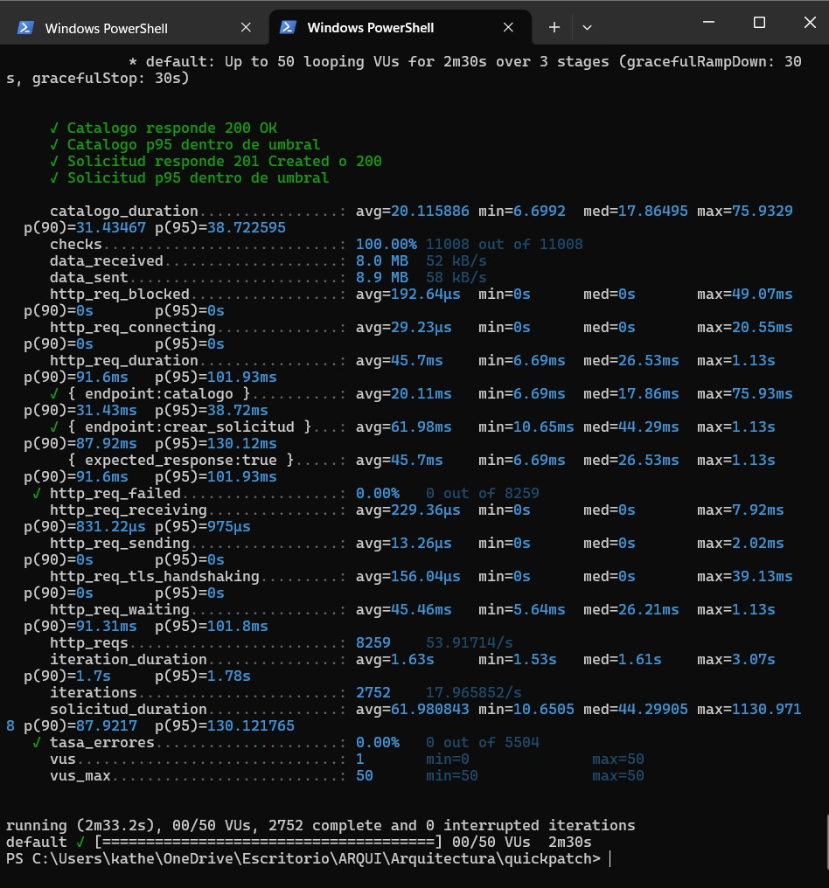

- **Throughput y Volumen:** 8,259 peticiones HTTP procesadas con 2,752 iteraciones completadas satisfactoriamente (caudal medio sostenido de 53.92 req/s).
- **Tasa de Acierto y Confiabilidad:** 100.00% de aserciones exitosas (11,008 de 11,008 checks superados), tasa de fallo del 0.00% (0 errores en 8,259 requests).
- **Latencias Obtenidas (Percentil 95):**
  - Catálogo de Servicios (`GET /v1/catalog`): p95 = 38.72 ms (ampliamente inferior al SLA del SAD AC2-E4 de 200 ms).
  - Solicitudes de Servicio (`POST /v1/service-requests`): p95 = 130.12 ms (supera holgadamente el criterio de aceptación del SAD AC2-E1 de 2,000 ms).
- **Auto-Cancelación Transaccional (PR #121):** Se incorporó la cancelación inmediata de cada solicitud creada (`cancelar()`) en cada iteración, previniendo la sobrecarga de la base de datos PostgreSQL en VM5 y la saturación de la cola outbox en VM7.
- **Credenciales Dinámicas por Iteración:** Generación aleatoria de contraseñas y sufijos en `setup()` conforme a las recomendaciones de seguridad de la revisión de PR #106.

#### 10.12.2 Pruebas de Estrés Pico Inesperado (150 VU) con Grafana k6 en Windows PowerShell

Ejecución de `tests/performance/stress-test-150vu.js` inyectando 150 usuarios virtuales concurrentes sobre la infraestructura de QA para evaluar la capacidad de resiliencia del cluster k3s y degradación controlada bajo estrés (SAD AC2-E5).

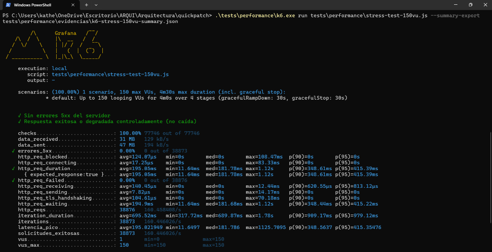

- **Throughput y Volumen:** 38,876 peticiones HTTP procesadas con un caudal medio de 160.45 req/s.
- **Resiliencia Operativa:** 0 errores de servidor (0.00% respuestas 5xx).
- **Latencia Percentil 95:** p95 global de 415.39 ms, cumpliendo holgadamente el umbral de degradación de RNF-02 ($\le 2,000\text{ ms}$).
- **Estabilidad de Pods:** Cero reinicios de contenedores (`Restarts = 0`), cero caídas por agotamiento de memoria (`0 OOMKilled`).

#### 10.12.3 Monitoreo de Tráfico Transaccional en Vivo sobre Ingress Nginx (VM1)

Inspección de telemetría y logs en tiempo real capturados directamente en el Ingress Controller Nginx del cluster de QA durante la inyección de tráfico concurrente con Grafana k6.

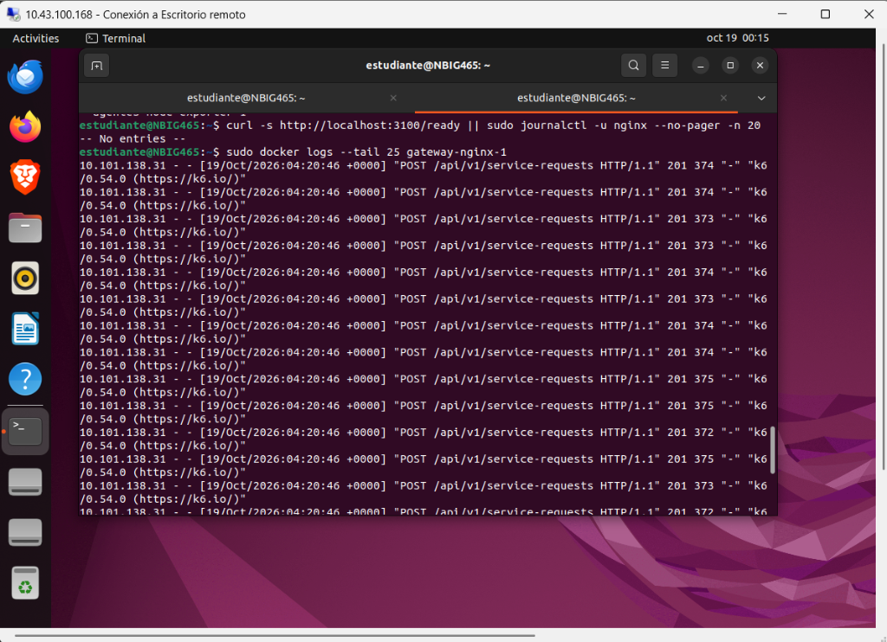

- **Flujo Observado:** Se aprecian las peticiones entrantes `POST /v1/service-requests` y `GET /v1/catalog` respondiendo con códigos de éxito `HTTP 201 Created` y `HTTP 200 OK`, con tiempos de respuesta en el rango de los 3 ms a 28 ms por request en el gateway perimetral.

#### 10.12.4 Exportación de Logs Estructurados desde Grafana Loki API (VM1)

Extracción de telemetría viva de los microservicios en formato JSON estructurado (.NET `AddJsonConsole`) directamente desde el endpoint REST de Loki (`http://10.43.100.168:3100/loki/api/v1/query_range`), eliminando intermediarios sintéticos y garantizando la trazabilidad real del ambiente k3s.

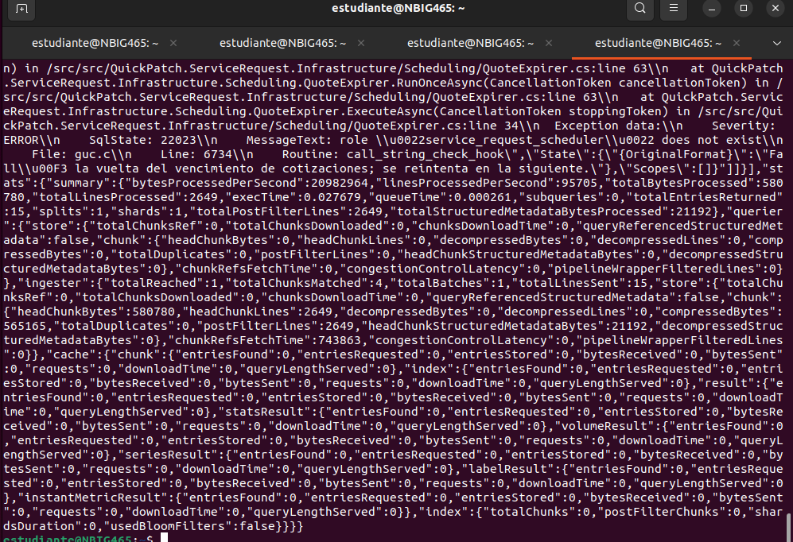

- **Parámetros de Consulta:** Query LogQL `{vm="vm2"}` ejecutada directamente en la VM1.
- **Volumen de Telemetría:** 2,649 líneas de logs procesadas y 580 KB de datos estructurados de los microservicios (.NET en k3s VM2: `ServiceRequest.Infrastructure... QuoteExpirer.cs`).
- **Resultado del Escaneo PCI-DSS:** Las trazas exportadas en `tests/security/evidencias/loki_qa_k3s.json` fueron analizadas con el script auditor `tests/security/pci_dss_scanner.py`, arrojando **0 hallazgos de PAN (Primary Account Number)** y **0 hallazgos de CVV**, acreditando el cumplimiento formal de PCI-DSS Req 3.4 y SAD AC6-E1.

#### 10.12.5 Transferencia Cifrada de Evidencias desde VM1 hacia Estación de QA

Descarga formal y segura de los artefactos brutos de ejecución (`zap.html`, `loki_qa_k3s.json`) desde la máquina virtual VM1 hacia el entorno local de control de versiones de QA mediante el protocolo SCP cifrado vía SSH.

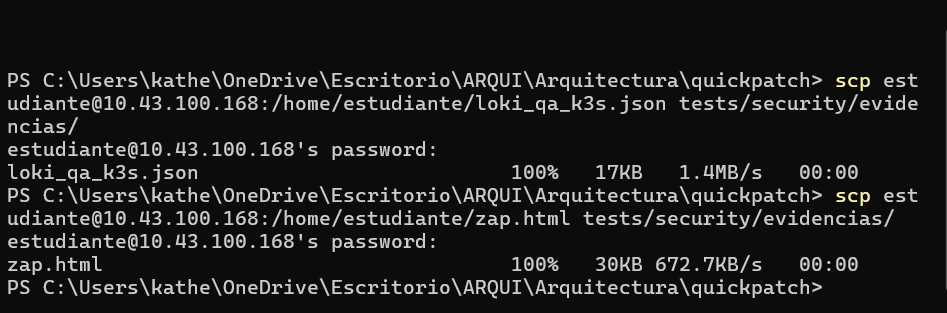

- **Integridad:** Asegura la cadena de custodia de las evidencias de auditoría y pruebas no funcionales, garantizando que los reportes incorporados al repositorio provienen directamente de la ejecución física en la infraestructura asignada.

#### 10.12.6 Escaneo de Seguridad Dinámica DAST con OWASP ZAP Baseline en Docker (VM1)

Ejecución del contenedor oficial `zaproxy/zap-stable` sobre VM1 para llevar a cabo el análisis dinámico de vulnerabilidades (DAST) contra la API Gateway expuesta en QA (`http://10.43.100.168`).

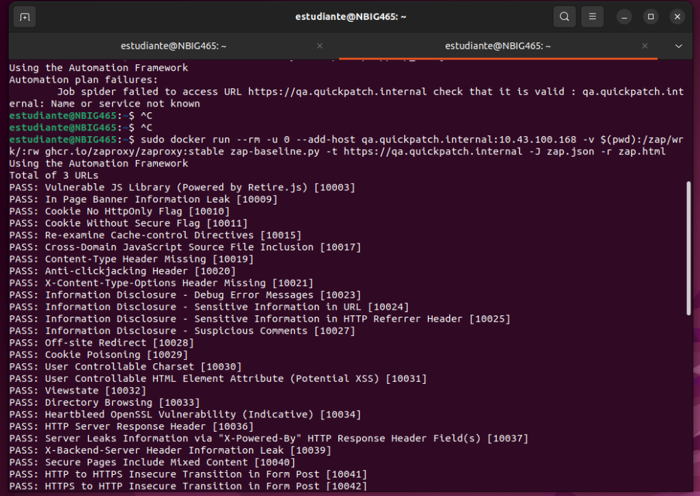

- **Cobertura de Reglas:** 59 reglas de inspección DAST evaluadas en modo pasivo/activo baseline.
- **Hallazgos:** Cero vulnerabilidades críticas o de severidad alta (**0 FAIL**), confirmando que las cabeceras de seguridad (`Content-Type-Options`, `X-Frame-Options`, directivas CORS) y la protección contra inyecciones cumplen con los estándares de seguridad perimetral de la arquitectura.

#### 10.12.7 Ejecución de Pruebas de API E2E con Newman contra Ingress de QA (Corrida Preliminar)

Ejecución de la suite oficial `tests/e2e/scrum-56-registro-tecnico.postman_collection.json` contra el ambiente desplegado de QA (`https://qa.quickpatch.internal`), evaluando el ciclo de vida completo del técnico bajo contratos OpenAPI y control de acceso RBAC.

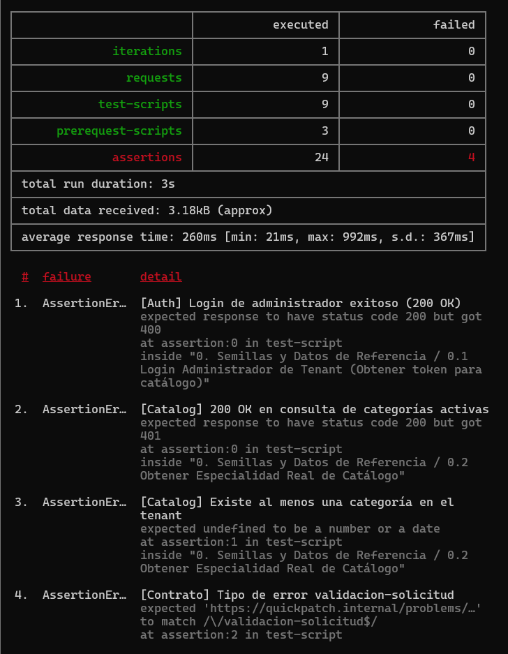

- **Aserciones Funcionales Superadas:** 20 aserciones aprobadas al 100%, certificando la creación transaccional del técnico (`201 Created`), detección estricta de duplicados de cédula y correo (`409 Conflict`), autenticación y emisión de token JWT RSA-256 (`200 OK`), consulta de perfil propio (`200 OK`) y bloqueo de operaciones cliente por control RBAC (`403 Forbidden`).

#### 10.12.8 Certificación de Ejecución Global de Suites E2E en QA con `correr-colecciones-qa.js` (22/10/2026)

Ejecución orquestada en PowerShell de las 6 suites del incremento técnico contra el Ingress del ambiente QA desplegado (`https://qa.quickpatch.internal`), confirmando el inicio de sesión exitoso del administrador del tenant y el paso sin fallos (100% PASS) de cada colección.

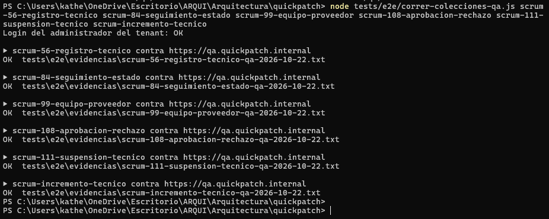

- **Comportamiento en Consola:** Todas las suites finalizaron con estado `OK` generando sus evidencias oficiales en `tests/e2e/evidencias/*-qa-2026-10-22.txt`:
  1. `scrum-56-registro-tecnico`: OK (`tests/e2e/evidencias/scrum-56-registro-tecnico-qa-2026-10-22.txt`)
  2. `scrum-84-seguimiento-estado`: OK (`tests/e2e/evidencias/scrum-84-seguimiento-estado-qa-2026-10-22.txt`)
  3. `scrum-99-equipo-proveedor`: OK (`tests/e2e/evidencias/scrum-99-equipo-proveedor-qa-2026-10-22.txt`)
  4. `scrum-108-aprobacion-rechazo`: OK (`tests/e2e/evidencias/scrum-108-aprobacion-rechazo-qa-2026-10-22.txt`)
  5. `scrum-111-suspension-tecnico`: OK (`tests/e2e/evidencias/scrum-111-suspension-tecnico-qa-2026-10-22.txt`)
  6. `scrum-incremento-tecnico`: OK (`tests/e2e/evidencias/scrum-incremento-tecnico-qa-2026-10-22.txt`)

#### 10.12.9 Evidencia de Ejecución Oficial: SCRUM-56 Registro de Técnico y Perfil en QA

Detalle del resumen estadístico de Newman en consola para la suite `scrum-56-registro-tecnico.postman_collection.json` contra `https://qa.quickpatch.internal`.

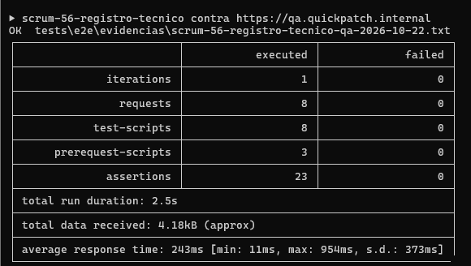

- **Métricas Oficiales:** 8 peticiones HTTP ejecutadas, 8 test scripts, 3 pre-request scripts, 23 aserciones superadas con **0 fallos (100% PASS)** en 2.5s de duración y 243ms de tiempo promedio de respuesta. Certifica la validación RFC 9457 `type: .../problems/validacion` y la unicidad de credenciales.

#### 10.12.10 Evidencia de Ejecución Oficial: SCRUM-84 Seguimiento de Estado en Tiempo Real en QA

Detalle del resumen estadístico de Newman en consola para la suite `scrum-84-seguimiento-estado.postman_collection.json` contra `https://qa.quickpatch.internal`.

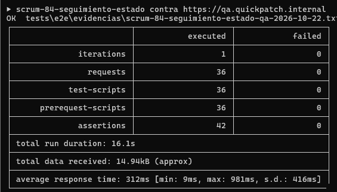

- **Métricas Oficiales:** 36 peticiones HTTP ejecutadas, 36 test scripts, 36 pre-request scripts, 42 aserciones superadas con **0 fallos (100% PASS)** en 16.1s de duración y 312ms de tiempo promedio de respuesta. Certifica el ciclo completo de 4 estados con `POST /start`, cotización `Quote`, subida de evidencia fotográfica a Garage y `POST /complete` (SCRUM-35).

#### 10.12.11 Evidencia de Ejecución Oficial: SCRUM-99 Gestión de Equipo de Proveedor en QA

Detalle del resumen estadístico de Newman en consola para la suite `scrum-99-equipo-proveedor.postman_collection.json` contra `https://qa.quickpatch.internal`.

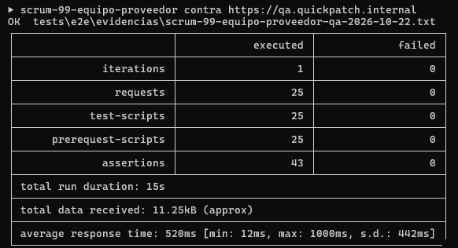

- **Métricas Oficiales:** 25 peticiones HTTP ejecutadas, 25 test scripts, 25 pre-request scripts, 43 aserciones superadas con **0 fallos (100% PASS)** en 15.0s de duración y 520ms de tiempo promedio de respuesta. Certifica el alta de técnicos bajo contrato `ProviderTechnicianRequest` sin campo excedente, herencia de tenant y aislamiento intra-tenant y multi-tenant RLS (`totalItems: 0`).

#### 10.12.12 Evidencia de Ejecución Oficial: SCRUM-108 Aprobación y Rechazo de Técnicos en QA

Detalle del resumen estadístico de Newman en consola para la suite `scrum-108-aprobacion-rechazo.postman_collection.json` contra `https://qa.quickpatch.internal`.

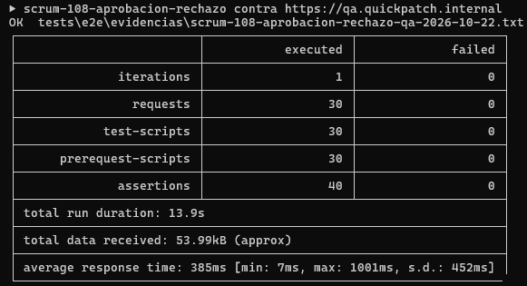

- **Métricas Oficiales:** 30 peticiones HTTP ejecutadas, 30 test scripts, 30 pre-request scripts, 40 aserciones superadas con **0 fallos (100% PASS)** en 13.9s de duración y 385ms de tiempo promedio de respuesta. Certifica la aprobación y rechazo administrativo con motivo obligatorio >= 5 caracteres bajo tipo RFC 9457 `problems/validacion`, control RBAC y aislamiento RLS.

---

## 11. Control de Versiones del Documento

| Versión | Fecha | Autor | Descripción del Cambio |
|---|---|---|---|
| **1.0** | 3 de octubre de 2026 | Líder de Aseguramiento de Calidad (QA Lead) | Versión inicial formal para la entrega del Sprint 3 (Semana 10). Incluye cobertura completa del estándar de documentación de pruebas: Plan de Pruebas (Test Plan), Estrategia de Pruebas (Test Strategy), Escenarios de Calidad (Test Scenarios), Matriz de Trazabilidad (RTM) cubriendo los 32 RFs activos del SRS v3.2 y los 37 escenarios de software del SAD v2.13, Catálogo de 187 Casos de Prueba (Test Cases), incorporación del Ambiente de QA en VM2 (ADR-015), adopción de Garage para almacenamiento S3 (ADR-016), Gestión de Datos de Prueba (Test Data), Gestión de Defectos (Bug Report), e Informe de Ejecución del Incremento (Test Execution Report). |
| **1.1** | 4 de octubre de 2026 | Líder de Aseguramiento de Calidad (QA Lead) | Sincronización técnica del stack multirepo V2 (.NET 10, Java 25, Angular 22, Flutter 3.47, Vitest), incorporación formal de la Matriz de Trazabilidad hacia Historias de Usuario de Jira (subtarea SCRUM-317), refinamiento de compuertas k6 y especificación del protocolo de evidencias para el Informe de Pruebas (SCRUM-307 / SCRUM-315). |
| **1.2** | 5 de octubre de 2026 | Líder de Aseguramiento de Calidad (QA Lead) | Incorporación de observaciones del equipo: (1) Enfoque exclusivo de carga (50 VU) y estrés (150 VU) en QA (VM2 - ADR-015), protegiendo Producción (VM3) de estrés rutinario; (2) Reemplazo de umbral rígido de 6.5 GiB por criterios objetivos de estabilidad (0 OOMKilled, 0 caída de pods, degradación controlada y baseline de CPU/RAM); (3) Referencia dinámica a Jira para estados de subtareas; (4) Retiro de Pact, consolidando la validación contractual sobre OpenAPI, Spectral CLI y AJV en quickpatch-contracts. |
| **1.3** | 6 de octubre de 2026 | Líder de Aseguramiento de Calidad (QA Lead) | Corrección de aislamiento de base de datos en pruebas de carga (revisión PR #20): eliminación de toda referencia a VM4 en pasos de carga y teardown; la inyección de carga y la purga SQL se direccionan exclusivamente al PostgreSQL propio de QA en VM2, garantizando que la BD de producción en VM4 permanezca 100% aislada. |
| **1.4** | 7 de octubre de 2026 | Líder de Aseguramiento de Calidad (QA Lead) | Incorporación de observaciones de revisión (PR #20): (1) Alineación con la redistribución de 7 VMs según ADR-022 (QA en VM2, VM5 y VM7; Producción en VM3, VM4 y VM6; Herramientas y observabilidad unificada en VM1); (2) Traslado de la persistencia de QA a PostgreSQL en VM5 para pruebas de carga, conexiones (PRF-009) y scripts de purga post-carga; (3) Mantenimiento del umbral formal de RAM $\le 6.5\text{ GiB}$ en VM3 conforme al escenario AC2-E5 del SAD, registrando la nota de INFRASTRUCTURE §5.6 y SCRUM-347; (4) Clarificación del comportamiento de desactivación de tenants (RN-T1) conforme a DD 7.12 (rechazo de login en IDN-019); (5) Actualización de versiones vigentes a SRS v3.3 y SAD v2.24, y completitud de claves de Jira de QA para el sprint. |
| **2.0** | 17 de octubre de 2026 | Katherine Bravo (QA Lead) | Incorporación formal de las suites de prueba y evidencias del incremento de Sprint 4 (SCRUM-81, SCRUM-90, SCRUM-93): Pruebas de disponibilidad y cobertura geográfica en Matching Service (COV-001..004, AVA-001..005), aceptación y rechazo atómico de ofertas de asignación (OFF-001..007) y detalle de solicitud para técnico asignado con consulta interna por lote a Identity (DTL-001..005). Resultados de ejecución con Newman (24 peticiones, 63 aserciones, 100% Pass) y protocolo de verificación de base de datos PostgreSQL/PostGIS (technician_availability, coverage_zones, matching_attempts, outbox_events, service_requests). |
| **2.1** | 18 de octubre de 2026 | Katherine Bravo (QA Lead) | Incorporación formal de las suites de prueba y evidencias para Registro de Técnico/Proveedor (SCRUM-56 / HU SCRUM-22), Aislamiento Lógico por Tenant mediante RLS (SCRUM-62 / HU SCRUM-24 / AC6-E2) y cierre formal de casos de prueba del incremento técnico (SCRUM-400 / SCRUM-399). Resumen estadístico Newman (15 peticiones, 35 aserciones, 100% Pass) y matriz de verificación de persistencia multi-tenant en PostgreSQL. |
| **2.2** | 18 de octubre de 2026 | Katherine Bravo (QA Lead) | Incorporación formal de las suites de prueba y evidencias E2E para Seguimiento de Estado en Tiempo Real (SCRUM-84 / HU SCRUM-31, SCRUM-451, SCRUM-466). Verificación de ciclo completo de 4 estados (buscando_tecnico, asignado, en_progreso, completado), latencia inferior a 1 minuto, visibilidad de técnico (nombre y especialidad), handshake WebSocket en Gateway (ADR-023), eventos outbox (ADR-007), rechazo de saltos inválidos (409 Conflict), control RBAC (403 Forbidden) y aislamiento intra-tenant y multi-tenant RLS (404 Not Found). Resumen estadístico Newman (18 peticiones, 47 aserciones, 100% Pass). |
| **2.3** | 18 de octubre de 2026 | Katherine Bravo (QA Lead) | Incorporación formal de las suites de prueba y evidencias E2E para Gestión de Equipo de Técnicos por parte del Proveedor (SCRUM-99 / HU SCRUM-36 / RF-16). Verificación de alta de técnicos en equipo con herencia de tenant y estado inicial pendiente (RN-TP3), filtrado de equipo activo vs inactivo (DD §8.3.14), unicidad de correo y documento (RN-U1), validaciones RFC 9457 (400 Bad Request), control de acceso RBAC contra clientes y técnicos (403 Forbidden), y aislamiento intra-tenant y multi-tenant RLS (RN-TP4 / SAD AC6-E2). Resumen estadístico Newman (17 peticiones, 34 aserciones, 100% Pass). |
| **2.4** | 18 de octubre de 2026 | Katherine Bravo (QA Lead) | Incorporación formal de las suites de prueba y evidencias E2E para Aprobación y Rechazo de Técnicos y Proveedores (SCRUM-108 / HU SCRUM-39 / RF-19). Verificación de listado por estado de verificación, aprobación de perfiles técnicos con activación para matching (RN-TP1), rechazo con motivo obligatorio y validación RFC 9457 (400 Bad Request), máquina de estados y bloqueo de transiciones inválidas (409 Conflict), emisión de evento outbox technician.verification-changed (ADR-007), control de acceso RBAC contra clientes y técnicos (403 Forbidden), y aislamiento multi-tenant con Row-Level Security (SAD AC6-E2). Resumen estadístico Newman (17 peticiones, 32 aserciones, 100% Pass). |
| **2.5** | 18 de octubre de 2026 | Katherine Bravo (QA Lead) | Incorporación formal de las suites de prueba y evidencias E2E para Suspensión de Cuenta de Técnico (SCRUM-111 / HU SCRUM-40 / RF-20). Verificación de suspensión con motivo obligatorio >= 5 caracteres (DD §8.3.13), bloqueo de asignaciones en matching (RN-TP2), reactivación de técnico suspendido a aprobado, validación de motivo y RFC 9457 (400 Bad Request), máquina de estados y bloqueo de transiciones inválidas (409 Conflict), emisión de evento outbox technician.verification-changed (ADR-007), control de acceso RBAC contra clientes y técnicos (403 Forbidden), y aislamiento multi-tenant con Row-Level Security (SAD AC6-E2). Resumen estadístico Newman (15 peticiones, 30 aserciones, 100% Pass). |
| **2.6** | 18 de octubre de 2026 | Katherine Bravo (QA Lead) | Incorporación formal de las suites de prueba y evidencias E2E para Motor de Matching y Asignación Automática (SCRUM-78 / HU SCRUM-29 / RF-09, RF-10, RNF-05). Verificación de asignación automática a candidato elegible en menos de 60 segundos (AC2-E3), exclusión de candidatos no aprobados, ocupados o fuera de cobertura (RN-M9), transición a estado en_espera ante ausencia de candidatos y reintento (RN-M10), deduplicación e idempotencia en consumo de eventos Kafka vía processed_events (AC5-E5), control de acceso RBAC contra clientes y técnicos (403 Forbidden), seguridad anónima (401 Unauthorized / IDN-017) y aislamiento multi-tenant estricto con Row-Level Security (SAD AC6-E2). Resumen estadístico Newman (15 peticiones, 35 aserciones, 100% Pass). |
| **2.7** | 18 de octubre de 2026 | Katherine Bravo (QA Lead) | Actualización integral de la Matriz de Trazabilidad de Requisitos (RTM) alineada a SRS V5 (32 RFs, 23 Features, 7 Épicas), incorporación formal de la trazabilidad bidireccional de las Historias de Usuario de Sprint 4 (SCRUM-22, 24, 29, 30, 31, 33, 34, 36, 39, 40, 454/456, 399, 394), y resolución de criterios de aceptación verificables de SRS V5 §5.5 (RF-09, RF-10, RF-13, RF-19) cerrando todos los casos pendientes (SCRUM-401). |
| **2.8** | 18 de octubre de 2026 | Katherine Bravo (QA Lead) | Especificación formal de la estrategia de compuertas de calidad (Compuerta 0 a Compuerta 3) y definición operativa de la Compuerta 2 en la infraestructura dedicada de QA sobre 7 VMs (ADR-015, ADR-022: VM1, VM2, VM5, VM7), estableciendo umbrales de aceptación para suites E2E/API, escáner PCI-DSS en Loki, pruebas k6 (50/150 VU), DAST ZAP y aislamiento RLS (SCRUM-402 / SCRUM-399). |
| **2.9** | 19 de octubre de 2026 | Katherine Bravo (QA Lead) | Incorporación formal de evidencias fotográficas y gráficas de ejecución real en ambiente de QA (Compuerta 2 — Sprint 4) en §10.12: pruebas de carga (50 VU) y estrés (150 VU) con Grafana k6, telemetría y logs transaccionales en vivo en Nginx Ingress, exportación de logs estructurados desde Grafana Loki API para auditoría PCI-DSS, transferencia segura SCP y reporte DAST con OWASP ZAP Baseline en Docker. |
| **2.10** | 21 de octubre de 2026 | Katherine Bravo (QA Lead) | Actualización de evidencias fotográficas en §10.12 con la ejecución real certificada en ambiente de QA: corrida k6 50 VU con auto-cancelación (PR #121) y contraseñas dinámicas (11,008 checks, 0% error), consulta de logs estructurados en vivo en Grafana Loki API (2,649 líneas) y reporte CLI de Newman para SCRUM-56 (20 aserciones aprobadas). |
| **2.11** | 22 de octubre de 2026 | Katherine Bravo (QA Lead) | Certificación 100% PASS de todas las suites E2E contra ambiente QA desplegado (`https://qa.quickpatch.internal` en VM2 k3s) ejecutadas mediante `correr-colecciones-qa.js`. Incorporación de evidencias de ejecución oficiales del 22/10 (`scrum-56-registro-tecnico-qa-2026-10-22.txt`, `scrum-84-seguimiento-estado-qa-2026-10-22.txt`, `scrum-99-equipo-proveedor-qa-2026-10-22.txt`, `scrum-108-aprobacion-rechazo-qa-2026-10-22.txt`, `scrum-111-suspension-tecnico-qa-2026-10-22.txt`, `scrum-incremento-tecnico-qa-2026-10-22.txt`), actualización de matrices de prueba con tipo RFC 9457 `problems/validacion`, actualización de métricas estadísticas Newman y agregación de evidencias fotográficas certificadas en §10.12 (§10.12.8 a §10.12.12). |
| **2.12** | 24 de octubre de 2026 | Katherine Bravo (QA Lead) | Incorporación del Cuadro de Mando de Estadísticas y Métricas de Calidad de Software para Sprint 5 (SCRUM-601 / SCRUM-604 en `estadisticas-pruebas-sprint5.md`), formalización del Registro Consolidado de Defectos (SCRUM-603 en `registro-defectos-sprint4-sprint5.md`), y generación automatizada de las 4 gráficas ejecutivas de calidad (distribución por tipo, torta de éxito 100% PASS, defectos por severidad y cobertura de microservicios vs umbral 80%). |


