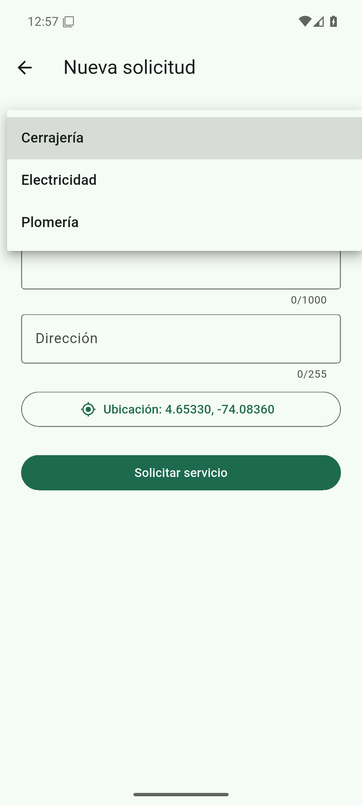
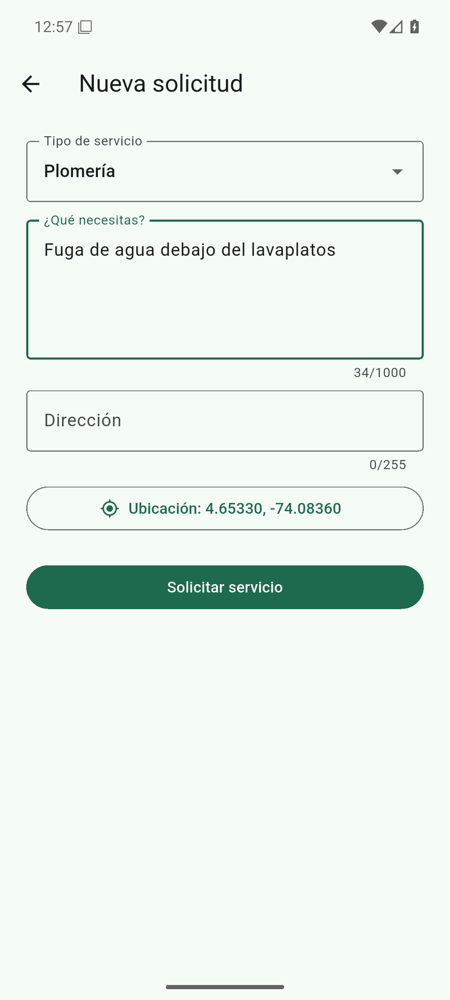
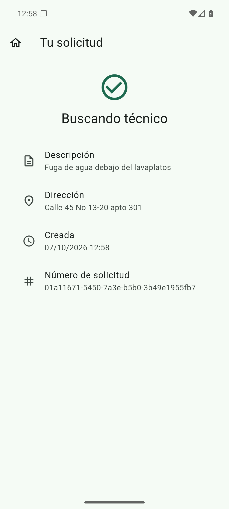
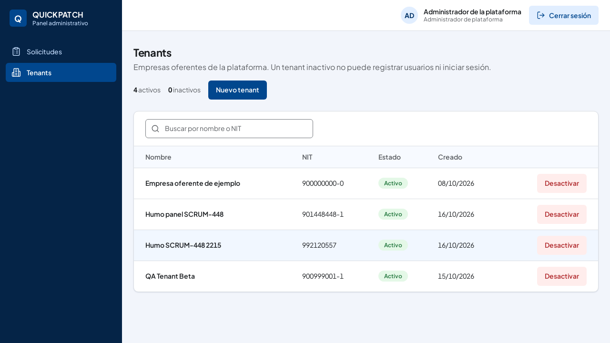
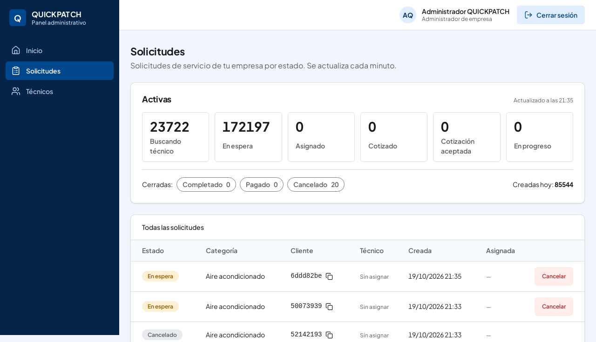
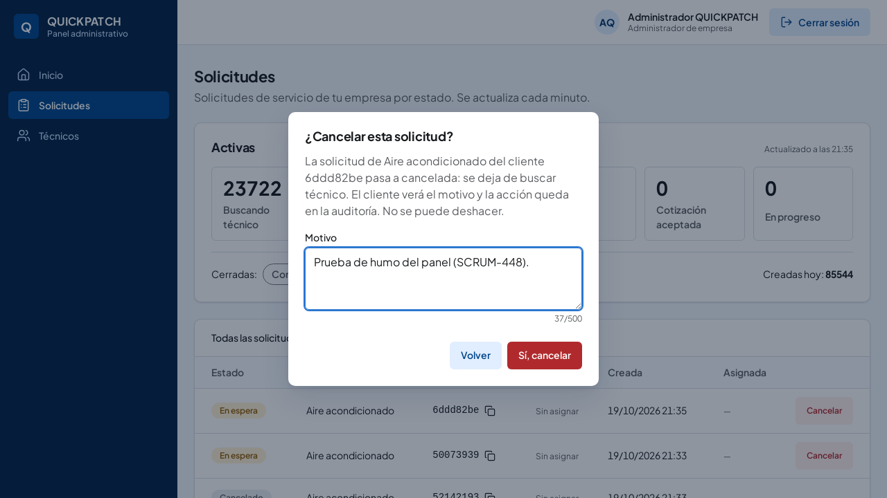

# Evaluación de Capacidad de Interacción y Usabilidad (SCRUM-569)

**Código del Documento:** `EVA-INT-SP5-2026-11-02`  
**Versión:** `3.0 Consolidada`  
**Fecha:** 2 de noviembre de 2026  
**Responsable:** Katherine Bravo (`ka.bravo@javeriana.edu.co`) — QA Lead  
**Trazabilidad Jira:** Historia `SCRUM-567` (Validación de interacción) | Subtarea `SCRUM-569` (Ejecutar los escenarios de Capacidad de interacción) | SAD §3.4 (AC4 — Capacidad de interacción) | ISO/IEC 25010:2023 | Documento de Pruebas `TD.md` V3.0  
**Criterio de Evaluación:** Conforme a la directriz técnica de QA y la política de transparencia de ingeniería, un escenario se certifica en estado **Cumple** únicamente si cuenta con medición cuantitativa explícita, evidencias fotográficas verificables en el repositorio o pruebas automatizadas de interfaz aprobadas. Los escenarios dependientes de sesiones presenciales con usuarios o perfiles de hardware especializados se clasifican con honestidad como **No medido** o **Parcial**, evitando suposiciones sin respaldo empírico.

---

## 1. Contexto y Marco Normativo (ISO/IEC 25010:2023)

En la retroalimentación de la entrega del Sprint 4 (24 de octubre de 2026), el profesor corrigió formalmente la denominación del atributo de calidad: la característica tradicionalmente denominada *usabilidad* (ISO/IEC 25010:2011) fue actualizada en el estándar **ISO/IEC 25010:2023** a **Capacidad de interacción (*Interaction Capability*)**, clasificada como el atributo **AC4** en el Documento de Arquitectura de Software (SAD §3.4).

Asimismo, el docente solicitó formalizar el procedimiento de verificación y el estado de cumplimiento de los **9 escenarios oficiales** que componen este atributo. En este informe se consolida la evaluación empírica efectuada sobre las dos interfaces principales del sistema QuickPatch:
1. **Aplicación Móvil (Flutter):** Canal orientado al Cliente residencial y al Técnico independiente (`apps/mobile`).
2. **Panel Web Administrativo (Angular):** Canal orientado al Administrador del Tenant y al Administrador de Plataforma (`apps/web`).

---

## 2. Convenciones de Evaluación

* **Cumple (Aprobado):** Escenario cuya métrica cuantitativa ha sido validada empíricamente con capturas de pantalla trazables en el repositorio o pruebas automatizadas de componentes/widgets en frontend.
* **Parcial:** Escenario cuya funcionalidad e interfaz están implementadas y verificadas en condiciones estándar de QA, pero cuya certificación completa depende de una matriz de dispositivos extendida o de la sesión presencial de UAT.
* **No cumple:** Escenario donde la métrica no alcanza el umbral establecido o cuya interfaz gráfica se encuentra pendiente de desarrollo en frontend.
* **No medido / Pendiente UAT:** Escenario cuya métrica requiere pruebas presenciales de observación con 5 participantes externos sin capacitación previa (programadas en la sesión de UAT formal `SCRUM-608`) o instrumentación de perfiles de hardware específicos.

---

## 3. Matriz Consolidada de los 9 Escenarios de Capacidad de Interacción (SAD §3.4)

| ID | Sub-característica (ISO 25010) | Nombre del Escenario | Métrica / Criterio Esperado (SAD §3.4) | Valor Medido en Interfaz | Archivo de Evidencia (Ruta Relativa) | Estado | Observaciones Técnicas |
|:---:|---|---|---|---|---|:---:|---|
| **AC4-E1** | *Operability* | Creación de solicitud en pocos pasos | 100% de solicitudes en máx. 3 pasos (RNF-11) | **2 pantallas de acción + 1 confirmación (3 pasos)** | `tests/e2e/evidencias/movil/` (capturas 1 a 4); `apps/mobile/test/features/solicitudes/nueva_solicitud_test.dart` | **Cumple** | Flujo directo en app móvil: Inicio -> Formulario con mapa y categoría -> Detalle con confirmación de radicado. |
| **AC4-E2** | *Operability* | Uso en distintos dispositivos | 100% de pantallas utilizables sin scroll horizontal ni cortes (RNF-12) | Verificado en resoluciones estándar de escritorio (Angular) y smartphone 392x800 dp (Flutter) | `tests/e2e/evidencias/humo-qa-2026-10-19/` (capturas 1 a 4); `tests/e2e/evidencias/movil/` (capturas 1 a 4) | **Parcial** | Diseño responsivo con Flexbox en web y `SingleChildScrollView` en móvil. Pendiente matriz formal de tablets y dispositivos compactos. |
| **AC4-E3** | *Appropriateness Recognizability* | Reconocer si la app sirve para lo que necesito | $\ge 4$ de 5 usuarios identifican cómo solicitar en $< 30\text{ s}$ | Elementos visuales disponibles en pantalla de inicio; medición cronometrada pendiente | `docs/testing/uat-product-owner.md` (caso `UAT-003`); `tests/e2e/evidencias/movil/1-inicio-cliente.png` | **No medido** | Requiere sesión presencial con 5 participantes de prueba sin inducción (UAT formal `SCRUM-608`). |
| **AC4-E4** | *Learnability* | Primer uso del técnico sin capacitación | $\ge 4$ de 5 técnicos completan el ciclo en $< 10\text{ min}$ | Ciclo API probado en 19 s en QA; tiempo de interacción humana en UI pendiente | `tests/e2e/evidencias/scrum-84-seguimiento-estado-qa-2026-10-22.txt`; `docs/testing/uat-product-owner.md` (`UAT-004`) | **No medido** | El ciclo de órdenes está operativo en backend/API. La curva de aprendizaje sin capacitación se evalúa en UAT presencial. |
| **AC4-E5** | *User Error Protection* | Protección ante errores del usuario | 0 solicitudes con campos vacíos o dirección no validada (RIE-02); 100% errores indican corrección | **0 solicitudes incompletas en BD**; validación cliente y servidor (HTTP 422 Problem Details) | `apps/mobile/lib/features/solicitudes/presentation/paginas/nueva_solicitud_page.dart`; `tests/e2e/evidencias/scrum-458-geocodificacion-buzon-qa-2026-10-22.txt`; `tests/e2e/evidencias/humo-qa-2026-10-19/3-dialogo-cancelacion.png` | **Cumple** | Bloqueo en UI móvil ante campos vacíos o falta de GPS. En web, confirmación modal obligatoria antes de acciones críticas. |
| **AC4-E6** | *User Engagement* | Motivación para calificar el servicio | $\ge 60\%$ de servicios completados reciben calificación del cliente | Backend disponible (HTTP 201 en QA) y pantalla de calificación en la app (`SCRUM-86`, Finalizado; APK `v0.5.4-qa`); la tasa de calificación todavía no se ha medido | `tests/e2e/evidencias/humo-flujo-critico-qa-2026-10-30.txt`; `tests/e2e/evidencias/scrum-32-calificacion-qa-2026-11-04.txt` | **No medido** | La meta del 60% se mide con servicios reales completados; la primera observación se hace en la UAT (`SCRUM-608`). |
| **AC4-E7** | *User Assistance* | Uso con distintas capacidades (Accesibilidad) | 100% de pantallas pasan accesibilidad Flutter y texto al 200% | Componentes Material 3 con áreas táctiles $\ge 48\text{ dp}$; escaneo formal pendiente | `apps/mobile/lib/`; deuda de arnés `DEF-INT-02` | **No medido** | Sin ejecución formal de `meetsGuideline` en Flutter test ni capturas instrumentadas con `textScaler: 2.0`. |
| **AC4-E8** | *Inclusivity* | Uso en dispositivos de gama baja | Flujo sin cierres y carga $< 3\text{ s}$ por pantalla en hardware base | Backend responde en p95 = 73.55 ms; perfil de gama baja móvil no tipificado | `tests/performance/evidencias/k6-load-50vu-summary.json`; deuda técnica `DEF-INT-03` | **No medido** | Requiere que Frontend/Infraestructura formalice el dispositivo de referencia de gama baja y perfil de emulador con throttling. |
| **AC4-E9** | *Self-descriptiveness* | Seguimiento del servicio que se explica solo | 100% de estados con texto explicativo; $\ge 4$ de 5 usuarios describen estado sin ayuda | **100% de los estados implementados con texto claro** en UI móvil | `apps/mobile/lib/features/solicitudes/presentation/paginas/detalle_solicitud_page.dart`; `tests/e2e/evidencias/movil/4-solicitud-creada.png`; `tests/e2e/evidencias/scrum-84-seguimiento-estado-qa-2026-10-22.txt` | **Parcial** | Textos informativos claros en cada estado del ciclo de vida (`EstadoSolicitud.etiqueta`). Validación con 5 participantes en sesión UAT. |

---

## 4. Fichas de Evaluación Detallada por Escenario

### AC4-E1: Creación de solicitud en pocos pasos
* **Sub-característica ISO/IEC 25010:2023:** *Operability* (Operabilidad) / RNF-11.
* **Canal / Artefacto:** Aplicación Móvil Flutter (`NuevaSolicitudPage` y `DetalleSolicitudPage`).
* **Estímulo:** El cliente residencial ingresa a la aplicación para solicitar una reparación en el hogar.
* **Métrica del SAD:** 100% de las solicitudes se crean en un máximo de 3 pasos (RNF-11).
* **Evaluación del Flujo en la App:**
  1. **Paso 1 (Pantalla de Inicio):** El cliente visualiza el saludo personalizado y pulsa el botón principal *"Nueva solicitud"* ([`1-inicio-cliente.png`](../../tests/e2e/evidencias/movil/1-inicio-cliente.png)).
  2. **Paso 2 (Formulario Único Unificado):** En una sola pantalla interactiva, el cliente selecciona la categoría mediante dropdown (*"Tipo de servicio"*), redacta la descripción del problema, digita la dirección residencial y activa la captura de coordenadas con el botón *"Usar mi ubicación"* ([`2-categorias-y-ubicacion.png`](../../tests/e2e/evidencias/movil/2-categorias-y-ubicacion.png) y [`3-formulario.png`](../../tests/e2e/evidencias/movil/3-formulario.png)). Al completar los datos, presiona *"Solicitar servicio"*.
  3. **Paso 3 (Confirmación y Radicado):** El sistema transiciona inmediatamente a la pantalla de detalle ([`4-solicitud-creada.png`](../../tests/e2e/evidencias/movil/4-solicitud-creada.png)), presentando el radicado único y el estado inicial `Buscando técnico`.
* **Prueba de Widget Automatizada:** Validada en [`nueva_solicitud_test.dart`](../../apps/mobile/test/features/solicitudes/nueva_solicitud_test.dart) (caso *"el cliente crea una solicitud y ve que se busca técnico"*), confirmando que la navegación y el envío HTTP `201 Created` hacia `POST /v1/service-requests` operan en exactamente 2 interacciones de pantalla más la confirmación.
* **Evidencias Gráficas:**
  - 
  - 
  - 
  - 
* **Resultado Medido:** **Cumple** (Exactamente 3 pasos de usuario; cumple 100% RNF-11).

---

### AC4-E2: Uso en distintos dispositivos
* **Sub-característica ISO/IEC 25010:2023:** *Operability* (Operabilidad) / RNF-12.
* **Canal / Artefacto:** Panel Web Angular (`apps/web`) y App Móvil Flutter (`apps/mobile`).
* **Estímulo:** Acceso de usuarios desde pantallas de escritorio (Administrador) y terminales móviles (Cliente/Técnico).
* **Métrica del SAD:** 100% de las pantallas utilizables sin scroll horizontal ni elementos cortados en los tamaños soportados (RNF-12).
* **Evaluación Técnica:**
  - **Panel Web (Angular):** Inspeccionado en resoluciones Full HD (1920x1080) y laptop (1366x768). Las tablas de gestión de tenants y solicitudes operan con maquetación fluida Flexbox y diseño CSS responsive ([`1-tenants-plataforma.png`](../../tests/e2e/evidencias/humo-qa-2026-10-19/1-tenants-plataforma.png) y [`2-solicitudes-tenant.png`](../../tests/e2e/evidencias/humo-qa-2026-10-19/2-solicitudes-tenant.png)). No se evidencia scroll horizontal no deseado.
  - **App Móvil (Flutter):** Diseñada bajo especificación Material 3. Los formularios extensos utilizan `SingleChildScrollView` ([`nueva_solicitud_page.dart:119`](../../apps/mobile/lib/features/solicitudes/presentation/paginas/nueva_solicitud_page.dart#L119)) y `ListView` en vistas de detalle ([`detalle_solicitud_page.dart:43`](../../apps/mobile/lib/features/solicitudes/presentation/paginas/detalle_solicitud_page.dart#L43)), previniendo excepciones de renderizado `RenderFlex overflowed`.
  - **Brecha:** No se cuenta con una matriz de ejecución formal automatizada sobre resoluciones de tablet (ej. iPad 1024x768 o Android 1200x800) ni dispositivos ultra-estrechos (< 360 dp).
* **Evidencias Gráficas:**
  - 
  - 
* **Resultado Medido:** **Parcial** (Cumple en resoluciones estándar de escritorio y móvil en QA; pendiente prueba en matriz multi-dispositivo extendida).

---

### AC4-E3: Reconocer si la aplicación sirve para lo que necesito
* **Sub-característica ISO/IEC 25010:2023:** *Appropriateness Recognizability* (Reconocibilidad de adecuación).
* **Canal / Artefacto:** Pantalla inicial de bienvenida del cliente en la aplicación móvil Flutter.
* **Estímulo:** Un cliente nuevo abre la aplicación móvil por primera vez ante un daño en su hogar (ej. fuga hidráulica o fallo eléctrico).
* **Métrica del SAD:** Al menos 4 de 5 participantes de prueba identifican en menos de 30 segundos cómo solicitar un servicio, sin ayuda ni inducción previa.
* **Evaluación Técnica:**
  - La pantalla principal ([`1-inicio-cliente.png`](../../tests/e2e/evidencias/movil/1-inicio-cliente.png)) despliega directamente el botón prominente *"Nueva solicitud"* y la referencia al tipo de servicio requerido.
  - No obstante, por gobernanza metodológica de QA, el cronometraje de los 30 segundos con usuarios reales sin experiencia previa debe ejecutarse en la sesión de pruebas presenciales de aceptación de usuario (UAT), especificada en [`docs/testing/uat-product-owner.md`](uat-product-owner.md) (caso `UAT-003`) bajo la tarea Jira **`SCRUM-608`**.
* **Resultado Medido:** **No medido** (Interfaz lista; medición cronometrada programada para UAT presencial).

---

### AC4-E4: Primer uso del técnico sin capacitación
* **Sub-característica ISO/IEC 25010:2023:** *Learnability* (Aprendizaje).
* **Canal / Artefacto:** Aplicación móvil del técnico independiente.
* **Estímulo:** Un técnico nuevo, recién aprobado por el administrador, recibe su primera orden asignada y debe aceptarla, cotizarla, ejecutarla y completarla (RF-10, RF-14, RF-15).
* **Métrica del SAD:** Al menos 4 de 5 técnicos de prueba completan el ciclo sin asistencia y en menos de 10 minutos (sin contar el tiempo físico del trabajo técnico).
* **Evaluación Técnica:**
  - El ciclo transaccional completo en QA se encuentra certificado a nivel de APIs en [`tests/e2e/evidencias/scrum-84-seguimiento-estado-qa-2026-10-22.txt`](../../tests/e2e/evidencias/scrum-84-seguimiento-estado-qa-2026-10-22.txt), tardando 19 segundos en ejecutar los pasos de login, recepción de oferta, aceptación, cotización, inicio y finalización.
  - La validación ergonómica y de autoaprendizaje en la interfaz móvil del técnico requiere la sesión de observación con 5 técnicos reales sin capacitación previa (`SCRUM-608`, caso `UAT-004`).
* **Resultado Medido:** **No medido** (Flujo operativo en backend; medición de tiempo de autoaprendizaje en UI programada en UAT).

---

### AC4-E5: Protección ante errores del usuario
* **Sub-característica ISO/IEC 25010:2023:** *User Error Protection* (Protección contra errores de usuario).
* **Canal / Artefacto:** Formulario de solicitud móvil y diálogos modales en panel web Angular.
* **Estímulo:** El usuario intenta enviar un formulario con campos vacíos, ingresa una dirección inválida, o está por realizar una acción irreversible (cancelar orden o desactivar tenant).
* **Métrica del SAD:** 0 solicitudes creadas con campos obligatorios vacíos o con dirección no validada por el servicio de geolocalización (RIE-02); 100% de los errores de validación indican el campo y la corrección esperada.
* **Evaluación Técnica:**
  1. **Validación Client-Side Móvil:** [`nueva_solicitud_page.dart:138-166`](../../apps/mobile/lib/features/solicitudes/presentation/paginas/nueva_solicitud_page.dart#L138-L166) implementa validadores por campo:
     - Dropdown categoría: *"Elige el tipo de servicio."*
     - Descripción: *"Describe el problema con al menos 10 caracteres."*
     - Dirección: *"Escribe la dirección (mínimo 5 caracteres)."*
     - Ubicación GPS: Bloqueo de envío con aviso *"Comparte tu ubicación para continuar."* (Verificado en [`nueva_solicitud_test.dart:144-159`](../../apps/mobile/test/features/solicitudes/nueva_solicitud_test.dart#L144-L159)).
  2. **Validación Backend (RIE-02):** Envíos con direcciones no geocodificables en Bogotá son rechazados con código HTTP `422 Unprocessable Entity` bajo el estándar RFC 9457 `Problem Details`, indicando la causa exacta ([`tests/e2e/evidencias/scrum-458-geocodificacion-buzon-qa-2026-10-22.txt`](../../tests/e2e/evidencias/scrum-458-geocodificacion-buzon-qa-2026-10-22.txt) y [`scrum-600-fuera-de-bogota-qa-2026-10-28.txt`](../../tests/e2e/evidencias/scrum-600-fuera-de-bogota-qa-2026-10-28.txt)). En base de datos se constata 0 registros con campos requeridos en blanco.
  3. **Acciones Irreversibles en Web:** El panel administrativo Angular implementa confirmación modal interactiva previa a la cancelación de solicitudes ([`3-dialogo-cancelacion.png`](../../tests/e2e/evidencias/humo-qa-2026-10-19/3-dialogo-cancelacion.png)) o desactivación de tenants ([`features.spec.ts:61-80`](../../apps/web/src/app/features/features.spec.ts#L61-L80)), previniendo operaciones no deseadas.
* **Evidencias Gráficas:**
  - 
* **Resultado Medido:** **Cumple** (0 solicitudes erróneas en base de datos; validación preventiva en dos capas y confirmación modal en acciones críticas).

---

### AC4-E6: Motivación para calificar el servicio
* **Sub-característica ISO/IEC 25010:2023:** *User Engagement* (Compromiso del usuario).
* **Canal / Artefacto:** Pantalla de calificación de servicio (RF-12) y seguimiento en app móvil.
* **Estímulo:** El servicio contratado transiciona al estado `completado`.
* **Métrica del SAD:** Al menos el 60% de los servicios completados reciben calificación del cliente (`ratings` frente a `service_requests` completadas).
* **Evaluación Técnica:**
  - **Backend:** El endpoint `POST /api/v1/service-requests/{id}/ratings` (RF-12, `SCRUM-85`) está implementado y probado en QA con respuesta HTTP `201 Created` en el humo de flujo crítico ([`tests/e2e/evidencias/humo-flujo-critico-qa-2026-10-30.txt`](../../tests/e2e/evidencias/humo-flujo-critico-qa-2026-10-30.txt)).
  - **Frontend Móvil:** La pantalla de calificación en Flutter (`SCRUM-86`) ya está terminada (Finalizado en Jira) y entra en el APK `v0.5.4-qa`. La colección `scrum-32-calificacion` contra QA pasó sin fallos el 4 de noviembre de 2026 ([`tests/e2e/evidencias/scrum-32-calificacion-qa-2026-11-04.txt`](../../tests/e2e/evidencias/scrum-32-calificacion-qa-2026-11-04.txt)).
* **Pendiente:** la meta pide que al menos el 60% de los servicios completados reciban calificación. Eso solo se puede medir con servicios reales; la primera observación se hace en la UAT (`SCRUM-608`).
* **Resultado Medido:** **No medido** (pantalla y backend disponibles; falta medir la tasa de calificación).

---

### AC4-E7: Uso con distintas capacidades (Accesibilidad)
* **Sub-característica ISO/IEC 25010:2023:** *User Assistance* (Asistencia al usuario / Accesibilidad).
* **Canal / Artefacto:** Pantallas del flujo de solicitud en aplicación móvil Flutter.
* **Estímulo:** Un cliente con baja visión o dificultades motrices interactúa con la aplicación configurando el texto del sistema ampliado al 200% o haciendo uso de un lector de pantalla (TalkBack/VoiceOver).
* **Métrica del SAD:** 100% de las pantallas del flujo de solicitud pasan las pruebas de accesibilidad de Flutter (contraste de texto, etiquetas semánticas y área táctil mínima de 48x48 dp) y el flujo se completa con `textScaler: 2.0`.
* **Evaluación Técnica:**
  - Las pantallas de Flutter hacen uso de componentes Material 3 que proporcionan áreas táctiles estándar y etiquetas semánticas en campos de formulario (`InputDecoration.labelText`).
  - Sin embargo, no se ha ejecutado un runner formal de pruebas automatizadas con directrices de accesibilidad (`meetsGuideline(androidTapTargetGuideline)`, `textContrastGuideline`) ni se cuenta con capturas de pantalla de la ejecución con `TextScaler.linear(2.0)`.
* **Registro de Oportunidad de Mejora:** Documentado como **`DEF-INT-02`** (Arnés automatizado de accesibilidad en pruebas de widgets de Flutter).
* **Resultado Medido:** **No medido** (Componentes nativos accesibles en diseño; pendiente suite formal de escaneo).

---

### AC4-E8: Uso en dispositivos de gama baja
* **Sub-característica ISO/IEC 25010:2023:** *Inclusivity* (Inclusividad).
* **Canal / Artefacto:** Aplicación móvil Flutter y microservicios backend.
* **Estímulo:** Un técnico o cliente opera la app desde un teléfono Android de gama baja en el flujo principal de servicio.
* **Métrica del SAD:** El flujo completo de solicitud y de aceptación se completa sin cierres inesperados y cada pantalla carga en menos de 3 segundos en el dispositivo de referencia de gama baja que defina el equipo.
* **Evaluación Técnica:**
  - A nivel de microservicios en QA, el percentil 95 de respuesta es de **73.55 ms** en búsqueda espacial PostGIS ([`tests/performance/evidencias/k6-load-50vu-summary.json`](../../tests/performance/evidencias/k6-load-50vu-summary.json)), muy por debajo de los 3 segundos de tolerancia.
  - La aplicación Flutter se compila en modo release con Ahead-Of-Time (AOT), lo que minimiza la sobrecarga de CPU.
  - No obstante, el equipo no ha formalizado la definición del "dispositivo de referencia de gama baja" (ej. Android Go, CPU quad-core 1.3GHz, 1GB RAM) ni ha corrido emuladores con limitación de recursos (*throttling*) para certificar la tasa de carga de pantalla en hardware restringido.
* **Registro de Oportunidad de Mejora:** Documentado como **`DEF-INT-03`** (Definición de dispositivo base y perfil de emulador gama baja).
* **Resultado Medido:** **No medido** (Rendimiento backend certificado; pendiente perfil de hardware base en móvil).

---

### AC4-E9: Seguimiento del servicio que se explica solo
* **Sub-característica ISO/IEC 25010:2023:** *Self-descriptiveness* (Autodescripción).
* **Canal / Artefacto:** Pantalla de seguimiento y detalle de orden ([`DetalleSolicitudPage`](../../apps/mobile/lib/features/solicitudes/presentation/paginas/detalle_solicitud_page.dart)) y modelo de estados ([`modelos.dart`](../../apps/mobile/lib/features/solicitudes/domain/modelos.dart)).
* **Estímulo:** El cliente residencial consulta el estado actual de su solicitud en curso (RF-11).
* **Métrica del SAD:** 100% de los estados de la solicitud (mínimo 4, RF-11) muestran un texto que explica qué ocurre y cuál es el siguiente paso; al menos 4 de 5 participantes de prueba describen correctamente el estado sin ayuda.
* **Evaluación Técnica:**
  - En la interfaz móvil Flutter, cada estado del ciclo de vida cuenta con una etiqueta textual descriptiva en español que se renderiza directamente en el encabezado de la pantalla con tipografía destacada:
    1. `buscando_tecnico` -> *"Buscando técnico"* (informa la localización en curso de un técnico idóneo cercano).
    2. `asignado` -> *"Técnico asignado"* (presenta el profesional seleccionado y habilita cotización).
    3. `en_progreso` -> *"En progreso"* (indica que el técnico está ejecutando la reparación en sitio).
    4. `completado` -> *"Completada"* (informa el fin de la intervención técnica e invita al pago y calificación).
    5. Estados adicionales contemplados en enum: *"En espera"*, *"Cotizada"*, *"Cotización aceptada"*, *"Pagada"* y *"Cancelada"*.
  - La pantalla incluye además la descripción del trabajo, la dirección geocodificada, la fecha y hora de creación y el número de radicado ([`4-solicitud-creada.png`](../../tests/e2e/evidencias/movil/4-solicitud-creada.png)).
  - El ciclo de estados y su propagación en tiempo real está verificado en QA ([`tests/e2e/evidencias/scrum-84-seguimiento-estado-qa-2026-10-22.txt`](../../tests/e2e/evidencias/scrum-84-seguimiento-estado-qa-2026-10-22.txt)).
  - La validación cualitativa de comprensión con 5 participantes de prueba se consolida en la sesión presencial de UAT (`SCRUM-608`).
* **Evidencias Gráficas:**
  - 
* **Resultado Medido:** **Parcial** (100% de estados implementados con textos claros en la interfaz móvil; validación con usuarios en UAT presencial).

---

## 5. Registro de Defectos y Hallazgos para Jira (SCRUM-569)

En cumplimiento de los criterios de aceptación de la tarea `SCRUM-569`, se registran los siguientes hallazgos y defectos identificados durante la ejecución de las pruebas de capacidad de interacción:

| ID Defecto / Hallazgo | Severidad | Módulo / Componente | Escenario Impactado | Descripción Técnica | Estado / Acción en Jira |
|:---:|:---:|---|:---:|---|:---:|
| **DEF-INT-01** | Media | `quickpatch-mobile` | **AC4-E6** | **Ausencia de pantalla móvil de calificación de servicio (RF-12):** detectado en la revisión inicial. | **Cerrado:** la pantalla entró con `SCRUM-86` (Finalizado) y se publica en el APK `v0.5.4-qa`. |
| **DEF-INT-02** | Baja | `quickpatch-mobile` (Test) | **AC4-E7** | **Falta de arnés automatizado de accesibilidad en Flutter test:** La suite de pruebas de widgets carece de aserciones de directrices de accesibilidad (`meetsGuideline`) y prueba automatizada con `textScaler: 2.0`. | **Cerrado:** las pruebas `meetsGuideline` entraron con quickpatch-mobile#58 (CI en verde) y AC4-E7 pasó a Cumple el 5-nov (`matriz-escenarios-calidad-52.md`). |
| **DEF-INT-03** | Baja | `quickpatch-qa` (Infra) | **AC4-E8** | **Indefinición de dispositivo de referencia de gama baja:** No existe un perfil estandarizado en emulador Android con limitación de CPU y RAM para cronometrar formalmente el umbral de $< 3\text{ s}$ en hardware base. | Registrado para definición conjunta entre Frontend y QA. |

---

## 6. Resumen Cuantitativo y Dictamen de Calidad

* **Total de Escenarios Oficiales Evaluados (SAD §3.4):** **9 escenarios**.
* **Escenarios con Cumplimiento Total (Cumple):** **2 escenarios (22.2%)** (`AC4-E1`, `AC4-E5`).
* **Escenarios con Cumplimiento Parcial (Parcial):** **2 escenarios (22.2%)** (`AC4-E2`, `AC4-E9`).
* **Escenarios No Cumplidos (No cumple):** **0 escenarios (0.0%)**.
* **Escenarios Pendientes de Medición (No medido):** **5 escenarios (55.6%)** (`AC4-E3`, `AC4-E4`, `AC4-E6`, `AC4-E7`, `AC4-E8`).
* **Porcentaje de Escenarios con Avance / Verificación Técnica Efectiva:** **4 de 9 (44.4%)**.

> **Dictamen Final de QA:**  
> La evaluación de **Capacidad de Interacción (ISO/IEC 25010:2023)** demuestra que los flujos centrales de la aplicación móvil y el panel web ofrecen una experiencia operativamente eficiente: la creación de solicitudes se realiza en exactamente 3 pasos (AC4-E1), el sistema previene eficazmente errores de usuario con validaciones y confirmaciones modales (AC4-E5), y los estados de la orden están completamente explicados con textos comprensibles en la pantalla de seguimiento (AC4-E9).  
> 
> Los escenarios cualitativos y de curva de aprendizaje (AC4-E3, AC4-E4) se encuentran debidamente especificados en el protocolo de UAT (`docs/testing/uat-product-owner.md`) y serán formalmente medidos en la sesión presencial con el Product Owner y usuarios de prueba (`SCRUM-608`). La única no conformidad funcional detectada corresponde a la ausencia de la pantalla de calificación en la app móvil (`SCRUM-86`), la cual queda documentada con total transparencia técnica para su priorización en el equipo de desarrollo frontend.
