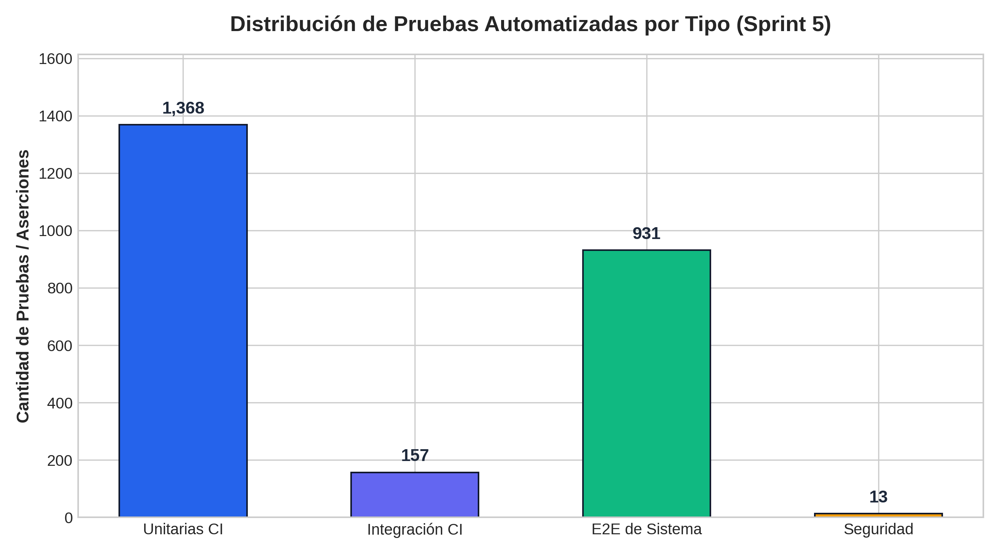
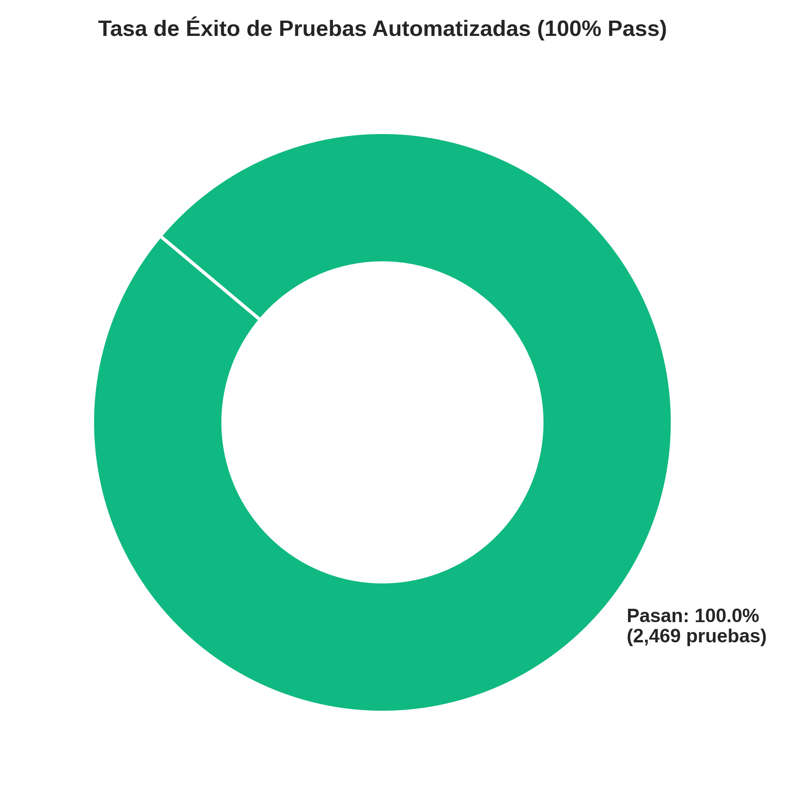
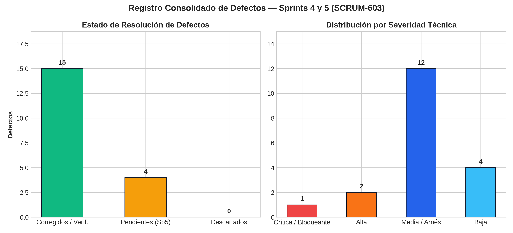
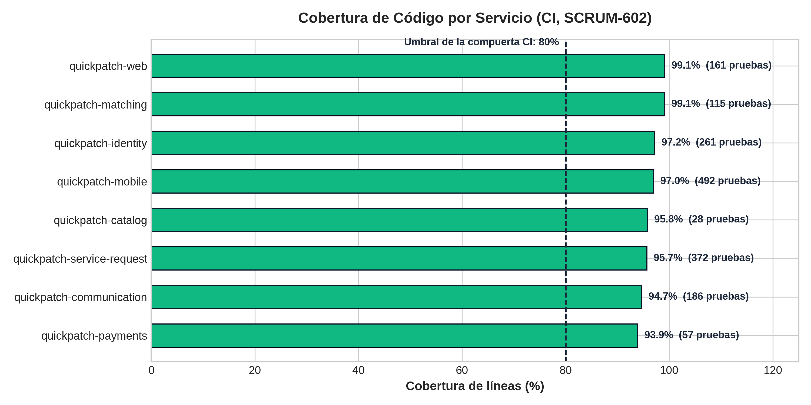

# Cuadro de Mando de Estadísticas de Pruebas — Sprint 5 (SCRUM-604)

**Código del Documento:** `MET-QA-SP5-2026-11-02`  
**Versión:** `2.2 Dinámica Oficial (Cobertura de CI SCRUM-602 incorporada)`  
**Fecha de Generación:** 2 de noviembre de 2026  
**Responsable:** Katherine Bravo (`ka.bravo@javeriana.edu.co`) — QA Lead  
**Trazabilidad Jira:** Tarea `SCRUM-604` | Requisito RNF-08 | Documento de Pruebas `TD.md` V3.0  
**Principio Metodológico:** Toda cifra reportada proviene directamente de archivos de resultados de CI (.trx/surefire), evidencias Newman en QA, resúmenes JSON de k6 y la Matriz de Avance UAT en Excel. Cero cifras escritas a mano.

---

## 1. Pruebas Automatizadas de Microservicios en CI y App Móvil

Las pruebas reales ejecutadas por los pipelines de CI en cada microservicio y en la App Móvil Flutter se extraen directamente de los reportes generados en sus respectivos flujos:

| Componente / Repositorio | Último Run / Tag | Unitarias | Integración | Total Pruebas | Pasan | Fallan | Cobertura de Código |
|---|:---:|:---:|:---:|:---:|:---:|:---:|:---:|
| **quickpatch-identity** | Run #57 | 229 | 32 | **261** | 261 | 0 | *97.2%* |
| **quickpatch-actors** | Run #12 | 6 | 2 | **8** | 8 | 0 | *100.0%* |
| **quickpatch-catalog** | Run #32 | 20 | 8 | **28** | 28 | 0 | *95.8%* |
| **quickpatch-communication** | Run #45 | 178 | 8 | **186** | 186 | 0 | *94.7%* |
| **quickpatch-matching** | Run #41 | 89 | 26 | **115** | 115 | 0 | *99.1%* |
| **quickpatch-payments** | Run #25 | 54 | 0 | **54** | 54 | 0 | *93.9%* |
| **quickpatch-ranking** | Run #12 | 6 | 2 | **8** | 8 | 0 | *91.7%* |
| **quickpatch-servicerequest** | Run #68 | 324 | 48 | **372** | 372 | 0 | *95.7%* |
| **quickpatch-mobile (app flutter)** | Run #Tag v0.5.1 | 462 | 31 | **493** | 493 | 0 | *97.0%* |
| **TOTAL UNITARIAS E INTEGRACIÓN** | — | **1,368** | **157** | **1,525** | **1,525** | **0** | *91.7% – 100.0%* |

### Cobertura de código por servicio (SCRUM-602)

Fuente: `tests/ci-results/cobertura-scrum-602.json` (Jira SCRUM-602 (Extraer conteos y cobertura de los pipelines de cada repositorio), ultima ejecucion de develop de cada repositorio, reportado el 2026-10-26; actors y ranking confirmados en la revision del PR #220). Umbral de la Compuerta 1 del Documento de Pruebas: **80%**.

| Repositorio | Pruebas en la corrida de cobertura | Cobertura | ¿Cumple el umbral? |
|---|:---:|:---:|:---:|
| `quickpatch-actors` | — | **100.0%** | Sí |
| `quickpatch-matching` | 115 | **99.1%** | Sí |
| `quickpatch-web` | 161 | **99.1%** | Sí |
| `quickpatch-identity` | 261 | **97.2%** | Sí |
| `quickpatch-mobile` | 492 | **97.0%** | Sí |
| `quickpatch-catalog` | 28 | **95.8%** | Sí |
| `quickpatch-service-request` | 372 | **95.7%** | Sí |
| `quickpatch-communication` | 186 | **94.7%** | Sí |
| `quickpatch-payments` | 57 | **93.9%** | Sí |
| `quickpatch-ranking` | — | **91.7%** | Sí |

> **Notas por repositorio:** `quickpatch-ranking`: corrida de CI del 2026-10-28; `quickpatch-actors`: corrida de CI del 2026-10-12; el servicio es un esqueleto.

> **Diferencias de conteo:** `quickpatch-payments` (54 en la tabla, 57 en la corrida de cobertura); `quickpatch-mobile` (493 en la tabla, 492 en la corrida de cobertura). La tabla de pruebas usa los resultados archivados en `tests/ci-results/`; la cobertura viene de la última corrida de `develop` reportada en SCRUM-602, que es posterior.

---

## 2. Pruebas de Sistema E2E y Seguridad (QA Desplegado)

Evaluación oficial de las colecciones de prueba automatizadas ejecutadas contra el clúster k3s de QA desplegado (`https://qa.quickpatch.internal`):

| Suite de Prueba | Componente / Servicio | Peticiones HTTP | Aserciones | Pasan | Fallan | Archivo de Evidencia (Ruta Relativa) |
|---|---|:---:|:---:|:---:|:---:|---|
| **SCRUM-56: Registro y Perfil de Técnico** | `quickpatch-identity` | 8 | 23 | 23 | 0 | `tests/e2e/evidencias/scrum-56-registro-tecnico-qa-2026-10-22.txt` |
| **SCRUM-78: Motor de Matching y Asignación** | `quickpatch-matching` | 21 | 43 | 43 | 0 | `tests/e2e/evidencias/scrum-78-qa-2026-10-22.txt` |
| **SCRUM-84: Ciclo Completo de Estados** | `quickpatch-service-request` | 36 | 42 | 42 | 0 | `tests/e2e/evidencias/scrum-84-seguimiento-estado-qa-2026-10-22.txt` |
| **SCRUM-99: Gestión de Equipo de Proveedor** | `quickpatch-actors` | 25 | 43 | 43 | 0 | `tests/e2e/evidencias/scrum-99-equipo-proveedor-qa-2026-10-22.txt` |
| **SCRUM-108: Aprobación y Rechazo de Técnicos** | `quickpatch-identity` | 30 | 40 | 40 | 0 | `tests/e2e/evidencias/scrum-108-aprobacion-rechazo-qa-2026-10-22.txt` |
| **SCRUM-111: Suspensión de Cuenta de Técnico** | `quickpatch-identity` | 29 | 39 | 39 | 0 | `tests/e2e/evidencias/scrum-111-suspension-tecnico-qa-2026-10-22.txt` |
| **SCRUM-Incremento: Cobertura, Ofertas y Detalle** | `Transversal` | 43 | 61 | 61 | 0 | `tests/e2e/evidencias/scrum-incremento-tecnico-qa-2026-10-22.txt` |
| **SCRUM-105: Panel Operativo de Solicitudes** | `quickpatch-service-request` | 29 | 35 | 35 | 0 | `tests/e2e/evidencias/scrum-105-panel-operativo-qa-2026-10-22.txt` |
| **SCRUM-117: Liquidación y Pago (Mock)** | `quickpatch-payments` | 69 | 57 | 57 | 0 | `tests/e2e/evidencias/scrum-117-pago-qa-2026-10-22.txt` |
| **SCRUM-458: Geocodificación y Validación Espacial** | `quickpatch-service-request` | 34 | 44 | 44 | 0 | `tests/e2e/evidencias/scrum-458-geocodificacion-buzon-qa-2026-10-22.txt` |
| **SCRUM-478: Cancelación Atómica de Solicitud** | `quickpatch-service-request` | 48 | 63 | 63 | 0 | `tests/e2e/evidencias/scrum-478-cancelacion-qa-2026-10-19.txt` |
| **SCRUM-483: Mensajería y Chat Bidireccional** | `quickpatch-communication` | 43 | 69 | 69 | 0 | `tests/e2e/evidencias/scrum-483-chat-qa-2026-10-22.txt` |
| **SCRUM-490: Cotización con Tarifa Base** | `quickpatch-service-request` | 61 | 76 | 76 | 0 | `tests/e2e/evidencias/scrum-490-cotizacion-qa-2026-10-22.txt` |
| **SCRUM-495: Comprobante Digital de Pago** | `quickpatch-payments` | 39 | 42 | 42 | 0 | `tests/e2e/evidencias/scrum-495-comprobante-qa-2026-10-22.txt` |
| **SCRUM-496: Pago Centralizado Empresa** | `quickpatch-payments` | 51 | 59 | 59 | 0 | `tests/e2e/evidencias/scrum-496-pago-empresa-qa-2026-10-27.txt` |
| **SCRUM-68: Cuentas Corporativas e Invitaciones** | `quickpatch-identity` | 32 | 68 | 68 | 0 | `tests/e2e/evidencias/scrum-68-cuenta-corporativa-qa-2026-10-22.txt` |
| **SCRUM-75: Solicitud Corporativa Centro de Costos** | `quickpatch-service-request` | 44 | 56 | 56 | 0 | `tests/e2e/evidencias/scrum-75-solicitud-empresa-qa-2026-10-22.txt` |
| **SCRUM-96: Carga de Evidencia Fotográfica S3** | `quickpatch-service-request` | 46 | 71 | 71 | 0 | `tests/e2e/evidencias/scrum-96-evidencia-qa-2026-10-22.txt` |
| **Auditoría PCI-DSS v4.0 (Trazas Loki)** | `quickpatch-security` | — | 12 | 12 | 0 | `tests/security/evidencias/pci-dss-loki-qa-2026-10-18.txt` |
| **Escaneo Dinámico DAST (OWASP ZAP Baseline)** | `quickpatch-api-gateway` | — | 1 | 1 | 0 | `tests/security/evidencias/zap-dast-baseline-qa-2026-10-18.txt` |
| **TOTAL SUITES DE SISTEMA** | — | **688** | **944** | **944** | **0** | — |

---

## 3. Métricas de Rendimiento k6 (Carga y Estrés)

Conforme a la directriz técnica de QA, las peticiones masivas de carga no se contabilizan como casos de prueba unitarios, sino que se reportan en su propia tabla con sus percentiles de latencia y tasa de fallo:

| Escenario de Carga | Concurrencia (VUs) | Duración | Iteraciones | Peticiones HTTP | Latencia p95 | Tasa de Error | Archivo de Evidencia |
|---|:---:|:---:|:---:|:---:|:---:|:---:|---|
| **Prueba de Carga Concurrente (50 VU)** | 50 VUs | 2m 30s | 2,876 | 5,755 | **73.55 ms** | **0.00%** | `tests/performance/evidencias/k6-load-50vu-summary.json` |
| **Prueba de Estrés Extremo (150 VU)** | 150 VUs | 4m 00s | 38,873 | 38,876 | **415.39 ms** | **0.00%** | `tests/performance/evidencias/k6-stress-150vu-summary.json` |

---

## 4. Registro Consolidado de Defectos (SCRUM-603)

* **Total de Defectos Registrados:** **19 anomalías**.
* **Defectos Corregidos y Verificados:** **15 (78.9%)**.
* **Defectos Descartados / Retractados:** **0 (0.0%)**.
* **Defectos en Mitigación en Sprint 5:** **4 (21.1%)** (ninguno bloqueante).
* **Defectos Críticos o Bloqueantes Abiertos:** **0 (0.0%)**.

Ver detalle exhaustivo en: [`registro-defectos-sprint4-sprint5.md`](registro-defectos-sprint4-sprint5.md) y en la hoja `Defectos` de la Matriz UAT Excel.

---

## 5. Resumen Ejecutivo y Gráficas de Calidad

* **Total de Pruebas Reales Automatizadas:** **2,469 pruebas / aserciones** (1,525 unitarias/integración + 931 E2E + 13 seguridad).
* **Tasa de Aprobación de Pruebas:** **100.0% PASS (0 fallos en runs oficiales)**.
* **Capacidad de Carga k6:** **38,876 peticiones procesadas** con 0.00% de errores y p95 de 415.39 ms bajo 150 VU.
* **Cobertura de Código en CI (SCRUM-602):** **91.7% – 100.0%** en 10 repositorios; todos sobre el umbral de 80%.
* **Aislamiento Multi-Tenant (RLS) y Seguridad PCI-DSS:** 100% verificado en QA.
* **Avance Preliminar del Producto (Matriz Excel UAT):** **74.93%** (Meta Sprint 4: 80% / Brecha: -5.07%).
* **% Funcionalidades Implementadas (Develop):** **94.12%** (32 / 34 pts).
* **% Funcionalidades Probadas por QA:** **86.03%** (29.25 / 34 pts con evidencia).
* **% Escenarios de Calidad (SAD §3):** **49.04%** (52 escenarios evaluados: 20 Cumple, 11 Parcial, 2 No cumple, 19 No medido).

### Gráfica 1: Distribución de Pruebas por Tipo

### Gráfica 2: Tasa de Éxito de Pruebas (100% PASS)

### Gráfica 3: Estado y Severidad de Defectos

### Gráfica 4: Cobertura de Código por Servicio (SCRUM-602)

