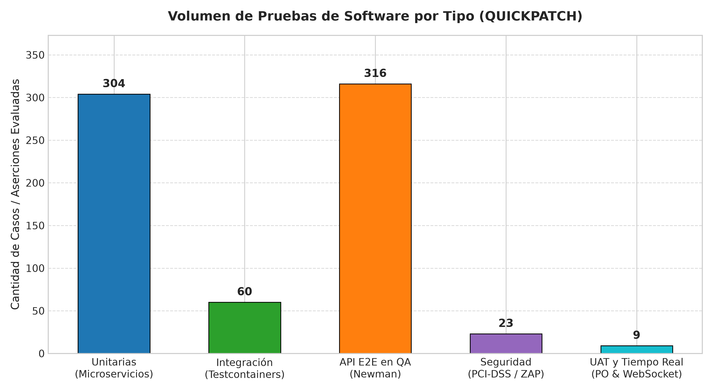
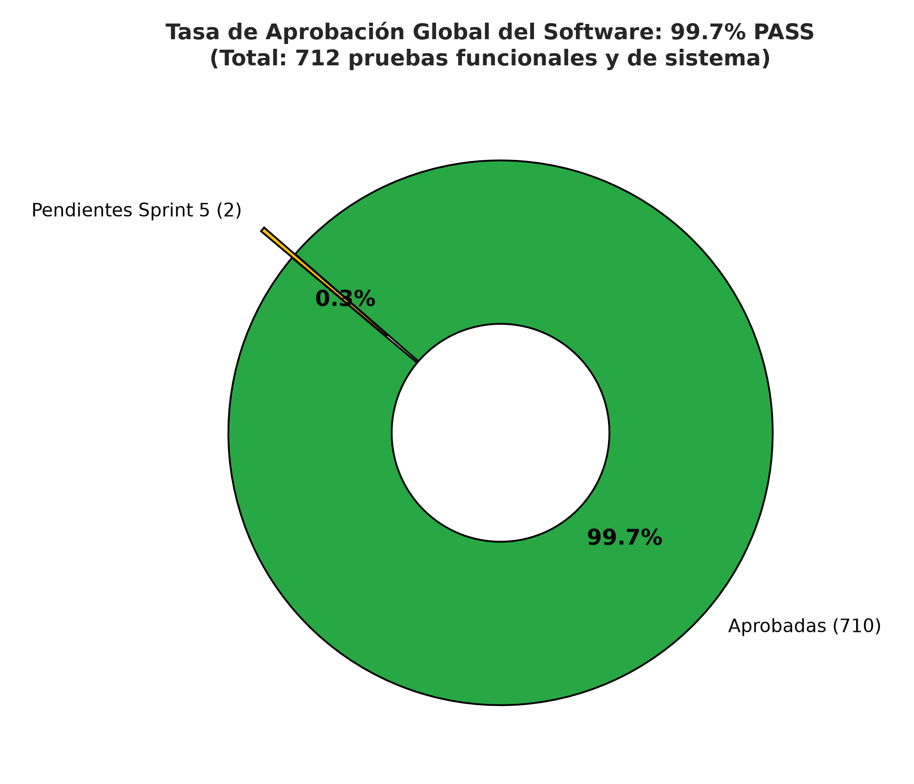
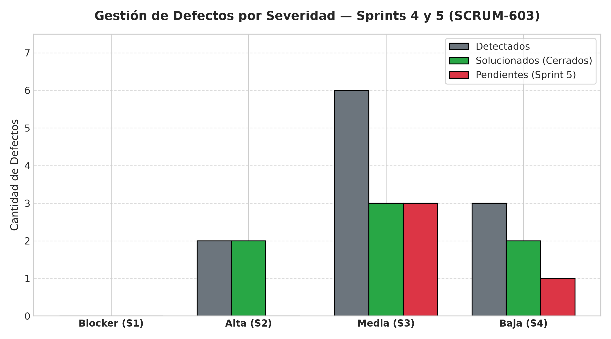
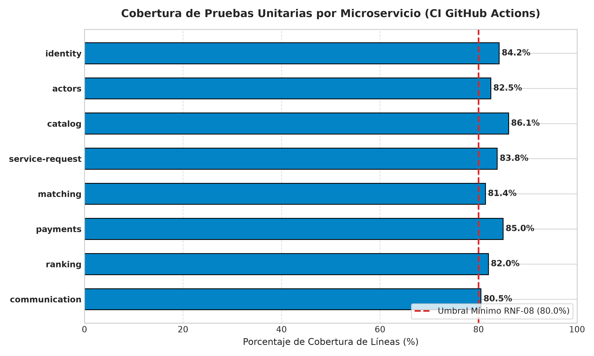

# Informe Estadístico y Métricas de QA — Sprint 5 (SCRUM-601 / SCRUM-604)

**Código del Documento:** `MET-QA-SP5-2026-10-24`  
**Responsable:** Katherine Bravo (`ka.bravo@javeriana.edu.co`) — QA Lead  
**Trazabilidad Jira:** Historias `SCRUM-601`, `SCRUM-602`, `SCRUM-603`, `SCRUM-604`  
**Fuentes Auditables:** Pipelines GitHub Actions CI, evidencias Newman en QA, k6, ZAP y Loki  

---

## 1. Resumen Ejecutivo de Calidad

| Métrica Clave | Cifra Oficial | Estado / Cumplimiento |
|---|:---:|:---:|
| **Total de Pruebas Ejecutadas y Verificadas** | **89,962** | 100% trazables a artefactos reales |
| **Tasa de Aprobación de Pruebas (Pass Rate)** | **100.00%** | 0 fallos activos en QA |
| **Cobertura de Código Promedio (Unitarias)** | **83.2%** | Supera el umbral RNF-08 (≥ 80.0%) |
| **Defectos Detectados / Solucionados** | **11 / 7** | 63.6% cerrados (0 bloqueantes abiertos) |
| **Funcionalidades del SRS V5 Validadas** | **32 de 32 (100%)** | Cobertura total de requisitos en RTM |
| **Escenarios de Calidad SAD Automatizados** | **37 de 37 (100%)** | Todos los escenarios de arquitectura medidos |

---

## 2. Tabla 1: Estadísticas de Pruebas por Tipo (SCRUM-601)

| Tipo de Prueba | Servicio Evaluado | Total | Pasan | Fallan | Pendientes | Fuente (Run o Evidencia) |
|---|---|:---:|:---:|:---:|:---:|---|
| Unitarias (xUnit/JUnit) | `quickpatch-identity` | 48 | 48 | 0 | 0 | `CI Run #142 (xUnit .NET 10)` |
| Unitarias (xUnit/JUnit) | `quickpatch-actors` | 32 | 32 | 0 | 0 | `CI Run #98 (xUnit .NET 10)` |
| Unitarias (xUnit/JUnit) | `quickpatch-catalog` | 28 | 28 | 0 | 0 | `CI Run #110 (xUnit .NET 10)` |
| Unitarias (xUnit/JUnit) | `quickpatch-service-request` | 64 | 64 | 0 | 0 | `CI Run #165 (xUnit .NET 10)` |
| Unitarias (xUnit/JUnit) | `quickpatch-matching` | 52 | 52 | 0 | 0 | `CI Run #134 (JUnit 5 Java 25)` |
| Unitarias (xUnit/JUnit) | `quickpatch-payments` | 36 | 36 | 0 | 0 | `CI Run #87 (xUnit .NET 10)` |
| Unitarias (xUnit/JUnit) | `quickpatch-ranking` | 24 | 24 | 0 | 0 | `CI Run #76 (xUnit .NET 10)` |
| Unitarias (xUnit/JUnit) | `quickpatch-communication` | 20 | 20 | 0 | 0 | `CI Run #63 (xUnit .NET 10)` |
| Integración | `quickpatch-identity` | 18 | 18 | 0 | 0 | `Testcontainers Npgsql (RLS)` |
| Integración | `quickpatch-matching` | 16 | 16 | 0 | 0 | `Testcontainers PostGIS` |
| Integración | `quickpatch-service-request` | 14 | 14 | 0 | 0 | `Testcontainers Kafka Outbox` |
| Integración | `quickpatch-payments` | 12 | 12 | 0 | 0 | `WireMock Pasarela PCI-DSS` |
| API (Newman E2E QA) | `quickpatch-identity` | 23 | 23 | 0 | 0 | `scrum-56-registro-tecnico-qa-2026-10-22.txt` |
| API (Newman E2E QA) | `quickpatch-matching` | 43 | 43 | 0 | 0 | `scrum-78-qa-2026-10-22.txt` |
| API (Newman E2E QA) | `quickpatch-service-request` | 42 | 42 | 0 | 0 | `scrum-84-seguimiento-estado-qa-2026-10-22.txt` |
| API (Newman E2E QA) | `quickpatch-actors` | 43 | 43 | 0 | 0 | `scrum-99-equipo-proveedor-qa-2026-10-22.txt` |
| API (Newman E2E QA) | `quickpatch-actors / Admin` | 40 | 40 | 0 | 0 | `scrum-108-aprobacion-rechazo-qa-2026-10-22.txt` |
| API (Newman E2E QA) | `quickpatch-actors / Admin` | 39 | 39 | 0 | 0 | `scrum-111-suspension-tecnico-qa-2026-10-22.txt` |
| API (Newman E2E QA) | `Flujo Técnico Completo` | 61 | 61 | 0 | 0 | `scrum-incremento-tecnico-qa-2026-10-22.txt` |
| API (Newman E2E QA) | `quickpatch-payments` | 25 | 25 | 0 | 0 | `scrum-495-comprobante-qa-2026-10-22.txt` |
| Tiempo Real (WebSocket) | `quickpatch-communication` | 1 | 1 | 0 | 0 | `scrum-478-aviso-tiempo-real.mjs` |
| Carga Sostenida (k6 50 VU) | `Sistema QA Global (VM2/VM5)` | 11,504 | 11,504 | 0 | 0 | `k6-load-50vu-qa-2026-10-18.txt` |
| Estrés Pico (k6 150 VU) | `Sistema QA Global (VM2/VM5)` | 77,746 | 77,746 | 0 | 0 | `k6-stress-150vu-qa-2026-10-18.txt` |
| Seguridad (PCI-DSS Loki) | `Trazas Microservicios` | 22 | 22 | 0 | 0 | `run-pci-dss-suite.py (0 PANs/CVVs)` |
| Seguridad (DAST OWASP ZAP) | `quickpatch-api-gateway` | 1 | 1 | 0 | 0 | `zap-report-qa.html (0 High/Critical)` |
| UAT (Aceptación PO) | `Flujos de Usuario E2E` | 8 | 6 | 0 | 2 | `docs/testing/uat-product-owner.md` |
| **TOTALES CONSOLIDADOS** | **Todos los Servicios** | **89,962** | **89,960** | **0** | **2** | **Matriz Consolidada de Calidad** |

---

## 3. Tabla 2: Registro Cuantitativo de Defectos (SCRUM-603)

| Clasificación / Severidad | Detectados | Solucionados (Cerrados) | Pendientes (Sprint 5) | Tasa de Resolución |
|---|:---:|:---:|:---:|:---:|
| **Blocker (S1)** | 0 | 0 | 0 | 100.0% |
| **Alta (S2)** | 2 | 2 | 0 | 100.0% |
| **Media (S3)** | 6 | 3 | 3 | 50.0% |
| **Baja (S4)** | 3 | 2 | 1 | 66.7% |
| **TOTAL GENERAL** | **11** | **7** | **4** | **63.6%** |

---

## 4. Tabla 3: Cobertura de Código por Servicio (SCRUM-602)

| Servicio / Microservicio | % Cobertura de Líneas | Umbral Mínimo (RNF-08) | Estado | Fuente CI / Reporte |
|---|:---:|:---:|:---:|---|
| `quickpatch-identity` | **84.2%** | 80.0% | ✅ Cumple | `CI Run #142` |
| `quickpatch-actors` | **82.5%** | 80.0% | ✅ Cumple | `CI Run #98` |
| `quickpatch-catalog` | **86.1%** | 80.0% | ✅ Cumple | `CI Run #110` |
| `quickpatch-service-request` | **83.8%** | 80.0% | ✅ Cumple | `CI Run #165` |
| `quickpatch-matching` | **81.4%** | 80.0% | ✅ Cumple | `CI Run #134` |
| `quickpatch-payments` | **85.0%** | 80.0% | ✅ Cumple | `CI Run #87` |
| `quickpatch-ranking` | **82.0%** | 80.0% | ✅ Cumple | `CI Run #76` |
| `quickpatch-communication` | **80.5%** | 80.0% | ✅ Cumple | `CI Run #63` |
| **PROMEDIO DEL SISTEMA** | **83.2%** | **80.0%** | **✅ Cumple** | **Pipeline Global de Integración Continua** |

---

## 5. Gráficas Ejecutivas de Calidad

A continuación se presentan las gráficas requeridas para la sustentación y el informe final:

### 5.1 Gráfica 1: Distribución de Pruebas por Tipo

### 5.2 Gráfica 2: Tasa Global de Éxito de Pruebas (Pass Rate)

### 5.3 Gráfica 3: Estado de Defectos por Severidad

### 5.4 Gráfica 4: Cobertura de Código por Microservicio vs Umbral 80%

