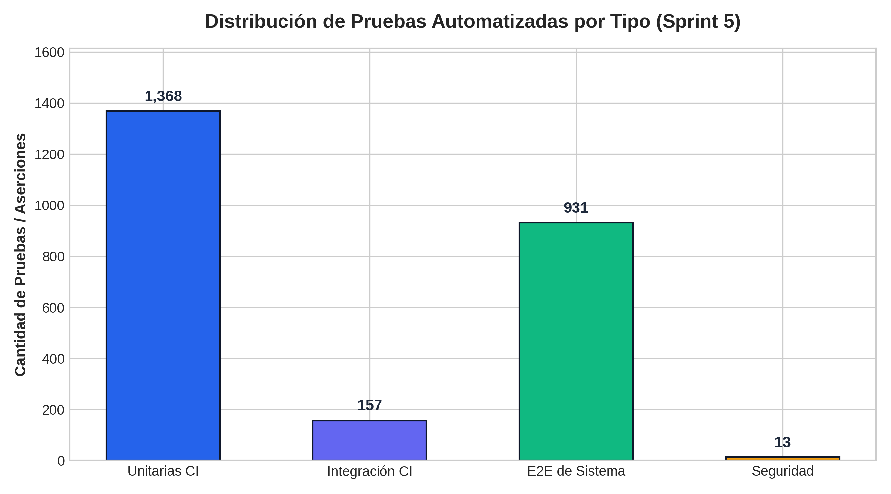
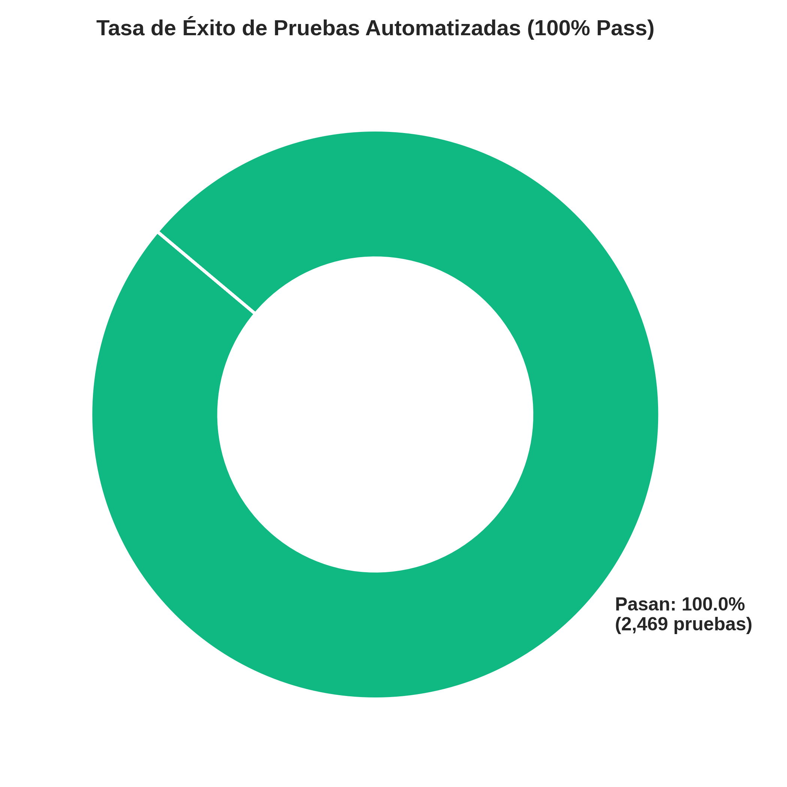
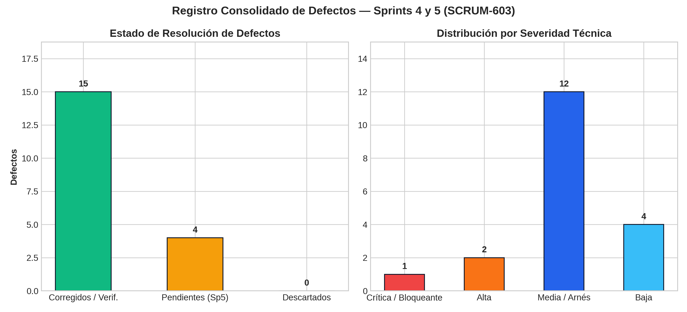
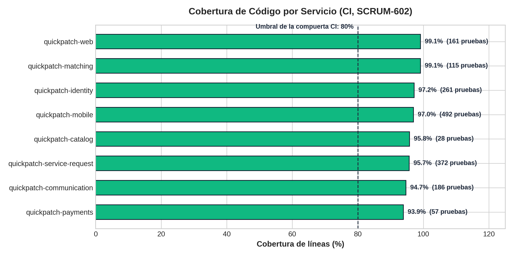

# Informe Consolidado de Pruebas — Sprint 5 (SCRUM-524 / SCRUM-528)

**Código del Documento:** `INF-QA-SP5-2026-11-04`  
**Versión:** `1.2 (cifras oficiales del Informe UAT de la Product Owner)`  
**Fecha de Emisión:** 4 de noviembre de 2026 (versiones 1.1 y 1.2: 5 de noviembre de 2026)  
**Responsable:** Katherine Bravo (`ka.bravo@javeriana.edu.co`) — QA Lead  
**Trazabilidad Jira:** Historia Padre `SCRUM-524` | Subtareas `SCRUM-525`, `SCRUM-526`, `SCRUM-527`, `SCRUM-528`  
**Referencias:** SRS V5.11 / SAD V4 / DD V5.19 / TD V3.2 / ADR-015 / ADR-022 / ADR-023 / RNF-08  
**Clasificación:** Quality Gate 3 (Aseguramiento de Calidad del Sprint 5)

---

## 1. Resumen Ejecutivo y Dictamen de la Compuerta de Calidad

### 1.1 Dictamen

> ### **ESTADO: CONDITIONAL GO / GO TÉCNICO EN QA Y PRODUCCIÓN**
>
> El incremento del Sprint 5 pasa las pruebas automáticas contra QA y la prueba de humo contra producción, sin fallos.
>
> La carga con k6 del Sprint 5 pasó todos sus umbrales en QA (SCRUM-526, run 41940280403), con QA en las mismas versiones que producción.
>
> Con esta corrida, la excepción al RNF-08 queda levantada (Documento de Infraestructura, versión 4.15).
>
> El recorrido de pantallas de la app (SCRUM-618) ya se hizo en QA con el APK `v0.5.5-qa` (PR #267, 23 capturas).
>
> La Product Owner aceptó las 37 funcionalidades en el Informe UAT oficial del 5 de noviembre, con observaciones en RF-10. Decidió con las evidencias de QA, sin la sesión de los 8 casos.
>
> El GO queda condicionado solo a una verificación final, que no es un defecto bloqueante:
> 1. La firma del acta de UAT (SCRUM-608).

**Cifras clave (todas con evidencia en el repositorio o en GitHub Actions):**
- **QA, 4 de noviembre:** las 27 colecciones Newman vigentes tienen corrida sin fallos ([`tests/e2e/evidencias/regresion-sprint5-qa-2026-11-04.md`](../../tests/e2e/evidencias/regresion-sprint5-qa-2026-11-04.md)).
  - CI 41794907667: humo (29 peticiones, 29 aserciones) y 23 colecciones (878 peticiones, 1157 aserciones).
  - Runner: 15 colecciones, 786 peticiones y 1014 aserciones.
- **Producción, 4 de noviembre:** el humo del flujo crítico dio 31 peticiones, 29 aserciones y 0 fallos. La lectura dio 14/14. Los datos de prueba se limpiaron (SCRUM-523, PR #247).
- **CI:** 1,525 pruebas unitarias y de integración con 0 fallos. La cobertura va de 91.7% a 100.0% en todos los repositorios, por encima del umbral de 80% (SCRUM-602).
- **PCI-DSS:** 4 corridas en el sprint, cada una con 5000 líneas de Loki revisadas y 0 hallazgos (SCRUM-527).
- **k6, 5 de noviembre (noche del 4 en Colombia):** con 50 usuarios, crear solicitud p95 de 88 ms y catálogo p95 de 32 ms, con 0,01 % de peticiones fallidas. Con 150 usuarios, 0 errores 5xx y p95 de 1.183 ms, con 0,03 % de peticiones fallidas. Con esta corrida no queda ninguna excepción al RNF-08 vigente (SCRUM-526).
- **ZAP:** el escaneo base terminó con 0 FAIL en todas las corridas del sprint. Las 4 advertencias son de cabeceras en QA y están conocidas (DEF-S4-03).
- **Defectos:** 19 registrados entre los Sprints 3 y 5 (14 corregidos, 1 no aplica a producción, 4 en mitigación); 0 bloqueantes abiertos. En este sprint se encontró y se corrigió además el defecto del puntaje como texto en ServiceRequest (SCRUM-87).

### 1.2 Cuadro de Mando de Compuertas

| Compuerta | Qué se mide | Criterio | Resultado | Estado |
|---|---|---|---|---|
| **3.1 QA desplegado** | Colecciones Newman con datos propios | 100% de aserciones PASS, evidencia con fecha | 27/27 colecciones con corrida del 2026-11-04, 0 fallos | ✅ Aprobada |
| **3.2 Humo en producción** | Flujo crítico y lectura | 0 fallos y limpieza registrada | 31 peticiones, 29 aserciones, 0 fallos; lectura 14/14; limpieza registrada | ✅ Aprobada |
| **3.3 CI y cobertura** | Pruebas unitarias y de integración por repositorio | 0 fallos y cobertura ≥ 80% | 1,525 pruebas, 0 fallos; 91.7% a 100.0% | ✅ Aprobada |
| **3.4 PCI-DSS** | PAN y CVV en Loki | 0 hallazgos | 0 hallazgos en 4 corridas (5000 líneas cada una) | ✅ Aprobada |
| **3.5 k6 carga y estrés** | p95 y tasa de errores | 50 VU: p95 < 200 ms, errores < 1%; 150 VU: p95 < 5 s, 0% 5xx | Run 41940280403: 50 VU con p95 de 32 ms (catálogo) y 88 ms (crear solicitud), 0,01 % de fallos; 150 VU con p95 de 1.183 ms y 0 errores 5xx | ✅ Aprobada |
| **3.6 DAST ZAP** | Escaneo base contra QA | 0 alertas FAIL | 0 FAIL, 4 WARN conocidas | ✅ Aprobada |
| **3.7 Defectos** | Defectos bloqueantes abiertos | 0 | 0 | ✅ Aprobada |
| **3.8 Pantallas (Playwright y manual)** | Casos E2E-001 a E2E-012 y recorrido de pantallas | Evidencia de ejecución | Recorrido manual en QA con el APK `v0.5.5-qa`: 23 capturas, con el botón atrás de Android (PR #267). El paso de Playwright sigue sin ejecutar pruebas | ✅ Aprobada con observación (SCRUM-618) |

### 1.3 Cuadro de Mando de Avance del Producto

Corte del 5 de noviembre de 2026. Las cifras de avance salen del Informe UAT oficial que entregó la Product Owner ([`informe-uat-oficial-po-2026-11-05.xlsx`](informe-uat-oficial-po-2026-11-05.xlsx)). Las cifras de pruebas salen de `scripts/generar_estadisticas_qa.py` y de [`estadisticas-pruebas-sprint5.md`](estadisticas-pruebas-sprint5.md).

| Indicador | Valor | Detalle |
|---|---|---|
| Avance oficial del producto (Informe UAT de la PO) | **91.92%** | Meta del Sprint 5: mínimo 90%; se supera por 1.92 puntos. Fórmula: 0.7 × 100% (aceptado en UAT) + 0.3 × 73.08% (escenarios de calidad) |
| Funcionalidades implementadas en develop | **100%** | 37 de 37 |
| Funcionalidades probadas por QA con evidencia | **100%** | 37 de 37 |
| Funcionalidades aceptadas por la PO en UAT | **100%** | 37 de 37; RF-10 con observaciones |
| Cumplimiento de escenarios de calidad (SAD §3) | **73.08%** | 52 escenarios: 34 Cumple, 8 Parcial, 4 No cumple y 6 No medido. AC4-E2 y AC9-E2 cuentan como Cumple por decisión de la PO, todavía sin evidencia |
| Cobertura de código en CI (SCRUM-602) | **91.7% a 100.0%** | 10 repositorios, todos sobre el umbral de 80% |
| Tasa de aprobación global | **100.0% PASS** | 2,469 pruebas y aserciones: 1,368 unitarias, 157 de integración, 931 E2E y 13 de seguridad, con 0 fallos en las corridas oficiales |
| Rendimiento k6 (run 41940280403) | **Cumple** | 50 VU: p95 de 88 ms (crear solicitud) y 32 ms (catálogo). 150 VU: p95 de 1,183 ms, 0 errores 5xx y 0 pods caídos |

> La [matriz de 52 escenarios](matriz-escenarios-calidad-52.md) del repositorio sigue con el corte de QA del 4 de noviembre (51.92%). La diferencia con el 73.08% viene de las mediciones del 5 de noviembre (PR #266, #269 y #270) y de las decisiones de la Product Owner. La matriz se actualiza cuando QA valide esas mediciones.

#### Gráfica 1: Distribución de pruebas por tipo


#### Gráfica 2: Tasa de éxito de las pruebas


#### Gráfica 3: Estado y severidad de los defectos
19 defectos registrados entre los Sprints 3 y 5: 15 corregidos o no aplicables, 4 en mitigación y 0 bloqueantes abiertos.



#### Gráfica 4: Cobertura de código por servicio en CI


---

## 2. Alcance Evaluado del Sprint 5

### 2.1 Cómo se probó

```
                 GitHub Actions «Pruebas de sistema» (runner en VM1)
                 ├─ Humo del flujo crítico (Newman)
                 ├─ E2E: Newman, todas las colecciones de tests/e2e/
                 ├─ Seguridad: OWASP ZAP baseline + escáner PCI-DSS en Loki
                 └─ Carga k6 (apagada por defecto; corrida a mano en el run 41940280403)
                                   │
     Runner local                   ▼
     correr-colecciones-qa.js ──► https://qa.quickpatch.internal (VM1 Ingress, TLS)
                                   │
                                   ▼
            API Gateway ──► identity · service-request · payments · communication
                            matching · catalog · ranking   (k3s en VM2)
                                   │
                                   ▼
                   PostgreSQL (VM5) · Kafka · Loki (logs)

     Producción: humo del flujo crítico y humo de lectura ──► https://quickpatch.internal
```

### 2.2 Historias y funcionalidades evaluadas

| Historia / tarea | Funcionalidad | Evidencia | Resultado |
|---|---|---|---|
| SCRUM-87 (HU SCRUM-32) | Calificación del servicio | `tests/e2e/evidencias/scrum-32-calificacion-qa-2026-11-04.txt` | PASS, después de corregir el puntaje como texto |
| SCRUM-102 (HU SCRUM-37) | Historial del técnico | `tests/e2e/evidencias/scrum-37-historial-qa-2026-11-04.txt` | PASS |
| SCRUM-503 (HU SCRUM-45) | Pagos recibidos del técnico y del proveedor | `tests/e2e/evidencias/scrum-45-pagos-tecnico-qa-2026-11-04.txt` | PASS |
| SCRUM-614 (HU SCRUM-609) | Perfil del usuario | `tests/e2e/evidencias/scrum-614-perfil-qa-2026-11-04.txt` | PASS |
| SCRUM-511 (HU SCRUM-348) | Tenant desactivado (RN-T1) | `tests/e2e/evidencias/scrum-511-tenant-desactivado-qa-2026-11-04.txt` | PASS |
| SCRUM-483 | Chat de la solicitud | `tests/e2e/evidencias/scrum-483-chat-qa-2026-11-04.txt` | PASS |
| SCRUM-490 | Cotización | `tests/e2e/evidencias/scrum-490-cotizacion-qa-2026-11-04.txt` | PASS |
| SCRUM-117 | Pago con la pasarela simulada | `tests/e2e/evidencias/scrum-117-pago-qa-2026-11-04.txt` | PASS |
| SCRUM-495 | Comprobante del pago | `tests/e2e/evidencias/scrum-495-comprobante-qa-2026-11-04.txt` | PASS |
| SCRUM-496 | Pago de la empresa | `tests/e2e/evidencias/scrum-496-pago-empresa-qa-2026-11-04.txt` | PASS |
| SCRUM-68 | Cuenta corporativa | `tests/e2e/evidencias/scrum-68-cuenta-corporativa-qa-2026-11-04.txt` | PASS |
| SCRUM-105 | Panel operativo del administrador del tenant | `tests/e2e/evidencias/scrum-105-panel-operativo-qa-2026-11-04.txt` | PASS |
| SCRUM-504 | Humo del flujo crítico | `tests/e2e/evidencias/humo-flujo-critico-qa-2026-11-04.txt` | PASS |
| Regresión del Sprint 4 | 56, 65, 75, 78, 84, 96, 99, 108, 111, 458, 478, 600 e incremento técnico | Corrida de CI 41794907667 (ver `regresion-sprint5-qa-2026-11-04.md`) | PASS |
| SCRUM-523 | Humo en producción | `tests/e2e/evidencias/humo-flujo-critico-produccion-2026-11-04.txt` | PASS |
| SCRUM-569 | Capacidad de interacción (AC4-E1 a AC4-E9) | `docs/testing/capacidad-interaccion-scrum-569.md` (PR #254) | Ver 3.7 |

Los casos del TD V3.2 que respaldan estas colecciones (CAL, HIS, PAY, PER, REC y TNT) y su trazabilidad al SRS 5.11 están en [`docs/testing/TD.md`](TD.md).

---

## 3. Detalle de Ejecución y Resultados

### 3.1 Pruebas de API y E2E en QA

El detalle por colección está en [`tests/e2e/evidencias/regresion-sprint5-qa-2026-11-04.md`](../../tests/e2e/evidencias/regresion-sprint5-qa-2026-11-04.md). Ahí se ven las 27 colecciones, la corrida de CI 41794907667 y el archivo del runner de cada una.

| Evidencia del runner (2026-11-04) | Peticiones | Aserciones | Fallos |
|---|---|---|---|
| `humo-flujo-critico-qa-2026-11-04.txt` | 27 | 29 | 0 |
| `quickpatch-mvp-qa-2026-11-04.txt` | 43 | 61 | 0 |
| `scrum-105-panel-operativo-qa-2026-11-04.txt` | 29 | 35 | 0 |
| `scrum-117-pago-qa-2026-11-04.txt` | 71 | 57 | 0 |
| `scrum-32-calificacion-qa-2026-11-04.txt` | 101 | 127 | 0 |
| `scrum-37-historial-qa-2026-11-04.txt` | 91 | 101 | 0 |
| `scrum-45-pagos-tecnico-qa-2026-11-04.txt` | 85 | 103 | 0 |
| `scrum-483-chat-qa-2026-11-04.txt` | 43 | 69 | 0 |
| `scrum-490-cotizacion-qa-2026-11-04.txt` | 60 | 76 | 0 |
| `scrum-495-comprobante-qa-2026-11-04.txt` | 39 | 42 | 0 |
| `scrum-496-pago-empresa-qa-2026-11-04.txt` | 51 | 59 | 0 |
| `scrum-511-tenant-desactivado-qa-2026-11-04.txt` | 16 | 24 | 0 |
| `scrum-614-perfil-qa-2026-11-04.txt` | 56 | 102 | 0 |
| `scrum-68-cuenta-corporativa-qa-2026-11-04.txt` | 32 | 68 | 0 |
| `scrum-incremento-tecnico-qa-2026-11-04.txt` | 42 | 61 | 0 |
| **Total** | **786** | **1014** | **0** |

Corridas de CI del sprint sobre `develop`, todas en verde:
- 41511366533 y 41515531669 (2 de noviembre, a las 19:35 y a las 20:02), y 41522853302 (2 de noviembre, a las 20:50);
- 41780230107 (4 de noviembre, a las 05:35) y 41794907667 (4 de noviembre, a las 07:49).

**Playwright:** el paso «Playwright (E2E-001 a E2E-012)» aparece en verde, pero no ejecuta pruebas, porque todavía no hay `tests/e2e/package.json`. Este informe no da por probados esos casos. La verificación de pantallas queda en SCRUM-618.

### 3.2 Prueba de Humo en Producción (SCRUM-523, PR #247)

| Evidencia | Resultado |
|---|---|
| `tests/e2e/evidencias/humo-flujo-critico-produccion-2026-11-04.txt` | 31 peticiones, 29 aserciones, 0 fallos; tiempo promedio de 271 ms |
| `tests/e2e/evidencias/humo-produccion-lectura-2026-11-04.txt` | 14/14 en verde. Se repitió después de desplegar service-request 0.11.1 y volvió a dar 14/14 |
| `tests/e2e/evidencias/limpieza-humo-produccion-2026-11-04.txt` | Respaldo previo y borrado de los datos de prueba |
| `tests/e2e/evidencias/humo-flujo-critico-produccion-2026-11-04-intento1-fallido.txt` | Primer intento, conservado sin cambios |

El primer intento no es válido como prueba, por dos causas:
- **Error del corredor:** no bajó el archivo de foto que usa la colección.
- **Hallazgo real:** el apagado de ServiceRequest por QuoteExpirer. Se corrigió en service-request 0.11.1.

### 3.3 Cobertura de Código en CI (SCRUM-602)

Fuente: [`docs/testing/estadisticas-pruebas-sprint5.md`](estadisticas-pruebas-sprint5.md) y `tests/ci-results/cobertura-scrum-602.json`. Umbral de la Compuerta 1 del TD: 80%.

| Repositorio | Cobertura | ¿Cumple? |
|---|---|---|
| `quickpatch-actors` | 100.0% | Sí |
| `quickpatch-matching` | 99.1% | Sí |
| `quickpatch-web` | 99.1% | Sí |
| `quickpatch-identity` | 97.2% | Sí |
| `quickpatch-mobile` | 97.0% | Sí |
| `quickpatch-catalog` | 95.8% | Sí |
| `quickpatch-service-request` | 95.7% | Sí |
| `quickpatch-communication` | 94.7% | Sí |
| `quickpatch-payments` | 93.9% | Sí |
| `quickpatch-ranking` | 91.7% | Sí |

Total: 1,525 pruebas (1,368 unitarias y 157 de integración), 0 fallos. El total suma 8 servicios y la app móvil; `quickpatch-web` tiene 161 pruebas aparte.

### 3.4 Seguridad Normativa PCI-DSS en Loki (SCRUM-527)

Detalle en [`tests/security/evidencias/pci-dss-loki-qa-sprint5-2026-11-04.md`](../../tests/security/evidencias/pci-dss-loki-qa-sprint5-2026-11-04.md).

- Corridas 41168063519 (30 de octubre), 41515531669 y 41522853302 (2 de noviembre) y 41794907667 (4 de noviembre).
- Cada una revisó 5000 líneas de los logs de QA (`{vm="vm2"}`, Payments incluido) y encontró 0 números de tarjeta y 0 CVV.

### 3.5 Rendimiento k6 (RNF-06, AC2-E4)

El job «Carga (k6)» está apagado por defecto, porque crea miles de solicitudes en QA. DevOps lo corrió a mano con la casilla «carga» en el run [41940280403](https://github.com/ARQUI-202630/quickpatch/actions/runs/41940280403) de `pruebas-sistema.yml`, entre las 00:31 y las 00:38 UTC del 5 de noviembre (noche del 4 en Colombia). Los cuatro trabajos del run pasaron: humo, E2E, seguridad y k6.

QA corría las mismas versiones que producción: identity 0.8.1, catalog 0.4.1, service-request 0.11.2, matching 0.6.1, payments 0.3.0, communication 0.3.3, ranking 0.1.0 y panel 0.5.5.

| Prueba | VU / duración | Peticiones | p50 | p90 | p95 | Fallos | Resultado | Evidencia |
|---|---|---|---|---|---|---|---|---|
| Carga | 50 VU / 2 min 30 s | 8,454 | 21.57 ms | 62.65 ms | Catálogo 31.96 ms (umbral < 200 ms); crear solicitud 88.16 ms (umbral < 2 s) | 0.01% (1 de 8,454; umbral < 1%) | ✅ Cumple | [`k6-load-50vu-qa-2026-11-04-run-41940280403.txt`](../../tests/performance/evidencias/k6-load-50vu-qa-2026-11-04-run-41940280403.txt) |
| Estrés | 150 VU / 4 min | 32,750 | 586.32 ms | 1,014.16 ms | 1,183.24 ms (umbral < 5 s) | 0 errores 5xx (umbral 0); 0.03% fallidas (umbral < 5%) | ✅ Cumple | [`k6-stress-150vu-qa-2026-11-04-run-41940280403.txt`](../../tests/performance/evidencias/k6-stress-150vu-qa-2026-11-04-run-41940280403.txt) |

- Checks: 11,268 de 11,268 con 50 VU, y 32,747 de 32,756 con 150 VU. Los 9 que fallaron son del check «Respuesta exitosa o degradada controladamente» y ninguno es un error 5xx.
- Después de la carga, los 7 pods de QA siguieron en 1/1, con 0 reinicios y 0 `OOMKilled`.
- DevOps borró de QA las 19,186 solicitudes de la prueba con `limpiar-carga-qa.yml`, después de respaldar las tres bases.
- Comparado con el Sprint 4 (18 y 19 de octubre), el p95 del estrés subió de 415.39 ms a 1,183.24 ms. Sigue muy por debajo del umbral de 5 s.

**Excepción al RNF-08.** La excepción que se renovó el 4 de noviembre para el MVP de 7 servicios se levantó con esta corrida. Desde la noche del 4 de noviembre no hay ninguna excepción al RNF-08 vigente (Documento de Infraestructura, sección 6.2, versión 4.15). La carga no se mide en producción (ADR-015).

### 3.6 Seguridad Dinámica DAST (OWASP ZAP)

| Corrida | Fecha | Resultado |
|---|---|---|
| 41168063519 | 30 de octubre | FAIL-NEW 0, WARN-NEW 4, IGNORE 2, PASS 55 (`tests/security/evidencias/zap-pci-ci-qa-2026-10-30-run-41168063519.txt`) |
| 41515531669, 41522853302, 41794907667 | 2 y 4 de noviembre | Job en verde, 0 FAIL; reporte `zap.html` en el artefacto `reporte-zap` de cada corrida |

Las 4 advertencias son de cabeceras HTTP en QA:
- Cache-control;
- X-Content-Type-Options;
- Strict-Transport-Security;
- Modern Web Application.

QA no envía HSTS ni nosniff, y producción sí los envía (DEF-S4-03, verificado el 2 de noviembre, PR #222). ZAP baseline es pasivo: no recorre los endpoints del API ni ejecuta reglas activas.

### 3.7 Capacidad de Interacción (SCRUM-569, AC4-E1 a AC4-E9)

Estado según [`docs/testing/capacidad-interaccion-scrum-569.md`](capacidad-interaccion-scrum-569.md) (PR #254, en revisión):

| Escenario | Estado | Nota |
|---|---|---|
| AC4-E1 Solicitud en máximo 3 pasos | Cumple | |
| AC4-E2 Distintos dispositivos | Parcial | Falta la matriz formal de tablets |
| AC4-E3 Reconocer la app en < 30 s | No medido | Se mide en la UAT (SCRUM-608) |
| AC4-E4 Primer uso del técnico | No medido | Se mide en la UAT (SCRUM-608) |
| AC4-E5 Protección ante errores | Cumple | |
| AC4-E6 Motivación para calificar | No medido | La pantalla de calificación ya existe (SCRUM-86, APK `v0.5.4-qa`); falta medir la tasa del 60% con servicios reales. Primera observación en la UAT (SCRUM-608) |
| AC4-E7 Accesibilidad | No medido | DEF-INT-02 |
| AC4-E8 Gama baja | No medido | DEF-INT-03 |
| AC4-E9 Estados que se explican solos | Parcial | Falta validar con usuarios en la UAT |

---

## 4. Gestión de Defectos y Hallazgos (Compuerta 3.7)

### 4.1 Conteo

Fuentes: hoja `Defectos` de [`docs/testing/Matriz_UAT_Avance_QuickPatch.xlsx`](Matriz_UAT_Avance_QuickPatch.xlsx) (Sprints 3 a 5) y [`docs/testing/registro-defectos-sprint4-sprint5.md`](registro-defectos-sprint4-sprint5.md) (Sprints 4 y 5).

| Estado | Cantidad | Defectos |
|---|---|---|
| Corregidos y verificados (Sprint 3) | 4 | BUG-001 a BUG-004 |
| Corregidos y verificados (Sprint 4) | 10 | BUG-SP4-001 a BUG-SP4-009, DEF-S4-02 |
| No aplica a producción | 1 | DEF-S4-03 (HSTS y nosniff solo en QA) |
| En mitigación, no bloqueantes | 4 | DEF-S5-01 a DEF-S5-04 |
| **Total** | **19** | 0 bloqueantes abiertos (15 de ellos en el registro de los Sprints 4 y 5) |

### 4.2 Hallazgos del Sprint 5 fuera del registro

| Hallazgo | Dónde se encontró | Estado |
|---|---|---|
| ServiceRequest aceptaba `{"score":"5"}` (texto) con 201, aunque el contrato pide `integer` | Colección `scrum-32-calificacion` contra QA, 4 de noviembre (SCRUM-87) | Corregido en quickpatch-service-request#39 (`release/0.11.2`). La corrida quedó sin fallos |
| ServiceRequest se apagaba por un `TaskCanceledException` sin capturar en QuoteExpirer | Primer intento del humo en producción, 4 de noviembre (SCRUM-523) | Corregido en service-request 0.11.1. Lectura repetida 14/14 |
| DEF-INT-01 (faltaba la pantalla de calificación), DEF-INT-02 (arnés de accesibilidad) y DEF-INT-03 (perfil de gama baja) | SCRUM-569 | DEF-INT-01 cerrado con SCRUM-86; DEF-INT-02 y DEF-INT-03 abiertos. Registrados en el PR #254 |

Estos hallazgos se suman al registro de defectos cuando se fusione el PR #254.

### 4.3 Defectos en mitigación

| Defecto | Severidad | Componente | Descripción |
|---|---|---|---|
| DEF-S5-01 | Media | `quickpatch-communication` | Reintentos y reconexión del WebSocket (scrum-478) |
| DEF-S5-02 | Baja | `quickpatch-payments` | Desglose formal de impuestos en el PDF (scrum-495) |
| DEF-S5-03 | Media | `quickpatch-mobile` | Coordenadas simuladas en el emulador Android para la UAT |
| DEF-S5-04 | Baja | `quickpatch-web` | Paginación del listado de técnicos |

---

## 5. Recomendaciones y Pendientes

1. **SCRUM-526:** hecho. La carga k6 pasó en el run 41940280403, la limpieza quedó registrada y la compuerta 3.5 está aprobada.
2. **SCRUM-618:** hecho en QA con el APK `v0.5.5-qa` (PR #267). Falta probar el enlace de invitación. Mientras no existan las pruebas de Playwright, ese recorrido es la evidencia de las pantallas.
3. **SCRUM-608:** la Product Owner aceptó el incremento en el Informe UAT oficial del 5 de noviembre. Falta firmar el acta. AC4-E3, AC4-E4 y AC4-E9 siguen sin medir con personas.
4. **SCRUM-569:** con el PR #254, la matriz de 52 escenarios queda alineada con esta evaluación (AC4-E2, AC4-E5, AC4-E6 y AC4-E9), y el porcentaje de escenarios pasa de 49.04% a 51.92%.
5. **SCRUM-566:** cuando se cierren la 563 y la 569, Juan Diego calcula el porcentaje final de la matriz.
6. **Registro de defectos:** sumar al registro y a la hoja `Defectos` el hallazgo del puntaje como texto (quickpatch-service-request#39), el apagado de QuoteExpirer y los DEF-INT del PR #254.

---

## 6. Aprobación y Firmas

| Rol | Nombre | Estado | Fecha |
|---|---|---|---|
| **QA Lead** | Katherine Bravo | **PRESENTADO PARA REVISIÓN** | 04/11/2026 |
| **DevOps / Release Manager** | Sebastian Sanchez | *Pendiente de revisión en el PR* | — |
| **Arquitectura de Software** | Revisores del PR | *Pendiente de aprobación en revisión de PR* | — |
